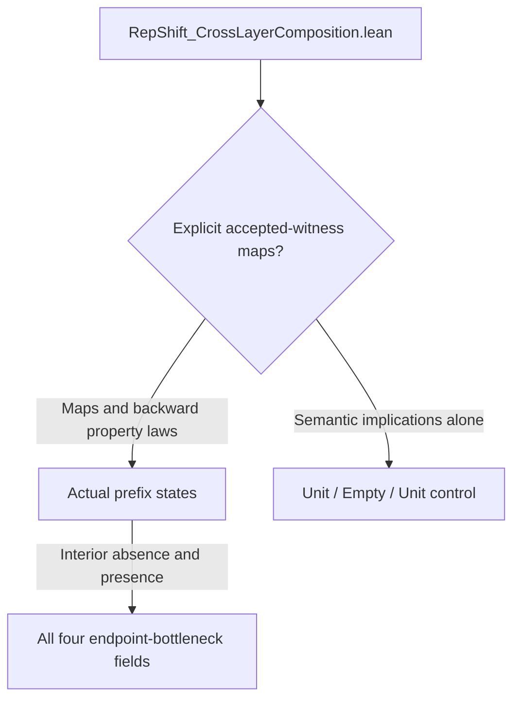

# Entangled Merged Pairs: claim index

[Repository](README.md) · [Formalization](#formalization) · [Claims](#claims) · [Modules](#modules) · [Check files](#check-files)

This index links the results of *Entangled Merged Pairs: The Observation-Boundary Principle* (SSRN 7640059) to their Lean declarations and source files. Numbers follow the paper; 21 headings also give the result's number in the first SSRN version; labels also identify supporting results in the Lean development. Names beneath a Lean namespace use that namespace as their prefix.

Each entry gives the conditions and the recorded Lean status. The recorded axiom checks use only `propext`, `Classical.choice`, and `Quot.sound`.

## Formalization

The development uses Lean 4.22.0-rc4 with the Mathlib revision pinned in `lake-manifest.json`. An observer is a function `q : X → Q`, and determination is the proposition that equal records give equal target values. A reading is a function from states to finite laws, a law being a nonnegative mass function of total mass one on a finite type. A stopped protocol is a policy and a stopping rule on retained action-outcome histories, with the information and expected cost of Section 5. Entropy is in natural logarithms; a statement in bits divides by `Real.log 2`.

| Layer | Content | Paper |
| --- | --- | --- |
| observers and pairs | determination, the invisible group, the structure theorem, place coordinates and their free orbit | Sections 2 to 4 |
| protocols and discrimination | finite laws, the entropy telescope, the transcript law, the singularity theorem, repeated readings, fibers of size `n` | Section 5 |
| instances | linear observers, automata and the unobservable subspace, secrecy and privacy, the arithmetic checker, halting and the theorem of Rice, the diagonal stages, common causes, the counted recursion, the calculus | Section 6 |
| physics | the pair as a qubit, the number field, the Bell table, state reconstruction, reset and the burden law | Section 7 |
| collected theorems | Theorem 9.1 as one conjunction of forty clause predicates; Theorem 10.2 as one conjunction of forty-two | Sections 9 and 10 |
| demands and instruments | minimal obstructions, licensed selectors, instruments with back-action, completion | Sections 4 and 11 |

Theorem 9.1 is `BoundaryTheoremFull.BoundaryTheoremFullGoal`, proved by `BoundaryTheoremFull.boundaryTheoremFullGoal`; clauses (1) to (24) form `BoundaryTheorem.BoundaryTheoremCoreGoal`. Each clause predicate is the type of the results its clause restates, with every parameter quantified. Names below are relative to `OperatorKO7.Meta.BoundaryObserver`, except the Tarski clause in `OperatorKO7.Meta.DistinctionBoundary.GodelArith`.

| Theorem 9.1 | Predicate | Proof | Module |
| --- | --- | --- | --- |
| (1) | `BoundaryPole.RecordPoleGoal` | `recordPoleGoal` | `BoundaryPole` |
| (2) | `BoundaryPole.BoundaryZeroSetGoal` | `boundaryZeroSetGoal` | `BoundaryPole` |
| (3) | `BoundaryPole.RecordProtocolPoleGoal` | `recordProtocolPoleGoal` | `BoundaryPole` |
| (4) | `BoundaryTheorem.KinematicClauseGoal` | `kinematicClause` | `BoundaryTheorem` |
| (5) | `BoundaryTheorem.PlaceOrbitClauseGoal` | `placeOrbitClause` | `BoundaryTheorem` |
| (6) | `BoundaryPole.PoleOrderOneGoal` | `poleOrderOneGoal` | `BoundaryPole` |
| (7) | `BoundaryPole.PoleResidueGoal` | `poleResidueGoal` | `BoundaryPole` |
| (8) | `BoundaryPole.GodelPoleGoal` | `godelPoleGoal` | `BoundaryPole` |
| (9) | `BoundaryPole.GodelSideSymbolGoal` | `godelSideSymbolGoal` | `BoundaryPole` |
| (10) | `BoundaryPole.DiagonalWalkGoal` | `diagonalWalkGoal` | `BoundaryPole` |
| (11) | `BoundaryPole.DiagonalUnionGoal` | `diagonalUnionGoal` | `BoundaryPole` |
| (12) | `BoundaryTheorem.CountedRecursionClauseGoal` | `countedRecursionClause` | `BoundaryTheorem` |
| (13) | `FiberResolution.FiberOneReadingGoal` | `fiberOneReading` | `FiberResolution` |
| (14) | `BoundaryTheorem.FiberCapacityClauseGoal` | `fiberCapacityClause` | `BoundaryTheorem` |
| (15) | `FiberResolution.FiberAttainmentGoal` | `fiberAttainment` | `FiberResolution` |
| (16) | `FiberResolution.FiberFanoGoal` | `fiberFano` | `FiberResolution` |
| (17) | `FiberResolution.SparseControlGoal` | `sparseControl` | `FiberResolution` |
| (18) | `BoundaryPole.TwoPointGoal` | `twoPointGoal` | `BoundaryPole` |
| (19) | `BoundaryPrivacy.PrivacyDiscriminationGoal` | `privacyDiscriminationGoal` | `BoundaryPrivacy` |
| (20) | `BoundaryPrivacy.PrivacyCostGoal` | `privacyCostGoal` | `BoundaryPrivacy` |
| (21) | `BoundarySecrecy.PerfectSecrecyPoleGoal` | `perfectSecrecyPoleGoal` | `BoundarySecrecy` |
| (22) | `BoundarySecrecy.OneTimePadGoal` | `oneTimePadGoal` | `BoundarySecrecy` |
| (23) | `BoundarySecrecy.ShannonKeyGoal` | `shannonKeyGoal` | `BoundarySecrecy` |
| (24) | `BoundaryTheorem.ApexCoreGoal` | `apexCoreGoal` | `BoundaryTheorem` |
| (25) | `CountedPassInformation.AllCarrierRecursionGoal` | `allCarrierRecursionGoal` | `CountedPassInformation` |
| (26) | `TarskiGoal` | `tarskiGoal` | `DistinctionBoundary.TarskiUndefinability` |
| (27) | `BoundaryTheoremFull.LinearAlgebraGoal` | `linearAlgebraGoal` | `BoundaryTheoremFull` |
| (28) | `BoundaryTheoremFull.AutomataControlGoal` | `automataControlGoal` | `BoundaryTheoremFull` |
| (29) | `BoundaryTheoremFull.ZeroErrorCodingGoal` | `zeroErrorCodingGoal` | `BoundaryTheoremFull` |
| (30) | `BoundaryTheoremFull.ComputabilityGoal` | `computabilityGoal` | `BoundaryTheoremFull` |
| (31) | `BoundaryTheoremFull.SelfReferenceGoal` | `selfReferenceGoal` | `BoundaryTheoremFull` |
| (32) | `BoundaryTheoremFull.CommonCausesGoal` | `commonCausesGoal` | `BoundaryTheoremFull` |
| (33) | `BoundaryTheoremFull.RewritingGoal` | `rewritingGoal` | `BoundaryTheoremFull` |
| (34) | `BoundaryTheoremFull.IdentityGoal` | `identityGoal` | `BoundaryTheoremFull` |
| (35) | `BoundaryTheoremFull.SeedFrontierGoal` | `seedFrontierGoal` | `BoundaryTheoremFull` |
| (36) | `BoundaryInfiniteCost.BoundaryInfiniteCostGoal` | `boundaryInfiniteCostGoal` | `BoundaryInfiniteCost` |
| (37) | `BoundaryTheoremFull.PlaceOrbitGeneralGoal` | `placeOrbitGeneralGoal` | `BoundaryTheoremFull` |
| (38) | `LandauDictionary.LandauDictionaryGoal` | `landauDictionary` | `LandauDictionary` |
| (39) | `BoundaryTheoremFull.InstrumentGoal` | `instrumentGoal` | `BoundaryTheoremFull` |
| (40) | `BoundaryTheoremFull.SecrecyGeneralGoal` | `secrecyGeneralGoal` | `BoundaryTheoremFull` |

Theorem 10.2 is `BoundaryTheorem.BoundaryTheoremGoal`, proved by `BoundaryTheorem.boundaryTheoremGoal` in `BoundaryTheoremQuantum`. Its clauses (1) to (23) are the predicates of the same clauses of Theorem 9.1.

| Theorem 10.2 | Predicate | Proof | Module |
| --- | --- | --- | --- |
| (24) | `BoundaryTheorem.ApexPairGoal` | `apexPairGoal` | `BoundaryTheoremQuantum` |
| (25) | `BoundaryTheorem.MergeFloorGoal` | `mergeFloor` | `BoundaryTheoremQuantum` |
| (26) | `BoundaryTheorem.CycleGoal` | `cycleGoal` | `BoundaryTheoremQuantum` |
| (27) | `BoundaryTheorem.DemonResetGoal` | `demonResetGoal` | `BoundaryTheoremQuantum` |
| (28) | `PairQubit.PauliRelationsGoal` | `pauli_relations` | `PairQubit` |
| (29) | `PairQubit.PairSpanGoal` | `pair_span` | `PairQubit` |
| (30) | `PairQubit.PairFiberAlgebraGoal` | `pair_fiber_algebra` | `PairQubit` |
| (31) | `PairQubit.BitConservationGoal` | `bitConservationGoal` | `PairQubit` |
| (32) | `PairQubit.ComplementaryBitsGoal` | `complementaryBitsGoal` | `PairQubit` |
| (33) | `PairQubit.ComplementaryLawGoal` | `complementaryLawGoal` | `PairQubit` |
| (34) | `PairQubit.GeneratorNoetherGoal` | `generatorNoetherGoal` | `PairQubit` |
| (35) | `PairQubit.UnitaryNoetherGoal` | `unitaryNoetherGoal` | `PairQubit` |
| (36) | `PairQubit.InvisiblePermutationGoal` | `invisiblePermutationGoal` | `PairQubit` |
| (37) | `PairQubit.FrameOrbitGoal` | `frameOrbitGoal` | `PairQubit` |
| (38) | `PairField.FieldSelectionGoal` | `fieldSelectionGoal` | `PairField` |
| (39) | `BoundaryTheorem.BellTableClauseGoal` | `bellTableClause` | `BoundaryTheoremQuantum` |
| (40) | `PairBell.PureExcessGoal` | `pureExcess` | `PairBell` |
| (41) | `PairQubit.MeasuredRowsGoal` | `measuredRowsGoal` | `PairQubit` |
| (42) | `PairQubit.QuantumRecordPoleGoal` | `quantumRecordPoleGoal` | `PairQubit` |

No declaration uses `sorry`, `admit`, a new axiom or `native_decide`. The files in `OperatorKO7/Test` query the type and the axioms of both collected theorems and of every declaration this index names; the recorded axioms are `propext`, `Classical.choice` and `Quot.sound`.

## Claims

### Def. 2.1, Lem. 2.3 (first version: Def. 2.1, Lem. 2.3)

`def:observer` · `lem:basic` · **PROVEN**

Determination is the absence of a collision and invariance under $G_q$; the orbits of $G_q$ are the fibers; $q$ determines the identity if and only if it is injective.

**Lean result.** One equivalence for each of the four clauses.

**Conditions.** Arbitrary types.

**Source.** [LicenseCore.lean][m1], [MergedPair.lean][m2]

Lean declarations

- `OperatorKO7.Meta.OperationalInexpressibility.LicenseCriterion.licensed_iff_attainedImageFactorization`

Lean namespace: `OperatorKO7.Meta.BoundaryObserver.MergedPair`

- `determines_iff_invariant`
- `same_record_iff_orbit`

### Thm. 2.10 (first version: Thm. 2.5)

`thm:boundary-three` · **PROVEN**

The three descriptions of a merged pair.

**Lean result.** Equal records, an invisible permutation exchanging the pair, and zero discrimination of every record-determined reading are equivalent.

**Conditions.** Arbitrary observer and two distinct states; the readings have finite output alphabets.

**Source.** [BoundaryThreeGeneral.lean][m3]

Lean declarations

- `OperatorKO7.Meta.BoundaryObserver.BoundaryThreeGeneral.boundary_three_descriptions_general`

### Thm. 4.1(i),(ii) (first version: Thm. 2.7(i),(ii))

`thm:place` · **PROVEN**

Side-alphabet size.

**Lean result.** A resolving coordinate with $n$ symbols exists if and only if every fiber has at most $n$ states; record and coordinate together are bijective.

**Conditions.** Joint injectivity uses fibers of size at most $n$; bijective common-alphabet coordinates require size $n$.

**Source.** [PlaceCoordinates.lean][m6], [PlaceExistence.lean][m7]

Lean declarations

Lean namespace: `OperatorKO7.Meta.BoundaryObserver.PlaceCoordinates`

- `exists_place_coordinate_iff`
- `placeCoord_pair_bijective`

- `OperatorKO7.Meta.BoundaryObserver.PlaceExistence.placeCoord_nonempty_iff_finite_fiber_cardinality`

### Thm. 4.1(ii),(iii) (first version: Thm. 2.7(ii),(iii))

`thm:place` · **PROVEN**

A place coordinate with $n$ values exists if and only if every fiber has at most $n$ states, and the invisible group acts with one orbit and trivial stabilizers on the place coordinates bijective on every fiber, the set $L_q$, nonempty when every fiber has $n$ states.

**Lean result.** The alphabet criterion, bijection and free transitive action; a resolving coordinate is fixed by every invisible permutation if and only if the original observer is injective.

**Conditions.** Arbitrary observers throughout: the alphabet criterion as an equivalence, the common-alphabet orbit (with $L_q$ nonempty for equal fiber sizes), the orbit of the families with an alphabet per fiber, and the fixed-coordinate criterion.

**Source.** [PlaceCoordinates.lean][m6], [PlaceOrbitGeneral.lean][m8]

Lean declarations

Lean namespace: `OperatorKO7.Meta.BoundaryObserver.PlaceCoordinates`

- `placeCoord_free`
- `placeCoord_transitive`

Lean namespace: `OperatorKO7.Meta.BoundaryObserver.PlaceOrbitGeneral`

- `placeFamily_exists_unique`
- `placeFamily_joint_bijective`
- `common_alphabet_two_orbits`

### Cor. 4.4 (first version: Cor. 7.6)

`cor:shannon-key` · **PROVEN**

Number of keys and the group cipher.

**Lean result.** Perfect secrecy needs at least as many positive-probability keys as messages, and the group one-time pad attains the bound.

**Conditions.** Finite sets of messages, keys and ciphertexts; a keyed decoder; a fixed law on keys. The lower bound counts positive-probability keys.

**Source.** [BoundarySecrecy.lean][m23], [GroupOneTimePad.lean][m24]

Lean declarations

- `OperatorKO7.Meta.BoundaryObserver.BoundarySecrecy.shannonKeyGoal`

- `OperatorKO7.Meta.BoundaryObserver.GroupOneTimePad.groupPad_attains_key_bound`

### Ex. 4.6 (first version: Ex. 2.6)

`ex:kalman` · **PROVEN**

Two states have one output sequence if and only if their difference lies in $\ker\mathcal O$; the merged pairs are the pairs $x\neq y$ with $x-y\in\ker\mathcal O$; translations by $\ker\mathcal O$ keep every record; no pair is merged if and only if $\mathrm{rank}\mathcal O=n$; a projection onto $\ker\mathcal O$ is a side record that resolves every merged pair.

**Lean result.** Record equality iff the difference is unobservable; the unobservable subspace is cut out by the records at $k<n$ and equals $\ker\mathcal O$; the merged-pair characterization; translation by $v$ keeps every record iff $v\in\ker\mathcal O$; empty boundary iff full rank; every projection onto $\ker\mathcal O$ separates every merged pair, and one exists.

**Conditions.** A vector space of finite dimension $n$ over a field; linear $A$ and $C$, with $C$ into any vector space over the field.

**Source.** [KalmanSideRecord.lean][m177], [KalmanObservability.lean][m4], [LinearObservability.lean][m5]

Lean declarations

Lean namespace: `OperatorKO7.Meta.BoundaryObserver.KalmanSideRecord`

- `kalman_example`
- `behavioralRecord_eq_iff_sub_mem_unobservable`
- `isMergedPair_iff_ker_stacked`
- `addRight_mem_licenseStabilizer_iff_ker_stacked`
- `boundary_eq_empty_iff_finrank_range`
- `projection_separates_mergedPair`
- `projection_record_injective`
- `exists_isProj_unobservable`

Lean namespace: `OperatorKO7.Meta.BoundaryObserver.KalmanObservability`

- `futureEq_iff_sub_mem_unobservable`
- `unobservable_eq_finite`
- `ker_stackedObservability`
- `unobservable_largest_invariant`
- `behavior_injective_iff`

- `OperatorKO7.Meta.BoundaryObserver.LinearObservability.observable_iff_rank_eq`

### Thm. 4.7 (first version: Thm. 2.8)

`thm:stochastic-side-records` · **PROVEN**

A side record permits a zero-error decoder if and only if it is a proper coloring of the support-conflict graph, and $n$ symbols suffice if and only if the graph is $n$-colorable.

**Lean result.** The support-conflict graph, the decoder-coloring equivalence, the $n$-colorability criterion, and the deterministic reading, whose graph has the collisions of the observer as its edges.

**Conditions.** A nonempty value set; finite records for the deterministic case.

**Source.** [StochasticGraph.lean][m10]

Lean declarations

Lean namespace: `OperatorKO7.Meta.BoundaryObserver.StochasticGraph`

- `decoder_iff_coloring`
- `colorable_iff_decoder`
- `chromaticNumber_le_iff_decoder`

### Prop. 4.9 (first version: Prop. 2.10)

`prop:full-support-repetition` · **PROVEN**

For $N\ge1$ the product reading of $N$ copies of one input has the support-conflict graph of $K$, so a zero-error decoder with a side record $s$ exists for $K_N$ if and only if it exists for $K$; at $N=0$, and under full support for every $N$, it exists if and only if $s$ alone determines $P$.

**Lean result.** Equality of the conflict graphs for every positive $N$ on nonnegative rows and on normalized channels, the decoder criterion carried across it, the $N=0$ case, the full-support graph with every pair of distinct targets adjacent, positivity of the product reading, and for the binary symmetric reading the absence of a finite zero-error decoder.

**Conditions.** Nonnegative rows for the graph equality; a nonempty value set for the decoder statements; a nonempty output set with every output possible under every input for the full-support clause.

**Source.** [StochasticGraph.lean][m10]

Lean declarations

Lean namespace: `OperatorKO7.Meta.BoundaryObserver.StochasticGraph`

- `repeatedChannel_conflictGraph_eq`
- `repeated_decoder_iff`
- `repeated_zero_decoder_iff`

### Def. 4.10

`def:joint-demands` · **DEFINITION**

A demand problem is a satisfaction relation between candidates and demands, with its successful sets and its minimal obstructions.

**Lean result.** The problem structure, the candidates satisfying a set of demands, the successful sets, and the minimal obstructions.

**Conditions.** Arbitrary demand and candidate types.

**Source.** [DemandComplex.lean][m159]

Lean declarations

Lean namespace: `UniversalObservation.Demand`

- `Problem`
- `Witnesses`
- `Good`
- `MinimalBad`

### Thm. 4.11

`thm:demand-obstruction` · **PROVEN**

Successful sets are downward closed, a finite set fails if and only if it contains a minimal obstruction, minimal obstructions form an antichain, and every downward-closed family is realized by a readout contract.

**Lean result.** Downward closure, the finite obstruction criterion, the antichain property, nonemptiness for a nonempty candidate set, and the realization of downward-closed families by Boolean readouts.

**Conditions.** Finite demand sets for the obstruction criterion.

**Source.** [DemandComplex.lean][m159]

Lean declarations

Lean namespace: `UniversalObservation.Demand`

- `good_downward`
- `finite_obstruction_iff`
- `minimal_bad_antichain`
- `boolean_downset_realization`
- `minimal_bad_nonempty`

### Thm. 4.11

`thm:demand-obstruction` · **PROVEN**

The sentences of the statement not backed by the entries above.

**Lean result.** The Boolean family of a downward family is nonempty if and only if the family holds the empty set, the empty demand is good if and only if the problem has a candidate, and the membership and Boolean problems realize every downward family.

**Conditions.** The hypotheses of the statement.

**Source.** [DemandComplex.lean][m159], [ObservationPrincipleDemand.lean][m194]

Lean declarations

Lean namespace: `OperatorKO7.Meta.BoundaryObserver.ObservationPrincipleDemand`

- `booleanFamily_nonempty_iff`

Lean namespace: `UniversalObservation.Demand`

- `good_empty_iff`
- `membership_realizes`
- `boolean_family_realizes`

### Prop. 4.13

`prop:demand-pair` · **PROVEN**

With unrestricted readouts the minimal obstructions are the pairs $\{x,x'\}$ with $q(x)=q(x')$ and $P(x)\neq P(x')$.

**Lean result.** A finite set is a minimal obstruction of the unrestricted readout problem if and only if it is such a pair.

**Conditions.** A nonempty value set.

**Source.** [DemandComplex.lean][m159]

Lean declarations

Lean namespace: `UniversalObservation.Demand`

- `minimal_bad_unrestricted_iff_pair`

### Prop. 4.13

`prop:demand-pair` · **PROVEN**

The sentences of the statement not backed by the entries above.

**Lean result.** An unrestricted readout problem is good on a demand set if and only if equal outputs on it give equal targets.

**Conditions.** The hypotheses of the statement.

**Source.** [DemandComplex.lean][m159]

Lean declarations

Lean namespace: `UniversalObservation.Demand`

- `unrestricted_good_iff`

### Ex. 4.14

`ex:demand-triple` · **PROVEN**

Three demands with $\mathrm{Sat}(w,i)\iff w\neq i$ fail together while every two succeed; the empty set is the obstruction of an empty candidate set.

**Lean result.** Global failure, success on every pair, minimality of the triple, the blocking singleton, and the empty obstruction.

**Conditions.** None.

**Source.** [DemandComplex.lean][m159]

Lean declarations

Lean namespace: `UniversalObservation.Demand`

- `triple_global_failure`
- `triple_every_pair`
- `triple_minimal_obstruction`
- `empty_candidates_empty_obstruction`
- `singleton_table_certificate`

### Ex. 4.14

`ex:demand-triple` · **PROVEN**

The sentences of the statement not backed by the entries above.

**Lean result.** The triple readout problem agrees with the triple demand, each readout fails at one index, and the triple, the false singleton and the problem with no candidates each have one minimal obstruction.

**Conditions.** The data of the example.

**Source.** [ObservationPrincipleExamples.lean][m188]

Lean declarations

Lean namespace: `OperatorKO7.Meta.BoundaryObserver.ObservationPrincipleExamples`

- `triple_readout_good_iff`
- `tripleReadout_fails_once`
- `triple_minimal_obstruction_unique`
- `falseSingleton_minimal_obstruction_unique`
- `empty_candidates_minimal_obstruction_unique`

### Thm. 4.15

`thm:licensed-selector` · **PROVEN**

A licensed selected family succeeds on $D$ with $k$ values if and only if some permitted selector leaves no contained minimal obstruction monochromatic; the least selector alphabet is the least licensed coloring alphabet.

**Lean result.** The selection-coloring equivalence and least-alphabet equality for the same retained demands, allowed selectors and combination permission, including the infinite infeasible value.

**Conditions.** Finite retained demand set; arbitrary ambient demand and candidate types for the least-alphabet equality.

**Source.** [DemandComplex.lean][m159]

Lean declarations

Lean namespace: `UniversalObservation.Demand`

- `selected_iff_colors`
- `licensed_coloring_iff_of_finite`
- `licensedMinimumAlphabet_eq_coloring_of_finite`
- `licensed_selector_least_alphabet`

### Thm. 4.15

`thm:licensed-selector` · **PROVEN**

The sentences of the statement not backed by the entries above.

**Lean result.** On a finite demand the licensed minimum alphabet is the licensed coloring number, and selection is coloring.

**Conditions.** The hypotheses of the statement.

**Source.** [DemandComplex.lean][m159], [ObservationPrincipleDemand.lean][m194]

Lean declarations

Lean namespace: `OperatorKO7.Meta.BoundaryObserver.ObservationPrincipleDemand`

- `licensed_selector_least_alphabet_of_finite`

Lean namespace: `UniversalObservation.Demand`

- `selectedOn_iff_colorsOn_of_finite`

### Prop. 4.16

`prop:demand-maximal` · **PROVEN**

A retained set is maximal if and only if it holds no monochromatic minimal obstruction and every outside demand completes one; under a hereditary permission maximality is feasibility with infeasibility of every extension.

**Lean result.** Both characterizations of maximal retained sets.

**Conditions.** A finite demand set for the first clause; an arbitrary demand set with a hereditary permission for the second.

**Source.** [DemandComplex.lean][m159]

Lean declarations

Lean namespace: `UniversalObservation.Demand`

- `maximal_retained_iff_obstruction`
- `maximal_licensed_iff_insert`

### Prop. 4.25(iii) (first version: Sec. 2)

`prop:invert` · **PROVEN**

A left inverse of $q$ exists if and only if $q$ is injective; a side record with $n$ values inverts $q$ if and only if every fiber has at most $n$ states; a uniform fiber of $n$ states leaves $\log_2n$ bits.

**Lean result.** The inverse and side-alphabet criteria, the attained-range conditional-entropy formula, and the logarithmic entropy of a uniform finite fiber in an arbitrary ambient state set.

**Conditions.** Finite fibers of bounded size for (ii); a finite uniform state law for (iii), with arbitrary record type.

**Source.** [BitDivision.lean][m9]

Lean declarations

Lean namespace: `OperatorKO7.Meta.BoundaryObserver.BitDivision`

- `isolatedFiberUniformConditionalEntropy_bits`
- `fairMergedPair_entropy_recovered_bits`

### Prop. 5.3 (first version: Prop. 3.3)

`prop:one-reading` · **PROVEN**

One reading has information at most $\Delta/\ln2$ bits at every prior; for a fair label it lies between $\Delta/(4\ln2)$ and $\Delta/2$, with the lower total-variation bounds and the positive-information criterion.

**Lean result.** The all-prior upper bound, both fair-label bounds, the total-variation chain, informativeness if and only if the rows differ, and attainment of the upper bound.

**Conditions.** Finite output alphabet and normalized nonnegative rows; a fair label for the two-sided band.

**Source.** [BoundarySingularity.lean][m11], [FairReadingBound.lean][m12]

Lean declarations

- `OperatorKO7.Meta.BoundaryObserver.BoundarySingularity.binary_information_le_discrimination`

Lean namespace: `OperatorKO7.Meta.BoundaryObserver.FairReadingBound`

- `fair_information_ge_quarter_discrimination`
- `fair_information_le_half_discrimination`
- `fair_information_pos_iff`

### Thm. 5.4 (first version: Thm. 4.1)

`thm:conditional-protocol` · **PROVEN**

The stopped masses keep the prior, the conditional information is the sum of local gains over active histories, and a local capacity $\kappa$ gives $0\le I(Z;T_n\mid H_0)\le\kappa \mathbb E[C_n]$.

**Lean result.** The target marginal of the stopped masses, the telescoping identity, and the two-sided bound under a local capacity at every positive-mass initial record.

**Conditions.** Finite horizon; finite types; history banks that list each history once.

**Source.** [ProtocolResolution.lean][m13]

Lean declarations

Lean namespace: `OperatorKO7.Meta.BoundaryObserver.ProtocolResolution`

- `terminalMI_eq_gain_sum`
- `terminalMI_le_expectedCost`
- `conditionalJointInfo_bounds`

### Ex. 5.5

`ex:conditional-rows` · **PROVEN**

A pair of fair reports determining the label.

**Lean result.** In the two-element group the report $K+B$ has mass one half under each label, and subtracting the key recovers the label.

**Conditions.** A uniform key independent of the label; the conditional rows after the first report follow from these two facts.

**Source.** [GroupOneTimePad.lean][m24]

Lean declarations

Lean namespace: `OperatorKO7.Meta.BoundaryObserver.GroupOneTimePad`

- `zmodTwo_pad_cipherLaw`
- `groupDec_groupEnc`

### Ex. 5.5

`ex:conditional-rows` · **PROVEN**

The sentences of the statement not backed by the entries above.

**Lean result.** The pad reports have the stated form with fair marginals and reveal the label as the sum of the two reports; the second rows differ and supply one bit; the first-report marginals agree while the second reading supplies one bit, so no capacity bound of the first marginals holds.

**Conditions.** The data of the example.

**Source.** [ObservationPrincipleExamples.lean][m188]

Lean declarations

Lean namespace: `OperatorKO7.Meta.BoundaryObserver.ObservationPrincipleExamples`

- `padReports_eq`
- `padReports_first_fair`
- `padReports_second_fair`
- `padReports_label`
- `secondRow_eq`
- `secondRow_differ`
- `second_reading_information`
- `conditional_rows_capacity_fails`

### Thm. 5.6 (first version: Thm. 4.3)

`thm:boundary-singularity` · **PROVEN**

Conditional discrimination bounds.

**Lean result.** The one-reading bound with the conditional joint bounds gives the reachable-history bound; the specializations give the information bound, the cost lower bound and its limits.

**Conditions.** The envelope and cost conditions hold at every history and action on each positive-weight initial branch.

**Source.** [BoundarySingularity.lean][m11], [ProtocolResolution.lean][m13]

Lean declarations

Lean namespace: `OperatorKO7.Meta.BoundaryObserver.BoundarySingularity`

- `binary_information_le_discrimination`
- `conditionalPairMenu_information_bound`
- `conditionalPairMenu_cost_lower_bound`
- `conditionalPairMenu_limit_cost_lower`
- `conditionalPairMenu_limit_zero`

- `OperatorKO7.Meta.BoundaryObserver.ProtocolResolution.conditionalJointInfo_bounds`

### Cor. 5.21

`cor:no-finite-horizon-zero-error` · **PROVEN**

With rows sharing an output, no adaptive zero-error protocol stops by a finite horizon.

**Lean result.** A positive history without exclusive outputs at every length; positive running mass under each label at every horizon; no zero error under a stop at every history of one length; the erasure first-definite protocol meets every hypothesis.

**Conditions.** Fixed rows at every history and action; both label priors positive; one output of positive mass under both rows.

**Source.** [ErasurePriorCompletion.lean][m58]

Lean declarations

Lean namespace: `OperatorKO7.Meta.BoundaryObserver.ErasurePriorCompletion`

- `zeroError_common_history_of_length`
- `zeroError_activeMass_pos`
- `zeroError_no_finite_horizon`
- `firstDefinite_activeMass_pos`

### Thm. 5.7 (first version: Thm. 4.4)

`thm:boundary-infinite-cost` · **PROVEN**

Merged pairs and infinite reading cost.

**Lean result.** A pair is merged if and only if the information of every record-determined protocol about the pair is zero, and if and only if its resolution cost is infinite.

**Conditions.** The generic observer result treats every record-determined protocol and information targets in $(0,1]$.

**Source.** [BoundaryInfiniteCost.lean][m14]

Lean declarations

Lean namespace: `OperatorKO7.Meta.BoundaryObserver.BoundaryInfiniteCost`

- `recordProtocol_blind_of_merged`
- `boundary_iff_blind`
- `boundary_iff_infinite_cost`

### Thm. 5.10 (first version: Thm. 4.7)

`thm:transcript-information` · **PROVEN**

The limit information is $H(Z)-U_T-A_\infty$, the tail vanishes for a protocol that stops with probability one, and then the limit is the information of the transcript law, also with initial records.

**Lean result.** The tail identity, normalized countable logarithmic joint-law information, equality with the finite-horizon limit, and the conditional identity with stopping required only at positive-weight branches.

**Conditions.** Finite target, action and report alphabets; normalized stopped law under the stated positive-weight stopping condition.

**Source.** [TranscriptLaw.lean][m15]

Lean declarations

Lean namespace: `OperatorKO7.Meta.BoundaryObserver.TranscriptLaw`

- `informationLimit_eq_countableTranscriptInformation`
- `conditionalInformationLimit_eq_countable_of_positive`
- `tail_eq_zero_of_stops`

### Thm. 5.14 (first version: Thm. 5.4)

`thm:pair-resolution-sharp` · **PROVEN**

For every finite reading of discrimination $\Delta>0$ the repeated reading errs with chance at most $\frac12e^{-N\Delta/4}$ and acquires $1-\hb(\eta)$ bits within $\frac{4\ln(1/(2\eta))}{\Delta}+1$ readings, so the cost is of order $\Delta^{-1}$ from both sides.

**Lean result.** The error bounds, the information bound, the two-sided statement, and the two ends at a split and at a merged pair.

**Conditions.** $\Delta>0$ for (i) to (iii).

**Source.** [PairResolution.lean][m16]

Lean declarations

Lean namespace: `OperatorKO7.Meta.BoundaryObserver.PairResolution`

- `repeat_cost`
- `repeat_error_le_exp`
- `repeat_target`
- `pair_resolution_two_sided`

### Prop. 5.15 (first version: Prop. 5.5)

`prop:seed-frontier` · **PROVEN**

With a fair label, unit-cost perfect binary readings and a free seed independent of the label, $c$ bits cost $c$ readings in expectation for $0\le c\le1$: a seeded protocol attains $c$ and $c$, and every protocol with binary outputs has information at most its expected cost.

**Lean result.** The local capacity $1$ of a binary output, the bound $I\le\mathbb E[C]$ at every horizon for finite and conditional protocols with costs at least one, the seeded protocol with its independence from the label, its information $c$ and its cost $c$ at horizon one, and the two in one declaration.

**Conditions.** Arbitrary finite label, initial-record and action alphabets for the binary-output bound; a fair Boolean label and independent Bernoulli seed for attainment.

**Source.** [SeedFrontier.lean][m17]

Lean declarations

Lean namespace: `OperatorKO7.Meta.BoundaryObserver.SeedFrontier`

- `seedProtocol_independent`
- `seedProtocol_information`
- `seedProtocol_cost`
- `seed_frontier`

### Rem. 5.17 (first version: Rem. 7.4)

`rem:fisher` · **PROVEN**

The discrimination has a quadratic Fisher term with cubic remainder. Its local two-sided band gives conditional inverse-cost bounds, and zero Fisher information gives little-o quadratic discrimination on positive support.

**Lean result.** Pointwise differentiability gives the quadratic little-o expansion and finite and limiting conditional cost bounds; twice differentiability at the base parameter gives the cubic remainder. The module also proves the zero-derivative classification and a support-creation example.

**Conditions.** Positive base masses for the expansion and Fisher classification; $I(\theta)>0$ for inverse-square order; new-support mass has its own lower bound.

**Source.** [FisherDiscrimination.lean][m20]

Lean declarations

Lean namespace: `OperatorKO7.Meta.BoundaryObserver.FisherDiscrimination`

- `discrimination_second_order_at`
- `discrimination_local_quadratic_band_at`
- `fisher_local_conditional_cost_reciprocal_at`
- `zero_fisher_discrimination_littleO_at`
- `quadraticLaw_half_discrimination`

### Thm. 5.19 (first version: Thm. 6.1)

`thm:zero-error-stopping` · **PROVEN**

Zero-error stopping.

**Lean result.** Zero-error recovery at finite expected cost exists if and only if neither support contains the other.

**Conditions.** The equivalence is stated for a fair label; the construction and the nested-support converse extend it to every nondegenerate prior.

**Source.** [ErasureReading.lean][m19]

Lean declarations

Lean namespace: `OperatorKO7.Meta.BoundaryObserver.ErasureReading`

- `exists_zeroError_finite_cost_iff`
- `exclusive_outputs_recovery`
- `firstExclusiveWith_extendedCost`
- `nested_rows_no_zeroError_finite_cost`

### Ex. 5.22

`ex:erasure` · **PROVEN**

An erasure reading.

**Lean result.** Discrimination $2p$; positive error at every fixed horizon; the first-definite protocol stops almost surely with zero error, acquires one bit for the fair label and has expected cost $1/p$.

**Conditions.** $0<p<1$ and unit reading cost.

**Source.** [ErasureReading.lean][m19]

Lean declarations

Lean namespace: `OperatorKO7.Meta.BoundaryObserver.ErasureReading`

- `erasure_discrimination_eq_two_mul`
- `erasure_fixed_horizon_positive_error`
- `erasure_stop_zero_error`
- `erasure_expected_cost_eq_inv`
- `firstDefinite_information`

### Ex. 5.22

`ex:erasure` · **PROVEN**

The sentences of the statement not backed by the entries above.

**Lean result.** With $p=1$ one reading has discrimination two, disjoint rows and a decoder with zero error; every erasure word law has mass one; with $p=0$ the rows and every word law agree, at discrimination zero.

**Conditions.** The data of the example.

**Source.** [ObservationPrincipleExamples.lean][m188]

Lean declarations

Lean namespace: `OperatorKO7.Meta.BoundaryObserver.ObservationPrincipleExamples`

- `erasure_one_reading_suffices`
- `erasureWord_sum`
- `erasure_zero_no_information`

### Thm. 5.23 (first version: Thm. 5.6)

`thm:fiber-resolution` · **PROVEN**

On a fiber of $n$ states with minimum pairwise discrimination $\Delta_{\min}$, the maximum-likelihood decoder of $N$ copies errs with chance at most $(n-1)e^{-N\Delta_{\min}/4}$ at every state.

**Lean result.** The error of the maximum-likelihood decoder under each state and its maximum over the states, the bound $(n-1)\beta^N$ for a bound $\beta$ on the pairwise Bhattacharyya coefficients, the bound $(n-1)e^{-N\Delta_{\min}/4}$, and the horizon for error $\eta$.

**Conditions.** $n\ge2$; $\Delta_{\min}>0$; a maximum-likelihood decoder.

**Source.** [FiberResolution.lean][m18]

Lean declarations

Lean namespace: `OperatorKO7.Meta.BoundaryObserver.FiberResolution`

- `fiberStateError_le_exp`
- `fiberMaxError_le_exp`
- `fiber_resolution_horizon`

### Sec. 5.6 (first version: Sec. 7.1)

`sec:all-prior-channel` · **PROVEN**

Binary symmetric readings.

**Lean result.** The fair-reading information formula, its quadratic bound, the adaptive cost lower bound and the expansion of $1-h_b$.

**Conditions.** Reliability bias lies in $[0,1/2]$ in the displayed fair-reading formulas. The adaptive bound permits signed biases with a uniform absolute bound and uses all posterior priors.

**Source.** [ProtocolResolution.lean][m13], [BitDivision.lean][m9]

Lean declarations

Lean namespace: `OperatorKO7.Meta.BoundaryObserver.ProtocolResolution`

- `binaryJoint_information_fair`
- `binaryJoint_information_le_quadratic`
- `conditional_binaryMenu_cost_lower_bound`

- `OperatorKO7.Meta.BoundaryObserver.BitDivision.one_sub_binEntropy_expansion`

### Thm. 6.7 (first version: Thm. 7.5)

`thm:secrecy-privacy` · **PROVEN**

Private readings have $\Delta\le2\tanh^2(\alpha/2)\le\alpha^2/2$ and cost at least $\frac{c\ln2}{2\tanh^2(\alpha/2)}$; perfect secrecy is zero discrimination; the one-time pad with key bias $\varepsilon$ has discrimination $8\varepsilon^2$.

**Lean result.** The row bound, conditional finite and limiting prices, zero conditional acquisition, every-prior secrecy with actual logarithmic information, biased pad and shared-key marginal counterexample.

**Conditions.** Arbitrary discrete message type and normalized prior, including infinite support; finite ciphertext alphabet. Conditional row laws after retained histories; unit reading cost for positive prices and arbitrary nonnegative costs for zero acquisition.

**Source.** [SecrecyPrivacy.lean][m21], [SecrecyCountablePriors.lean][m22]

Lean declarations

Lean namespace: `OperatorKO7.Meta.BoundaryObserver.SecrecyPrivacy`

- `conditionalPrivacy_finite_cost_bounds`
- `conditionalPrivacy_limit_cost_bounds`
- `conditionalPrivacy_zero_information`
- `conditionalSecrecy_zero_information`

- `OperatorKO7.Meta.BoundaryObserver.SecrecyCountablePriors.perfect_secrecy_every_prior`

<!-- expanded-manuscript-additions -->
### Added results of the expanded manuscript

These entries follow the claim-to-code table of the expanded paper, in its order, and list the results beyond the first version.

### Thm. 2.13

`thm:partial-factorization` · **PROVEN**

Canonical domain, edge, kernel, image and inclusion factorization.

**Lean result.** Equality of the partial morphism including its domain and admitted edges; unique quotient factor; carrier equivalence and restriction laws.

**Conditions.** Arbitrary carriers; declared transition preservation.

**Source.** [CanonicalBoundaryFactorization.lean][m33], [QuotientImageEquiv.lean][m34], [RestrictionLaws.lean][m35], [KernelQuotientARS.lean][m176]

Lean declarations

- `OperatorKO7.Meta.LicensedBoundaryCalculus.PartialLicensedReductionMorphism.canonical_boundary_factorization_universal_unconditional`
- `OperatorKO7.Meta.LicensedBoundaryCalculus.PartialLicensedReductionMorphism.quotientImageEquiv`
- `OperatorKO7.Meta.LicensedBoundaryCalculus.PartialLicensedReductionMorphism.kernel_factorization_unique`
- `OperatorKO7.Meta.LicensedBoundaryCalculus.PartialLicensedReductionMorphism.restrictDomain_restrictEdges_comm`
- `OperatorKO7.Meta.LicensedBoundaryCalculus.PartialLicensedReductionMorphism.isTotal_iff_exists_total_morphism`

### Thm. 2.13

`thm:partial-factorization` · **PROVEN**

The sentences of the statement not backed by the entries above.

**Lean result.** Restriction to a domain and restriction to a set of edges are each idempotent.

**Conditions.** The hypotheses of the statement.

**Source.** [RestrictionLaws.lean][m35]

Lean declarations

Lean namespace: `OperatorKO7.Meta.LicensedBoundaryCalculus.PartialLicensedReductionMorphism`

- `restrictDomain_idempotent`
- `restrictEdges_idempotent`

### Thm. 2.14

`thm:exact-dynamic-transport` · **PROVEN**

Exact set and transition transport.

**Lean result.** Adjunction and round-trip criteria; equality of all post-images iff pointwise lifting; canonical dynamic exactness iff quotient lifting.

**Conditions.** Arbitrary carriers; forward simulation.

**Source.** [Galois.lean][m36], [AbstractPost.lean][m37], [StepLifting.lean][m38]

Lean declarations

- `OperatorKO7.Meta.LicensedBoundaryCalculus.ObserverAbstraction.alpha_subset_iff_subset_gamma`
- `OperatorKO7.Meta.LicensedBoundaryCalculus.ObserverAbstraction.gamma_alpha_eq_all_iff_injective`
- `OperatorKO7.Meta.LicensedBoundaryCalculus.ObserverAbstraction.alpha_gamma_eq_all_iff_surjective`
- `OperatorKO7.Meta.LicensedBoundaryCalculus.ObserverAbstraction.alpha_post_eq_post_alpha_all_iff_stepLifting`
- `OperatorKO7.Meta.LicensedBoundaryCalculus.PartialLicensedReductionMorphism.quotientImageExact_iff_stepLifting`
- `OperatorKO7.Meta.LicensedBoundaryCalculus.ObserverAbstraction.quotientImage_alpha_post_exact_iff`

### Thm. 2.14

`thm:exact-dynamic-transport` · **PROVEN**

The sentences of the statement not backed by the entries above.

**Lean result.** Under forward simulation the image of a post-set lies in the post-set of the image; a quotient image that lifts every step is isomorphic to the image system, and step lifting on the quotient image is equivalent to bisimulation on the image.

**Conditions.** The hypotheses of the statement.

**Source.** [AbstractPost.lean][m37], [StepLifting.lean][m38]

Lean declarations

Lean namespace: `OperatorKO7.Meta.LicensedBoundaryCalculus.ObserverAbstraction`

- `alpha_post_subset_post_alpha`

Lean namespace: `OperatorKO7.Meta.LicensedBoundaryCalculus.PartialLicensedReductionMorphism`

- `quotientImageARSIsomorphism`
- `quotientImageExact_iff_bisimulationOnImage`

### Prop. 2.15

`prop:class-lifting-control` · **PROVEN**

On three states with one edge, the canonical quotient map is an isomorphism of transition systems while the observation fails lifting from a state.

**Lean result.** The two transition systems and the total observation, forward simulation, quotient exactness, the failure of step lifting, and the two statements on $\mathrm{Post}$.

**Conditions.** Source $\{a,a',b\}$ with the edge $a\to b$, target $\{u,v\}$ with the edge $u\to v$, record $f(a)=f(a')=u$, $f(b)=v$.

**Source.** [AbstractPost.lean][m37]

Lean declarations

Lean namespace: `OperatorKO7.Meta.LicensedBoundaryCalculus.ObserverAbstraction`

- `repLiftSource_fixture`
- `repLiftTarget_fixture`
- `repLift_fixture`
- `repLift_forward`
- `repLift_quotientImageExact`
- `repLift_not_stepLifting`
- `repLift_quotient_exact_pointwise_not`

### Prop. 2.15

`prop:class-lifting-control` · **PROVEN**

The sentences of the statement not backed by the entries above.

**Lean result.** A quotient image that lifts every step gives an isomorphism of the kernel quotient system onto the image system.

**Conditions.** The hypotheses of the statement.

**Source.** [StepLifting.lean][m38]

Lean declarations

Lean namespace: `OperatorKO7.Meta.LicensedBoundaryCalculus.PartialLicensedReductionMorphism`

- `quotientImageARSIsomorphism`

### Cor. 2.16

`cor:avoidance-pullback` · **PROVEN**

Avoidance pulls back along an image inclusion, and the pullback is an equivalence for every target set if and only if the image is the whole target set.

**Lean result.** Disjointness transfer under $\alpha(T)\subseteq W$; the equivalence for every target set if and only if $\alpha(T)=W$.

**Conditions.** Arbitrary map and sets with $\alpha(T)\subseteq W$.

**Source.** [Galois.lean][m36]

Lean declarations

Lean namespace: `OperatorKO7.Meta.LicensedBoundaryCalculus.ObserverAbstraction`

- `avoid_pullback`
- `avoid_iff_all_iff_alpha_eq`

### Thm. 2.11

`thm:language-license` · **PROVEN**

Licensed target iff explicitly expressible in the specified language.

**Lean result.** Soundness gives necessity; complete denotation and postcomposition closure construct every licensed target; separate finite counterexamples.

**Conditions.** Nonempty verdict type; declared soundness, completeness and closure.

**Source.** [BethDefinability.lean][m39]

Lean declarations

- `OperatorKO7.Meta.OperationalInexpressibility.DefinitionUnification.ObservedLanguage.bethPropertyOn_of_complete`
- `OperatorKO7.Meta.OperationalInexpressibility.DefinitionUnification.ObservedLanguage.licensed_of_explicitlyDefines`
- `OperatorKO7.Meta.OperationalInexpressibility.DefinitionUnification.ObservedLanguage.beth_complete_is_required`
- `OperatorKO7.Meta.OperationalInexpressibility.DefinitionUnification.ObservedLanguage.beth_postcomposition_is_required`

### Thm. 2.11

`thm:language-license` · **PROVEN**

The sentences of the statement not backed by the entries above.

**Lean result.** The Beth property holds for every complete language closed under postcomposition with no inhabitation hypothesis, and in a sound and complete language explicit definability is equivalent to licensing.

**Conditions.** The hypotheses of the statement.

**Source.** [ObservationPrincipleLogic.lean][m192]

Lean declarations

Lean namespace: `OperatorKO7.Meta.BoundaryObserver.ObservationPrincipleLogic`

- `bethPropertyOn_of_complete_general`
- `explicitlyDefines_iff_licensed`

### Prop. 2.12

`prop:context-language` · **PROVEN**

Context-relative language boundary iff a target-changing observer collision.

**Lean result.** The semantic language and observer definitions coincide under all three bridge premises.

**Conditions.** Sound language, one complete denotation, observer-visible dimension.

**Source.** [DefinitionUnification.lean][m40]

Lean declarations

- `OperatorKO7.Meta.OperationalInexpressibility.DefinitionUnification.ObservedLanguage.operationalInexpressibility_language_iff_observer`
- `OperatorKO7.Meta.OperationalInexpressibility.DefinitionUnification.sound_is_required`
- `OperatorKO7.Meta.OperationalInexpressibility.DefinitionUnification.complete_is_required`
- `OperatorKO7.Meta.OperationalInexpressibility.DefinitionUnification.observerSeesDimension_is_required`

### Thm. 4.22

`thm:relational-side-capacity` · **PROVEN**

Exact side alphabet is the maximum common-certificate coloring number of an attained observer fiber.

**Lean result.** Independent fiber colorings glue; singleton targets recover fiber multiplicity; finite enumeration computes the optimum.

**Conditions.** Finite source; arbitrary certificate carrier for the existence theorem; finite enumerations and decidable acceptance for computation.

**Source.** [RelationalSideCapacity.lean][m41]

Lean declarations

- `OperatorKO7.Meta.OperationalInexpressibility.RelationalSideCapacity.exists_sideChannel_iff_capacity_le`
- `OperatorKO7.Meta.OperationalInexpressibility.RelationalSideCapacity.relationalSideCapacity_exact`
- `OperatorKO7.Meta.OperationalInexpressibility.RelationalSideCapacity.relationalSideCapacity_singleton`
- `OperatorKO7.Meta.OperationalInexpressibility.RelationalSideCapacity.threeWay_pairwise_compatible_capacity_two`

Lean namespace: `OperatorKO7.Meta.OperationalInexpressibility.RelationalSideCapacity`

- `relationalSideCapacity?_eq_none_iff`

### Thm. 4.22

`thm:relational-side-capacity` · **PROVEN**

The sentences of the statement not backed by the entries above.

**Lean result.** A state with no permitted value has no partial side channel of any size, and the computed capacity returns that capacity once every state has a permitted value.

**Conditions.** The hypotheses of the statement.

**Source.** [RelationalSideCapacity.lean][m41]

Lean declarations

Lean namespace: `OperatorKO7.Meta.OperationalInexpressibility.RelationalSideCapacity`

- `no_sideChannel_of_no_certificate`
- `relationalSideCapacity?_eq_some`

### Thm. 4.29

`thm:finite-observer-persistent` · **PROVEN**

Kernel stabilization by the attained-image bound; a fixed side record repairs all times iff it repairs the bound time, and the least fixed side alphabet is the terminal-fiber target multiplicity.

**Lean result.** Finite image dynamics becomes bijective on its stable image; side equality intersects the same kernels; the least-lift construction and universal lower bound give the exact fixed side capacity.

**Conditions.** Compatible deterministic evolution and finite attained image; finite source for the finite side-capacity formula.

**Source.** [FiniteObserverRecurrence.lean][m42], [LiftOrRefuse.lean][m48], [RelationalSideCapacity.lean][m41]

Lean declarations

- `OperatorKO7.Meta.OperationalInexpressibility.FiniteObserverRecurrence.finite_license_bound_of_range_finite`
- `OperatorKO7.Meta.OperationalInexpressibility.FiniteObserverRecurrence.fixed_side_license_of_range_finite`
- `OperatorKO7.Meta.OperationalInexpressibility.FiniteObserverRecurrence.finite_license_bound_sharp`
- `OperatorKO7.Meta.OperationalInexpressibility.LiftOrRefuse.least_lift_eq_fiberMultiplicity`
- `OperatorKO7.Meta.OperationalInexpressibility.RelationalSideCapacity.relationalSideCapacity_singleton`

### Thm. 6.42

`thm:normal-form-transport` · **PROVEN**

Normal-form uniqueness, termination and confluence transport under their exact map conditions.

**Lean result.** Normal-form injectivity; arbitrary well-founded silent-step rank; independent termination and uniqueness targets.

**Conditions.** Arbitrary relations; conversion statement for term rewriting systems.

**Source.** [NormalFormFaithfulTransport.lean][m43], [ConfluenceTransport.lean][m44]

Lean declarations

- `OperatorKO7.Meta.OperationalInexpressibility.NormalFormFaithfulTransport.relationUNred_transfer`
- `OperatorKO7.Meta.OperationalInexpressibility.NormalFormFaithfulTransport.UNconv_transfer`
- `OperatorKO7.Meta.OperationalInexpressibility.NormalFormFaithfulTransport.relation_wellFounded_of_rankedSimulation`
- `OperatorKO7.Meta.OperationalInexpressibility.ConfluenceTransport.confluent_of_wellFounded_and_relationUNred`

### Thm. 6.43

`thm:faithful-outgoing` · **PROVEN**

Exact image isomorphism, ambient path lifting and preservation of actual normalizer/cost.

**Lean result.** Closed relation embeddings give the general path/accessibility laws; injective constructor folds realize them and preserve machine execution.

**Conditions.** Exact represented edges plus outgoing closure; the root adapter of the calculus of Section 6.11 covers its two recursor rules.

**Source.** [FaithfulRecursorRealization.lean][m45]

Lean declarations

- `OperatorKO7.Meta.OperationalInexpressibility.FaithfulRecursorRealization.FaithfulRealization.relationIso`
- `OperatorKO7.Meta.OperationalInexpressibility.FaithfulRecursorRealization.closedEmbedding_star_pull`
- `OperatorKO7.Meta.OperationalInexpressibility.FaithfulRecursorRealization.closedEmbedding_acc_iff`
- `OperatorKO7.Meta.OperationalInexpressibility.FaithfulRecursorRealization.ambient_exact_outgoing_iff`
- `OperatorKO7.Meta.OperationalInexpressibility.FaithfulRecursorRealization.FaithfulRealization.transportMachine_complete_state`
- `OperatorKO7.Meta.OperationalInexpressibility.FaithfulRecursorRealization.faithful_reflection_alone_insufficient`

### Thm. 6.43

`thm:faithful-outgoing` · **PROVEN**

The sentences of the statement not backed by the entries above.

**Lean result.** An injective map carries a relation to an isomorphic generated relation; transport of every outgoing step is agreement on the image with closed outgoing steps, and under it paths lift, accessibility transfers both ways and confluence at a point transfers; conjugate and encoded ranked machines keep normal forms and costs.

**Conditions.** The hypotheses of the statement.

**Source.** [ObservationPrincipleLogic.lean][m192], [FaithfulRecursorRealization.lean][m45]

Lean declarations

Lean namespace: `OperatorKO7.Meta.BoundaryObserver.ObservationPrincipleLogic`

- `generatedRelation`
- `generated_relation_iso`
- `exact_outgoing_iff`
- `exactEmbedding`
- `exact_outgoing_path_lift`
- `exact_outgoing_acc_iff`
- `exact_outgoing_confluent_at`
- `conjMachine`
- `conjMachine_normalize_cost`
- `encoded_machine_transport`

Lean namespace: `OperatorKO7.Meta.OperationalInexpressibility.FaithfulRecursorRealization`

- `closedEmbedding_confluent_at`

### Def. 4.20

`def:annotated-derivations` · **DEFINITION**

Typed theories, extensions and annotated derivations.

**Lean result.** A theory with a derivation type for each sentence; an extension with injective maps on sentences and derivations; annotated derivations with a base and a licensed constructor; relabelling of licenses.

**Conditions.** Arbitrary sentence, derivation and license types.

**Source.** [LCELTypedDerivations.lean][m47], [LCELAnnotatedReimport.lean][m46]

Lean declarations

Lean namespace: `OperatorKO7.Meta.LCELTypedDerivations`

- `TypedTheory`
- `TheoryExtension`

Lean namespace: `OperatorKO7.Meta.LCELAnnotatedReimport`

- `AnnotatedDerivation`
- `mapLicense`

### Prop. 4.21

`prop:annotated-reimport` · **PROVEN**

Annotated derivations are equivalent to base proofs plus licensed extension-proof payloads.

**Lean result.** Actual constructors, inverse maps, partial projections and license-relabeling laws.

**Conditions.** Specified typed theory extension and license carrier; semantic soundness is separately supplied.

**Source.** [LCELAnnotatedReimport.lean][m46], [LCELTypedDerivations.lean][m47]

Lean declarations

- `OperatorKO7.Meta.LCELAnnotatedReimport.annotatedDerivationEquivPayload`
- `OperatorKO7.Meta.LCELAnnotatedReimport.annotated_reimport_reversibility_derived`
- `OperatorKO7.Meta.LCELAnnotatedReimport.mapLicense_comp`
- `OperatorKO7.Meta.LCELAnnotatedReimport.boundary_annotation_erases_to_none`

### Prop. 4.21

`prop:annotated-reimport` · **PROVEN**

The sentences of the statement not backed by the entries above.

**Lean result.** Relabelling the license of an annotated derivation commutes with its payload equivalence.

**Conditions.** The hypotheses of the statement.

**Source.** [ObservationPrincipleDemand.lean][m194]

Lean declarations

Lean namespace: `OperatorKO7.Meta.BoundaryObserver.ObservationPrincipleDemand`

- `annotatedPayload_relabel_comm`

### Thm. 4.23

`thm:lift-refusal-frontier` · **PROVEN**

Exact attained lift--refusal frontier, convexity, guessing interpretation and universal joint refinement.

**Lean result.** Finite menu minimum equals total weight minus list vulnerability over ordered additive weights; joint kernel universal property and greatest-refusal criterion.

**Conditions.** Finite carriers and nonnegative weights for minimization; positive weights for the exact zero threshold; $k>0$ for a total side encoder.

**Source.** [LiftOrRefuse.lean][m48], [KTryVulnerability.lean][m49], [LiftUniversalProperty.lean][m50]

Lean declarations

- `OperatorKO7.Meta.OperationalInexpressibility.LiftOrRefuse.repairFrontier_attained`
- `OperatorKO7.Meta.OperationalInexpressibility.KTryVulnerability.repairFrontier_eq_sub_kTryVulnerability`
- `OperatorKO7.Meta.OperationalInexpressibility.LiftOrRefuse.repairFrontier_convex`
- `OperatorKO7.Meta.OperationalInexpressibility.LiftUniversalProperty.jointPair_greatest_licensingRefinement`
- `OperatorKO7.Meta.OperationalInexpressibility.LiftUniversalProperty.licensingRefinement_iff_kernel_le`
- `OperatorKO7.Meta.OperationalInexpressibility.LiftUniversalProperty.exists_greatest_licensedOn_iff`

### Thm. 4.23

`thm:lift-refusal-frontier` · **PROVEN**

The sentences of the statement not backed by the entries above.

**Lean result.** The least residual mass of repair with $k$ side symbols is at most the refused mass, does not increase with $k$, is zero once $k$ reaches the fiber multiplicity and, under a positive weight, only then, and at $k=1$ equals the Bayes risk.

**Conditions.** The hypotheses of the statement.

**Source.** [LiftOrRefuse.lean][m48]

Lean declarations

Lean namespace: `OperatorKO7.Meta.OperationalInexpressibility.LiftOrRefuse`

- `repairFrontier_le_refusedMass`
- `repairFrontier_antitone`
- `repairFrontier_eq_zero_of_fiberMultiplicity_le`
- `fiberMultiplicity_le_of_repairFrontier_eq_zero`
- `repairFrontier_one_eq_bayesRisk`

### Thm. 4.24

`thm:observer-measurable-refusal` · **PROVEN**

Greatest feasible acceptance set determined by the record, with its exact minimum refused weight.

**Lean result.** Whole-fiber acceptance is feasible iff contained in the set of fibers with at most $k$ targets; attained encoder, weight formula and Boolean control.

**Conditions.** Finite source, arbitrary observation/target carriers, $k>0$ and nonnegative ordered additive weights for minimum cost.

**Source.** [LiftOrRefuse.lean][m48]

Lean declarations

- `OperatorKO7.Meta.OperationalInexpressibility.LiftOrRefuse.observerSaturated_repair_iff`
- `OperatorKO7.Meta.OperationalInexpressibility.LiftOrRefuse.observerAccepted_repair`
- `OperatorKO7.Meta.OperationalInexpressibility.LiftOrRefuse.observerAccepted_refusedMass_le`
- `OperatorKO7.Meta.OperationalInexpressibility.LiftOrRefuse.observerAccepted_refusedMass_eq`

### Thm. 4.24

`thm:observer-measurable-refusal` · **PROVEN**

The sentences of the statement not backed by the entries above.

**Lean result.** The accepted set is saturated for the observer.

**Conditions.** The hypotheses of the statement.

**Source.** [LiftOrRefuse.lean][m48]

Lean declarations

Lean namespace: `OperatorKO7.Meta.OperationalInexpressibility.LiftOrRefuse`

- `observerAccepted_saturated`

### Thm. 11.5

`thm:quadratic-interference` · **PROVEN**

Every finite pair-form interference term of order at least three vanishes; quadratic amplitudes instantiate it and a cubic control fails it.

**Lean result.** Arbitrary real pair forms, complete powerset cancellation, amplitude expansion, nonzero second-order and cubic third-order witnesses.

**Conditions.** Finite index set; amplitude-sum probabilities are explicit data in the quantum application.

**Source.** [SorkinInterferenceOrder.lean][m51]

Lean declarations

- `OperatorKO7.Meta.UUET.SorkinInterferenceOrder.alternating_pair_form_eq_zero`
- `OperatorKO7.Meta.UUET.SorkinInterferenceOrder.normSq_campSum`
- `OperatorKO7.Meta.UUET.SorkinInterferenceOrder.sorkinI_eq_zero_of_three_le`
- `OperatorKO7.Meta.UUET.SorkinInterferenceOrder.arity_three_third_order_witness`

### Thm. 11.5

`thm:quadratic-interference` · **PROVEN**

The sentences of the statement not backed by the entries above.

**Lean result.** The second Sorkin term of two amplitudes is twice their real inner product, and the real instance at arity two has value $2$.

**Conditions.** The hypotheses of the statement.

**Source.** [SorkinInterferenceOrder.lean][m51]

Lean declarations

Lean namespace: `OperatorKO7.Meta.UUET.SorkinInterferenceOrder`

- `sorkinI2_eq_two_dot`
- `arity_two_second_order_witness`

### Thm. 11.8

`thm:sharp-complementary-entropy` · **PROVEN**

Sharp weighted binary-entropy floor and one-bit complementary entropy bound for every qubit density matrix.

**Lean result.** Finite weighted scalar inequality, closed Bloch-disk inequality, actual PSD trace-one Pauli matrices and an equality witness; code uses nats.

**Conditions.** Nonnegative weights and biases in $[-1,1]$; complex PSD trace-one matrix for the qubit instance.

**Source.** [BinEntropySharpBound.lean][m52], [PairQubit.lean][m53]

Lean declarations

- `OperatorKO7.Meta.ReverseBridge.BinEntropySharpBound.weighted_bias_entropic_floor`
- `OperatorKO7.Meta.ReverseBridge.BinEntropySharpBound.bloch_entropic_floor_sharp`
- `OperatorKO7.Meta.BoundaryObserver.PairQubit.complementary_entropy_sharp`
- `OperatorKO7.Meta.BoundaryObserver.PairQubit.complementary_entropy_sharp_attained`

### Thm. 11.8

`thm:sharp-complementary-entropy` · **PROVEN**

The sentences of the statement not backed by the entries above.

**Lean result.** For a density of trace one the two projective readings have outcome probabilities $(1+\mathrm{tr}(\rho X))/2$ and $(1+\mathrm{tr}(\rho Z))/2$.

**Conditions.** The hypotheses of the statement.

**Source.** [ObservationPrincipleQuantum.lean][m202]

Lean declarations

Lean namespace: `OperatorKO7.Meta.BoundaryObserver.ObservationPrincipleQuantum`

- `projective_outcome_probabilities`

### Thm. 11.9

`thm:phase-ensemble` · **PROVEN**

Exact finite phase average and necessary-and-sufficient dephasing criterion.

**Lean result.** Actual matrix conjugation, entrywise moment multiplier, positivity and trace; global-phase and qubit controls.

**Conditions.** Finite ensemble and matrix indices; nonnegative normalized weights and unit phases for the physical channel.

**Source.** [PhaseTwirl.lean][m54]

Lean declarations

- `OperatorKO7.Meta.UUET.Quantum.phaseEnsemble_apply`
- `OperatorKO7.Meta.UUET.Quantum.phaseEnsemble_eq_dephase_iff`
- `OperatorKO7.Meta.UUET.Quantum.phaseEnsemble_trace`
- `OperatorKO7.Meta.UUET.Quantum.phaseEnsemble_positive`

### Thm. 11.9

`thm:phase-ensemble` · **PROVEN**

The sentences of the statement not backed by the entries above.

**Lean result.** A phase ensemble of unit phases has correlation one on the diagonal and removes a nonzero coherence if and only if the correlation at that entry is zero.

**Conditions.** The hypotheses of the statement.

**Source.** [ObservationPrincipleQuantum.lean][m202]

Lean declarations

Lean namespace: `OperatorKO7.Meta.BoundaryObserver.ObservationPrincipleQuantum`

- `phaseCorrelation_diag`
- `phaseEnsemble_removes_coherence_iff`

### Thm. 11.10

`thm:classical-shadow-composition` · **PROVEN**

Compression preserves a composite exactly when the discarded intermediate component has zero observable return.

**Lean result.** Universal idempotent-ring identity, actual matrix dephasing instance and Hadamard counterexample.

**Conditions.** Any ring for the algebraic identity; complex-linear matrix endomorphisms for the shadow.

**Source.** [PhaseTwirl.lean][m54]

Lean declarations

- `OperatorKO7.Meta.UUET.Quantum.compression_multiplicative_iff`
- `OperatorKO7.Meta.UUET.Quantum.dephaseEnd_idempotent`
- `OperatorKO7.Meta.UUET.Quantum.classical_shadow_composition_iff`
- `OperatorKO7.Meta.UUET.Quantum.hadamard_dephase_composition_failure`

### Thm. 11.10

`thm:classical-shadow-composition` · **PROVEN**

The sentences of the statement not backed by the entries above.

**Lean result.** A map that keeps diagonal inputs diagonal composes under compression, and a class composes under compression if and only if the off-diagonal leg $D f(1-D)gD$ vanishes for every pair of the class.

**Conditions.** The hypotheses of the statement.

**Source.** [ObservationPrincipleQuantum.lean][m202]

Lean declarations

Lean namespace: `OperatorKO7.Meta.BoundaryObserver.ObservationPrincipleQuantum`

- `diagonal_preserving_composes`
- `class_compression_iff`

### Prop. 6.44

`prop:history-cost-descent` · **PROVEN**

Actual history cost descends through erasure exactly when constant on each erased fiber.

**Lean result.** The arbitrary target factorization theorem instantiated at the cost map, unique image decoder and collision obstruction.

**Conditions.** Arbitrary history, record and cost types; the cost function must refer to the specified execution.

**Source.** [LicenseCore.lean][m1]

Lean declarations

- `OperatorKO7.Meta.OperationalInexpressibility.LicenseCriterion.licensed_iff_attainedImageFactorization`
- `OperatorKO7.Meta.OperationalInexpressibility.LicenseCriterion.attainedImageDecoder_unique`
- `OperatorKO7.Meta.OperationalInexpressibility.LicenseCriterion.unlicensed_iff_collision`

### Cor. 6.45

`cor:erased-history-length` · **PROVEN**

Two histories with one erased conversion proof have different outer lengths; nested condition work can exceed the outer length.

**Lean result.** Outer lengths $0$ and $2$, equal erased proofs and no length function on them; outer length $1$ with two occurrences, and the bound by occurrences for every history.

**Conditions.** The two-rule conditional system at the stated levels.

**Source.** [ConditionalDerivationData.lean][m171]

Lean declarations

Lean namespace: `OperatorKO7.Meta.UniqueNormalization.ConditionHistory`

- `history_erasure_not_injective`
- `history_totalOccurrences`

### Thm. 11.11

`thm:diagonal-bayes` · **PROVEN**

A diagonal quantum measurement branch is exactly classical likelihood multiplication and Bayesian normalization.

**Lean result.** Actual matrix branch, evidence trace, posterior identity, positive trace-one output and complete binary instrument.

**Conditions.** Finite carrier, nonnegative likelihood/prior and positive evidence; likelihood at most one for completeness.

**Source.** [Kraus.lean][m55]

Lean declarations

- `OperatorKO7.Meta.UUET.Quantum.likelihoodFilter_diagonal`
- `OperatorKO7.Meta.UUET.Quantum.likelihoodFilter_trace`
- `OperatorKO7.Meta.UUET.Quantum.likelihoodFilter_bayes`
- `OperatorKO7.Meta.UUET.Quantum.diagonal_bayes_density`
- `OperatorKO7.Meta.UUET.Quantum.likelihoodFilter_complete`

### Thm. 2.5

`thm:unique-attained-image` · **PROVEN**

Equal kernels and mutual determination are equivalent to a unique commuting equivalence of attained records.

**Lean result.** Actual equivalence, existence, uniqueness and converse for arbitrary types.

**Conditions.** Full record-carrier identification requires surjectivity; dynamic and resource laws are separately specified.

**Source.** [LicenseCore.lean][m1]

Lean declarations

- `OperatorKO7.Meta.OperationalInexpressibility.LicenseCriterion.same_kernel_iff_unique_attainedImageEquiv`
- `OperatorKO7.Meta.OperationalInexpressibility.LicenseCriterion.mutual_refinement_iff_same_kernel`
- `OperatorKO7.Meta.OperationalInexpressibility.LicenseCriterion.attainedImageDecoder_unique`

### Thm. 2.5

`thm:unique-attained-image` · **PROVEN**

The sentences of the statement not backed by the entries above.

**Lean result.** Two surjective records have one kernel if and only if one and only one bijection of their images carries the first record to the second.

**Conditions.** The hypotheses of the statement.

**Source.** [ObserverFoundations.lean][m190]

Lean declarations

Lean namespace: `OperatorKO7.Meta.BoundaryObserver.ObserverFoundations`

- `same_kernel_iff_unique_equiv_of_surjective`

### Thm. 11.12

`thm:finite-fluctuation` · **PROVEN**

Exact finite Jarzynski and Crooks identities, with the mean-work inequality.

**Lean result.** Finite summation and reversal reindexing, followed by Jensen's inequality for normalized forward weights.

**Conditions.** Specified microscopic-reversibility identity, normalized laws, positive inverse temperature and odd work under reversal.

**Source.** [QMLaw_FluctuationTheorem.lean][m56]

Lean declarations

- `OperatorKO7.Meta.ReverseBridge.QMLaw_FluctuationTheorem.FiniteWorkProcess.jarzynski_equality`
- `OperatorKO7.Meta.ReverseBridge.QMLaw_FluctuationTheorem.FiniteWorkProcess.crooks_path_ratio`
- `OperatorKO7.Meta.ReverseBridge.QMLaw_FluctuationTheorem.FiniteWorkProcess.crooks_work_distribution`
- `OperatorKO7.Meta.ReverseBridge.QMLaw_FluctuationTheorem.FiniteWorkProcess.jarzynski_second_law`

### Thm. 6.46

`thm:extension-separation` · **PROVEN**

Diagonal obstruction survives closure-preserving extensions; polynomial orientation obstruction can be removed, and no surjective obstruction-truth map identifies the systems.

**Lean result.** Arbitrary-carrier diagonal theorem, concrete cross-coupled free-schema orienter and stronger nonsurjectivity theorem.

**Conditions.** Fixed-point-free shift and diagonal closure; the stated counter-uncoupled and full polynomial languages.

**Source.** [ObstructionClassSeparation.lean][m57]

Lean declarations

- `OperatorKO7.Meta.DistinctionBoundary.ObstructionClassSeparation.no_universal_evaluator_of_diagonal_closure`
- `OperatorKO7.Meta.DistinctionBoundary.ObstructionClassSeparation.polynomial_extension_dissolves_obstruction`
- `OperatorKO7.Meta.DistinctionBoundary.ObstructionClassSeparation.no_surjective_obstructionTruthMap_diagonal_to_orientation`

### Thm. 5.19, attained minimum

`thm:zero-error-stopping` · **PROVEN**

The first exclusive output attains the minimum zero-error expected reading cost over arbitrary adaptive finite action policies.

**Lean result.** Pointwise history-charge comparison, adaptive geometric survival and an extended-cost lower bound; no finite-cost premise needed for comparison.

**Conditions.** Fixed conditional rows, positive binary prior, zero error and reading charges at least one; positive exclusive masses for the finite formula.

**Source.** [ErasurePriorCompletion.lean][m58]

Lean declarations

- `OperatorKO7.Meta.BoundaryObserver.ErasurePriorCompletion.exclusiveCut_historyCost_le`
- `OperatorKO7.Meta.BoundaryObserver.ErasurePriorCompletion.exclusiveCut_activeMass`
- `OperatorKO7.Meta.BoundaryObserver.ErasurePriorCompletion.zeroError_cost_ge_weighted_reciprocal`
- `OperatorKO7.Meta.BoundaryObserver.ErasurePriorCompletion.firstExclusiveWith_is_optimal`

### Thm. 5.19, attained minimum

`thm:zero-error-stopping` · **PROVEN**

The sentences of the statement not backed by the entries above.

**Lean result.** For a full-support prior a zero-error protocol of finite cost exists if and only if both exclusive masses are positive; the first-exclusive protocol costs the prior-weighted reciprocal of the exclusive masses, at most the larger reciprocal; one-sided support gives zero transcript mass and infinite extended cost. The lower bound holds with an independent initial record.

**Conditions.** The hypotheses of the statement.

**Source.** [ErasurePriorCompletion.lean][m58], [ErasureReading.lean][m19], [ObservationPrincipleProtocols.lean][m196]

Lean declarations

Lean namespace: `OperatorKO7.Meta.BoundaryObserver.ErasurePriorCompletion`

- `exists_zeroError_finite_cost_arbitrary_prior_iff`
- `firstExclusiveWith_weighted_cost`
- `firstExclusiveWith_weighted_cost_le_max`
- `firstExclusiveWith_stopped_law_information`

Lean namespace: `OperatorKO7.Meta.BoundaryObserver.ErasureReading`

- `zeroError_transcriptTotal_eq_zero`
- `zeroError_extendedCost_eq_top`
- `no_zeroError_finite_cost_of_supportWithin`
- `rows_supportWithin`
- `OperatorKO7.Meta.BoundaryObserver.ObservationPrincipleProtocols.conditional_zeroError_cost_ge`

### Thm. 11.13

`thm:finite-bath-rank` · **PROVEN**

A finite full-rank bath cannot lower system rank; every mixed density input retains positive output entropy.

**Lean result.** Actual tensor and unitary rank identities, partial-trace support bound and normalized spectral-entropy consequence.

**Conditions.** Finite complex PSD matrices; nonempty full-rank reservoir for monotonicity; trace-one mixed input for positive entropy.

**Source.** [BoundarySingularityQuantum.lean][m59]

Lean declarations

- `OperatorKO7.Meta.BoundaryObserver.BoundarySingularity.Thermal.rank_tensor`
- `OperatorKO7.Meta.BoundaryObserver.BoundarySingularity.Thermal.rank_le_marginalLeft_rank_mul`
- `OperatorKO7.Meta.BoundaryObserver.BoundarySingularity.Thermal.unitary_marginal_rank_capacity`
- `OperatorKO7.Meta.BoundaryObserver.BoundarySingularity.Thermal.unitary_fullRank_bath_rank_nondecreasing`
- `OperatorKO7.Meta.BoundaryObserver.BoundarySingularity.Thermal.no_exact_mixed_thermal_erasure_entropy`

### Thm. 11.13

`thm:finite-bath-rank` · **PROVEN**

The sentences of the statement not backed by the entries above.

**Lean result.** Every Gibbs state of a finite Hermitian Hamiltonian is positive definite, and a density of rank above one has positive entropy.

**Conditions.** The hypotheses of the statement.

**Source.** [BoundaryReconstruction.lean][m133], [BoundarySingularityQuantum.lean][m59]

Lean declarations

Lean namespace: `OperatorKO7.Meta.BoundaryObserver.BoundaryReconstruction.Thermal`

- `gibbsState_posDef`

Lean namespace: `OperatorKO7.Meta.BoundaryObserver.BoundarySingularity.Thermal`

- `entropy_pos_of_rank_gt_one`

### Thm. 11.14

`thm:pure-reset-capacity` · **PROVEN**

An arbitrary prescribed pure system target is reached by a joint unitary exactly when the input joint rank fits in the reservoir dimension.

**Lean result.** Nonzero spectral support is embedded into a pure-system reservoir sector and extended to a basis permutation. Inverse diagonalization and local covariance produce the target; the existing rank inequality gives necessity.

**Conditions.** Finite complex spaces; positive semidefinite trace-one system and reservoir states; specified positive semidefinite trace-one rank-one target; all joint unitaries permitted.

**Source.** [BoundarySingularityQuantum.lean][m59]

Lean declarations

Lean namespace: `OperatorKO7.Meta.BoundaryObserver.BoundarySingularity.Thermal`

- `exact_reset_iff_rank_capacity`
- `reset_support_permutation`
- `exists_basis_reset_of_rank`
- `marginalLeft_local_rotate`
- `exists_pure_reset_of_rank`

### Thm. 11.15

`thm:normalized-fiber-hilbert` · **PROVEN**

Normalized record amplitudes are linearly isometric to fiber-constant amplitudes, with diagonal intertwining and exact group-invariant range.

**Lean result.** Actual complex Euclidean inner products and a surjective LinearIsometryEquiv, including its pointwise formula.

**Conditions.** Finite state and attained-record sets; surjective observer; the orbit-kernel hypothesis for the invariant-space clause.

**Source.** [FreeHilbertRealization.lean][m60]

Lean declarations

- `OperatorKO7.Meta.BoundaryOperator.Foundations.FreeHilbertRealization.normalizedFiberLift_inner`
- `OperatorKO7.Meta.BoundaryOperator.Foundations.FreeHilbertRealization.normalizedFiberEquiv`
- `OperatorKO7.Meta.BoundaryOperator.Foundations.FreeHilbertRealization.normalizedFiberEquiv_apply`
- `OperatorKO7.Meta.BoundaryOperator.Foundations.FreeHilbertRealization.normalizedFiberLift_intertwines`
- `OperatorKO7.Meta.BoundaryOperator.Foundations.FreeHilbertRealization.fiberConstant_iff_group_invariant`

### Prop. 11.16

`prop:operator-descent` · **PROVEN**

A source operator descends along the normalized lift if and only if it preserves fiber-constant amplitudes, and then uniquely; diagonal multipliers descend if and only if they are fiber constant; operators commuting with an orbit-fiber group action descend.

**Lean result.** Restriction to the fiber-constant subspace transported by the inverse linear isometric equivalence, injectivity of the isometry, the constant amplitude test, translation invariance of orbit-constant amplitudes, and a two-point indicator control.

**Conditions.** Finite source and record sets; surjective observer; the orbit-kernel hypothesis for the group clause. The collective raising coefficients are a direct count in the text.

**Source.** [FreeHilbertRealization.lean][m60]

Lean declarations

Lean namespace: `OperatorKO7.Meta.BoundaryOperator.Foundations.FreeHilbertRealization`

- `normalizedFiberLift_injective`
- `descends_iff_preserves_fiberConstant`
- `descended_unique`
- `diagonal_descends_iff`
- `translateAmplitude`
- `equivariant_preserves_fiberConstant`
- `equivariant_descends_unique`
- `indicator_not_descends`

### Prop. 11.17

`prop:finite-scalar-commutator` · **PROVEN**

A finite scalar commutator is possible exactly for zero scalar and commuting operators.

**Lean result.** Trace obstruction in every nonempty finite dimension.

**Conditions.** Commutative characteristic-zero domain; nonempty finite matrix index.

**Source.** [OperatorLawCorrections.lean][m61]

Lean declarations

- `OperatorKO7.Meta.QuantumBoundary.OperatorLawCorrections.trace_commutator`
- `OperatorKO7.Meta.QuantumBoundary.OperatorLawCorrections.commutator_eq_scalar_iff`
- `OperatorKO7.Meta.QuantumBoundary.OperatorLawCorrections.finite_commutator_ne_scalar`
- `OperatorKO7.Meta.QuantumBoundary.OperatorLawCorrections.finite_commutator_ne_one`

### Thm. 11.18

`thm:infinite-certificate-carrier` · **PROVEN**

These finite rule systems admit the specified hub-model certificate exactly on infinite carriers, including every duplication parameter.

**Lean result.** Actual carrier embedding and ray construction; native conversion uniqueness, infinite reduction and duplication results.

**Conditions.** Rule preservation plus refutation of every nontrivial overlap of the actual hub linearization; no claim about the length of syntactic proofs.

**Source.** [CertificateCarrierClassification.lean][m62], [CertificateFamilyInstances.lean][m63]

Lean declarations

- `OperatorKO7.Meta.UniqueNormalization.CertificateCapacity.capacity_certificate_iff_infinite`
- `OperatorKO7.Meta.UniqueNormalization.CertificateCapacity.capacity_embedding`
- `OperatorKO7.Meta.UniqueNormalization.CertificateCapacity.capacity_countable_certificate`
- `OperatorKO7.Meta.UniqueNormalization.CertificateFamily.family_certificate_iff_infinite`
- `OperatorKO7.Meta.UniqueNormalization.CertificateFamily.family_UNconv`
- `OperatorKO7.Meta.UniqueNormalization.CertificateFamily.family_infinite_reduction`
- `OperatorKO7.Meta.UniqueNormalization.CertificateFamily.ruleD_duplicates_iff`
- `OperatorKO7.Meta.UniqueNormalization.CertificateFamily.family_unit_rulesHold`

### Thm. 11.19

`thm:structural-defect-composition` · **PROVEN**

Undefined states and rejected raw edges add by stage; maximum fiber size is submultiplicative and target omission is monotone.

**Lean result.** Actual disjoint-sum failure equivalences, finite counts and image inclusion.

**Conditions.** Composable partial licensed morphisms on finite carriers; downstream failures are counted on first-stage admitted data.

**Source.** [StructuralComposition.lean][m64], [EdgeDefect.lean][m65]

Lean declarations

- `OperatorKO7.Meta.LicensedBoundaryCalculus.PartialLicensedReductionMorphism.structural_composition_universal`
- `OperatorKO7.Meta.LicensedBoundaryCalculus.PartialLicensedReductionMorphism.structural_composition_pointwise_and_quantitative`
- `OperatorKO7.Meta.LicensedBoundaryCalculus.PartialLicensedReductionMorphism.compositeRejectedEdgeEquiv`

### Prop. 11.20

`prop:typed-resource-composition` · **PROVEN**

Event counts and explicit vector valuations compose additively; morphism and trace alone do not determine semantic certificate floors.

**Lean result.** Universal additive laws plus two actual transactions with equal map and trace and unequal derived profiles.

**Conditions.** Explicit event weights and semantic construction data; finite traces.

**Source.** [EventLedger.lean][m66], [AdditiveValuation.lean][m67], [SemanticNoGo.lean][m68]

Lean declarations

- `OperatorKO7.Meta.LicensedBoundaryCalculus.countEvents_append`
- `OperatorKO7.Meta.LicensedBoundaryCalculus.AdditiveValuation.evaluate_add`
- `OperatorKO7.Meta.LicensedBoundaryCalculus.AdditiveValuation.evaluate_countEvents_append`
- `OperatorKO7.Meta.LicensedBoundaryCalculus.IntegratedBuilders.same_morphism_trace_different_profile_fixture`
- `OperatorKO7.Meta.LicensedBoundaryCalculus.IntegratedBuilders.no_morphism_trace_only_semanticProfile_fixture`

### Prop. 11.20

`prop:typed-resource-composition` · **PROVEN**

The sentences of the statement not backed by the entries above.

**Lean result.** The two-alternative orientation transaction has fixed-length certificate floor one. No function of the morphism and the event trace returns the fixed-length certificate floor of every operation on the two-state chain system.

**Conditions.** The hypotheses of the statement.

**Source.** [SemanticNoGo.lean][m68], [ObservationPrincipleDemand.lean][m194]

Lean declarations

Lean namespace: `OperatorKO7.Meta.LicensedBoundaryCalculus.IntegratedBuilders`

- `orientation_twoAlternatives_fixedLengthFloor_eq_one`
- `OperatorKO7.Meta.BoundaryObserver.ObservationPrincipleDemand.no_morphism_trace_only_certificateFloor`

### Thm. 11.21

`thm:based-kernel-realization` · **PROVEN**

Every finite sample of a based Hermitian positive kernel has an exact complex Gram realization and the corresponding squared-distance identity.

**Lean result.** Actual PSD factorization and complex Euclidean vectors; the module has only general Mathlib dependencies.

**Conditions.** Hermitian kernel, vanishing base row and column, and nonnegative finite quadratic forms.

**Source.** [BasedKernel.lean][m69]

Lean declarations

- `OperatorKO7.RH.Screw.BasedKernel.finite_realization_package`
- `OperatorKO7.RH.Screw.BasedKernel.feature_distance_identity`

### Cor. 11.22

`cor:residual-side-stabilizer` · **PROVEN**

Remaining symmetry after a side record is the product of symmetric groups of the joint cells; its finite order is the product of cell-size factorials.

**Lean result.** Existing arbitrary-observer group equivalence instantiated at the actual joint observer.

**Conditions.** Arbitrary source and record types for the isomorphism and triviality criterion; finite source for the order formula.

**Source.** [LicenseStabilizer.lean][m70]

Lean declarations

- `OperatorKO7.Meta.OperationalInexpressibility.LicenseStabilizer.licenseStabilizerFiberMulEquiv`
- `OperatorKO7.Meta.OperationalInexpressibility.LicenseStabilizer.licenseStabilizer_eq_bot_iff_injective`
- `OperatorKO7.Meta.OperationalInexpressibility.LicenseStabilizer.natCard_licenseStabilizer_eq_prod_factorial`

### Cor. 11.22

`cor:residual-side-stabilizer` · **PROVEN**

The sentences of the statement not backed by the entries above.

**Lean result.** A permutation fixes the record and the side map if and only if it lies in the stabilizer of the joint record.

**Conditions.** The hypotheses of the statement.

**Source.** [ObservationPrincipleProtocols.lean][m196]

Lean declarations

Lean namespace: `OperatorKO7.Meta.BoundaryObserver.ObservationPrincipleProtocols`

- `side_stabilizer_eq_joint`

### Def. 2.1

`def:observer` · **DEFINITION**

An observer is a map $q\colon X\to Y$; it determines a target $P$ when equal records give equal values of $P$.

**Lean result.** Determination is the proposition that $q(x)=q(x')$ implies $P(x)=P(x')$, proved equivalent to $P=g\circ q$ for some $g$ on the image of $q$; a merged pair is a pair of distinct states with one record.

**Conditions.** Arbitrary types.

**Source.** [MergedPair.lean][m2], [LicenseCore.lean][m1]

Lean declarations

- `OperatorKO7.Meta.BoundaryObserver.MergedPair.Determines`
- `OperatorKO7.Meta.BoundaryObserver.MergedPair.IsMergedPair`
- `OperatorKO7.Meta.BoundaryObserver.MergedPair.determines_iff_no_collision`
- `OperatorKO7.Meta.OperationalInexpressibility.LicenseCriterion.licensed_iff_attainedImageFactorization`

### Def. 2.1

`def:observer` · **PROVEN**

The sentences of the statement not backed by the entries above.

**Lean result.** Two decoders on the attained image that both give the target are equal.

**Conditions.** The data of the definition.

**Source.** [LicenseCore.lean][m1]

Lean declarations

Lean namespace: `OperatorKO7.Meta.OperationalInexpressibility.LicenseCriterion`

- `attainedImageDecoder_unique`

### Def. 2.2

`def:invisible` · **DEFINITION**

The invisible group $G_q$ is the group of permutations $\sigma$ of $X$ with $q\circ\sigma=q$.

**Lean result.** The subgroup of the permutation group of $X$ whose members preserve $q$, with its group isomorphism onto the product of the permutation groups of the fibers.

**Conditions.** Arbitrary types.

**Source.** [LicenseStabilizer.lean][m70]

Lean declarations

- `OperatorKO7.Meta.OperationalInexpressibility.LicenseStabilizer.licenseStabilizer`
- `OperatorKO7.Meta.OperationalInexpressibility.LicenseStabilizer.licenseStabilizerFiberMulEquiv`

### Lem. 2.3

`lem:basic` · **PROVEN**

Determination is the absence of a collision and invariance under $G_q$; the orbits of $G_q$ are the fibers; $q$ determines the identity if and only if it is injective.

**Lean result.** One equivalence for each of the four clauses.

**Conditions.** Arbitrary types.

**Source.** [MergedPair.lean][m2]

Lean declarations

- `OperatorKO7.Meta.BoundaryObserver.MergedPair.determines_iff_no_collision`
- `OperatorKO7.Meta.BoundaryObserver.MergedPair.determines_iff_invariant`
- `OperatorKO7.Meta.BoundaryObserver.MergedPair.same_record_iff_orbit`
- `OperatorKO7.Meta.BoundaryObserver.MergedPair.determines_id_iff_injective`

### Lem. 2.3

`lem:basic` · **PROVEN**

The sentences of the statement not backed by the entries above.

**Lean result.** Refinement is inclusion of stabilizers, strict refinement is strict inclusion, equal kernels are equal stabilizers, and the stabilizer is trivial if and only if the observer is injective.

**Conditions.** The hypotheses of the statement.

**Source.** [LicenseStabilizer.lean][m70]

Lean declarations

Lean namespace: `OperatorKO7.Meta.OperationalInexpressibility.LicenseStabilizer`

- `observerRefines_iff_licenseStabilizer_le`
- `observerRefines_strict_iff_licenseStabilizer_lt`
- `same_kernel_iff_licenseStabilizer_eq`
- `licenseStabilizer_eq_bot_iff_injective`

### Prop. 2.4

`prop:tables` · **PROVEN**

A reflexive symmetric relation is a kernel if and only if it is transitive; the least kernel above it is its transitive closure; equal kernels give equal tests; every apartness relation is the complement of a kernel.

**Lean result.** An order isomorphism between observers up to kernel and setoids, the transitive-closure bound, the equivalence of equal kernels with equal families of Boolean tests, and the apartness characterization.

**Conditions.** Clause (iii) for Boolean tests.

**Source.** [LicenseLattice.lean][m71], [MergedPair.lean][m2], [LicenseGalois.lean][m72]

Lean declarations

- `OperatorKO7.Meta.OperationalInexpressibility.LicenseLattice.observerKernelPartitionEquiv`
- `OperatorKO7.Meta.BoundaryObserver.MergedPair.transGen_least_kernel`
- `OperatorKO7.Meta.OperationalInexpressibility.LicenseGalois.same_kernel_iff_same_boolean_license_family`
- `OperatorKO7.Meta.BoundaryObserver.MergedPair.apartness_is_kernel_complement`

### Prop. 2.4

`prop:tables` · **PROVEN**

The sentences of the statement not backed by the entries above.

**Lean result.** A reflexive symmetric table is the kernel of a record if and only if it is transitive, and then of its quotient; one observer determines every target of a second if and only if the targets take one value or the kernels are included; kernel inclusion, strict inclusion and equality are inclusion, strict inclusion and equality of determined tests; the kernel is agreement on determined tests; record apartness is irreflexive, symmetric and cotransitive; a test family is the determined family of some record if and only if it is closed.

**Conditions.** The hypotheses of the statement.

**Source.** [ObserverFoundations.lean][m190]

Lean declarations

Lean namespace: `OperatorKO7.Meta.BoundaryObserver.ObserverFoundations`

- `table_is_kernel_iff`
- `table_kernel_of_quotient`
- `DeterminesTarget`
- `determines_all_targets_iff`
- `kernel_le_iff_tests`
- `kernel_lt_iff_tests`
- `same_tests_iff_same_kernel`
- `kernel_eq_determined_tests_agreement`
- `apartness_properties`
- `determined_tests_iff_closed`

### Def. 2.6

`def:contract` · **DEFINITION**

A contract $(q,P,\mathcal F)$ is solvable when some permitted readout $f$ satisfies $f\circ q=P$.

**Lean result.** The proposition that some $f\in\mathcal F$ satisfies $f(q(x))=P(x)$ for every state $x$.

**Conditions.** Arbitrary types.

**Source.** [SelfEvaluationBounds.lean][m73]

Lean declarations

- `OperatorKO7.Meta.BoundaryObserver.SelfEvaluationBounds.Solvable`

### Prop. 2.7

`prop:two-obstructions` · **PROVEN**

A collision blocks every family of readouts; with all readouts, solvability is determination; a second map shrinks the boundary and empties it once it separates every merged pair.

**Lean result.** The three clauses as stated.

**Conditions.** Clause (ii) assumes a nonempty value set.

**Source.** [SelfEvaluationBounds.lean][m73]

Lean declarations

- `OperatorKO7.Meta.BoundaryObserver.SelfEvaluationBounds.collision_blocks_every_family`
- `OperatorKO7.Meta.BoundaryObserver.SelfEvaluationBounds.solvable_univ_iff_determines`
- `OperatorKO7.Meta.BoundaryObserver.SelfEvaluationBounds.boundary_pair_subset`
- `OperatorKO7.Meta.BoundaryObserver.SelfEvaluationBounds.boundary_pair_eq_empty`

### Def. 2.8

`def:boundary` · **DEFINITION**

The boundary of $q$ is its set of merged pairs.

**Lean result.** The set of pairs of distinct states with one record, empty if and only if $q$ is injective.

**Conditions.** Arbitrary types.

**Source.** [MergedPair.lean][m2]

Lean declarations

- `OperatorKO7.Meta.BoundaryObserver.MergedPair.boundary`
- `OperatorKO7.Meta.BoundaryObserver.MergedPair.boundary_eq_empty_iff_injective`

### Def. 2.9

`def:discrimination` · **DEFINITION**

A reading assigns a probability law to each state; the triangular discrimination of two laws is $\sum_z(P(z)-Q(z))^2/(P(z)+Q(z))$.

**Lean result.** The finite sum with a zero term at each output where both masses vanish, readings as maps to finite laws, record-determined readings, and the discrimination of a reading at two states.

**Conditions.** Finite output alphabet.

**Source.** [BoundarySingularity.lean][m11], [BoundaryPole.lean][m74]

Lean declarations

- `OperatorKO7.Meta.BoundaryObserver.BoundarySingularity.discrimination`
- `OperatorKO7.Meta.BoundaryObserver.BoundaryPole.Reading`
- `OperatorKO7.Meta.BoundaryObserver.BoundaryPole.RecordDetermined`
- `OperatorKO7.Meta.BoundaryObserver.BoundaryPole.readingDiscrimination`

### Thm. 2.10

`thm:boundary-three` · **PROVEN**

For $x\neq x'$, equal records, an invisible permutation from $x$ to $x'$, and zero discrimination of every record-determined reading are equivalent.

**Lean result.** The three-way equivalence for every observer; the converse uses the two-point indicator reading, whose discrimination at a split pair is $2$.

**Conditions.** Readings on finite alphabets; the record type is arbitrary.

**Source.** [BoundaryThreeGeneral.lean][m3], [Boundary.lean][m75]

Lean declarations

- `OperatorKO7.Meta.BoundaryObserver.BoundaryThreeGeneral.boundary_three_descriptions_general`
- `OperatorKO7.Meta.BoundaryObserver.BoundaryThreeGeneral.boundaryZeroSet_general`
- `OperatorKO7.Meta.BoundaryObserver.BoundaryThreeGeneral.indicatorReading_discrimination_split`
- `OperatorKO7.Meta.BoundaryObserver.Boundary.boundary_three_descriptions`

### Thm. 3.1

`thm:pair` · **PROVEN**

A merged pair has one value under every determined test, two separating tests, no invariant description of distinctness, one side symbol, two maximal injective restrictions, no comparison decoder, and one bit.

**Lean result.** The seven clauses, including conditional entropies of one bit and zero after a separating side record for the actual uniform pushforward law on any merged pair.

**Conditions.** Arbitrary state, record and side-symbol types; the uniform law on the selected pair for clause (7).

**Source.** [MergedPair.lean][m2], [BitDivision.lean][m9]

Lean declarations

- `OperatorKO7.Meta.BoundaryObserver.MergedPair.mergedPair_tests_through_record`
- `OperatorKO7.Meta.BoundaryObserver.MergedPair.mergedPair_separating_tests`
- `OperatorKO7.Meta.BoundaryObserver.MergedPair.distinct_not_from_invariant_tests`
- `OperatorKO7.Meta.BoundaryObserver.MergedPair.mergedPair_side_symbol`
- `OperatorKO7.Meta.BoundaryObserver.MergedPair.mergedPair_restriction`
- `OperatorKO7.Meta.BoundaryObserver.MergedPair.mergedPair_no_comparison_decoder`
- `OperatorKO7.Meta.BoundaryObserver.BitDivision.pair_condEntropy_one_bit`
- `OperatorKO7.Meta.BoundaryObserver.BitDivision.fairMergedPair_entropy_recovered_bits`
- `OperatorKO7.Meta.BoundaryObserver.BitDivision.fairPairOutputMass_pushforward`

### Thm. 3.1

`thm:pair` · **PROVEN**

The sentences of the statement not backed by the entries above.

**Lean result.** Four relations on a merged pair are invariant under its transposition, and no others; a relation is invariant if and only if its swapped values agree; and a separating side symbol gives a comparison decoder.

**Conditions.** The hypotheses of the statement.

**Source.** [MergedPair.lean][m2], [ObserverFoundations.lean][m190]

Lean declarations

Lean namespace: `OperatorKO7.Meta.BoundaryObserver.ObserverFoundations`

- `swap_invariant_relations_four`

Lean namespace: `OperatorKO7.Meta.BoundaryObserver.MergedPair`

- `mergedPair_comparison_decoder`
- `swap_invariant_relation_iff`

### Rem. 3.2

`cor:single` · **PROVEN**

Every test on a one-element set is constant, and a set with a separating test has two distinct elements.

**Lean result.** Constancy of every Boolean test on a subsingleton type, and distinctness of two points that a test separates.

**Conditions.** None.

**Source.** [MergedPair.lean][m2]

Lean declarations

- `OperatorKO7.Meta.BoundaryObserver.MergedPair.test_const_of_subsingleton`
- `OperatorKO7.Meta.BoundaryObserver.MergedPair.two_points_of_separating_test`

### Rem. 3.2

`cor:single` · **PROVEN**

The sentences of the statement not backed by the entries above.

**Lean result.** A separating Boolean test separates distinct states, the Boolean alphabet has two values, and some Boolean test separates them.

**Conditions.** The hypotheses of the statement.

**Source.** [ObserverFoundations.lean][m190]

Lean declarations

Lean namespace: `OperatorKO7.Meta.BoundaryObserver.ObserverFoundations`

- `least_separating_set`

### Cor. 3.3

`cor:pair-invariants` · **PROVEN**

The orbits of $G_q$ on pairs are fixed by the two records and the truth value of $x=x'$, and the invariant functions of pairs are the functions of those three data.

**Lean result.** The orbit criterion for pairs and the matching description of invariant functions on $X\times X$.

**Conditions.** Arbitrary types.

**Source.** [PairInvariants.lean][m76]

Lean declarations

- `OperatorKO7.Meta.BoundaryObserver.PairInvariants.pair_orbit_iff`
- `OperatorKO7.Meta.BoundaryObserver.PairInvariants.pair_invariant_iff`

### Cor. 3.4

`cor:count` · **PROVEN**

Two finite subsets lie in one orbit of $G_q$ if and only if they meet every fiber in the same number of states.

**Lean result.** The orbit criterion for finite sets by the count of members in each fiber, and the permutation that matches two such sets.

**Conditions.** Decidable equality of states and records; fibers may be infinite.

**Source.** [PairInvariants.lean][m76]

Lean declarations

- `OperatorKO7.Meta.BoundaryObserver.PairInvariants.finset_orbit_iff`
- `OperatorKO7.Meta.BoundaryObserver.PairInvariants.exists_stabilizer_matching_finsets`

### Thm. 3.5

`thm:finite-tuple-invariants` · **PROVEN**

Finite tuples lie in one orbit under one invisible permutation if and only if they have equal records and equal equality patterns; with a separate permutation per coordinate only the records survive.

**Lean result.** The orbit and invariance criteria for one shared permutation, the criterion for independent permutations, and the loss of the equality pattern.

**Conditions.** A finite index set for the shared case; any index set for the independent case.

**Source.** [TupleInvariants.lean][m77]

Lean declarations

- `OperatorKO7.Meta.BoundaryObserver.TupleInvariants.tuple_orbit_iff`
- `OperatorKO7.Meta.BoundaryObserver.TupleInvariants.tuple_invariant_iff`
- `OperatorKO7.Meta.BoundaryObserver.TupleInvariants.independent_invariant_iff`
- `OperatorKO7.Meta.BoundaryObserver.TupleInvariants.shared_reference_is_necessary`

### Prop. 3.6

`prop:self-test` · **PROVEN**

For one point $x$ of an $n$-element set, the invariant tests are the functions of $e_x$, $\log_2n=\hb(1/n)+\frac{n-1}{n}\log_2(n-1)$, and $e_x$ carries one bit and $\log_2n$ bits only at $n=2$.

**Lean result.** The invariance statement for the stabilizer of a point, the entropy identity, the one-bit equivalence, and the equivalence $H(e_x)=\log_2n\iff n=2$ in nats and in bits.

**Conditions.** $n\ge2$.

**Source.** [PairInvariants.lean][m76], [BitDivision.lean][m9]

Lean declarations

- `OperatorKO7.Meta.BoundaryObserver.PairInvariants.point_stabilizer_invariant_iff`
- `OperatorKO7.Meta.BoundaryObserver.BitDivision.log_eq_binEntropy_add`
- `OperatorKO7.Meta.BoundaryObserver.BitDivision.selfTest_one_bit_iff`
- `OperatorKO7.Meta.BoundaryObserver.BitDivision.selfTest_entropy_eq_log_iff`
- `OperatorKO7.Meta.BoundaryObserver.BitDivision.selfTest_bits_eq_logb_iff`

### Prop. 3.6

`prop:self-test` · **PROVEN**

The sentences of the statement not backed by the entries above.

**Lean result.** A test is constant off the point if and only if it factors through the self-test, the point stabilizer has the orbits of the point and of its complement, the invariant tests are the four composites of the self-test, two on a one-point set, and the self-test law has entropy $\hb(1/n)$.

**Conditions.** The hypotheses of the statement.

**Source.** [ObserverFoundations.lean][m190]

Lean declarations

Lean namespace: `OperatorKO7.Meta.BoundaryObserver.ObserverFoundations`

- `const_off_iff_factors`
- `point_stabilizer_orbits`
- `invariantTests`
- `invariantTests_eq_range`
- `invariantTests_card_four`
- `invariantTests_card_two`
- `selfTestLaw`
- `selfTest_pushforward`
- `selfTest_entropy`

### Def. 3.7

`def:occ` · **DEFINITION**

An occurrence is a pair $(y,r)\in Y\times R$ of a content and a place, with the content and place observers as the two projections.

**Lean result.** The occurrences are the product type with its two projections; the abbreviation of the two-place instance names it.

**Conditions.** The named abbreviation fixes the places to two roles; the general results take $Y\times R$.

**Source.** [RoleErasureInstance.lean][m78], [PlaceCoordinates.lean][m6]

Lean declarations

- `OperatorKO7.Meta.DistinctionBoundary.RoleErasureInstance.Occ`
- `OperatorKO7.Meta.BoundaryObserver.PlaceCoordinates.content_place_injective`

### Ex. 3.8

`ex:two-voids` · **PROVEN**

One content at two places gives two occurrences with a constant content observer and a bijective place observer, and the transposition acts on the separating tests by negation.

**Lean result.** The content observer is constant and the place observer bijective on the two occurrences of the one-element content, the two occurrences form a merged pair, and the separating tests are the two indicators.

**Conditions.** None.

**Source.** [EqualityTest.lean][m79], [MergedPair.lean][m2]

Lean declarations

- `OperatorKO7.Meta.BoundaryObserver.MergedPair.unit_occurrences`
- `OperatorKO7.Meta.BoundaryObserver.MergedPair.isMergedPair_void_occurrences`
- `OperatorKO7.Meta.BoundaryObserver.MergedPair.mergedPair_separating_tests`

### Ex. 3.8

`ex:two-voids` · **PROVEN**

The sentences of the statement not backed by the entries above.

**Lean result.** The two occurrences form a set of two elements over one content pair, the content stabilizer is the whole group of two elements, and the swap negates the separating test.

**Conditions.** The data of the example.

**Source.** [ObservationPrincipleExamples.lean][m188]

Lean declarations

Lean namespace: `OperatorKO7.Meta.BoundaryObserver.ObservationPrincipleExamples`

- `occurrences_card`
- `content_pairs_card`
- `content_stabilizer_eq_top`
- `perm_occurrences`
- `content_stabilizer_two_elements`
- `swap_negates_separating_test`

### Prop. 3.9

`prop:choice` · **PROVEN**

No choice function on a nonempty family of two-element sets is fixed by the product of their symmetric groups.

**Lean result.** For every choice function some member of the product group moves one of its values.

**Conditions.** A nonempty index type; each set has two distinct points.

**Source.** [MergedPair.lean][m2]

Lean declarations

- `OperatorKO7.Meta.BoundaryObserver.MergedPair.no_invariant_choice`

### Prop. 3.10

`prop:complement` · **PROVEN**

The pair of content and place is injective, any two occurrences are joined by one step of each kernel, each content fiber meets each place fiber once, and two occurrences are equal, copies, or of different content.

**Lean result.** Injectivity of the pair, the total transitive closure of the union of the two kernels, the single intersection of fibers, and the trichotomy.

**Conditions.** Arbitrary content and place types, including empty types.

**Source.** [PlaceCoordinates.lean][m6]

Lean declarations

- `OperatorKO7.Meta.BoundaryObserver.PlaceCoordinates.content_place_injective`
- `OperatorKO7.Meta.BoundaryObserver.PlaceCoordinates.content_place_join`
- `OperatorKO7.Meta.BoundaryObserver.PlaceCoordinates.content_place_kernel_union_transGen_eq_total`
- `OperatorKO7.Meta.BoundaryObserver.PlaceCoordinates.content_class_meets_place_class`
- `OperatorKO7.Meta.BoundaryObserver.PlaceCoordinates.occurrence_trichotomy`

### Thm. 4.1

`thm:place` · **PROVEN**

A place coordinate with $n$ values exists if and only if every fiber has at most $n$ states, and the invisible group acts with one orbit and trivial stabilizers on the place coordinates bijective on every fiber, the set $L_q$, nonempty when every fiber has $n$ states.

**Lean result.** The alphabet criterion, bijection and free transitive action; a resolving coordinate is fixed by every invisible permutation if and only if the original observer is injective.

**Conditions.** Arbitrary observers throughout: the alphabet criterion as an equivalence, the common-alphabet orbit (with $L_q$ nonempty for equal fiber sizes), the orbit of the families with an alphabet per fiber, and the fixed-coordinate criterion.

**Source.** [PlaceCoordinates.lean][m6], [PlaceExistence.lean][m7], [ObserverDegenerateCases.lean][m80], [PlaceOrbitGeneral.lean][m8]

Lean declarations

- `OperatorKO7.Meta.BoundaryObserver.PlaceCoordinates.exists_place_coordinate_iff`
- `OperatorKO7.Meta.BoundaryObserver.PlaceCoordinates.placeCoord_pair_bijective`
- `OperatorKO7.Meta.BoundaryObserver.PlaceCoordinates.placeCoord_free`
- `OperatorKO7.Meta.BoundaryObserver.PlaceCoordinates.placeCoord_transitive`
- `OperatorKO7.Meta.BoundaryObserver.PlaceExistence.placeExistenceGoal`
- `OperatorKO7.Meta.BoundaryObserver.ObserverDegenerateCases.resolving_fixed_iff_injective`
- `OperatorKO7.Meta.BoundaryObserver.ObserverDegenerateCases.merged_pair_moves_resolving_coordinate`
- `OperatorKO7.Meta.BoundaryObserver.ObserverDegenerateCases.identity_observer_fixed_control`
- `OperatorKO7.Meta.BoundaryObserver.PlaceOrbitGeneral.PlaceFamily`
- `OperatorKO7.Meta.BoundaryObserver.PlaceOrbitGeneral.placeFamily_free`
- `OperatorKO7.Meta.BoundaryObserver.PlaceOrbitGeneral.placeFamily_exists_unique`
- `OperatorKO7.Meta.BoundaryObserver.PlaceOrbitGeneral.placeFamily_joint_bijective`
- `OperatorKO7.Meta.BoundaryObserver.PlaceOrbitGeneral.placeFamily_self`
- `OperatorKO7.Meta.BoundaryObserver.PlaceOrbitGeneral.placeFamily_common_alphabet`
- `OperatorKO7.Meta.BoundaryObserver.PlaceOrbitGeneral.common_alphabet_two_orbits`

### Thm. 4.1

`thm:place` · **PROVEN**

The sentences of the statement not backed by the entries above.

**Lean result.** The least resolving size is the largest fiber size, zero on an empty set; place coordinates bijective on every fiber exist if and only if every attained fiber has $n$ elements; on the unequal-fiber observer the four resolving coordinates form two orbits, read off the coordinate value at the third state.

**Conditions.** The hypotheses of the statement.

**Source.** [ObserverFoundations.lean][m190]

Lean declarations

Lean namespace: `OperatorKO7.Meta.BoundaryObserver.ObserverFoundations`

- `least_resolving_size`
- `least_resolving_size_empty`
- `placeCoord_nonempty_iff_encard`
- `unequalFibers`
- `unequalFibers_resolving_card`
- `unequalFibers_stabilizer_fixes`
- `unequalFibers_swap_mem`
- `unequalFibers_orbits`
- `unequalFibers_two_orbits_nonempty`

### Rem. 4.2

`rem:landau` · **PROVEN**

The observer reads as a change of symmetry, a place coordinate as the order parameter, the merge as a release of entropy, and the reading cost as a pole at the boundary.

**Lean result.** The invisible group as the product of the permutation groups of the fibers, with the fibers as its orbits; the free action with one orbit on the place coordinates bijective on every fiber; the entropy of the merge and its reversal by one outside coordinate; the pole of order one in $\Delta$ and of order two in $\varepsilon$ on both sides; the absence of a return without an infinite chain; the five in one conjunction.

**Conditions.** Uniform law on a finite fiber for its entropy, on any state space and with any record set, with the finite-state form beside it; finite laws at positive discrimination for the price; the match is an identity of structure with no thermodynamic limit.

**Source.** [LandauDictionary.lean][m81], [BitDivision.lean][m9]

Lean declarations

- `OperatorKO7.Meta.BoundaryObserver.LandauDictionary.landau_symmetry_change`
- `OperatorKO7.Meta.BoundaryObserver.LandauDictionary.landau_order_parameter`
- `OperatorKO7.Meta.BoundaryObserver.LandauDictionary.landau_entropy_release`
- `OperatorKO7.Meta.BoundaryObserver.LandauDictionary.landau_reading_pole`
- `OperatorKO7.Meta.BoundaryObserver.LandauDictionary.landau_irreversibility`
- `OperatorKO7.Meta.BoundaryObserver.LandauDictionary.LandauDictionaryGoal`
- `OperatorKO7.Meta.BoundaryObserver.LandauDictionary.landauDictionary`
- `OperatorKO7.Meta.BoundaryObserver.BitDivision.isolatedFiberUniformConditionalEntropy_bits`

### Rem. 4.3

`prop:continuous-place-obstruction` · **PROVEN**

On a preconnected space no continuous map to a discrete space separates a merged pair.

**Lean result.** For a merged pair of a preconnected space, no continuous map into a discrete space makes $(q,s)$ injective.

**Conditions.** Preconnected state space, discrete symbol space.

**Source.** [AdmissibleObservation.lean][m82]

Lean declarations

- `OperatorKO7.Meta.BoundaryObserver.AdmissibleObservation.no_continuous_discrete_repair`

### Rem. 4.3

`prop:continuous-place-obstruction` · **PROVEN**

The sentences of the statement not backed by the entries above.

**Lean result.** A continuous map from a preconnected space to a discrete space is constant.

**Conditions.** The hypotheses of the statement.

**Source.** [ObserverFoundations.lean][m190]

Lean declarations

Lean namespace: `OperatorKO7.Meta.BoundaryObserver.ObserverFoundations`

- `continuous_discrete_const`

### Cor. 4.4

`cor:shannon-key` · **PROVEN**

A decryptable cipher with one ciphertext law for every message has at least as many keys of positive mass as messages, and the group pad attains the bound.

**Lean result.** The bound on the number of keys of positive mass, the uniform ciphertext law of the pad on a finite group, and the attainment of the bound.

**Conditions.** Finite messages, keys and ciphertexts.

**Source.** [BoundarySecrecy.lean][m23], [ShannonSecrecyCapacity.lean][m83], [GroupOneTimePad.lean][m24]

Lean declarations

- `OperatorKO7.Meta.BoundaryObserver.BoundarySecrecy.shannonKeyGoal`
- `OperatorKO7.Meta.UniversalBoundary.ShannonSecrecyCapacity.shannon_key_bound`
- `OperatorKO7.Meta.BoundaryObserver.GroupOneTimePad.groupPad_cipherLaw`
- `OperatorKO7.Meta.BoundaryObserver.GroupOneTimePad.groupPad_attains_key_bound`

### Rem. 4.5

`prop:labellings` · **PROVEN**

For a two-element set, sending a bijection $p\colon C\to\{1,2\}$ to $p^{-1}(1)$ is a bijection onto $C$ that commutes with the transposition.

**Lean result.** Bijectivity and equivariance of the map from labellings to members.

**Conditions.** A set of two elements.

**Source.** [PlaceCoordinates.lean][m6]

Lean declarations

- `OperatorKO7.Meta.BoundaryObserver.PlaceCoordinates.labelling_member_bijective`
- `OperatorKO7.Meta.BoundaryObserver.PlaceCoordinates.labelling_member_equivariant`

### Thm. 4.7

`thm:stochastic-side-records` · **PROVEN**

A side record permits a zero-error decoder if and only if it is a proper coloring of the support-conflict graph, and $n$ symbols suffice if and only if the graph is $n$-colorable.

**Lean result.** The support-conflict graph, the decoder-coloring equivalence, the $n$-colorability criterion, and the deterministic reading, whose graph has the collisions of the observer as its edges.

**Conditions.** A nonempty value set; finite records for the deterministic case.

**Source.** [StochasticGraph.lean][m10]

Lean declarations

- `OperatorKO7.Meta.BoundaryObserver.StochasticGraph.conflictGraph`
- `OperatorKO7.Meta.BoundaryObserver.StochasticGraph.decoder_iff_coloring`
- `OperatorKO7.Meta.BoundaryObserver.StochasticGraph.colorable_iff_decoder`
- `OperatorKO7.Meta.BoundaryObserver.StochasticGraph.deterministic_graph`

### Thm. 4.7

`thm:stochastic-side-records` · **PROVEN**

The sentences of the statement not backed by the entries above.

**Lean result.** The chromatic number of the support-conflict graph is at most $n$ if and only if an $n$-symbol side record has a zero-error decoder.

**Conditions.** The hypotheses of the statement.

**Source.** [StochasticGraph.lean][m10]

Lean declarations

Lean namespace: `OperatorKO7.Meta.BoundaryObserver.StochasticGraph`

- `chromaticNumber_le_iff_decoder`

### Ex. 4.8

`ex:stochastic-cycle` · **PROVEN**

On $\mathbb Z/5\mathbb Z$ with two possible inputs per output the conflict graph is the five-cycle, so two side symbols fail and three suffice.

**Lean result.** The conflict graph of the cycle reading is the five-cycle, no two-symbol side record admits a zero-error decoder, and a three-symbol one does.

**Conditions.** None.

**Source.** [StochasticGraph.lean][m10]

Lean declarations

- `OperatorKO7.Meta.BoundaryObserver.StochasticGraph.cycle_graph`
- `OperatorKO7.Meta.BoundaryObserver.StochasticGraph.cycle_no_binary_decoder`
- `OperatorKO7.Meta.BoundaryObserver.StochasticGraph.cycle_ternary_decoder`

### Ex. 4.8

`ex:stochastic-cycle` · **PROVEN**

The sentences of the statement not backed by the entries above.

**Lean result.** Every output of the five-cycle reading has two inputs in its support, no more and no fewer.

**Conditions.** The data of the example.

**Source.** [StochasticGraph.lean][m10]

Lean declarations

Lean namespace: `OperatorKO7.Meta.BoundaryObserver.StochasticGraph`

- `cycle_output_support`

### Prop. 4.9

`prop:full-support-repetition` · **PROVEN**

For $N\ge1$ the product reading of $N$ copies of one input has the support-conflict graph of $K$, so a zero-error decoder with a side record $s$ exists for $K_N$ if and only if it exists for $K$; at $N=0$, and under full support for every $N$, it exists if and only if $s$ alone determines $P$.

**Lean result.** Equality of the conflict graphs for every positive $N$ on nonnegative rows and on normalized channels, the decoder criterion carried across it, the $N=0$ case, the full-support graph with every pair of distinct targets adjacent, positivity of the product reading, and for the binary symmetric reading the absence of a finite zero-error decoder.

**Conditions.** Nonnegative rows for the graph equality; a nonempty value set for the decoder statements; a nonempty output set with every output possible under every input for the full-support clause.

**Source.** [StochasticGraph.lean][m10], [NoisyResolution.lean][m84]

Lean declarations

- `OperatorKO7.Meta.BoundaryObserver.StochasticGraph.repeated_conflictGraph_eq`
- `OperatorKO7.Meta.BoundaryObserver.StochasticGraph.repeated_decoder_iff`
- `OperatorKO7.Meta.BoundaryObserver.StochasticGraph.repeated_zero_decoder_iff`
- `OperatorKO7.Meta.BoundaryObserver.StochasticGraph.repeatedChannel_conflictGraph_eq`
- `OperatorKO7.Meta.BoundaryObserver.StochasticGraph.full_support_conflictGraph_adj`
- `OperatorKO7.Meta.BoundaryObserver.StochasticGraph.repeated_pos`
- `OperatorKO7.Meta.BoundaryObserver.StochasticGraph.full_support_repetition_decoder_iff`
- `OperatorKO7.Meta.BoundaryObserver.NoisyResolution.readingsJoint_pos`
- `OperatorKO7.Meta.BoundaryObserver.NoisyResolution.no_finite_exact_decoder`

### Prop. 4.25

`prop:invert` · **PROVEN**

A left inverse of $q$ exists if and only if $q$ is injective; a side record with $n$ values inverts $q$ if and only if every fiber has at most $n$ states; a uniform fiber of $n$ states leaves $\log_2n$ bits.

**Lean result.** The inverse and side-alphabet criteria, the attained-range conditional-entropy formula, and the logarithmic entropy of a uniform finite fiber in an arbitrary ambient state set.

**Conditions.** Finite fibers of bounded size for (ii); a finite uniform state law for (iii), with arbitrary record type.

**Source.** [NoReturn.lean][m85], [BitDivision.lean][m9]

Lean declarations

- `OperatorKO7.Meta.BoundaryObserver.NoReturn.left_inverse_iff_injective`
- `OperatorKO7.Meta.BoundaryObserver.NoReturn.exists_inverting_record_iff`
- `OperatorKO7.Meta.BoundaryObserver.BitDivision.condEntropy_uniform`
- `OperatorKO7.Meta.BoundaryObserver.BitDivision.attainedUniformConditionalEntropy_eq_meanLog`
- `OperatorKO7.Meta.BoundaryObserver.BitDivision.attainedUniformConditionalEntropy_eq_joint_sub_record`
- `OperatorKO7.Meta.BoundaryObserver.BitDivision.isolatedFiberUniformConditionalEntropy_bits`

### Prop. 4.26

`prop:idempotent` · **PROVEN**

A choice of one state per record gives an idempotent $e=u\circ q$ with $q\circ e=q$, injective if and only if $q$ is, and an injective idempotent is the identity.

**Lean result.** The map $e$, its idempotence and record preservation, the existence of a section, and the identity criterion.

**Conditions.** None.

**Source.** [NoReturn.lean][m85]

Lean declarations

- `OperatorKO7.Meta.BoundaryObserver.NoReturn.recordChoice`
- `OperatorKO7.Meta.BoundaryObserver.NoReturn.recordChoice_idempotent`
- `OperatorKO7.Meta.BoundaryObserver.NoReturn.exists_record_section`
- `OperatorKO7.Meta.BoundaryObserver.NoReturn.injective_idempotent_eq_id`

### Prop. 4.27

`prop:record-choice-orbit` · **PROVEN**

A record choice merges the pairs that $q$ merges and no others; two choices are conjugate under an invisible permutation that exchanges the chosen states; the stabilizer of a choice fixes its chosen states and is trivial if and only if no fiber has three states.

**Lean result.** The merge criterion, the equality criterion, the conjugating involution with its fixed states, closure of the record choices under conjugation, the stabilizer criterion, and the freeness criterion.

**Conditions.** Sections $u$ of the record map, with $q\circ u$ the identity on the range.

**Source.** [RecordChoiceOrbit.lean][m86]

Lean declarations

- `OperatorKO7.Meta.BoundaryObserver.RecordChoiceOrbit.recordChoice_merges_iff`
- `OperatorKO7.Meta.BoundaryObserver.RecordChoiceOrbit.recordChoice_eq_iff`
- `OperatorKO7.Meta.BoundaryObserver.RecordChoiceOrbit.recordChoice_conj`
- `OperatorKO7.Meta.BoundaryObserver.RecordChoiceOrbit.recordChoice_conj_closed`
- `OperatorKO7.Meta.BoundaryObserver.RecordChoiceOrbit.recordChoice_stabilizer_iff`
- `OperatorKO7.Meta.BoundaryObserver.RecordChoiceOrbit.recordChoice_conj_free_iff`

### Prop. 4.28

`prop:noreturn` · **PROVEN**

Absence of infinite sequences excludes return; a return gives an infinite sequence; the converse holds on a finite carrier and fails for successor on $\mathbb N$.

**Lean result.** No-return and no-reversal results, the finite-carrier equivalence, and an infinite-carrier counterexample.

**Conditions.** Arbitrary relations; finiteness of the carrier for the converse.

**Source.** [NoReturn.lean][m85]

Lean declarations

- `OperatorKO7.Meta.BoundaryObserver.NoReturn.no_return_of_no_infinite_seq`
- `OperatorKO7.Meta.BoundaryObserver.NoReturn.step_not_undone_of_no_infinite_seq`
- `OperatorKO7.Meta.BoundaryObserver.NoReturn.infinite_seq_of_return`
- `OperatorKO7.Meta.BoundaryObserver.NoReturn.return_iff_infinite_seq_of_finite`
- `OperatorKO7.Meta.BoundaryObserver.NoReturn.succ_no_return_and_infinite`

### Prop. 4.30

`prop:division` · **PROVEN**

A reading of reliability $1/2+\varepsilon$ leaves $\hb(1/2+\varepsilon)$ and gives $1-\hb(1/2+\varepsilon)$ bits, independent at $\varepsilon=0$, equal to the label at $\varepsilon=1/2$, with $1-\hb(1/2+\varepsilon)=\frac{2}{\ln2}\varepsilon^2+O(\varepsilon^4)$.

**Lean result.** The conditional entropy and the mutual information of the reading, the two endpoint criteria, and the expansion as a big-O statement at zero.

**Conditions.** Entropies in nats; the bit forms divide by $\ln2$.

**Source.** [BitDivision.lean][m9]

Lean declarations

- `OperatorKO7.Meta.BoundaryObserver.BitDivision.reading_condEntropy`
- `OperatorKO7.Meta.BoundaryObserver.BitDivision.reading_mutualInfo`
- `OperatorKO7.Meta.BoundaryObserver.BitDivision.reading_independent_iff`
- `OperatorKO7.Meta.BoundaryObserver.BitDivision.reading_exact_iff`
- `OperatorKO7.Meta.BoundaryObserver.BitDivision.one_sub_binEntropy_expansion`

### Prop. 4.31

`prop:copies` · **PROVEN**

Repeating an observer keeps its kernel, and $N$ independent readings give at most $\min\{1,N(1-\hb(1/2+\varepsilon))\}$ bits about a fair label.

**Lean result.** The kernel of the repeated observer and the information bound for $N$ readings.

**Conditions.** $N\geq1$ for the kernel; $0\le\varepsilon\le1/2$.

**Source.** [BitDivision.lean][m9]

Lean declarations

- `OperatorKO7.Meta.BoundaryObserver.BitDivision.repeat_same_kernel`
- `OperatorKO7.Meta.BoundaryObserver.BitDivision.readings_mutualInfo_le`

### Prop. 4.32

`prop:null` · **PROVEN**

Under the uniform law $H(x\mid q(x))=\sum_y\frac{n_y}{n}\log_2n_y$, equal to $\log_2n$ for a constant observer and to $0$ for an injective one, with the group forms $G_q=\Sym(X)$ and $G_q$ trivial on an arbitrary set; the uniform law is the one invariant law and the one of largest entropy, and the content observer on $X\times\{0,1\}$ leaves one bit.

**Lean result.** The conditional entropy formula over the attained records, the two extreme cases, the two group forms on an arbitrary set, the invariant law and the equality case of the largest entropy, the size of $X\times\{0,1\}$, and the conditional entropy of the content observer, in nats.

**Conditions.** A finite nonempty state set and an arbitrary record set; an arbitrary state set for the two group forms.

**Source.** [BitDivision.lean][m9]

Lean declarations

- `OperatorKO7.Meta.BoundaryObserver.BitDivision.attainedUniformConditionalEntropy_eq_meanLog`
- `OperatorKO7.Meta.BoundaryObserver.BitDivision.attainedUniformConditionalEntropy_eq_log_card_iff`
- `OperatorKO7.Meta.BoundaryObserver.BitDivision.attainedUniformConditionalEntropy_eq_zero_iff`
- `OperatorKO7.Meta.BoundaryObserver.BitDivision.licenseStabilizer_eq_top_iff`
- `OperatorKO7.Meta.BoundaryObserver.BitDivision.licenseStabilizer_eq_bot_iff`
- `OperatorKO7.Meta.BoundaryObserver.BitDivision.invariant_law_uniform`
- `OperatorKO7.Meta.BoundaryObserver.BitDivision.entropy_eq_log_card_iff`
- `OperatorKO7.Meta.BoundaryObserver.BitDivision.pair_system_log_card`
- `OperatorKO7.Meta.BoundaryObserver.BitDivision.uniformProductProjection_condEntropy_one_bit`

### Prop. 4.32

`prop:null` · **PROVEN**

The sentences of the statement not backed by the entries above.

**Lean result.** Under the uniform law the mutual information of the record is the record entropy, and a pair system has entropy at most the state entropy plus one bit.

**Conditions.** The hypotheses of the statement.

**Source.** [ObserverFoundations.lean][m190]

Lean declarations

Lean namespace: `OperatorKO7.Meta.BoundaryObserver.ObserverFoundations`

- `uniform_mutualInfo_eq`
- `pair_system_largest_entropy`

### Lem. 5.1

`lem:binary-entropy-deficit` · **PROVEN**

For $|t|\le1$, $1-\hb((1+t)/2)\le t^2$.

**Lean result.** The inequality with the binary entropy in bits.

**Conditions.** $|t|\le1$.

**Source.** [FourTestTables.lean][m87]

Lean declarations

- `OperatorKO7.Meta.BoundaryObserver.FourTestTables.one_sub_binEntropy_le_sq`

### Prop. 5.2

`prop:discrimination` · **PROVEN**

The discrimination lies between $0$ and the $\ell^1$ distance and vanishes only at equal laws, is $0$ or $2$ for an observer, $8\varepsilon^2$ for the binary symmetric rows of bias $\varepsilon$, satisfies $2 \mathrm{TV}^2\le\Delta\le2 \mathrm{TV}$, and tends to $0$ or $2$ along converging readings.

**Lean result.** The bounds and the zero criterion, the deterministic values, the binary value, the two total-variation bounds, and the two limits.

**Conditions.** Nonnegative masses; probability laws for the total-variation bounds.

**Source.** [BoundarySingularity.lean][m11], [DiscriminationLimits.lean][m88]

Lean declarations

- `OperatorKO7.Meta.BoundaryObserver.BoundarySingularity.discrimination_eq_zero_iff`
- `OperatorKO7.Meta.BoundaryObserver.BoundarySingularity.discrimination_deterministic`
- `OperatorKO7.Meta.BoundaryObserver.BoundarySingularity.discrimination_binaryKernel`
- `OperatorKO7.Meta.BoundaryObserver.DiscriminationLimits.two_tv_sq_le_discrimination`
- `OperatorKO7.Meta.BoundaryObserver.DiscriminationLimits.discrimination_tendsto_merged`
- `OperatorKO7.Meta.BoundaryObserver.DiscriminationLimits.discrimination_tendsto_split`
- `OperatorKO7.Meta.BoundaryObserver.BoundarySingularity.discrimination_nonneg`
- `OperatorKO7.Meta.BoundaryObserver.BoundarySingularity.discrimination_le_sum_abs`

### Prop. 5.2

`prop:discrimination` · **PROVEN**

The sentences of the statement not backed by the entries above.

**Lean result.** The discrimination is two minus the overlap, equals two if and only if the supports are disjoint, and if and only if a zero-error decoder exists, takes the value two at two positive entries, and is at most twice the total variation.

**Conditions.** The hypotheses of the statement.

**Source.** [DiscriminationLimits.lean][m88]

Lean declarations

Lean namespace: `OperatorKO7.Meta.BoundaryObserver.DiscriminationLimits`

- `discrimination_eq_two_sub_overlap`
- `discrimination_eq_two_iff_disjoint`
- `exists_zero_error_decoder_iff_discrimination_eq_two`
- `discrimination_two_positive_entries`
- `discrimination_le_two_tv`

### Prop. 5.3

`prop:one-reading` · **PROVEN**

One reading has information at most $\Delta/\ln2$ bits at every prior; for a fair label it lies between $\Delta/(4\ln2)$ and $\Delta/2$, with the lower total-variation bounds and the positive-information criterion.

**Lean result.** The all-prior upper bound, both fair-label bounds, the total-variation chain, informativeness if and only if the rows differ, and attainment of the upper bound.

**Conditions.** Finite output alphabet and normalized nonnegative rows; a fair label for the two-sided band.

**Source.** [BoundarySingularity.lean][m11], [FairReadingBound.lean][m12]

Lean declarations

- `OperatorKO7.Meta.BoundaryObserver.BoundarySingularity.binary_information_le_discrimination`
- `OperatorKO7.Meta.BoundaryObserver.FairReadingBound.fair_information_le_half_discrimination`
- `OperatorKO7.Meta.BoundaryObserver.FairReadingBound.fair_bound_attained_split`
- `OperatorKO7.Meta.BoundaryObserver.FairReadingBound.fair_information_ge_quarter_discrimination`
- `OperatorKO7.Meta.BoundaryObserver.FairReadingBound.fair_reading_pinsker`
- `OperatorKO7.Meta.BoundaryObserver.FairReadingBound.fair_information_pos_iff`

### Thm. 5.4

`thm:conditional-protocol` · **PROVEN**

The stopped masses keep the prior, the conditional information is the sum of local gains over active histories, and a local capacity $\kappa$ gives $0\le I(Z;T_n\mid H_0)\le\kappa\,\mathbb E[C_n]$.

**Lean result.** The target marginal of the stopped masses, the telescoping identity, and the two-sided bound under a local capacity at every positive-mass initial record.

**Conditions.** Finite horizon; finite types; history banks that list each history once.

**Source.** [ProtocolResolution.lean][m13]

Lean declarations

- `OperatorKO7.Meta.BoundaryObserver.ProtocolResolution.stoppedMass_target_marginal`
- `OperatorKO7.Meta.BoundaryObserver.ProtocolResolution.terminalMI_eq_gain_sum`
- `OperatorKO7.Meta.BoundaryObserver.ProtocolResolution.conditionalJointInfo_bounds`

### Thm. 5.6

`thm:boundary-singularity` · **PROVEN**

The discrimination of $q$ vanishes only at merged pairs; $c$ bits cost at least $c\ln2/\delta$ at every horizon and in the limit; at $\delta=0$ nothing is acquired; the binary symmetric menu has cost of order $\varepsilon^{-2}$, attained.

**Lean result.** The zero set and the finite-horizon bound, the limit bound, the zero-discrimination pole at every horizon and in the limit, the limits along converging readings, and the two-sided binary bound.

**Conditions.** Every permitted reading costs at least one; finite alphabets.

**Source.** [BoundarySingularity.lean][m11], [DiscriminationLimits.lean][m88], [ResolutionAttainment.lean][m89]

Lean declarations

- `OperatorKO7.Meta.BoundaryObserver.BoundarySingularity.boundary_singularity`
- `OperatorKO7.Meta.BoundaryObserver.BoundarySingularity.pairMenu_cost_lower_bound`
- `OperatorKO7.Meta.BoundaryObserver.BoundarySingularity.pairMenu_limit_cost_lower`
- `OperatorKO7.Meta.BoundaryObserver.BoundarySingularity.pairMenu_zero_discrimination`
- `OperatorKO7.Meta.BoundaryObserver.DiscriminationLimits.boundary_singularity_limits`
- `OperatorKO7.Meta.BoundaryObserver.ResolutionAttainment.resolution_cost_two_sided`

### Thm. 5.6

`thm:boundary-singularity` · **PROVEN**

The sentences of the statement not backed by the entries above.

**Lean result.** Conditional information and cost are monotone in the horizon and converge; the conditional pair menu has local capacity, information, cost and limit bounds and zero information at zero discrimination; the information limit is at most the initial label entropy. Rows of discrimination zero give local capacity zero and zero information at every horizon and in the limit for arbitrary nonnegative reading costs, also with a finite retained initial record.

**Conditions.** The hypotheses of the statement.

**Source.** [BoundarySingularity.lean][m11], [ObservationPrincipleProtocols.lean][m196], [ProtocolResolution.lean][m13]

Lean declarations

Lean namespace: `OperatorKO7.Meta.BoundaryObserver.ObservationPrincipleProtocols`

- `conditionalJointInfo_mono`
- `conditionalExpectedCost_mono`

Lean namespace: `OperatorKO7.Meta.BoundaryObserver.BoundarySingularity`

- `conditionalPairMenu_capacity`
- `conditionalPairMenu_information_bound`
- `conditionalPairMenu_cost_lower_bound`
- `conditionalPairMenu_limit_bound`
- `conditionalPairMenu_limit_cost_lower`
- `conditionalPairMenu_limit_zero`
- `conditionalPairMenu_zero_discrimination`

Lean namespace: `OperatorKO7.Meta.BoundaryObserver.ProtocolResolution`

- `conditionalInformationLimit_le_initial_entropy`
- `conditionalJointInfo_tendsto`
- `conditionalFiniteCost_tendsto`
- `OperatorKO7.Meta.BoundaryObserver.ObservationPrincipleProtocols.zeroRows_capacity`
- `OperatorKO7.Meta.BoundaryObserver.ObservationPrincipleProtocols.zeroRows_zero_information`
- `OperatorKO7.Meta.BoundaryObserver.ObservationPrincipleProtocols.conditional_zeroRows_zero_information`

### Prop. 5.7

`prop:boundary-infinite-cost` · **PROVEN**

For $x_0\neq x_1$: merged, if and only if every record-determined adaptive protocol acquires nothing at every horizon and in the limit, if and only if no such unit-cost protocol reaches a target $0<c\le1$; at a split pair the indicator of the record acquires one bit at cost one.

**Lean result.** The two equivalences as one declaration, the forward direction from the record protocol pole, the converse through the one-reading indicator protocol with its discrimination $2$, information at least one and cost one.

**Conditions.** Finite action and output alphabets; readings record-determined at every history; costs at least one for the cost form; targets $0<c\le1$.

**Source.** [BoundaryInfiniteCost.lean][m14]

Lean declarations

- `OperatorKO7.Meta.BoundaryObserver.BoundaryInfiniteCost.recordProtocol_blind_of_merged`
- `OperatorKO7.Meta.BoundaryObserver.BoundaryInfiniteCost.indicator_protocol_split`
- `OperatorKO7.Meta.BoundaryObserver.BoundaryInfiniteCost.boundary_iff_blind`
- `OperatorKO7.Meta.BoundaryObserver.BoundaryInfiniteCost.boundary_iff_infinite_cost`
- `OperatorKO7.Meta.BoundaryObserver.BoundaryInfiniteCost.BoundaryInfiniteCostGoal`
- `OperatorKO7.Meta.BoundaryObserver.BoundaryInfiniteCost.boundaryInfiniteCostGoal`

### Def. 5.8

`def:transcript-law` · **DEFINITION**

The transcript mass of a target at a history is its prefix mass where the protocol stops and zero elsewhere.

**Lean result.** The transcript mass of a protocol with one initial record.

**Conditions.** Finite target, action and outcome types.

**Source.** [TranscriptLaw.lean][m15]

Lean declarations

- `OperatorKO7.Meta.BoundaryObserver.TranscriptLaw.transcriptMass`

### Prop. 5.9

`prop:transcript-law` · **PROVEN**

Stopped mass splits into transcript mass and active mass; transcript masses are summable, the active mass decreases to the escaping mass, and $I(Z;T_n)=H(Z)-U_n-A_n$.

**Lean result.** The split of the stopped mass, the prior identity, summability, monotone convergence of the active mass, and the uncertainty decomposition of the finite-horizon information.

**Conditions.** One initial record; finite types.

**Source.** [TranscriptLaw.lean][m15]

Lean declarations

- `OperatorKO7.Meta.BoundaryObserver.TranscriptLaw.transcript_add_active_eq_prior`
- `OperatorKO7.Meta.BoundaryObserver.TranscriptLaw.transcriptMass_summable`
- `OperatorKO7.Meta.BoundaryObserver.TranscriptLaw.activeMass_tendsto`
- `OperatorKO7.Meta.BoundaryObserver.TranscriptLaw.terminalMI_eq_transcript_sub_active`
- `OperatorKO7.Meta.BoundaryObserver.TranscriptLaw.activeMass_antitone`
- `OperatorKO7.Meta.BoundaryObserver.TranscriptLaw.transcriptUncertainty_summable`

### Prop. 5.9

`prop:transcript-law` · **PROVEN**

The sentences of the statement not backed by the entries above.

**Lean result.** The transcript uncertainty is at most the prior entropy, and the active uncertainty is nonnegative.

**Conditions.** The hypotheses of the statement.

**Source.** [TranscriptLaw.lean][m15]

Lean declarations

Lean namespace: `OperatorKO7.Meta.BoundaryObserver.TranscriptLaw`

- `transcriptUncertainty_le_entropy`
- `activeUncertainty_nonneg`

### Thm. 5.10

`thm:transcript-information` · **PROVEN**

The limit information is $H(Z)-U_T-A_\infty$, the tail vanishes for a protocol that stops with probability one, and then the limit is the information of the transcript law, also with initial records.

**Lean result.** The tail identity, normalized countable logarithmic joint-law information, equality with the finite-horizon limit, and the conditional identity with stopping required only at positive-weight branches.

**Conditions.** Finite target, action and report alphabets; normalized stopped law under the stated positive-weight stopping condition.

**Source.** [TranscriptLaw.lean][m15]

Lean declarations

- `OperatorKO7.Meta.BoundaryObserver.TranscriptLaw.informationLimit_eq_transcript`
- `OperatorKO7.Meta.BoundaryObserver.TranscriptLaw.tail_eq_zero_of_stops`
- `OperatorKO7.Meta.BoundaryObserver.TranscriptLaw.informationLimit_eq_transcriptInformation`
- `OperatorKO7.Meta.BoundaryObserver.TranscriptLaw.conditionalInformationLimit_eq_transcript`
- `OperatorKO7.Meta.BoundaryObserver.TranscriptLaw.informationLimit_eq_countableTranscriptInformation`
- `OperatorKO7.Meta.BoundaryObserver.TranscriptLaw.conditionalInformationLimit_eq_countable_of_positive`
- `OperatorKO7.Meta.BoundaryObserver.TranscriptLaw.CountableTranscriptJointLaw.information`

### Thm. 5.10

`thm:transcript-information` · **PROVEN**

The sentences of the statement not backed by the entries above.

**Lean result.** The active uncertainty converges to the nonnegative tail uncertainty and is at most the active mass times $\log_2|Z|$.

**Conditions.** The hypotheses of the statement.

**Source.** [TranscriptLaw.lean][m15]

Lean declarations

Lean namespace: `OperatorKO7.Meta.BoundaryObserver.TranscriptLaw`

- `activeUncertainty_tendsto`
- `tail_nonneg`
- `activeUncertainty_le_activeMass`

### Prop. 5.24

`prop:all-prior-binary` · **PROVEN**

The exact all-prior capacity is $1-\hb(1/2+\varepsilon)$, attained at the fair prior and bounded by $4\varepsilon^2$.

**Lean result.** The closed form of the information, its maximum at the fair prior, the quadratic bound, and the envelope bound for biases at most $\varepsilon$.

**Conditions.** $|\delta|\le\varepsilon\le1/2$.

**Source.** [ProtocolResolution.lean][m13]

Lean declarations

- `OperatorKO7.Meta.BoundaryObserver.ProtocolResolution.binaryJoint_information`
- `OperatorKO7.Meta.BoundaryObserver.ProtocolResolution.binaryJoint_information_le_fair`
- `OperatorKO7.Meta.BoundaryObserver.ProtocolResolution.binaryJoint_information_le_quadratic`
- `OperatorKO7.Meta.BoundaryObserver.ProtocolResolution.binaryJoint_information_le_envelope`
- `OperatorKO7.Meta.BoundaryObserver.ProtocolResolution.binaryJoint_information_le_exact_envelope`
- `OperatorKO7.Meta.BoundaryObserver.ProtocolResolution.binaryCapacity_le_quadratic`
- `OperatorKO7.Meta.BoundaryObserver.ProtocolResolution.binaryCapacity_pos`

### Prop. 5.24

`prop:all-prior-binary` · **PROVEN**

The sentences of the statement not backed by the entries above.

**Lean result.** The fair binary prior attains the capacity, which is zero at zero bias and nonnegative. At the fair prior the information equals one minus the binary entropy at one half plus the bias.

**Conditions.** The hypotheses of the statement.

**Source.** [ObservationPrincipleProtocols.lean][m196], [ProtocolResolution.lean][m13]

Lean declarations

Lean namespace: `OperatorKO7.Meta.BoundaryObserver.ObservationPrincipleProtocols`

- `fair_binary_attains_capacity`

Lean namespace: `OperatorKO7.Meta.BoundaryObserver.ProtocolResolution`

- `binaryCapacity_zero`
- `binaryCapacity_nonneg`
- `OperatorKO7.Meta.BoundaryObserver.ProtocolResolution.binaryJoint_information_fair`

### Cor. 5.25

`cor:adaptive-binary-cost` · **PROVEN**

Exact capacity controls adaptive conditional information and expected cost; the unconditional stopped limit obeys the same capacity bound.

**Lean result.** The two-sided bound at every horizon, the cost lower bound, and the zero-signal case.

**Conditions.** Unit lower cost per reading; a binary menu at every positive-mass initial record; the bias bound $\varepsilon$ unrestricted in the general forms, since a menu at a bias bound above one half is a menu at one half.

**Source.** [ProtocolResolution.lean][m13]

Lean declarations

- `OperatorKO7.Meta.BoundaryObserver.ProtocolResolution.conditional_binaryMenu_bound`
- `OperatorKO7.Meta.BoundaryObserver.ProtocolResolution.conditional_binaryMenu_cost_lower_bound`
- `OperatorKO7.Meta.BoundaryObserver.ProtocolResolution.conditional_binaryMenu_zero_signal`
- `OperatorKO7.Meta.BoundaryObserver.ProtocolResolution.BinaryMenu.abs_bias_le_half`
- `OperatorKO7.Meta.BoundaryObserver.ProtocolResolution.binaryMenu_capacity_general`
- `OperatorKO7.Meta.BoundaryObserver.ProtocolResolution.conditional_binaryMenu_bound_general`
- `OperatorKO7.Meta.BoundaryObserver.ProtocolResolution.conditional_binaryMenu_cost_lower_bound_general`
- `OperatorKO7.Meta.BoundaryObserver.ProtocolResolution.binaryMenu_exact_capacity`
- `OperatorKO7.Meta.BoundaryObserver.ProtocolResolution.conditional_binaryMenu_exact_bound`
- `OperatorKO7.Meta.BoundaryObserver.ProtocolResolution.conditional_binaryMenu_exact_cost`
- `OperatorKO7.Meta.BoundaryObserver.ProtocolResolution.binaryMenu_exact_limit`

### Thm. 5.26

`thm:resolution-cost` · **PROVEN**

$N$ independent readings of reliability $1/2+\varepsilon$ give at most $4N\varepsilon^2$ bits, so $c$ bits need $N\ge c/(4\varepsilon^2)$.

**Lean result.** The quadratic information bound, the horizon bound, and the combined statement with the explicit radius of the failing budget.

**Conditions.** $0\le\varepsilon\le1/2$; $\varepsilon>0$ for the horizon bound.

**Source.** [StochasticGraph.lean][m10], [ReadingBudgetNeighborhood.lean][m90]

Lean declarations

- `OperatorKO7.Meta.BoundaryObserver.StochasticGraph.readingsInformation_le_quadratic`
- `OperatorKO7.Meta.BoundaryObserver.StochasticGraph.information_target_cost`
- `OperatorKO7.Meta.BoundaryObserver.ReadingBudgetNeighborhood.resolution_cost_statement`

### Thm. 5.26

`thm:resolution-cost` · **PROVEN**

The sentences of the statement not backed by the entries above.

**Lean result.** $N$ binary readings of bias $\varepsilon$ supply at most $N$ times the binary capacity, and a target of $c$ bits needs at least $c$ over the capacity readings.

**Conditions.** The hypotheses of the statement.

**Source.** [ObservationPrincipleProtocols.lean][m196]

Lean declarations

Lean namespace: `OperatorKO7.Meta.BoundaryObserver.ObservationPrincipleProtocols`

- `readingsInformation_le_capacity`
- `readings_cost_capacity`

### Def. 5.27

`def:protocol-frontier` · **DEFINITION**

The finite-horizon and limit minimum costs of a family of protocols for an information target.

**Lean result.** The two minimum costs as extended infima over a family of conditional protocols, the lower bound $c/(4\varepsilon^2)$ for families of binary menus at finite horizon and in the limit, and the upper bound of the majority protocols.

**Conditions.** $0<\varepsilon\le1/2$ for the bounds; $0<\eta\le1/2$ and $c\le1-\hb(\eta)$ for the upper bound.

**Source.** [ProtocolFamilyCost.lean][m91]

Lean declarations

- `OperatorKO7.Meta.BoundaryObserver.ProtocolFamilyCost.familyMinCost`
- `OperatorKO7.Meta.BoundaryObserver.ProtocolFamilyCost.familyLimitMinCost`
- `OperatorKO7.Meta.BoundaryObserver.ProtocolFamilyCost.familyMinCost_lower`
- `OperatorKO7.Meta.BoundaryObserver.ProtocolFamilyCost.familyLimitMinCost_lower`
- `OperatorKO7.Meta.BoundaryObserver.ProtocolFamilyCost.familyMinCost_upper_majority`

### Def. 5.28

`def:majority-protocol` · **DEFINITION**

The majority protocol reads a fair label through $N$ independent readings of agreement chance $1/2+\varepsilon$ at unit cost, and its decoder returns the majority value.

**Lean result.** The protocol, the majority decoder, and the proof that the protocol is a binary menu of bias $\varepsilon$.

**Conditions.** $0\le\varepsilon\le1/2$.

**Source.** [ResolutionAttainment.lean][m89]

Lean declarations

- `OperatorKO7.Meta.BoundaryObserver.ResolutionAttainment.majorityProtocol`
- `OperatorKO7.Meta.BoundaryObserver.ResolutionAttainment.majority`
- `OperatorKO7.Meta.BoundaryObserver.ResolutionAttainment.majorityProtocol_binaryMenu`

### Thm. 5.29

`thm:resolution-sharp` · **PROVEN**

The majority protocol costs $N$, errs with chance at most $\frac12(1-4\varepsilon^2)^n$, acquires at least $1-\hb(\eta)$ bits within $\frac{\ln(1/(2\eta))}{2\varepsilon^2}+3$ readings, and meets the lower bound $c/(4\varepsilon^2)$ to order.

**Lean result.** The cost, the error bound with its exponential form, the information bound, the target horizon, and the two-sided statement in the bias and in the discrimination.

**Conditions.** $0<\varepsilon\le1/2$; odd horizon $N=2n+1$.

**Source.** [ResolutionAttainment.lean][m89]

Lean declarations

- `OperatorKO7.Meta.BoundaryObserver.ResolutionAttainment.majority_cost`
- `OperatorKO7.Meta.BoundaryObserver.ResolutionAttainment.majority_error_le`
- `OperatorKO7.Meta.BoundaryObserver.ResolutionAttainment.majority_information`
- `OperatorKO7.Meta.BoundaryObserver.ResolutionAttainment.resolution_cost_two_sided`

### Thm. 5.29

`thm:resolution-sharp` · **PROVEN**

The sentences of the statement not backed by the entries above.

**Lean result.** The binary menu has the binary capacity as local capacity, with the matching information and cost bounds and the two-sided discrimination form; the majority error is at most $\tfrac12e^{-4n\varepsilon^2}$, and every decoder errs with probability $1/2$ at zero signal. The horizon $n=\lceil\ln(1/(2\eta))/(4\varepsilon^2)\rceil$ of (iii) is explicit, and for every target $0<c<1$ the least cost has order $\varepsilon^{-2}$ from both sides, at finite horizons and in the limit, and order $\Delta^{-1}$ in the discrimination.

**Conditions.** The hypotheses of the statement.

**Source.** [NoisyResolution.lean][m84], [ObservationPrincipleProtocols.lean][m196], [ResolutionAttainment.lean][m89], [ResourceFrontier.lean][m127]

Lean declarations

Lean namespace: `OperatorKO7.Meta.BoundaryObserver.ObservationPrincipleProtocols`

- `binaryMenu_capacity_exact`
- `binaryMenu_information_bound_exact`
- `binaryMenu_cost_lower_bound_exact`
- `resolution_two_sided_discrimination`
- `mainCost_order`

Lean namespace: `OperatorKO7.Meta.BoundaryObserver.ResolutionAttainment`

- `majority_error_le_exp`
- `majority_target`

Lean namespace: `OperatorKO7.Meta.BoundaryObserver.ResourceFrontier`

- `sharpScalingGoal`
- `sharpScalingGoal_limit`

Lean namespace: `OperatorKO7.Meta.BoundaryObserver.NoisyResolution`

- `decoderError_zero_signal`

### Lem. 5.11

`lem:binary-fano` · **PROVEN**

The conditional entropy of a binary label given a transcript is at most the binary entropy of the error chance of any decoder.

**Lean result.** The inequality in bits for a finite family of nonnegative masses of total one.

**Conditions.** Finite transcript set.

**Source.** [ResolutionAttainment.lean][m89]

Lean declarations

- `OperatorKO7.Meta.BoundaryObserver.ResolutionAttainment.sum_massUncertainty_le_binEntropy`

### Def. 5.12

`def:repeated-reading` · **DEFINITION**

The repeated reading reads a fair label through $N$ independent copies at unit cost, with the likelihood-ratio decoder and the Bhattacharyya coefficient of the rows.

**Lean result.** The protocol, the decoder, the Bhattacharyya coefficient of the two rows, and the expected cost $N$ at horizon $N$, zero at $N=0$.

**Conditions.** Finite alphabet.

**Source.** [PairResolution.lean][m16]

Lean declarations

- `OperatorKO7.Meta.BoundaryObserver.PairResolution.repeatProtocol`
- `OperatorKO7.Meta.BoundaryObserver.PairResolution.mapDecoder`
- `OperatorKO7.Meta.BoundaryObserver.PairResolution.bhattacharyya`
- `OperatorKO7.Meta.BoundaryObserver.PairResolution.repeat_cost`

### Def. 5.12

`def:repeated-reading` · **PROVEN**

The sentences of the statement not backed by the entries above.

**Lean result.** The Bhattacharyya coefficient is one on equal laws and zero on laws of disjoint support.

**Conditions.** The data of the definition.

**Source.** [ObservationPrincipleExamples.lean][m188]

Lean declarations

Lean namespace: `OperatorKO7.Meta.BoundaryObserver.ObservationPrincipleExamples`

- `bhattacharyya_self`
- `bhattacharyya_disjoint`

### Lem. 5.13

`lem:bhattacharyya` · **PROVEN**

$1-\mathrm{BC}=\frac12\sum_y(\sqrt{P(y)}-\sqrt{Q(y)})^2$ and $\Delta\le4(1-\mathrm{BC})$, so $0\le\mathrm{BC}\le1-\Delta/4\le1$.

**Lean result.** The Hellinger identity and the two inequalities. The coefficient is nonnegative and at most one, and the discrimination is nonnegative.

**Conditions.** Probability rows.

**Source.** [PairResolution.lean][m16], [BoundarySingularity.lean][m11]

Lean declarations

- `OperatorKO7.Meta.BoundaryObserver.PairResolution.one_sub_bhattacharyya`
- `OperatorKO7.Meta.BoundaryObserver.PairResolution.discrimination_le_four_one_sub_bhattacharyya`
- `OperatorKO7.Meta.BoundaryObserver.PairResolution.bhattacharyya_le_one_sub_quarter_discrimination`
- `OperatorKO7.Meta.BoundaryObserver.PairResolution.bhattacharyya_nonneg`
- `OperatorKO7.Meta.BoundaryObserver.PairResolution.bhattacharyya_le_one`
- `OperatorKO7.Meta.BoundaryObserver.BoundarySingularity.discrimination_nonneg`

### Thm. 5.14

`thm:pair-resolution-sharp` · **PROVEN**

For every finite reading of discrimination $\Delta>0$ the repeated reading errs with chance at most $\frac12e^{-N\Delta/4}$ and acquires $1-\hb(\eta)$ bits within $\frac{4\ln(1/(2\eta))}{\Delta}+1$ readings, so the cost is of order $\Delta^{-1}$ from both sides.

**Lean result.** The error bounds, the information bound, the two-sided statement, and the two ends at a split and at a merged pair.

**Conditions.** $\Delta>0$ for (i) to (iii).

**Source.** [PairResolution.lean][m16]

Lean declarations

- `OperatorKO7.Meta.BoundaryObserver.PairResolution.repeat_error_le`
- `OperatorKO7.Meta.BoundaryObserver.PairResolution.repeat_information`
- `OperatorKO7.Meta.BoundaryObserver.PairResolution.pair_resolution_two_sided`
- `OperatorKO7.Meta.BoundaryObserver.PairResolution.split_pair_one_reading`
- `OperatorKO7.Meta.BoundaryObserver.PairResolution.merged_pair_no_information`

### Thm. 5.14

`thm:pair-resolution-sharp` · **PROVEN**

The sentences of the statement not backed by the entries above.

**Lean result.** The decoder error of the repeated reading is at most half the $N$-th power of the Bhattacharyya coefficient, at most $\tfrac12(1-\Delta/4)^N\leq\tfrac12e^{-N\Delta/4}$, at cost $N$; the main cost lies between the two bounds for every target below one bit, with order $1/\Delta$; the conditional pair menu has the cost lower bound.

**Conditions.** The hypotheses of the statement.

**Source.** [BoundarySingularity.lean][m11], [ObservationPrincipleProtocols.lean][m196], [PairResolution.lean][m16]

Lean declarations

Lean namespace: `OperatorKO7.Meta.BoundaryObserver.ObservationPrincipleProtocols`

- `repeat_error_chain`
- `mainCostSet`
- `mainCost`
- `mainCost_bounds`
- `exists_eta_of_lt_one`
- `mainCost_order`

Lean namespace: `OperatorKO7.Meta.BoundaryObserver.PairResolution`

- `repeat_error_le_exp`
- `repeat_cost`
- `bhattacharyya_le_one_sub_quarter_discrimination`

Lean namespace: `OperatorKO7.Meta.BoundaryObserver.BoundarySingularity`

- `conditionalPairMenu_cost_lower_bound`

### Prop. 5.15

`prop:seed-frontier` · **PROVEN**

With a fair label, unit-cost perfect binary readings and a free seed independent of the label, $c$ bits cost $c$ readings in expectation for $0\le c\le1$: a seeded protocol attains $c$ and $c$, and every protocol with binary outputs has information at most its expected cost.

**Lean result.** The local capacity $1$ of a binary output, the bound $I\le\mathbb E[C]$ at every horizon for finite and conditional protocols with costs at least one, the seeded protocol with its independence from the label, its information $c$ and its cost $c$ at horizon one, and the two in one declaration.

**Conditions.** Arbitrary finite label, initial-record and action alphabets for the binary-output bound; a fair Boolean label and independent Bernoulli seed for attainment.

**Source.** [SeedFrontier.lean][m17]

Lean declarations

- `OperatorKO7.Meta.BoundaryObserver.SeedFrontier.binary_output_capacity`
- `OperatorKO7.Meta.BoundaryObserver.SeedFrontier.perfect_reading_information_le_cost`
- `OperatorKO7.Meta.BoundaryObserver.SeedFrontier.conditional_perfect_reading_information_le_cost`
- `OperatorKO7.Meta.BoundaryObserver.SeedFrontier.seedProtocol`
- `OperatorKO7.Meta.BoundaryObserver.SeedFrontier.seedProtocol_independent`
- `OperatorKO7.Meta.BoundaryObserver.SeedFrontier.seedProtocol_information`
- `OperatorKO7.Meta.BoundaryObserver.SeedFrontier.seedProtocol_cost`
- `OperatorKO7.Meta.BoundaryObserver.SeedFrontier.seed_frontier`

### Thm. 5.18

`thm:fisher-loss` · **PROVEN**

Exact Fisher loss, contraction, equality on positive channel edges, and score determination on deterministic observation fibers.

**Lean result.** The residual identity derives the inequality and its equality cases. A differentiable normalized curve supplies the law and tangent; a fixed finite channel transports both. The certificate is constructed from these identities.

**Conditions.** Finite alphabets and positive masses on the attained support; coordinate differentiability at the base point. The several-parameter matrix statement applies the scalar result in each direction.

**Source.** [FisherDPI.lean][m92]

Lean declarations

- `OperatorKO7.Meta.UUET.Statistics.fisher_score_residual_identity`
- `OperatorKO7.Meta.UUET.Statistics.fisher_data_processing_of_pushforward`
- `OperatorKO7.Meta.UUET.Statistics.fisher_equality_iff_score_preserved`
- `OperatorKO7.Meta.UUET.Statistics.fisher_equality_iff_common_output_scores`
- `OperatorKO7.Meta.UUET.Statistics.fisher_equality_iff_fiber_constant`
- `OperatorKO7.Meta.UUET.Statistics.ParametricFamily.ofCurve`
- `OperatorKO7.Meta.UUET.Statistics.channel_pushforward_hasDerivAt`

### Thm. 5.18

`thm:fisher-loss` · **PROVEN**

The sentences of the statement not backed by the entries above.

**Lean result.** The conditional score mean and variance are defined, the score of the processed family is the conditional mean of the score of the original family, and the Fisher loss is the expected conditional variance of the score. For every channel, the output restricted to its attained support carries the loss identity, the conditional variance form, the bound and the equality criterion on the edges of the original channel; a deterministic observer loses information if and only if a fiber holds two different scores.

**Conditions.** The hypotheses of the statement.

**Source.** [ObservationPrincipleProtocols.lean][m196]

Lean declarations

Lean namespace: `OperatorKO7.Meta.BoundaryObserver.ObservationPrincipleProtocols`

- `condScoreMean`
- `condScoreVar`
- `score_eq_condScoreMean`
- `fisher_loss_conditional_variance`
- `OperatorKO7.Meta.BoundaryObserver.ObservationPrincipleProtocols.AttainedOutput`
- `OperatorKO7.Meta.BoundaryObserver.ObservationPrincipleProtocols.attained_of_pos`
- `OperatorKO7.Meta.BoundaryObserver.ObservationPrincipleProtocols.mass_eq_zero_of_not_attained`
- `OperatorKO7.Meta.BoundaryObserver.ObservationPrincipleProtocols.restrictAttained`
- `OperatorKO7.Meta.BoundaryObserver.ObservationPrincipleProtocols.attainedFamily`
- `OperatorKO7.Meta.BoundaryObserver.ObservationPrincipleProtocols.fisher_loss_attained`
- `OperatorKO7.Meta.BoundaryObserver.ObservationPrincipleProtocols.fisher_loss_attained_deterministic`

### Rem. 5.17

`rem:fisher` · **PROVEN**

The discrimination has a quadratic Fisher term with cubic remainder. Its local two-sided band gives conditional inverse-cost bounds, and zero Fisher information gives little-o quadratic discrimination on positive support.

**Lean result.** Pointwise differentiability gives the quadratic little-o expansion and finite and limiting conditional cost bounds; twice differentiability at the base parameter gives the cubic remainder. The module also proves the zero-derivative classification and a support-creation example.

**Conditions.** Positive base masses for the expansion and Fisher classification; $I(\theta)>0$ for inverse-square order; new-support mass has its own lower bound.

**Source.** [FisherDiscrimination.lean][m20]

Lean declarations

- `OperatorKO7.Meta.BoundaryObserver.FisherDiscrimination.discrimination_second_order_at`
- `OperatorKO7.Meta.BoundaryObserver.FisherDiscrimination.discrimination_local_quadratic_band_at`
- `OperatorKO7.Meta.BoundaryObserver.FisherDiscrimination.fisher_local_conditional_cost_reciprocal_at`
- `OperatorKO7.Meta.BoundaryObserver.FisherDiscrimination.fisher_local_conditional_limit_reciprocal_at`
- `OperatorKO7.Meta.BoundaryObserver.FisherDiscrimination.zero_fisher_discrimination_littleO_at`
- `OperatorKO7.Meta.BoundaryObserver.FisherDiscrimination.quadraticLaw_boundary_lower`
- `OperatorKO7.Meta.BoundaryObserver.FisherDiscrimination.discrimination_ge_new_support_mass`
- `OperatorKO7.Meta.BoundaryObserver.FisherDiscrimination.quadraticLaw_half_discrimination`
- `OperatorKO7.Meta.BoundaryObserver.FisherDiscrimination.bernoulli_fisher_half`
- `OperatorKO7.Meta.BoundaryObserver.FisherDiscrimination.quadraticLaw_fisher_zero`

### Rem. 5.17

`rem:fisher` · **PROVEN**

The sentences of the statement not backed by the entries above.

**Lean result.** The discrimination is the $f$-divergence of $(u-1)^2/(u+1)$ with $f(1)=0$ and $f''(1)=1$, and every twice differentiable $f$-divergence has quadratic term $f''(1)/2$ times the Fisher form; the boundary law has closed discrimination $2t^2/(2-t^2)$ and is not little-o of $t^2$; the cost bound takes its two value forms, zero Fisher information makes the cost exceed every multiple of the inverse squared distance, repetition attains $1-\hb(\eta)$ bits, the Fisher information is nonnegative and zero if and only if every derivative is zero, a function twice differentiable at a point need not be $C^2$, and the binary check gives $8\varepsilon^2$.

**Conditions.** The hypotheses of the remark.

**Source.** [FisherDiscrimination.lean][m20], [ObservationPrincipleFisher.lean][m198]

Lean declarations

Lean namespace: `OperatorKO7.Meta.BoundaryObserver.ObservationPrincipleFisher`

- `discriminationGenerator`
- `discrimination_eq_fDivergence`
- `hasDerivAt_discriminationGenerator`
- `discriminationGenerator_second_derivative`
- `quadraticLaw_discrimination_closed`
- `quadraticLaw_not_littleO`
- `fisher_cost_value_forms`
- `zero_fisher_cost_exceeds_every_multiple`
- `lawAt`
- `fisher_repetition_attains`
- `fDivergence_quadratic_fisher`

Lean namespace: `OperatorKO7.Meta.BoundaryObserver.FisherDiscrimination`

- `fisherInformation_nonnegative`
- `fisherInformation_eq_zero_iff_deriv_zero`
- `twiceDifferentiableAt_of_contDiff`
- `twiceDifferentiableAt_strictly_weaker`
- `discrimination_remainder_littleO_at`
- `binary_check_constant`

### Rem. 5.19

`rem:erasure` · **PROVEN**

The erasure protocol has mean cost $1/p$. For arbitrary finite rows, zero-error recovery of a fair label at finite expected cost is equivalent to incomparable supports.

**Lean result.** Fixed-horizon failure, almost-sure stopped recovery, the support criterion, both label-conditioned reciprocal costs, and the prior-weighted expected cost.

**Conditions.** $0<p<1$ for the erasure example; fixed conditional rows and unit lower reading cost for the criterion; positive probabilities of both labels in the nested-support impossibility.

**Source.** [ErasureReading.lean][m19]

Lean declarations

- `OperatorKO7.Meta.BoundaryObserver.ErasureReading.erasure_discrimination_eq_two_mul`
- `OperatorKO7.Meta.BoundaryObserver.ErasureReading.erasure_fixed_horizon_positive_error`
- `OperatorKO7.Meta.BoundaryObserver.ErasureReading.erasure_stop_zero_error`
- `OperatorKO7.Meta.BoundaryObserver.ErasureReading.erasure_expected_cost_eq_inv`
- `OperatorKO7.Meta.BoundaryObserver.ErasureReading.exists_zeroError_finite_cost_iff`
- `OperatorKO7.Meta.BoundaryObserver.ErasureReading.exclusive_outputs_recovery`
- `OperatorKO7.Meta.BoundaryObserver.ErasureReading.firstExclusiveWith_extendedCost`
- `OperatorKO7.Meta.BoundaryObserver.ErasureReading.nested_rows_no_zeroError_finite_cost`

### Thm. 5.23

`thm:fiber-resolution` · **PROVEN**

On a fiber of $n$ states with minimum pairwise discrimination $\Delta_{\min}$, the maximum-likelihood decoder of $N$ copies errs with chance at most $(n-1)e^{-N\Delta_{\min}/4}$ at every state.

**Lean result.** The error of the maximum-likelihood decoder under each state and its maximum over the states, the bound $(n-1)\beta^N$ for a bound $\beta$ on the pairwise Bhattacharyya coefficients, the bound $(n-1)e^{-N\Delta_{\min}/4}$, and the horizon for error $\eta$.

**Conditions.** $n\ge2$; $\Delta_{\min}>0$; a maximum-likelihood decoder.

**Source.** [FiberResolution.lean][m18]

Lean declarations

- `OperatorKO7.Meta.BoundaryObserver.FiberResolution.fiberStateError`
- `OperatorKO7.Meta.BoundaryObserver.FiberResolution.fiberMaxError`
- `OperatorKO7.Meta.BoundaryObserver.FiberResolution.fiberStateError_le_bhattacharyya`
- `OperatorKO7.Meta.BoundaryObserver.FiberResolution.fiberStateError_le_exp`
- `OperatorKO7.Meta.BoundaryObserver.FiberResolution.fiber_resolution_horizon`

### Thm. 6.1

`thm:affine-self-certificates` · **PROVEN**

A nonempty fiber is a translate of $\ker M$; $L$ is constant on it if and only if $L$ is a row combination; the fiber is empty if and only if a row combination refutes $b$; otherwise a kernel vector separates two states of one observation; for an arbitrary linear map $T$, the equation $T(x)=u$ has no solution if and only if some linear form vanishes on the range of $T$ and not at $u$.

**Lean result.** The translate description, the row-certificate criterion, the refutation criterion, the annihilator criterion for an arbitrary linear map, the kernel-vector alternative, and the trichotomy of certificates. Constancy on the fiber is equivalent to the inclusion of kernels; a kernel vector gives two solutions with different targets, and no readout of the observation returns the target. On the two states of a kernel vector no function of the row vector returns the target.

**Conditions.** A finite family of rows, and an arbitrary linear map between vector spaces for the annihilator form; no requirement on the dimension.

**Source.** [AffineSelfObservation.lean][m93], [ObservationPrincipleProtocols.lean][m196]

Lean declarations

- `OperatorKO7.Meta.BoundaryObserver.AffineSelfObservation.solution_iff_kernel_translate`
- `OperatorKO7.Meta.BoundaryObserver.AffineSelfObservation.target_forced_iff_row_certificate`
- `OperatorKO7.Meta.BoundaryObserver.AffineSelfObservation.no_solution_iff_row_refutation`
- `OperatorKO7.Meta.BoundaryObserver.AffineSelfObservation.no_solution_iff_annihilator`
- `OperatorKO7.Meta.BoundaryObserver.AffineSelfObservation.no_row_certificate_iff_kernel_witness`
- `OperatorKO7.Meta.BoundaryObserver.AffineSelfObservation.source_certificate_trichotomy`
- `OperatorKO7.Meta.BoundaryObserver.AffineSelfObservation.target_forced_iff_kernel`
- `OperatorKO7.Meta.BoundaryObserver.AffineSelfObservation.ambiguity_certificate_sound`
- `OperatorKO7.Meta.BoundaryObserver.AffineSelfObservation.kernel_witness_excludes_readout`
- `OperatorKO7.Meta.BoundaryObserver.ObservationPrincipleProtocols.kernel_pair_no_readout`

### Rem. 6.2

`rem:nullstellensatz` · **PROVEN**

Over a field in which every nonconstant polynomial has a root a polynomial target is constant on $V(I)$ if and only if $L-\lambda\in\sqrt I$, and otherwise two points of $V(I)$ form a collision.

**Lean result.** The polynomial observer, the radical criterion from the Nullstellensatz of Mathlib, and the collision of two points of the variety.

**Conditions.** A finite set of variables; a field in which every nonconstant polynomial has a root.

**Source.** [NullstellensatzObserver.lean][m94]

Lean declarations

- `OperatorKO7.Meta.BoundaryObserver.NullstellensatzObserver.polynomialObserver`
- `OperatorKO7.Meta.BoundaryObserver.NullstellensatzObserver.constant_on_variety_iff_radical`
- `OperatorKO7.Meta.BoundaryObserver.NullstellensatzObserver.variety_collision`

### Rem. 6.2

`rem:nullstellensatz` · **PROVEN**

The sentences of the statement not backed by the entries above.

**Lean result.** The zero fiber of the polynomial record of generators of an ideal is the zero locus of the ideal.

**Conditions.** The hypotheses of the remark.

**Source.** [NullstellensatzObserver.lean][m94]

Lean declarations

Lean namespace: `OperatorKO7.Meta.BoundaryObserver.NullstellensatzObserver`

- `fiber_zero_eq_zeroLocus`

### Prop. 6.3

`prop:m45-row-mixing` · **PROVEN**

A bijective change of the complete row vector keeps the solution set, yet it can change the feasibility of a restriction to one original row.

**Lean result.** The real example $M(x)=(x,x)$, $b=(0,1)$ with the shear $\rho(u,v)=(u,v-u)$: the second original row is feasible, the second transformed row is not, and the complete solution sets agree; a collapsed row map is not injective.

**Conditions.** Arbitrary source, index and value types for the complete-vector equivalence; arbitrary field and module for linear row changes; the real shear supplies the restriction control.

**Source.** [DemandTransport.lean][m126], [DemandDetector.lean][m107]

Lean declarations

Lean namespace: `UniversalObservation.Transport`

- `equation_vector_change_global`
- `affine_invertible_rows_keep_solutions`

Lean namespace: `UniversalObservation.Completion.AffineSource`

- `row_mixing_scope_control`
- `collapsed_row_not_injective`

### Thm. 6.4

`thm:permitted-equivalence` · **PROVEN**

The behavioral equivalence $\equiv_A$ is the greatest equivalence in $\ker q$ preserved by every permitted action, it equals agreement under every adaptive experiment, and a separating experiment passes a boundary event.

**Lean result.** The greatest-equivalence statement, the equivalence with all well-founded adaptive experiments, and the boundary event of a separating execution.

**Conditions.** Well-founded experiments.

**Source.** [AdmissibleObservation.lean][m82]

Lean declarations

- `OperatorKO7.Meta.BoundaryObserver.AdmissibleObservation.futureEq_greatest`
- `OperatorKO7.Meta.BoundaryObserver.AdmissibleObservation.futureEq_iff_all_adaptive`
- `OperatorKO7.Meta.BoundaryObserver.AdmissibleObservation.actual_resolution_has_boundary_event`

### Thm. 6.4

`thm:permitted-equivalence` · **PROVEN**

The sentences of the statement not backed by the entries above.

**Lean result.** Experimental indistinguishability is an equivalence relation, as a setoid. Equality under the future record gives equal outputs of every experiment, for every output type.

**Conditions.** The hypotheses of the statement.

**Source.** [AdmissibleObservation.lean][m82]

Lean declarations

Lean namespace: `OperatorKO7.Meta.BoundaryObserver.AdmissibleObservation`

- `futureSetoid`
- `OperatorKO7.Meta.BoundaryObserver.AdmissibleObservation.evaluate_eq_of_futureEq`

### Prop. 6.5

`prop:universal-stable-record` · **PROVEN**

The quotient by $\equiv_A$ carries a read map and a transition for every action, and every surjective updateable record that determines $q$ has one map to it commuting with the records.

**Lean result.** The induced read map and transitions, the existence and uniqueness of the factor map, and its commutation with the actions.

**Conditions.** A surjective record; the nonsurjective case restricts to the image.

**Source.** [AdmissibleObservation.lean][m82]

Lean declarations

- `OperatorKO7.Meta.BoundaryObserver.AdmissibleObservation.minimalRead`
- `OperatorKO7.Meta.BoundaryObserver.AdmissibleObservation.minimalStep`
- `OperatorKO7.Meta.BoundaryObserver.AdmissibleObservation.minimal_observer_universal`
- `OperatorKO7.Meta.BoundaryObserver.AdmissibleObservation.minimal_factor_commutes`

### Prop. 6.5

`prop:universal-stable-record` · **PROVEN**

The sentences of the statement not backed by the entries above.

**Lean result.** A record that is not surjective has one commuting map, and no other, after restriction to its attained image.

**Conditions.** The hypotheses of the statement.

**Source.** [ObservationPrincipleProtocols.lean][m196]

Lean declarations

Lean namespace: `OperatorKO7.Meta.BoundaryObserver.ObservationPrincipleProtocols`

- `minimal_observer_universal_range`

### Prop. 6.6

`prop:kalman` · **PROVEN**

For a linear system on a vector space of any dimension, $x\equiv_Ay$ if and only if $x-y$ lies in the intersection of the kernels $\ker(CA^k)$, the largest $A$-invariant subspace in $\ker C$, and the quotient by it is the universal stable record; in finite dimension $n$ the intersection is $\ker\mathcal O$ and the behavioral record is injective if and only if $\mathrm{rank}\mathcal O=n$.

**Lean result.** The kernel criterion, the largest invariant subspace, the classes of the quotient as the classes of $\equiv_A$, and the universal property of the quotient, in every dimension and for every record space; the stacked kernel, and the injectivity criterion with its rank form, in finite dimension. In finite dimension the kernel of the stacked map is the unobservable subspace, and the intersection stops at the dimension.

**Conditions.** Any dimension and any record space for the kernel criterion, the invariant subspace and the quotient; finite dimension for the rank and stacking statements.

**Source.** [KalmanObservability.lean][m4], [LinearObservability.lean][m5]

Lean declarations

- `OperatorKO7.Meta.BoundaryObserver.KalmanObservability.futureEq_iff_sub_mem_unobservable`
- `OperatorKO7.Meta.BoundaryObserver.KalmanObservability.unobservable_largest_invariant`
- `OperatorKO7.Meta.BoundaryObserver.KalmanObservability.quotient_eq_iff_futureEq`
- `OperatorKO7.Meta.BoundaryObserver.KalmanObservability.unobservable_quotient_universal`
- `OperatorKO7.Meta.BoundaryObserver.LinearObservability.behavioral_equiv_iff_mem_ker_obs`
- `OperatorKO7.Meta.BoundaryObserver.KalmanObservability.behavior_injective_iff`
- `OperatorKO7.Meta.BoundaryObserver.LinearObservability.observable_iff_rank_eq`
- `OperatorKO7.Meta.BoundaryObserver.KalmanObservability.ker_stackedObservability`
- `OperatorKO7.Meta.BoundaryObserver.KalmanObservability.unobservable_eq_finite`

### Thm. 6.7

`thm:secrecy-privacy` · **PROVEN**

Private readings have $\Delta\le2\tanh^2(\alpha/2)\le\alpha^2/2$ and cost at least $\frac{c\ln2}{2\tanh^2(\alpha/2)}$; perfect secrecy is zero discrimination; the one-time pad with key bias $\varepsilon$ has discrimination $8\varepsilon^2$.

**Lean result.** The row bound, conditional finite and limiting prices, zero conditional acquisition, every-prior secrecy with actual logarithmic information, biased pad and shared-key marginal counterexample.

**Conditions.** Arbitrary discrete message type and normalized prior, including infinite support; finite ciphertext alphabet. Conditional row laws after retained histories; unit reading cost for positive prices and arbitrary nonnegative costs for zero acquisition.

**Source.** [BoundaryPrivacy.lean][m95], [SecrecyPrivacy.lean][m21], [BoundarySecrecy.lean][m23], [SecrecyCountablePriors.lean][m22]

Lean declarations

- `OperatorKO7.Meta.BoundaryObserver.BoundaryPrivacy.privacyDiscriminationGoal`
- `OperatorKO7.Meta.BoundaryObserver.BoundaryPrivacy.privacyCostGoal`
- `OperatorKO7.Meta.BoundaryObserver.SecrecyPrivacy.privacy_zero_no_information`
- `OperatorKO7.Meta.BoundaryObserver.SecrecyPrivacy.privacy_cost_quadratic`
- `OperatorKO7.Meta.BoundaryObserver.SecrecyPrivacy.secrecy_equal_rows_iff_zero_information`
- `OperatorKO7.Meta.BoundaryObserver.SecrecyPrivacy.secrecy_protocol_zero`
- `OperatorKO7.Meta.BoundaryObserver.SecrecyPrivacy.biased_pad_secret_iff`
- `OperatorKO7.Meta.BoundaryObserver.BoundarySecrecy.shannonKeyGoal`
- `OperatorKO7.Meta.BoundaryObserver.SecrecyPrivacy.conditionalPrivacy_zero_information`
- `OperatorKO7.Meta.BoundaryObserver.SecrecyPrivacy.conditionalPrivacy_finite_cost_bounds`
- `OperatorKO7.Meta.BoundaryObserver.SecrecyPrivacy.conditionalPrivacy_limit_cost_bounds`
- `OperatorKO7.Meta.BoundaryObserver.SecrecyPrivacy.conditionalSecrecy_zero_information`
- `OperatorKO7.Meta.BoundaryObserver.SecrecyPrivacy.reusedPadRow_decodes`
- `OperatorKO7.Meta.BoundaryObserver.SecrecyPrivacy.reusedPadRow_marginals`
- `OperatorKO7.Meta.BoundaryObserver.SecrecyCountablePriors.perfect_secrecy_every_prior`
- `OperatorKO7.Meta.BoundaryObserver.SecrecyCountablePriors.information_eq_entropy_sub`
- `OperatorKO7.Meta.BoundaryObserver.SecrecyCountablePriors.finiteSupport_information`
- `OperatorKO7.Meta.BoundaryObserver.SecrecyCountablePriors.geometric_secret_reading_zero`
- `OperatorKO7.Meta.BoundaryObserver.SecrecyPrivacy.biased_pad_discrimination`

### Thm. 6.8

`thm:godel` · **PROVEN**

The Gödel sentence is true in $\mathbb N$ if and only if it is not provable, and neither it nor its negation is provable.

**Lean result.** The truth-provability equivalence of the arithmetic Gödel sentence and the unconditional first incompleteness statement for the checker.

**Conditions.** The arithmetic checker of the development.

**Source.** [GodelFixedPointSemantics.lean][m96]

Lean declarations

- `OperatorKO7.Meta.DistinctionBoundary.GodelArith.eval_arithGodelSentence_iff_not_provable`
- `OperatorKO7.Meta.DistinctionBoundary.GodelArith.godel_first_incompleteness_Q_unconditional`

### Cor. 6.9

`cor:godel` · **PROVEN**

The sentence and its negation are a collision of provability for truth, with two maximal licensed singletons, a side-symbol criterion, and their transposition in $G_q$.

**Lean result.** The collision, the two maximal licensed sets, the equivalence of determination on the pair with a separating side symbol, and the invisible transposition.

**Conditions.** None.

**Source.** [GodelObserverCollision.lean][m97], [GodelPairSideSymbol.lean][m98]

Lean declarations

- `OperatorKO7.Meta.DistinctionBoundary.GodelObserverCollision.godel_provability_collision`
- `OperatorKO7.Meta.DistinctionBoundary.GodelObserverCollision.godel_refusals`
- `OperatorKO7.Meta.BoundaryObserver.GodelPairSideSymbol.godel_pair_side_symbol_iff`
- `OperatorKO7.Meta.DistinctionBoundary.GodelObserverCollision.godel_swap_keeps_provability`

### Cor. 6.9

`cor:godel` · **PROVEN**

The sentences of the statement not backed by the entries above.

**Lean result.** A subset of the Gödel pair is a maximal licensed subset if and only if it is one of the two singletons.

**Conditions.** The hypotheses of the statement.

**Source.** [ObservationPrincipleLogic.lean][m192]

Lean declarations

Lean namespace: `OperatorKO7.Meta.BoundaryObserver.ObservationPrincipleLogic`

- `godel_pair_maximal_licensed`

### Thm. 6.10

`thm:tarski` · **PROVEN**

Every formula has a diagonal sentence true if and only if the formula holds at its code; no formula defines truth in $\mathbb N$ on all sentences; the code-equality formula separates $\gamma$ from $\neg\gamma$ and agrees with truth on the pair.

**Lean result.** The general diagonal sentence and its sentence property, the truth-definition predicate, the undefinability, and the separator with its evaluation.

**Conditions.** The checker's first-order arithmetic with its standard-model evaluation; sentences in the development's sense; no hypothesis on the free variables of the candidate formula.

**Source.** [TarskiUndefinability.lean][m99]

Lean declarations

- `OperatorKO7.Meta.DistinctionBoundary.GodelArith.general_diagonal`
- `OperatorKO7.Meta.DistinctionBoundary.GodelArith.diagSentence_isSentence`
- `OperatorKO7.Meta.DistinctionBoundary.GodelArith.DefinesTruth`
- `OperatorKO7.Meta.DistinctionBoundary.GodelArith.tarski_undefinability`
- `OperatorKO7.Meta.DistinctionBoundary.GodelArith.eval_godelSeparator`
- `OperatorKO7.Meta.DistinctionBoundary.GodelArith.pair_separator_definable`
- `OperatorKO7.Meta.DistinctionBoundary.GodelArith.TarskiGoal`
- `OperatorKO7.Meta.DistinctionBoundary.GodelArith.tarskiGoal`

### Prop. 6.11

`prop:m44-bounded-records` · **PROVEN**

For every evaluator bound $b$ two codes with the record $\mathsf{none}$ have opposite source statuses, and no function of the bounded record classifies the status.

**Lean result.** The bounded evaluation at its own budget returns none, the two codes with opposite statuses, and the absence of a classifier.

**Conditions.** Codes of Mathlib's partial recursive functions.

**Source.** [DemandDetector.lean][m107]

Lean declarations

Lean namespace: `UniversalObservation.Completion`

- `evaln_input_budget_none`
- `finite_budget_same_record_opposite_statuses`
- `no_uniform_fixed_budget_record_classifier`

### Prop. 6.11

`prop:m44-bounded-records` · **PROVEN**

The sentences of the statement not backed by the entries above.

**Lean result.** Each budget has two codes of opposite halting status at that input, both with empty bounded record there, and goodness of the bounded halting source is halting.

**Conditions.** The hypotheses of the statement.

**Source.** [DemandDetector.lean][m107], [ObservationPrincipleLogic.lean][m192]

Lean declarations

Lean namespace: `OperatorKO7.Meta.BoundaryObserver.ObservationPrincipleLogic`

- `bounded_records_opposite_statuses`

Lean namespace: `UniversalObservation.Completion`

- `boundedHaltingSourceAt_good_iff`

### Thm. 6.12

`thm:m44-uniform-detection` · **PROVEN**

The source of a code is feasible if and only if the code halts at input $0$, both statuses occur, and no total computable function detects the infeasible sources.

**Lean result.** The feasibility criterion, the two statuses, the absence of a computable detector, and the equations every correct detector satisfies.

**Conditions.** Codes of Mathlib's partial recursive functions.

**Source.** [DemandDetector.lean][m107]

Lean declarations

Lean namespace: `UniversalObservation.Completion`

- `boundedHaltingSource_good_iff`
- `boundedHaltingSource_both_statuses`
- `no_computable_source_obstruction_detector`
- `boundedHaltingSource_detector_equations`

### Thm. 6.12

`thm:m44-uniform-detection` · **PROVEN**

The sentences of the statement not backed by the entries above.

**Lean result.** Goodness of the bounded halting source at an input is halting at that input.

**Conditions.** The hypotheses of the statement.

**Source.** [DemandDetector.lean][m107]

Lean declarations

Lean namespace: `UniversalObservation.Completion`

- `boundedHaltingSourceAt_good_iff`

### Thm. 6.13

`thm:rice` · **PROVEN**

An extensional test is computable if and only if it is constant; for a nonconstant one every bounded record has a merged pair with opposite values and zero information; no computable code map negates it; the halting set is semidecidable with a complement that is not; the union of the bounded records determines the semantics observer and is finer than it.

**Lean result.** Rice's equivalence, the merged pair of every bounded record with its pole, the fixed-point obstruction, the one-sided halting statement, and the two tower statements: equal bounded records at every bound give one partial function, and two codes with one partial function have different bounded records at some bound.

**Conditions.** Extensional tests on codes of partial recursive functions.

**Source.** [RiceBoundary.lean][m100]

Lean declarations

- `OperatorKO7.Meta.BoundaryObserver.RiceBoundary.paddedInput_evaln_none`
- `OperatorKO7.Meta.BoundaryObserver.RiceBoundary.paddedCode_eval`
- `OperatorKO7.Meta.BoundaryObserver.RiceBoundary.paddedCode_evaln_none`
- `OperatorKO7.Meta.BoundaryObserver.RiceBoundary.extensional_computable_iff_const`
- `OperatorKO7.Meta.BoundaryObserver.RiceBoundary.bounded_record_merged_pair`
- `OperatorKO7.Meta.BoundaryObserver.RiceBoundary.bounded_record_protocol_pole`
- `OperatorKO7.Meta.BoundaryObserver.RiceBoundary.no_fixed_point_free_code_map`
- `OperatorKO7.Meta.BoundaryObserver.RiceBoundary.halting_one_sided`
- `OperatorKO7.Meta.BoundaryObserver.RiceBoundary.bounded_records_union_determines_eval`
- `OperatorKO7.Meta.BoundaryObserver.RiceBoundary.bounded_records_finer_than_eval`

### Thm. 6.13

`thm:rice` · **PROVEN**

The sentences of the statement not backed by the entries above.

**Lean result.** A nonconstant extensional test has, at every bound, a pair of opposite values with zero discrimination under every record-determined reading, and the semantic uniform evaluation hypothesis fails. Each bounded halting set is a computable predicate of the code and is determined by the bounded record.

**Conditions.** The hypotheses of the statement.

**Source.** [ObservationPrincipleLogic.lean][m192]

Lean declarations

Lean namespace: `OperatorKO7.Meta.BoundaryObserver.ObservationPrincipleLogic`

- `rice_bounded_pair_zero_discrimination`
- `semantic_uniform_evaluation_hypothesis_fails`
- `OperatorKO7.Meta.BoundaryObserver.ObservationPrincipleLogic.bounded_halting_decided`

### Thm. 6.14

`thm:uniform-evaluation` · **PROVEN**

If a code transformation applies a fixed-point-free $j$ to every evaluation, no code evaluates the diagonal, and no total quotation of Boolean predicates preserves evaluation.

**Lean result.** The diagonal obstruction for a general value set, its Boolean form, and the absence of a total quotation map.

**Conditions.** A fixed-point-free value map.

**Source.** [DiagonalObservation.lean][m101]

Lean declarations

- `OperatorKO7.Meta.BoundaryObserver.DiagonalObservation.no_internal_self_evaluator`
- `OperatorKO7.Meta.BoundaryObserver.DiagonalObservation.no_internal_boolean_self_evaluator`
- `OperatorKO7.Meta.BoundaryObserver.DiagonalObservation.no_total_quote_back`

### Prop. 6.15

`prop:demand-diagonal-extension` · **PROVEN**

No code represents the transformed diagonal; the one-code extension keeps the old table and represents it, its own diagonal is again unrepresented, and every finite stage repeats this.

**Lean result.** The absence of the transformed diagonal, the conservative extension, the absence at every stage, and the preservation of earlier tables.

**Conditions.** A fixed-point-free $j$.

**Source.** [DemandCompletion.lean][m160]

Lean declarations

Lean namespace: `UniversalObservation.Completion`

- `transformed_diagonal_absent`
- `conservative_diagonal_extension`
- `every_stage_diagonal_absent`
- `stage_table_preserved`

### Prop. 6.15

`prop:demand-diagonal-extension` · **PROVEN**

The sentences of the statement not backed by the entries above.

**Lean result.** The stage $n$ of the extension has $|C|+n$ codes.

**Conditions.** The hypotheses of the statement.

**Source.** [DemandCompletion.lean][m160]

Lean declarations

Lean namespace: `UniversalObservation.Completion`

- `stage_cardinality`

### Prop. 6.16

`prop:diagonal-union` · **PROVEN**

The union of the diagonal tower on $C\sqcup\mathbb N$ agrees with every stage, evaluates each code alike at every stage, leaves its transformed diagonal unrepresented, and no code transformation of the one-code extension represents $j\circ E^+$.

**Lean result.** The union evaluator, agreement with every stage, independence of the presentation, the absent diagonal, and the failure of closure under the change map.

**Conditions.** $j(v_0)\neq v_0$ for the last clause.

**Source.** [DemandCompletion.lean][m160]

Lean declarations

Lean namespace: `UniversalObservation.Completion`

- `limitEval`
- `stage_eval_eq_limit`
- `stage_eval_independent_of_representatives`
- `limit_diagonal_absent`
- `extend_not_closed_under_change`

### Thm. 6.17

`thm:partial-self-evaluation` · **PROVEN**

A self-evaluating code of a partial evaluator closed under negation is unresolved at its negation, a nonconstant evaluator meets both premises, and no total Boolean readout commutes with negation.

**Lean result.** The forced value $\bot$ at the self-input, the two-code completion, and the absence of a total readout.

**Conditions.** Values in $\{0,1,\bot\}$.

**Source.** [PartialSelfEvaluation.lean][m102]

Lean declarations

- `OperatorKO7.Meta.BoundaryObserver.PartialSelfEvaluation.self_evaluation_forces_none`
- `OperatorKO7.Meta.BoundaryObserver.PartialSelfEvaluation.nonconstant_completion`
- `OperatorKO7.Meta.BoundaryObserver.PartialSelfEvaluation.no_total_boolean_readout`

### Ex. 6.18

`ex:xor` · **PROVEN**

For $E(c,x)=c\oplus x$ the code observer has an empty boundary, yet the diagonal contract is not solvable.

**Lean result.** The unrepresented diagonal, the empty boundary, and the unsolvable contract with no merged pair.

**Conditions.** None.

**Source.** [SelfEvaluationBounds.lean][m73]

Lean declarations

- `OperatorKO7.Meta.BoundaryObserver.SelfEvaluationBounds.xorEval_diagonal_not_represented`
- `OperatorKO7.Meta.BoundaryObserver.SelfEvaluationBounds.code_observer_boundary_empty`
- `OperatorKO7.Meta.BoundaryObserver.SelfEvaluationBounds.representation_failure_without_merged_pair`

### Ex. 6.18

`ex:xor` · **PROVEN**

The sentences of the statement not backed by the entries above.

**Lean result.** The diagonal of the exclusive-or evaluator is constant false, and the fresh code represents it while every old evaluation is kept.

**Conditions.** The data of the example.

**Source.** [ObservationPrincipleExamples.lean][m188]

Lean declarations

Lean namespace: `OperatorKO7.Meta.BoundaryObserver.ObservationPrincipleExamples`

- `xorEval_diagonal_const`
- `xor_new_code_repairs`

### Prop. 6.19

`prop:readouts` · **PROVEN**

A real randomized readout obeys negation in law if and only if its unresolved probability is $1/2$ and its definite probabilities are complementary. Normalized Boolean kernels and interval-valued readouts determine each other.

**Lean result.** The real interval classification, both inverse formulas for normalized kernels, the fair law, its uniqueness under accurate definite readings, and deterministic impossibility.

**Conditions.** Real probabilities in $[0,1]$; uniqueness of the fair law also uses $p(0)=0$ and $p(1)=1$.

**Source.** [SelfEvaluationBounds.lean][m73]

Lean declarations

- `OperatorKO7.Meta.BoundaryObserver.SelfEvaluationBounds.real_readouts_full`
- `OperatorKO7.Meta.BoundaryObserver.SelfEvaluationBounds.realReadoutKernel_recovers`
- `OperatorKO7.Meta.BoundaryObserver.SelfEvaluationBounds.realReadoutProbabilityOfKernel_recovers`
- `OperatorKO7.Meta.BoundaryObserver.SelfEvaluationBounds.realFairReadout_unique_of_definite_and_negation`
- `OperatorKO7.Meta.BoundaryObserver.SelfEvaluationBounds.constantHalf_ne_realFairReadout`

### Prop. 6.19

`prop:readouts` · **PROVEN**

The sentences of the statement not backed by the entries above.

**Lean result.** The constant-half readout preserves negation in law and differs from the fair readout at a definite value.

**Conditions.** The hypotheses of the statement.

**Source.** [ObservationPrincipleLogic.lean][m192], [SelfEvaluationBounds.lean][m73]

Lean declarations

Lean namespace: `OperatorKO7.Meta.BoundaryObserver.ObservationPrincipleLogic`

- `constantHalf_differs_at_zero`

Lean namespace: `OperatorKO7.Meta.BoundaryObserver.SelfEvaluationBounds`

- `constantHalfRealReadout_law`

### Prop. 6.20

`prop:approximate` · **PROVEN**

Approximate self-evaluation forces $\delta\le\varepsilon_{\mathrm d}+\varepsilon_{\mathrm r}$, with equality possible; a collision forces an error of $\delta/2$; the displacement hypothesis cannot be dropped.

**Lean result.** The displacement bound, its attainment, the half-error bound at a collision, and the shift map with no uniform displacement.

**Conditions.** A pseudometric value space.

**Source.** [SelfEvaluationBounds.lean][m73]

Lean declarations

- `OperatorKO7.Meta.BoundaryObserver.SelfEvaluationBounds.approx_self_evaluation_bound`
- `OperatorKO7.Meta.BoundaryObserver.SelfEvaluationBounds.approx_bound_attained`
- `OperatorKO7.Meta.BoundaryObserver.SelfEvaluationBounds.collision_error_half`
- `OperatorKO7.Meta.BoundaryObserver.SelfEvaluationBounds.shiftMap_no_uniform_displacement`

### Prop. 6.20

`prop:approximate` · **PROVEN**

The sentences of the statement not backed by the entries above.

**Lean result.** The shift map has no fixed point.

**Conditions.** The hypotheses of the statement.

**Source.** [SelfEvaluationBounds.lean][m73]

Lean declarations

Lean namespace: `OperatorKO7.Meta.BoundaryObserver.SelfEvaluationBounds`

- `shiftMap_ne_self`

### Prop. 6.21

`prop:coverage` · **PROVEN**

Finite test coverage and vanishing geometric error coexist with failure to represent the target. The paired family has four finite-block error counts, unrestricted minimum zero, and bounded-index minimum $1/(2n)$.

**Lean result.** The complete finite-block count, both minima and the zero-error criterion, together with full-domain failure of every code.

**Conditions.** $n>0$ for the uniform mean and zero-error criterion; the empty block has zero wrong answers and an empty bounded code carrier.

**Source.** [SelfEvaluationBounds.lean][m73]

Lean declarations

- `OperatorKO7.Meta.BoundaryObserver.SelfEvaluationBounds.threshold_passes_finite`
- `OperatorKO7.Meta.BoundaryObserver.SelfEvaluationBounds.threshold_not_represented`
- `OperatorKO7.Meta.BoundaryObserver.SelfEvaluationBounds.thresholdErrorMass_tendsto_zero`
- `OperatorKO7.Meta.BoundaryObserver.SelfEvaluationBounds.pairedBlock_error_count_exact`
- `OperatorKO7.Meta.BoundaryObserver.SelfEvaluationBounds.pairedBlock_unrestricted_minimum_zero`
- `OperatorKO7.Meta.BoundaryObserver.SelfEvaluationBounds.pairedBlock_bounded_minimum_mean`
- `OperatorKO7.Meta.BoundaryObserver.SelfEvaluationBounds.pairedBlock_zero_iff_outside`
- `OperatorKO7.Meta.BoundaryObserver.SelfEvaluationBounds.pairedGlobal_worst_case_one`

### Prop. 6.21

`prop:coverage` · **PROVEN**

The sentences of the statement not backed by the entries above.

**Lean result.** The threshold evaluator fails at the inputs $x\geq a$ and at no others, at its own code in particular, with error mass $2^{-a}$; the paired evaluator is closed under negation, its target is the negated diagonal, each code errs at one input and no other, every code errs on its own block, and neither the target nor the self-evaluation is represented.

**Conditions.** The hypotheses of the statement.

**Source.** [SelfEvaluationBounds.lean][m73]

Lean declarations

Lean namespace: `OperatorKO7.Meta.BoundaryObserver.SelfEvaluationBounds`

- `thresholdEval_self`
- `threshold_fails_at_self`
- `thresholdErrorMass_eq`
- `threshold_error_iff`
- `pairedEval_negation_closed`
- `pairedEval_self`
- `pairedTarget_eq_not_self`
- `pairedEval_error_iff`
- `paired_every_code_errs`
- `paired_not_represented`
- `paired_self_evaluation_not_represented`
- `paired_row_error_set`

### Def. 6.22

`def:shared` · **DEFINITION**

Two parties hold one copy each of a bit $r$ with $\Pr[r=1]=w$ and report functions of their setting and of $r$.

**Lean result.** The real-weight joint law, both marginals and arbitrary local report maps.

**Conditions.** Real weight $0\le w\le1$.

**Source.** [SharedRecordPair.lean][m103]

Lean declarations

- `OperatorKO7.Meta.BoundaryObserver.SharedRecordPair.realSharedJoint`
- `OperatorKO7.Meta.BoundaryObserver.SharedRecordPair.realSharedLeftMarginal`
- `OperatorKO7.Meta.BoundaryObserver.SharedRecordPair.realSharedRightMarginal`
- `OperatorKO7.Meta.BoundaryObserver.SharedRecordPair.realLocalJoint`

### Prop. 6.23

`prop:shared` · **PROVEN**

The joint law of the copies is not a product, it is a product given $r$, the law of one report does not depend on the other setting, and the score is at most $2$ in absolute value.

**Lean result.** The real-valued joint law, the interior non-product criterion, conditional factorization, both setting-independent marginals, and the CHSH bound computed from the same joint law, including its attainment.

**Conditions.** Every real prior weight $w\in[0,1]$; the unconditional joint is non-product if and only if $0<w<1$. Local deterministic binary reports at both settings.

**Source.** [SharedRecordPair.lean][m103]

Lean declarations

- `OperatorKO7.Meta.BoundaryObserver.SharedRecordPair.realSharedJoint_normalized`
- `OperatorKO7.Meta.BoundaryObserver.SharedRecordPair.realSharedJoint_nonproduct_iff_interior`
- `OperatorKO7.Meta.BoundaryObserver.SharedRecordPair.realConditionalJoint_product`
- `OperatorKO7.Meta.BoundaryObserver.SharedRecordPair.realLocalJoint_no_signalling`
- `OperatorKO7.Meta.BoundaryObserver.SharedRecordPair.realSharedJoint_eq_local_identity`
- `OperatorKO7.Meta.BoundaryObserver.SharedRecordPair.realLocalCorrelation_eq_weighted`
- `OperatorKO7.Meta.BoundaryObserver.SharedRecordPair.realLocalCHSH_bound`
- `OperatorKO7.Meta.BoundaryObserver.SharedRecordPair.realLocalCHSH_attained`

### Def. 6.24

`def:table` · **DEFINITION**

A table is a family of four disagreement rates, with correlations $E_{xy}=1-2d_{xy}$, the score $S(d)$, observers, vectors, and the cycle inequalities.

**Lean result.** The table type, the score, the existence of an observer with a finite hidden variable, the existence of unit vectors with the given inner products, and the cycle inequalities. Unit vectors with the correlations as inner products exist in a finite Euclidean space if and only if they exist in some real inner-product space.

**Conditions.** Rates in $[0,1]$.

**Source.** [FourTestTables.lean][m87], [ObservationPrincipleExamples.lean][m188]

Lean declarations

- `OperatorKO7.Meta.BoundaryObserver.FourTestTables.Table`
- `OperatorKO7.Meta.BoundaryObserver.FourTestTables.score`
- `OperatorKO7.Meta.BoundaryObserver.FourTestTables.HasObserver`
- `OperatorKO7.Meta.BoundaryObserver.FourTestTables.CycleIneq`
- `OperatorKO7.Meta.BoundaryObserver.FourTestTables.HasVectors`
- `OperatorKO7.Meta.BoundaryObserver.ObservationPrincipleExamples.hasVectors_of_inner`
- `OperatorKO7.Meta.BoundaryObserver.ObservationPrincipleExamples.hasVectors_iff_inner`

### Thm. 6.25

`thm:observer-tables` · **PROVEN**

A table has an observer if and only if its rates satisfy the cycle inequalities with bound $1$, and then $|S(d)|\le2$.

**Lean result.** The cycle inequalities and the score bound for a table with an observer, and the converse realization.

**Conditions.** Rates in $[0,1]$.

**Source.** [FourTestTables.lean][m87], [ObserverRealization.lean][m104], [PitowskyPolytope.lean][m105]

Lean declarations

- `OperatorKO7.Meta.BoundaryObserver.FourTestTables.observer_cycleIneq`
- `OperatorKO7.Meta.BoundaryObserver.FourTestTables.observer_abs_score_le_two`
- `OperatorKO7.Meta.BoundaryObserver.ObserverRealization.hasObserver_iff_cycle`
- `OperatorKO7.Meta.BoundaryObserver.PitowskyPolytope.mem_correlationPolytope_iff`
- `OperatorKO7.Meta.BoundaryObserver.PitowskyPolytope.fine_theorem`
- `OperatorKO7.Meta.BoundaryObserver.PitowskyPolytope.hasObserver_iff_cycleIneq`
- `OperatorKO7.Meta.BoundaryObserver.PitowskyPolytope.sixteen_facets`
- `OperatorKO7.Meta.BoundaryObserver.PitowskyPolytope.correlationPolytope_fullDim`
- `OperatorKO7.Meta.BoundaryObserver.PitowskyPolytope.cycle_without_box`

### Ex. 6.26

`ex:pr-box` · **PROVEN**

The table $d_{11}=1$ and $d_{xy}=0$ otherwise has score $4$ and no observer, and the box of Popescu and Rohrlich realizes it with uniform marginals.

**Lean result.** The score, the absence of an observer, the realizing joint laws, and their uniform marginals; also the actual two-qubit bound $|S|\le2\sqrt{2-r^2}$ for every density and four sign tests.

**Conditions.** The bound $2\sqrt2$ of the tables with vectors is Theorem 6.28; its identification with quantum correlations is Tsirelson's theorem, cited.

**Source.** [PopescuRohrlichBox.lean][m106], [PairPurification.lean][m165]

Lean declarations

- `OperatorKO7.Meta.BoundaryObserver.PopescuRohrlichBox.prBox_score`
- `OperatorKO7.Meta.BoundaryObserver.PopescuRohrlichBox.prBox_no_observer`
- `OperatorKO7.Meta.BoundaryObserver.PopescuRohrlichBox.prJoint_realizes`
- `OperatorKO7.Meta.BoundaryObserver.PopescuRohrlichBox.prJoint_marginals_uniform`

Lean namespace: `OperatorKO7.Meta.BoundaryObserver.PairPurification`

- `mixedExcess_abs`

### Prop. 6.27

`prop:symbol` · **PROVEN**

Every table has $S(d)=4-4(\rho_0+\rho_1)$, and a table with an observer has $\rho_0+\rho_1\ge\frac12$.

**Lean result.** The score identity and the refusal bound.

**Conditions.** None.

**Source.** [FourTestTables.lean][m87]

Lean declarations

- `OperatorKO7.Meta.BoundaryObserver.FourTestTables.score_eq_refused`
- `OperatorKO7.Meta.BoundaryObserver.FourTestTables.observer_refused_ge_half`

### Thm. 6.34

`thm:common-law-certificate` · **PROVEN**

A common law exists if and only if $p$ lies in the convex hull of the deterministic report vectors; otherwise a separating score exists, and it bounds every realizable repair from below.

**Lean result.** The convex-hull criterion, the separating-score equivalence, and the repair bound.

**Conditions.** Finite assignments; a finite set of reports for the separation.

**Source.** [ObserverRealization.lean][m104]

Lean declarations

- `OperatorKO7.Meta.BoundaryObserver.ObserverRealization.realizable_iff_mem_convexHull`
- `OperatorKO7.Meta.BoundaryObserver.ObserverRealization.not_realizable_iff_separating_score`
- `OperatorKO7.Meta.BoundaryObserver.ObserverRealization.separating_score_repair_bound`

### Ex. 6.35

`ex:triangle-repair` · **PROVEN**

Three Boolean tests cannot all disagree pairwise, a set of the three demands that set a rate to one is successful if and only if it omits one of them and the three form a minimal obstruction, every realizable repair of the rates $(1,1,1)$ changes them by at least one, and the rates $(2/3,2/3,2/3)$ attain the bound.

**Lean result.** The score bound two per assignment, non-realizability, success of a set of demands of the common-law source of the triangle if and only if it omits one demand, the minimal obstruction, the repair lower bound, and the optimal repair.

**Conditions.** None.

**Source.** [ObserverRealization.lean][m104], [DemandDetector.lean][m107]

Lean declarations

- `OperatorKO7.Meta.BoundaryObserver.ObserverRealization.triangle_score_le`
- `OperatorKO7.Meta.BoundaryObserver.ObserverRealization.triangle_not_realizable`
- `OperatorKO7.Meta.BoundaryObserver.ObserverRealization.triangle_repair_lower`
- `OperatorKO7.Meta.BoundaryObserver.ObserverRealization.triangle_optimal_repair`

Lean namespace: `UniversalObservation.Completion.CommonLawSource`

- `triangle_good_iff_proper`
- `triangle_univ_minimal_bad`

### Ex. 6.35

`ex:triangle-repair` · **PROVEN**

The sentences of the statement not backed by the entries above.

**Lean result.** The three named assignments have the stated reports, and the one-hot law is a probability law with rate $2/3$ at every test.

**Conditions.** The data of the example.

**Source.** [ObservationPrincipleExamples.lean][m188]

Lean declarations

Lean namespace: `OperatorKO7.Meta.BoundaryObserver.ObservationPrincipleExamples`

- `triangle_named_assignments`
- `oneHotLaw_rates`

### Def. 6.36

`def:passes` · **DEFINITION**

The uncounted pass relation is the loop at $t$; the counted pass relation lowers the counter by one on $T\times\mathbb N$, with the content observer, the counter, and the test $[k=0]$.

**Lean result.** The loop relation and its constant run, the counted pass relation, and the three maps on $T\times\mathbb N$.

**Conditions.** None.

**Source.** [RecursorDecidability.lean][m108]

Lean declarations

- `OperatorKO7.Meta.BoundaryObserver.RecursorDecidability.selfLoop`
- `OperatorKO7.Meta.BoundaryObserver.RecursorDecidability.constantRun`
- `OperatorKO7.Meta.BoundaryObserver.RecursorDecidability.Pass`
- `OperatorKO7.Meta.BoundaryObserver.RecursorDecidability.content`
- `OperatorKO7.Meta.BoundaryObserver.RecursorDecidability.counter`
- `OperatorKO7.Meta.BoundaryObserver.RecursorDecidability.observed`

### Prop. 6.37

`prop:uncounted` · **PROVEN**

The uncounted relation returns in one step and has an infinite sequence, its state observer determines only constants, and passes $0$ and $1$ are a merged pair.

**Lean result.** The return, the infinite sequence, the undetermined test $[n=0]$, and the merged pair.

**Conditions.** None.

**Source.** [RecursorDecidability.lean][m108]

Lean declarations

- `OperatorKO7.Meta.BoundaryObserver.RecursorDecidability.selfLoop_return`
- `OperatorKO7.Meta.BoundaryObserver.RecursorDecidability.selfLoop_infinite_seq`
- `OperatorKO7.Meta.BoundaryObserver.RecursorDecidability.constantRun_observed_not_determined`
- `OperatorKO7.Meta.BoundaryObserver.RecursorDecidability.constantRun_merged_pair`

### Prop. 6.37

`prop:uncounted` · **PROVEN**

The sentences of the statement not backed by the entries above.

**Lean result.** A target determined by the constant run is constant.

**Conditions.** The hypotheses of the statement.

**Source.** [ObservationPrincipleLogic.lean][m192]

Lean declarations

Lean namespace: `OperatorKO7.Meta.BoundaryObserver.ObservationPrincipleLogic`

- `constantRun_determined_const`

### Thm. 6.38

`thm:recursor-decidability` · **PROVEN**

The counted relation terminates on every content carrier. An orienting measure or the zero test is determined by the content if and only if the content carrier is empty; every chain to counter zero has the initial counter length.

**Lean result.** Well-foundedness, chain lengths, and determination for empty and inhabited content types. The relation has no infinite sequence and no return; the content is constant along a pass and the counter orients every pass.

**Conditions.** Arbitrary content type; the nonempty obstruction and the empty case are both proved.

**Source.** [RecursorDecidability.lean][m108], [ObserverDegenerateCases.lean][m80]

Lean declarations

- `OperatorKO7.Meta.BoundaryObserver.RecursorDecidability.pass_chain_counter`
- `OperatorKO7.Meta.BoundaryObserver.RecursorDecidability.pass_wellFounded`
- `OperatorKO7.Meta.BoundaryObserver.RecursorDecidability.orienting_measure_not_content_determined`
- `OperatorKO7.Meta.BoundaryObserver.RecursorDecidability.observed_not_content_determined`
- `OperatorKO7.Meta.BoundaryObserver.RecursorDecidability.run_length_eq_counter`
- `OperatorKO7.Meta.BoundaryObserver.ObserverDegenerateCases.counted_recursion_all_carriers`
- `OperatorKO7.Meta.BoundaryObserver.ObserverDegenerateCases.orienting_content_determined_iff_empty`
- `OperatorKO7.Meta.BoundaryObserver.ObserverDegenerateCases.content_determines_observed_iff_empty`
- `OperatorKO7.Meta.BoundaryObserver.ObserverDegenerateCases.empty_counter_control`
- `OperatorKO7.Meta.BoundaryObserver.RecursorDecidability.pass_no_infinite_seq`
- `OperatorKO7.Meta.BoundaryObserver.RecursorDecidability.pass_no_return`
- `OperatorKO7.Meta.BoundaryObserver.RecursorDecidability.counter_orients`
- `OperatorKO7.Meta.BoundaryObserver.RecursorDecidability.content_constant_along_pass`

### Thm. 6.38

`thm:recursor-decidability` · **PROVEN**

The sentences of the statement not backed by the entries above.

**Lean result.** On a nonempty content set no observer that factors through the content determines a measure that falls at every pass, nor the observed counter value; the counter determines it, and every pass chain reaches count zero.

**Conditions.** The hypotheses of the statement.

**Source.** [ObservationPrincipleLogic.lean][m192]

Lean declarations

Lean namespace: `OperatorKO7.Meta.BoundaryObserver.ObservationPrincipleLogic`

- `factors_through_content_not_measure`
- `factors_through_content_not_observed`
- `counter_determines_observed`
- `pass_chain_exists`

### Prop. 6.39

`prop:counter-cost` · **PROVEN**

A given encoder resolves the passes if and only if it is injective; an encoder into $m$ symbols exists if and only if $n+1\le m$. The counter resolves the full uniform entropy, while the zero test leaves $\frac{n}{n+1}\log_2 n$ bits.

**Lean result.** The given-map and existence criteria, the constant-map control, full counter entropy, and its split into zero-test information and residual entropy.

**Conditions.** Uniform law on $n+1$ passes; entropy identities in nats are converted to bits by division by $\ln2$.

**Source.** [RecursorDecidability.lean][m108]

Lean declarations

- `OperatorKO7.Meta.BoundaryObserver.RecursorDecidability.counter_least_coordinate`
- `OperatorKO7.Meta.BoundaryObserver.RecursorDecidability.counter_is_coordinate`
- `OperatorKO7.Meta.BoundaryObserver.RecursorDecidability.content_leaves_log`
- `OperatorKO7.Meta.BoundaryObserver.RecursorDecidability.counter_leaves_zero`
- `OperatorKO7.Meta.BoundaryObserver.RecursorDecidability.one_pass_one_bit`
- `OperatorKO7.Meta.BoundaryObserver.RecursorDecidability.counter_side_encoder_injective_iff`
- `OperatorKO7.Meta.BoundaryObserver.RecursorDecidability.counter_side_encoder_exists_iff`
- `OperatorKO7.Meta.BoundaryObserver.RecursorDecidability.counter_side_encoder_size_not_sufficient_for_given_map`
- `OperatorKO7.Meta.BoundaryObserver.RecursorDecidability.zeroTest_conditional_entropy`
- `OperatorKO7.Meta.BoundaryObserver.RecursorDecidability.zeroTest_fullCounter_entropy_split`
- `OperatorKO7.Meta.BoundaryObserver.RecursorDecidability.zeroTest_many_passes_entropy_positive`

### Cor. 6.40

`cor:three-laws` · **PROVEN**

The test $[k=0]$ changes value once along a run, record-determined readings of the content acquire nothing about a pass at every horizon and in the limit, and $n$ passes leave $\log_2(n+1)$ bits.

**Lean result.** The three laws as one statement, the zero information of adaptive record-determined protocols, the count of bits, the pass as the inverse of an injection, and the saturating pass whose merged pairs are $(R,0)$, $(R,1)$.

**Conditions.** Readings record-determined at every history.

**Source.** [CountedRecursionLaws.lean][m109], [CountedPassInformation.lean][m110], [RecursorDecidability.lean][m108]

Lean declarations

- `OperatorKO7.Meta.BoundaryObserver.CountedRecursionLaws.Laws`
- `OperatorKO7.Meta.BoundaryObserver.CountedRecursionLaws.countedRecursion_laws`
- `OperatorKO7.Meta.BoundaryObserver.CountedRecursionLaws.countedRecursion_adaptive_zero_information`
- `OperatorKO7.Meta.BoundaryObserver.CountedRecursionLaws.countedRecursion_passes_logb_two`
- `OperatorKO7.Meta.BoundaryObserver.CountedPassInformation.counted_passes_conditional_zero_information`
- `OperatorKO7.Meta.BoundaryObserver.RecursorDecidability.pass_step_injective`
- `OperatorKO7.Meta.BoundaryObserver.RecursorDecidability.pass_of_step`
- `OperatorKO7.Meta.BoundaryObserver.RecursorDecidability.satPass`
- `OperatorKO7.Meta.BoundaryObserver.RecursorDecidability.satPass_merged_iff`

### Prop. 6.41

`prop:recursor-calculus` · **PROVEN**

In the calculus the recursor $O_k(R)$ steps by the base and step rules, unrolls to $k$ applications of $s$, returns $R$ at the root only at $k=0$, and its two copies of $s$ form a merged pair.

**Lean result.** The pass realized by the step rule, the root return criterion, the unrolling, and the merged pair of the two copies.

**Conditions.** The seven-constructor calculus of the development.

**Source.** [Recursor.lean][m111], [KernelCases.lean][m112]

Lean declarations

- `OperatorKO7.Meta.BoundaryObserver.RecursorDecidability.pass_realized`
- `OperatorKO7.Meta.BoundaryObserver.RecursorDecidability.returns_iff_observed`
- `OperatorKO7.Meta.BoundaryObserver.KernelCases.O_unroll`
- `OperatorKO7.Meta.BoundaryObserver.KernelCases.step_copies_merged_pair`

### Prop. 6.41

`prop:recursor-calculus` · **PROVEN**

The sentences of the statement not backed by the entries above.

**Lean result.** The recursor unrolls by $k$ counted root steps with their contextual images, the frame copy of a spine returns its step term, and the unrolling reaches every intermediate spine.

**Conditions.** The hypotheses of the statement.

**Source.** [KernelCases.lean][m112], [ObservationPrincipleLogic.lean][m192]

Lean declarations

Lean namespace: `OperatorKO7.Meta.BoundaryObserver.ObservationPrincipleLogic`

- `recursor_unroll_counted`

Lean namespace: `OperatorKO7.Meta.BoundaryObserver.KernelCases`

- `frameCopy_spine`
- `unroll_steps`

### Thm. 6.47

`thm:fork` · **PROVEN**

Every term $\eqW(a,a)$ has two root reducts; at $a=\voidc$ they are distinct normal forms; a term has two unjoinable root reducts if and only if it is $\eqW(c,c)$.

**Lean result.** The two reducts and their unjoinable normal forms at $\voidc$, the completeness of the diagonal as the root obstruction, and the root reducts of $\eqW$.

**Conditions.** The root relation of the calculus.

**Source.** [EqWVoidAnomaly.lean][m113], [CriticalPairCompleteness.lean][m114], [KernelCases.lean][m112]

Lean declarations

- `OperatorKO7.Meta.SafeStep.EqWVoidAnomaly.eqW_void_void_admits_two_normal_forms`
- `OperatorKO7.Meta.SafeStep.EqWVoidAnomaly.eqW_void_void_normal_forms_are_unjoinable`
- `OperatorKO7.Meta.DistinctionBoundary.CriticalPairCompleteness.eqW_diagonal_is_the_unique_root_obstruction`
- `OperatorKO7.Meta.BoundaryObserver.KernelCases.eqW_root_reducts`

### Thm. 6.47

`thm:fork` · **PROVEN**

The sentences of the statement not backed by the entries above.

**Lean result.** The void and the integrated merge of two voids are distinct normal forms.

**Conditions.** The hypotheses of the statement.

**Source.** [ObservationPrincipleLogic.lean][m192]

Lean declarations

Lean namespace: `OperatorKO7.Meta.BoundaryObserver.ObservationPrincipleLogic`

- `void_normalForm`
- `integrate_merge_void_void_normalForm`
- `fork_distinct_normal_forms`

### Prop. 6.48

`prop:redex` · **PROVEN**

The reflexive rule fires on $\eqW(a,b)$ if and only if the contents agree, the difference rule fires always, and two copies of one term are a merged pair of the content observer that the place observer separates.

**Lean result.** The two firing conditions, the merged pair of the two occurrences, and the separating place reading.

**Conditions.** The root relation of the calculus.

**Source.** [KernelCases.lean][m112], [EqualityTest.lean][m79]

Lean declarations

- `OperatorKO7.Meta.BoundaryObserver.KernelCases.eqRefl_fires_iff`
- `OperatorKO7.Meta.BoundaryObserver.KernelCases.eqDiff_fires`
- `OperatorKO7.Meta.BoundaryObserver.Instances.EqualityTest.equality_occurrences_merged`
- `OperatorKO7.Meta.BoundaryObserver.Instances.EqualityTest.equality_place_reading_separates`

### Prop. 6.49

`prop:orientation` · **PROVEN**

No binary term defines a relation that an endomorphism fixing the truth value fails to preserve; in the calculus the substitution of $\voidc$ for both variables fixes $\deltac \voidc$, so no term defines $x\neq y$.

**Lean result.** The general obstruction for a finitary signature and the seven-constructor instance: the collapse of the two variables to $\voidc$ fixes $\deltac \voidc$ and identifies the two variables.

**Conditions.** Terms over the seven constructors and two variables.

**Source.** [HomomorphicInexpressibility.lean][m115], [HomomorphicGuardBarrier.lean][m116]

Lean declarations

- `OperatorKO7.Meta.BoundaryGeneral.HomomorphicInexpressibility.predicate_not_termDefinable_of_hom_collapse`
- `OperatorKO7.Meta.SafeStep.HomomorphicGuardBarrier.ko7VariableCollapseHom_fixes_positiveTruth`
- `OperatorKO7.Meta.SafeStep.HomomorphicGuardBarrier.ko7VariableCollapseHom_identifies_variables`
- `OperatorKO7.Meta.SafeStep.HomomorphicGuardBarrier.ko7_sevenConstructor_disequality_not_termDefinable`

### Thm. 6.50

`thm:object` · **PROVEN**

Under the contextual relation the equality test at two copies of $\voidc$ has two distinct normal forms, its root reducts at two copies of $\deltac t$ join at $\voidc$, and joinability at two copies of $a$ is reduction of $a$ to some $\deltac t$.

**Lean result.** The reducts and normal forms at two copies of $\voidc$, the joinability at $\deltac t$, and the equivalence between joinability of the diagonal reducts and reduction of their common argument to a $\deltac$-headed term.

**Conditions.** The contextual closure of the root relation.

**Source.** [KernelCases.lean][m112], [ContextualDiagonalScope.lean][m117], [ContextualClassification.lean][m118]

Lean declarations

- `OperatorKO7.Meta.BoundaryObserver.KernelCases.eqW_void_void_ctx_reducts`
- `OperatorKO7.Meta.BoundaryObserver.KernelCases.eqW_void_void_ctx_normal_forms`
- `OperatorKO7.Meta.DistinctionBoundary.ContextualDiagonalScope.eqW_delta_diagonal_ctx_joinable`
- `OperatorKO7.Meta.DistinctionBoundary.ContextualDiagonalScope.contextual_fracture_scope`
- `OperatorKO7.Meta.DistinctionBoundary.ContextualClassification.diagonal_ctx_joins_iff_reaches_delta`

### Thm. 6.50

`thm:object` · **PROVEN**

The sentences of the statement not backed by the entries above.

**Lean result.** The diagonal at a delta term reaches the void in two contextual steps; the contextual reduct list is sound and complete; the bounded delta-head check with step bound $W(a)$ decides reachability of a delta head and the join of the diagonal, which is equivalent to reaching the void. Every reduction path from a term has fewer steps than the weight of the term.

**Conditions.** The hypotheses of the statement.

**Source.** [ObservationPrincipleLogic.lean][m192], [ContextualClassification.lean][m118], [RegionMembership.lean][m206], [SafeStep_Complexity.lean][m207]

Lean declarations

Lean namespace: `OperatorKO7.Meta.BoundaryObserver.ObservationPrincipleLogic`

- `delta_diagonal_ctx_path`

Lean namespace: `OperatorKO7.Meta.DistinctionBoundary.RegionMembership`

- `ctxReducts_sound`
- `ctxReducts_complete`
- `ctxReducts_iff`
- `reachesDeltaHead_complete_of_W`
- `reachesDeltaHeadFuel_W_iff`
- `boundary_membership_decidable_on_fueled_region`
- `classifier_join_iff_fueled_W`

Lean namespace: `OperatorKO7.Meta.DistinctionBoundary.ContextualClassification`

- `joinCtx_void_iff_ctxStar_void`
- `MetaSN_KO7.stepCtxFullPow_length_lt_W`

### Prop. 6.51

`prop:persistent-difference` · **PROVEN**

Persistent difference of the compared operands is the interior of disequality along componentwise guarded reduction, and current difference need not persist.

**Lean result.** The interior by independent reducts; containment, forward invariance, greatestness and idempotence; the coalescing pair and the persistent pair.

**Conditions.** The guarded root relation on closed terms of the seven constructors, applied to one component at a time.

**Source.** [PersistentLicense.lean][m173], [EqGuardedConfluence.lean][m174]

Lean declarations

Lean namespace: `OperatorKO7.Meta.DistinctionBoundary.PersistentLicense`

- `persistent_distinct_iff`
- `box_subset`
- `box_forwardInvariant`
- `box_greatest`
- `box_idempotent`
- `box_strictly_below_at_coalescing`
- `stably_distinct_box`

### Thm. 9.1, clauses (1) to (24)

`thm:boundary-theorem` · **PROVEN**

The twenty-four core clauses of the Observation-Boundary Principle hold under their stated hypotheses.

**Lean result.** The conjunction of the twenty-four core clause statements; with the all-carrier recursion classification and the conditional finite-count law it is `boundaryTheorem_all_carriers`. Clause (2) quantifies over every observer. The predicate of clause (12) contains the adaptive zero-information law for any finite family of pass counts, at every horizon and in the limit, and the equivalence of determination with an empty state type; the predicate of clause (14) contains the total bound of information by capacity times expected cost.

**Conditions.** The hypotheses of each clause.

**Source.** [BoundaryTheorem.lean][m119], [BoundaryPole.lean][m74], [ObserverDegenerateCases.lean][m80], [CountedPassInformation.lean][m110]

Lean declarations

- `OperatorKO7.Meta.BoundaryObserver.BoundaryTheorem.BoundaryTheoremCoreGoal`
- `OperatorKO7.Meta.BoundaryObserver.BoundaryTheorem.boundaryTheoremCoreGoal`
- `OperatorKO7.Meta.BoundaryObserver.BoundaryTheorem.CountedRecursionClauseGoal`
- `OperatorKO7.Meta.BoundaryObserver.BoundaryTheorem.countedRecursionClause`
- `OperatorKO7.Meta.BoundaryObserver.BoundaryTheorem.FiberCapacityClauseGoal`
- `OperatorKO7.Meta.BoundaryObserver.BoundaryTheorem.fiberCapacityClause`
- `OperatorKO7.Meta.BoundaryObserver.BoundaryPole.BoundaryZeroSetGoal`
- `OperatorKO7.Meta.BoundaryObserver.ObserverDegenerateCases.orienting_content_determined_iff_empty`
- `OperatorKO7.Meta.BoundaryObserver.CountedPassInformation.boundaryTheorem_all_carriers`

### Thm. 9.1, clauses (25) to (32) and the conjunction of all forty

`thm:boundary-theorem` · **PROVEN**

Clauses (25) to (32) hold under their stated hypotheses, and the forty clauses form one conjunction.

**Lean result.** One goal per clause, in the order of the clauses: the all-carrier recursion classification, Tarski's undefinability with the pair separator, and the goals of the linear algebra, automata and control, zero-error coding, computability, self-reference and common-causes rows, each the statement of its theorems with every parameter quantified; the goal of clause (28) contains the bijection of the quotient by the unobservable subspace onto the minimal observer. One proof term proves the conjunction of the core goal with the sixteen group goals.

**Conditions.** The hypotheses of each clause.

**Source.** [BoundaryTheoremFull.lean][m120], [CountedPassInformation.lean][m110], [TarskiUndefinability.lean][m99]

Lean declarations

- `OperatorKO7.Meta.BoundaryObserver.BoundaryTheoremFull.BoundaryTheoremFullGoal`
- `OperatorKO7.Meta.BoundaryObserver.BoundaryTheoremFull.boundaryTheoremFullGoal`
- `OperatorKO7.Meta.BoundaryObserver.CountedPassInformation.AllCarrierRecursionGoal`
- `OperatorKO7.Meta.DistinctionBoundary.GodelArith.TarskiGoal`
- `OperatorKO7.Meta.BoundaryObserver.BoundaryTheoremFull.LinearAlgebraGoal`
- `OperatorKO7.Meta.BoundaryObserver.BoundaryTheoremFull.AutomataControlGoal`
- `OperatorKO7.Meta.BoundaryObserver.BoundaryTheoremFull.ZeroErrorCodingGoal`
- `OperatorKO7.Meta.BoundaryObserver.BoundaryTheoremFull.ComputabilityGoal`
- `OperatorKO7.Meta.BoundaryObserver.BoundaryTheoremFull.SelfReferenceGoal`
- `OperatorKO7.Meta.BoundaryObserver.BoundaryTheoremFull.CommonCausesGoal`

### Thm. 9.1, clauses (33) to (40)

`thm:boundary-theorem` · **PROVEN**

Clauses (33) to (40) hold under their stated hypotheses.

**Lean result.** One goal per clause: the rewriting and identity rows, the perfect reading with a free seed at every horizon and in the information limit, the boundary as the set of infinite cost for every observer and every target in $(0,1]$, the general place orbit for every observer and alphabet family, with a family existing iff every fiber is in bijection with its alphabet, and with the four resolving coordinates of the three-state control in two orbits, the five-part Landau dictionary on any state space, the instrument laws and secrecy for an arbitrary message set.

**Conditions.** The hypotheses of each clause; the cost form of clause (36) for readings costing at least one.

**Source.** [BoundaryTheoremFull.lean][m120], [BoundaryInfiniteCost.lean][m14], [LandauDictionary.lean][m81]

Lean declarations

- `OperatorKO7.Meta.BoundaryObserver.BoundaryTheoremFull.RewritingGoal`
- `OperatorKO7.Meta.BoundaryObserver.BoundaryTheoremFull.IdentityGoal`
- `OperatorKO7.Meta.BoundaryObserver.BoundaryTheoremFull.SeedFrontierGoal`
- `OperatorKO7.Meta.BoundaryObserver.BoundaryInfiniteCost.BoundaryInfiniteCostGoal`
- `OperatorKO7.Meta.BoundaryObserver.BoundaryTheoremFull.PlaceOrbitGeneralGoal`
- `OperatorKO7.Meta.BoundaryObserver.PlaceOrbitGeneral.placeFamily_nonempty_iff`
- `OperatorKO7.Meta.BoundaryObserver.PlaceOrbitGeneral.common_alphabet_four_coordinates_two_orbits`
- `OperatorKO7.Meta.BoundaryObserver.BoundaryInfiniteCostConditional.conditional_binary_output_limiting_information_le_cost`
- `OperatorKO7.Meta.BoundaryObserver.LandauDictionary.LandauDictionaryGoal`
- `OperatorKO7.Meta.BoundaryObserver.BoundaryTheoremFull.InstrumentGoal`
- `OperatorKO7.Meta.BoundaryObserver.BoundaryTheoremFull.SecrecyGeneralGoal`

### Thm. 9.1, clauses (33) to (40)

`thm:boundary-theorem` · **PROVEN**

Declarations of their own for sentences of the statement; the clause predicates of the entries above contain each.

**Lean result.** Clause (14): local capacity bounds the total information by capacity times expected cost. Clause (28): the quotient by the unobservable subspace is in bijection with the minimal observer, preserving read maps and actions. Clause (37): the four resolving coordinates of the unequal-fiber observer form two orbits. Clause (38): a coordinate with a restoration map exists for arbitrary state sets if and only if every fiber is finite with at most $n$ states.

**Conditions.** The hypotheses of the statement.

**Source.** [KalmanObservability.lean][m4], [NoReturn.lean][m85], [ObservationPrincipleBoundaryClauses.lean][m204], [ObserverFoundations.lean][m190], [ProtocolResolution.lean][m13]

Lean declarations

Lean namespace: `OperatorKO7.Meta.BoundaryObserver.ProtocolResolution`

- `terminalMI_le_expectedCost`

Lean namespace: `OperatorKO7.Meta.BoundaryObserver.ObserverFoundations`

- `unequalFibers`
- `unequalFibers_resolving_card`
- `unequalFibers_orbits`
- `unequalFibers_two_orbits_nonempty`

Lean namespace: `OperatorKO7.Meta.BoundaryObserver.NoReturn`

- `exists_inverting_record_iff`

Lean namespace: `OperatorKO7.Meta.BoundaryObserver.KalmanObservability`

- `quotient_eq_iff_futureEq`
- `unobservable_quotient_universal`

Lean namespace: `OperatorKO7.Meta.BoundaryObserver.ObservationPrincipleBoundaryClauses`

- `quotient_minimal_equiv`

### Thm. 8.1

`thm:instrument-recovery` · **PROVEN**

An instrument has a restoration map if and only if its joint output is injective; a joint collision persists under every later instrument; recoverable instruments compose; injectivity of the composite gives that of the first.

**Lean result.** The restoration criterion, the persistence of collisions, composition, and the first-factor statement.

**Conditions.** A nonempty input space for the restoration criterion.

**Source.** [InstrumentLoss.lean][m121]

Lean declarations

- `OperatorKO7.Meta.BoundaryObserver.InstrumentLoss.recoverable_iff_joint_injective`
- `OperatorKO7.Meta.BoundaryObserver.InstrumentLoss.joint_collision_persists`
- `OperatorKO7.Meta.BoundaryObserver.InstrumentLoss.compose_recoverable`
- `OperatorKO7.Meta.BoundaryObserver.InstrumentLoss.first_injective_of_composite`

### Rem. 8.2

`rem:two-instruments` · **PROVEN**

The retained output $x\mapsto(q(x),x)$ of the non-disturbing instrument is injective for every $q$, and the retained output $x\mapsto(q(x),e(x))$ of a record choice merges two states if and only if $q$ does.

**Lean result.** Injectivity of the joint output with the state, and the kernel of the joint output with the chosen representative.

**Conditions.** Arbitrary types and every map $u$ from attained records to states; no section premise is needed for the joint-kernel identity.

**Source.** [NoReturn.lean][m85]

Lean declarations

- `OperatorKO7.Meta.BoundaryObserver.NoReturn.nondisturbing_joint_injective`
- `OperatorKO7.Meta.BoundaryObserver.NoReturn.recordChoice_joint_eq_iff`

### Prop. 8.3

`prop:act-division` · **PROVEN**

Initial label ambiguity plus the read, retained and intrinsic erased contributions equals one fair bit; every contribution is in $[0,1]$.

**Lean result.** The coincident-input case, four-part bounds, deterministic pair and global restoration equivalences, adaptive stochastic continuation, and an explicit recoverable-state ambiguity example. Existing declarations supply the readout examples and attainment.

**Conditions.** Normalized finite outcome and post-state laws, arbitrary selected input states. Global deterministic restoration assumes a nonempty input type. Intrinsic loss subtracts initial ambiguity from remaining label uncertainty.

**Source.** [InstrumentDivision.lean][m122]

Lean declarations

- `OperatorKO7.Meta.BoundaryObserver.InstrumentDivision.act_division_with_initial_ambiguity`
- `OperatorKO7.Meta.BoundaryObserver.InstrumentDivision.act_division_four_parts_unit_interval`
- `OperatorKO7.Meta.BoundaryObserver.InstrumentDivision.erasedPart_self`
- `OperatorKO7.Meta.BoundaryObserver.InstrumentDivision.deterministic_intrinsic_zero_iff_pairRecoverable`
- `OperatorKO7.Meta.BoundaryObserver.InstrumentDivision.recoverable_iff_all_pairs_intrinsic_zero`
- `OperatorKO7.Meta.BoundaryObserver.InstrumentDivision.intrinsicErasedPart_ge_under_continuation`
- `OperatorKO7.Meta.BoundaryObserver.InstrumentDivision.recovered_state_with_initial_ambiguity`
- `OperatorKO7.Meta.BoundaryObserver.InstrumentDivision.act_division_upper_bounds_attained`

### Prop. 8.3

`prop:act-division` · **PROVEN**

The sentences of the statement not backed by the entries above.

**Lean result.** A record-determined instrument has read part zero at a merged pair, a side symbol with two values has read part one, and silent erasure moves the bit into the erased part. The kept part, read plus retained, cannot increase along a continuation.

**Conditions.** The hypotheses of the statement.

**Source.** [InstrumentDivision.lean][m122], [LandauerErasure.lean][m123]

Lean declarations

Lean namespace: `OperatorKO7.Meta.BoundaryObserver.InstrumentDivision`

- `record_determined_read_part_zero`
- `side_symbol_read_part_one`

Lean namespace: `OperatorKO7.Meta.BoundaryObserver.LandauerErasure`

- `erase_charges_one_bit`
- `OperatorKO7.Meta.BoundaryObserver.InstrumentDivision.kept_le_under_continuation`

### Rem. 8.4

`rem:landauer` · **PROVEN**

Clearing the outcome and keeping the post-state increases erased label information by $I(B;r\mid t)=H(r\mid t)-H(r\mid B,t)$. Reading one bit need not cause one bit of additional loss upon reset.

**Lean result.** The same retained-state law, the conditional-information reset identity, nonnegativity, the zero-increment criterion, and the read-and-retain control. The erased part after clearing is the label uncertainty given the state, and before clearing the label uncertainty given the record and the state.

**Conditions.** Finite normalized instrument and a fair input label. Information is measured in bits; the thermal register bound is attributed to the cited physical sources.

**Source.** [LandauerErasure.lean][m123]

Lean declarations

- `OperatorKO7.Meta.BoundaryObserver.LandauerErasure.erase_charges_one_bit`
- `OperatorKO7.Meta.BoundaryObserver.LandauerErasure.forgetRecord`
- `OperatorKO7.Meta.BoundaryObserver.LandauerErasure.forgetRecord_preserves_stateLaw`
- `OperatorKO7.Meta.BoundaryObserver.LandauerErasure.erasedPart_forgetRecord`
- `OperatorKO7.Meta.BoundaryObserver.LandauerErasure.reset_after_read_costs_read_bit`
- `OperatorKO7.Meta.BoundaryObserver.LandauerErasure.reset_erasure_increment_eq_conditional_information`
- `OperatorKO7.Meta.BoundaryObserver.LandauerErasure.resetConditionalInformation_nonnegative`
- `OperatorKO7.Meta.BoundaryObserver.LandauerErasure.reset_erasure_eq_iff_conditional_information_zero`
- `OperatorKO7.Meta.BoundaryObserver.LandauerErasure.readAndKeep_reset_counterexample`
- `OperatorKO7.Meta.BoundaryObserver.LandauerErasure.erasedPart_forgetRecord_eq_labelGivenState`
- `OperatorKO7.Meta.BoundaryObserver.LandauerErasure.erasedPart_eq_labelGivenRecordState`

### Thm. 8.5

`thm:stochastic-instrument-composition` · **PROVEN**

The adaptive composite of stochastic instruments is normalized, keeps the first-outcome marginal, associates, preserves equal joint laws, and restoration is support separation, inherited by the first factor and equivalent under restoring continuations.

**Lean result.** The composite law and the statements of the theorem, with the deterministic embedding.

**Conditions.** Finite outcome and state types; a nonempty input space for restoration.

**Source.** [InstrumentComposition.lean][m124]

Lean declarations

- `OperatorKO7.Meta.BoundaryObserver.InstrumentComposition.sequential`
- `OperatorKO7.Meta.BoundaryObserver.InstrumentComposition.first_outcome_kept`
- `OperatorKO7.Meta.BoundaryObserver.InstrumentComposition.sequential_associative`
- `OperatorKO7.Meta.BoundaryObserver.InstrumentComposition.equal_joint_laws_persist`
- `OperatorKO7.Meta.BoundaryObserver.InstrumentComposition.recoverable_iff_support_separated`
- `OperatorKO7.Meta.BoundaryObserver.InstrumentComposition.sequential_recoverable_iff`
- `OperatorKO7.Meta.BoundaryObserver.InstrumentComposition.first_recoverable_of_sequential`
- `OperatorKO7.Meta.BoundaryObserver.InstrumentComposition.deterministic_restoration_iff`
- `OperatorKO7.Meta.BoundaryObserver.InstrumentComposition.deterministic_composition_commutes`

### Thm. 8.6

`thm:target-continuation` · **PROVEN**

A continuation only adds conflict edges, a side decoder after it gives one before it, and under restoring continuations the graphs and decoder conditions agree.

**Lean result.** The persistence of conflicts, the decoder transfer, and the two equalities under restoring continuations.

**Conditions.** A nonempty value set for the decoder statements.

**Source.** [InstrumentComposition.lean][m124]

Lean declarations

- `OperatorKO7.Meta.BoundaryObserver.InstrumentComposition.sequential_conflict_persists`
- `OperatorKO7.Meta.BoundaryObserver.InstrumentComposition.side_decoder_before_of_after`
- `OperatorKO7.Meta.BoundaryObserver.InstrumentComposition.recoverable_continuation_graph_eq`
- `OperatorKO7.Meta.BoundaryObserver.InstrumentComposition.recoverable_continuation_decoder_iff`

### Thm. 11.1

`thm:demand-completion` · **PROVEN**

For compact candidates with closed acceptance sets, every finite set succeeding is the whole set succeeding; a readout family is closed if and only if it contains every target with all finite agreements.

**Lean result.** Compact completion, the closure criterion by finite agreement, the closed-readout criterion, and the threshold problem, failing on the whole set while every finite part succeeds.

**Conditions.** Compact candidate space; discrete output space.

**Source.** [DemandCompletion.lean][m160]

Lean declarations

Lean namespace: `UniversalObservation.Completion`

- `compact_completion_iff`
- `mem_closure_iff_finite_agreement`
- `closed_readouts_iff`
- `threshold_global_bad`

### Thm. 11.2

`thm:maximal-repair-frontier` · **PROVEN**

A stable repair is maximal if and only if $E=\mathrm{Safe}_R(D)$ and $D=\Box_EP$; the two endpoint repairs are maximal, and distinct maximal repairs are incomparable. A greatest repair exists exactly when $R$ preserves $P$, and is then $(R,P)$.

**Lean result.** The saturation criterion, the two maximal endpoints, the antichain property, and the exact greatest-repair existence criterion with positive and negative fixtures.

**Conditions.** No finiteness of the state space.

**Source.** [ObserverRepair.lean][m125]

Lean declarations

- `OperatorKO7.Meta.BoundaryObserver.ObserverRepair.maximal_iff_saturated`
- `OperatorKO7.Meta.BoundaryObserver.ObserverRepair.endpoint_repairs_maximal`
- `OperatorKO7.Meta.BoundaryObserver.ObserverRepair.maximal_repairs_antichain`
- `OperatorKO7.Meta.BoundaryObserver.ObserverRepair.greatestRepair_eq_raw`
- `OperatorKO7.Meta.BoundaryObserver.ObserverRepair.exists_greatestRepair_iff_preserves`
- `OperatorKO7.Meta.BoundaryObserver.ObserverRepair.boundaryEdge_no_greatestRepair`

### Prop. 11.3

`prop:demand-budget-transport` · **PROVEN**

Bijections of demands and candidates that preserve satisfaction and costs preserve budget feasibility of every demand set and budget.

**Lean result.** The demand isomorphism, budget feasibility, its transport equivalence, and the goal form.

**Conditions.** Real cost and budget sequences.

**Source.** [DemandTransport.lean][m126], [ResourceFrontier.lean][m127]

Lean declarations

- `OperatorKO7.Meta.BoundaryObserver.ResourceFrontier.budgetTransportGoal`

Lean namespace: `UniversalObservation.Transport`

- `DemandIso`
- `BudgetFeasible`
- `budget_transport_iff`

### Prop. 11.3

`prop:demand-budget-transport` · **PROVEN**

The sentences of the statement not backed by the entries above.

**Lean result.** Licensed plans and budget feasibility are defined, and a demand isomorphism with corresponding menus carries licensed feasibility and budget feasibility in both directions.

**Conditions.** The hypotheses of the statement.

**Source.** [DemandTransport.lean][m126], [ObservationPrincipleProtocols.lean][m196]

Lean declarations

Lean namespace: `OperatorKO7.Meta.BoundaryObserver.ObservationPrincipleProtocols`

- `IsLicensedPlan`
- `PlanBudgetFeasible`
- `plan_budget_transport_iff`

Lean namespace: `UniversalObservation.Transport.DemandIso`

- `licensed_transport_iff`

### Def. A.1

`def:protocol-task-frontier` · **DEFINITION**

A protocol task with permissions, licensed readouts and coordinate costs, its strategies, requirements, feasible regions and minimum costs at finite and unbounded horizon; the finite-horizon minimum cost is $\infty$ if and only if no strategy qualifies.

**Lean result.** The task, strategy and requirement structures, finite-horizon feasibility, the minimum cost in each coordinate with the value $\infty$ if and only if no strategy qualifies, limit feasibility, and the convergence of the finite-horizon information to its limit.

**Conditions.** Finite $H_0,Z,A,Y$; arbitrary $V,\mathcal R,J$.

**Source.** [ProtocolResolution.lean][m13]

Lean declarations

- `OperatorKO7.Meta.BoundaryObserver.ProtocolResolution.ProtocolTask`
- `OperatorKO7.Meta.BoundaryObserver.ProtocolResolution.ProtocolStrategy`
- `OperatorKO7.Meta.BoundaryObserver.ProtocolResolution.ProtocolRequirement`
- `OperatorKO7.Meta.BoundaryObserver.ProtocolResolution.ProtocolTask.Feasible`
- `OperatorKO7.Meta.BoundaryObserver.ProtocolResolution.ProtocolTask.minimumCost`
- `OperatorKO7.Meta.BoundaryObserver.ProtocolResolution.ProtocolTask.LimitFeasible`
- `OperatorKO7.Meta.BoundaryObserver.ProtocolResolution.conditionalJointInfo_tendsto`
- `OperatorKO7.Meta.BoundaryObserver.ProtocolResolution.ProtocolTask.minimumCost_eq_top_iff`

### Prop. A.2

`prop:protocol-law-transport` · **PROVEN**

Bijections that preserve the prior, action laws, outcome laws, stopping flags, readouts and costs, and that carry the source target to the destination target, preserve the prefix and stopped masses, the information, the expected costs, and the error and refusal probabilities; the error alone uses the target condition.

**Lean result.** Transport of prefix masses, stopped masses, the information and the expected cost, and of the expectation of every terminal loss that the bijections preserve, the error and the refusal included; the error transport of a task isomorphism uses its target field. The refusal probability is preserved as well.

**Conditions.** One initial record; for the error, targets that correspond under the answer bijection.

**Source.** [ProtocolResolution.lean][m13]

Lean declarations

- `OperatorKO7.Meta.BoundaryObserver.ProtocolResolution.FiniteProtocolIso.prefixMass_transport`
- `OperatorKO7.Meta.BoundaryObserver.ProtocolResolution.FiniteProtocolIso.stoppedMass_transport`
- `OperatorKO7.Meta.BoundaryObserver.ProtocolResolution.FiniteProtocolIso.terminalMI_transport`
- `OperatorKO7.Meta.BoundaryObserver.ProtocolResolution.FiniteProtocolIso.expectedCost_transport`
- `OperatorKO7.Meta.BoundaryObserver.ProtocolResolution.FiniteProtocolIso.stoppedExpectation_transport`
- `OperatorKO7.Meta.BoundaryObserver.ProtocolResolution.TaskIso.errorMass_transport`
- `OperatorKO7.Meta.BoundaryObserver.ProtocolResolution.TaskIso.refusalMass_transport`

### Thm. A.3

`thm:frontier-transport` · **PROVEN**

A task isomorphism carries feasible regions and minimum costs; a simulation carries feasibility with mapped budgets; a binary task of bias $\varepsilon$ needs budget at least $\gamma/\kappa_\varepsilon$, hence $\gamma/(4\varepsilon^2)$ for $\gamma\ge0$, and at $\varepsilon=0$ nothing is acquired.

**Lean result.** Transport of the feasible regions and of the minimum costs at finite and unbounded horizon, the simulation statement, the binary lower bounds, and the zero-capacity case.

**Conditions.** Task identities at every history, zero-probability histories included.

**Source.** [ProtocolResolution.lean][m13], [ResourceFrontier.lean][m127]

Lean declarations

- `OperatorKO7.Meta.BoundaryObserver.ProtocolResolution.TaskIso.frontier_transport`
- `OperatorKO7.Meta.BoundaryObserver.ProtocolResolution.TaskIso.minimumCost_transport`
- `OperatorKO7.Meta.BoundaryObserver.ProtocolResolution.TaskSimulation.feasible`
- `OperatorKO7.Meta.BoundaryObserver.ProtocolResolution.BinaryTask.frontier_lower`
- `OperatorKO7.Meta.BoundaryObserver.ProtocolResolution.BinaryTask.zero_capacity`

Lean namespace: `OperatorKO7.Meta.BoundaryObserver.ResourceFrontier`

- `binaryTask_exact_capacity`
- `binaryTask_frontier_lower_exact`
- `binaryTask_minimumCost_lower_exact`
- `binaryTask_limitMinimumCost_lower_exact`
- `binaryTask_limit_frontier_lower_exact`

### Thm. A.3

`thm:frontier-transport` · **PROVEN**

The sentences of the statement not backed by the entries above.

**Lean result.** A task isomorphism carries limit feasibility and the limit minimum cost, and a task of zero capacity has information limit zero. Feasibility transports in both directions, and the four bounds hold with the price four times the square of the bias. At zero bias every allowed strategy has zero information at every horizon and in the limit.

**Conditions.** The hypotheses of the statement.

**Source.** [ProtocolResolution.lean][m13], [ObservationPrincipleProtocols.lean][m196]

Lean declarations

Lean namespace: `OperatorKO7.Meta.BoundaryObserver.ProtocolResolution.TaskIso`

- `limitFeasible_transport_iff`
- `limitMinimumCost_transport`

Lean namespace: `OperatorKO7.Meta.BoundaryObserver.ProtocolResolution.BinaryTask`

- `limit_zero_capacity`
- `OperatorKO7.Meta.BoundaryObserver.ProtocolResolution.TaskIso.feasible_transport_iff`
- `OperatorKO7.Meta.BoundaryObserver.ProtocolResolution.BinaryTask.minimumCost_lower`
- `OperatorKO7.Meta.BoundaryObserver.ProtocolResolution.BinaryTask.limit_frontier_lower`
- `OperatorKO7.Meta.BoundaryObserver.ProtocolResolution.BinaryTask.limitMinimumCost_lower`
- `OperatorKO7.Meta.BoundaryObserver.ObservationPrincipleProtocols.binaryTask_zero_information`

### Prop. A.4

`prop:frontier-controls` · **PROVEN**

For the binary tasks $B(q,\delta,p,\lambda)$ the feasible region is invariant under the flip of the bias, while equal supports, cost and license can each separate tasks that no isomorphism links.

**Lean result.** The flip invariance and the three controls, with the outcome record that is not injective.

**Conditions.** $0\le q\le1$, $|\delta|\le1/2$, $p\ge0$.

**Source.** [ProtocolResolution.lean][m13]

Lean declarations

- `OperatorKO7.Meta.BoundaryObserver.ProtocolResolution.binaryTaskFlip_frontier`
- `OperatorKO7.Meta.BoundaryObserver.ProtocolResolution.equalSupport_control`
- `OperatorKO7.Meta.BoundaryObserver.ProtocolResolution.cost_control`
- `OperatorKO7.Meta.BoundaryObserver.ProtocolResolution.licenseLoss_control`

### Prop. A.4

`prop:frontier-controls` · **PROVEN**

The sentences of the statement not backed by the entries above.

**Lean result.** The label flip is a task isomorphism, the quarter prior is feasible at zero cost, and the outcome record of a history is not injective. The requirement of error at most one quarter with no refusal is infeasible at horizon zero for the fair prior.

**Conditions.** The hypotheses of the statement.

**Source.** [ProtocolResolution.lean][m13]

Lean declarations

Lean namespace: `OperatorKO7.Meta.BoundaryObserver.ProtocolResolution`

- `binaryTaskFlip`
- `quarterPrior_feasible`
- `outcomeRecord_not_injective`
- `OperatorKO7.Meta.BoundaryObserver.ProtocolResolution.fairPrior_infeasible`

### Def. A.5

`def:resolution-minimum-cost` · **DEFINITION**

The minimum information cost, the limit minimum cost and the confidence cost of the fair binary task of bias $e(\varepsilon)$.

**Lean result.** The clipped bias, the task, and the three minimum costs as extended infima.

**Conditions.** None.

**Source.** [ResourceFrontier.lean][m127]

Lean declarations

- `OperatorKO7.Meta.BoundaryObserver.ResourceFrontier.readingBias`
- `OperatorKO7.Meta.BoundaryObserver.ResourceFrontier.resolutionTask`
- `OperatorKO7.Meta.BoundaryObserver.ResourceFrontier.resolutionMinimumCost`
- `OperatorKO7.Meta.BoundaryObserver.ResourceFrontier.resolutionLimitMinimumCost`
- `OperatorKO7.Meta.BoundaryObserver.ResourceFrontier.confidenceMinimumCost`

### Thm. A.6

`thm:resolution-minimum-cost` · **PROVEN**

Each of the three minimum costs lies between $c/\kappa_\varepsilon$, at least $\frac{c}{4\varepsilon^2}$ for $c\ge0$, and $\frac{\ln(1/(2\eta))}{2\varepsilon^2}+3$.

**Lean result.** The two-sided bounds for the three costs, the lower bounds with the capacity $1-\hb(1/2+\varepsilon)$ and with $4\varepsilon^2$, and their comparison for $c\ge0$. The three extended infima are finite.

**Conditions.** $0<\varepsilon\le1/2$, $0<\eta\le1/2$, $c\le1-\hb(\eta)$.

**Source.** [ResourceFrontier.lean][m127]

Lean declarations

- `OperatorKO7.Meta.BoundaryObserver.ResourceFrontier.resolutionMinimumCost_bounds`
- `OperatorKO7.Meta.BoundaryObserver.ResourceFrontier.resolutionLimitMinimumCost_bounds`
- `OperatorKO7.Meta.BoundaryObserver.ResourceFrontier.confidenceMinimumCost_bounds`

Lean namespace: `OperatorKO7.Meta.BoundaryObserver.ResourceFrontier`

- `resolutionMinimumCost_exact_lower`
- `resolutionLimitMinimumCost_exact_lower`
- `confidenceMinimumCost_exact_lower`
- `quadratic_price_le_exact_price`
- `OperatorKO7.Meta.BoundaryObserver.ResourceFrontier.resolutionExtendedInfima_finite`

### Cor. A.7

`cor:resolution-minimum-scaling` · **PROVEN**

Each minimum cost is of order $\varepsilon^{-2}$ near zero, with positive constants on both sides.

**Lean result.** The inverse-square scaling of the information cost, the limit cost and the confidence cost.

**Conditions.** $0<c<1$; for the confidence cost $c\le1-\hb(\eta)$.

**Source.** [ResourceFrontier.lean][m127]

Lean declarations

- `OperatorKO7.Meta.BoundaryObserver.ResourceFrontier.sharpScalingGoal`
- `OperatorKO7.Meta.BoundaryObserver.ResourceFrontier.sharpScalingGoal_limit`
- `OperatorKO7.Meta.BoundaryObserver.ResourceFrontier.confidence_sharpScaling`

### Rem. A.8, A.8

`thm:dynamic-stopping` · `ex:delayed-information` · **PROVEN**

The value $V_n$ bounds and attains the returns, continuing pays if and only if $V_n(Fs)-c(s)>g(s)$, a step bound makes stopping optimal, and a zero current gain does not force stopping.

**Lean result.** The bound and attainment, the continuation criterion, the stopping criterion, and the delayed-information example with $V_1(0)=1/2$ and $V_2(0)=3/4$.

**Conditions.** One permitted continuation.

**Source.** [DynamicStopping.lean][m128]

Lean declarations

- `OperatorKO7.Meta.BoundaryObserver.DynamicStopping.return_le_value`
- `OperatorKO7.Meta.BoundaryObserver.DynamicStopping.value_attained`
- `OperatorKO7.Meta.BoundaryObserver.DynamicStopping.continue_improves_iff`
- `OperatorKO7.Meta.BoundaryObserver.DynamicStopping.stop_optimal_of_step_bound`
- `OperatorKO7.Meta.BoundaryObserver.DynamicStopping.zero_current_gain_does_not_force_stop`

### Thm. A.9

`thm:finite-experiment-bank` · **PROVEN**

Any $n$ distinct behavioral alternatives in an arbitrary state space are separated by at most $n-1$ independent words; on a finite state set, at most $m-1$ words realize the full behavioral kernel.

**Lean result.** The finite-candidate equivalence on arbitrary carriers, the full finite-state realization, and the sharp equality-trial count.

**Conditions.** Finite candidate index for the first clause; finite state set for the full-kernel clause; fresh copies of the initial state.

**Source.** [AdmissibleObservation.lean][m82]

Lean declarations

- `OperatorKO7.Meta.BoundaryObserver.AdmissibleObservation.finite_independent_bank_iff`
- `OperatorKO7.Meta.BoundaryObserver.AdmissibleObservation.finite_behavioral_record_realization`
- `OperatorKO7.Meta.BoundaryObserver.AdmissibleObservation.finite_separating_tests`
- `OperatorKO7.Meta.BoundaryObserver.AdmissibleObservation.equalityTrials_injective_iff_card`

### Prop. A.10

`prop:first-action-obstruction` · **PROVEN**

If every first action merges two initial alternatives with one record, no adaptive single-run experiment identifies them all.

**Lean result.** The obstruction, the destructive example, and the identification by independent trials.

**Conditions.** At least two alternatives.

**Source.** [AdmissibleObservation.lean][m82]

Lean declarations

- `OperatorKO7.Meta.BoundaryObserver.AdmissibleObservation.no_identifier_of_first_step_collision`
- `OperatorKO7.Meta.BoundaryObserver.AdmissibleObservation.destructive_no_single_run_identifier`
- `OperatorKO7.Meta.BoundaryObserver.AdmissibleObservation.independent_trials_identify`

### Thm. 4.12

`thm:demand-finite-checker` · **PROVEN**

For a finite Boolean incidence table, exhaustive search returns a common candidate or a minimal obstruction whose replay succeeds, replay rejects a wrong source, and the licensed search returns a replayable repair certificate.

**Lean result.** Solver output with accepted replay, rejection of a mismatched table, and replay of the licensed search.

**Conditions.** Finite selector and candidate alphabets; decidable permissions.

**Source.** [DemandComplex.lean][m159]

Lean declarations

Lean namespace: `UniversalObservation.Demand`

- `finite_solver_replays`
- `wrong_source_replay_rejected`
- `licensed_solver_replays`

### Thm. 4.12

`thm:demand-finite-checker` · **PROVEN**

The sentences of the statement not backed by the entries above.

**Lean result.** The envelope replay and the repair replay accept the correct certificates and no others.

**Conditions.** The hypotheses of the statement.

**Source.** [DemandComplex.lean][m159]

Lean declarations

Lean namespace: `UniversalObservation.Demand`

- `replayEnvelope_correct`
- `replayRepair_correct`

### Thm. 6.28

`thm:vector-tables` · **PROVEN**

A table has vectors if and only if its angles satisfy the cycle inequalities with bound $\pi$, and if and only if a positive semidefinite unit-diagonal $4\times4$ matrix carries its correlations; tables with an observer have vectors; vectors give the quadratic refusal bound and $|S|\le2\sqrt2$, attained.

**Lean result.** The angle criterion, the inclusion of the observer tables, the quadratic bound on the refused weights, the score bound $2\sqrt2$ and the extreme table, and the one-bit bound of part (iv); the positive semidefinite completion criterion.

**Conditions.** Real inner-product spaces; angles in $[0,\pi]$.

**Source.** [FourTestTables.lean][m87]

Lean declarations

- `OperatorKO7.Meta.BoundaryObserver.FourTestTables.hasVectors_iff_angle_cycle`
- `OperatorKO7.Meta.BoundaryObserver.FourTestTables.observer_hasVectors`
- `OperatorKO7.Meta.BoundaryObserver.FourTestTables.vectors_quadratic`
- `OperatorKO7.Meta.BoundaryObserver.FourTestTables.vectors_refused_ge`
- `OperatorKO7.Meta.BoundaryObserver.FourTestTables.vectors_abs_score_le`
- `OperatorKO7.Meta.BoundaryObserver.FourTestTables.extremeTable_hasVectors`
- `OperatorKO7.Meta.BoundaryObserver.FourTestTables.extremeTable_score`
- `OperatorKO7.Meta.BoundaryObserver.FourTestTables.vectors_bits_le_one`
- `OperatorKO7.Meta.BoundaryObserver.FourTestTables.hasVectors_iff_psd_completion`

### Thm. 6.28

`thm:vector-tables` · **PROVEN**

The sentences of the statement not backed by the entries above.

**Lean result.** The extreme table has angles $\pi/4$ at three settings and $3\pi/4$ at the fourth, and refused mass $1-1/\sqrt2$. The kept-refused form of (iii), the sum of the two products of kept and refused weight at least one quarter, holds for every table with vectors.

**Conditions.** The hypotheses of the statement.

**Source.** [FourTestTables.lean][m87], [ObservationPrincipleQuantumPair.lean][m200], [ObservationPrincipleExamples.lean][m188]

Lean declarations

Lean namespace: `OperatorKO7.Meta.BoundaryObserver.ObservationPrincipleQuantumPair`

- `extremeTable_angles`

Lean namespace: `OperatorKO7.Meta.BoundaryObserver.FourTestTables`

- `extremeTable_refused`
- `OperatorKO7.Meta.BoundaryObserver.ObservationPrincipleExamples.vectors_kept_refused_ge`

### Prop. 6.29

`prop:overlap` · **PROVEN**

The kept and refused weights of a law on a pair satisfy $(\kappa-\rho)^2+4\kappa\rho=1$; the label test and the transposition anticommute and give vectors of the extreme table.

**Lean result.** The weight identity and its amplitude form, the squares and the anticommutation of the two matrices, and their traces.

**Conditions.** A probability law on two states.

**Source.** [FourTestTables.lean][m87]

Lean declarations

- `OperatorKO7.Meta.BoundaryObserver.FourTestTables.kept_refused_identity`
- `OperatorKO7.Meta.BoundaryObserver.FourTestTables.kept_refused_eq_amplitude`
- `OperatorKO7.Meta.BoundaryObserver.FourTestTables.labelMat_mul_self`
- `OperatorKO7.Meta.BoundaryObserver.FourTestTables.swapMat_mul_self`
- `OperatorKO7.Meta.BoundaryObserver.FourTestTables.label_swap_anticommute`
- `OperatorKO7.Meta.BoundaryObserver.FourTestTables.label_swap_trace`

### Prop. 6.29

`prop:overlap` · **PROVEN**

The sentences of the statement not backed by the entries above.

**Lean result.** The overlap sum over the pair is $2\sqrt{\kappa\rho}$; the square-root amplitude has label form $p(x_0)-p(x_1)$ and transposition form $2\sqrt{p(x_0)p(x_1)}$; the label test and the transposition are orthonormal for half the trace, and four unit vectors realize the extreme table; the amplitude entanglement is at most $1/4$, equal to $1/4$ if and only if the law is fair and zero if and only if it is a point law.

**Conditions.** The hypotheses of the statement.

**Source.** [EntangledMergedPair.lean][m163], [ObservationPrincipleQuantumPair.lean][m200], [FiniteAmplitudeEntanglement.lean][m175]

Lean declarations

Lean namespace: `OperatorKO7.Meta.BoundaryObserver.ObservationPrincipleQuantumPair`

- `overlap_sum`
- `sqrtAmplitude`
- `sqrtAmplitude_label_form`
- `sqrtAmplitude_swap_form`
- `halfTraceInner`
- `label_swap_orthonormal`
- `extremeU`
- `extremeV`
- `extreme_vectors_realize`

Lean namespace: `OperatorKO7.Meta.UUET`

- `amplitudeEntanglement_le_quarter`
- `amplitudeEntanglement_eq_zero_iff`

Lean namespace: `OperatorKO7.Meta.BoundaryObserver.EntangledMergedPair`

- `amplitudeEntanglement_eq_quarter_iff`

### Prop. 6.32

`prop:totals` · **PROVEN**

The normalized totals of many rounds converge to the centred normal law with covariance $E_{xy}$, and the four totals have a common law if and only if the table has vectors, and any law with unit variances and these covariances forces vectors.

**Lean result.** The weak limit of the law of the normalized totals and the equivalence between pair marginals of one Gaussian law and vectors; the Gaussian covariances as the positive semidefinite matrices, singular ones and dimension zero included, and the vector criterion from the second moments of an arbitrary law.

**Conditions.** Reports with the joint laws $(1+\alpha\beta E_{xy})/4$ in independent rounds.

**Source.** [BinaryPairLimit.lean][m129], [GaussianTotals.lean][m130]

Lean declarations

- `OperatorKO7.Meta.BoundaryObserver.BinaryPairLimit.pairTotalLaw_weak_limit`
- `OperatorKO7.Meta.BoundaryObserver.GaussianTotals.hasVectors_iff_pairMarginals`
- `OperatorKO7.Meta.BoundaryObserver.GaussianTotals.psd_iff_gaussian_covariance`
- `OperatorKO7.Meta.BoundaryObserver.GaussianTotals.common_moments_imply_vectors`

### Ex. 6.33

`ex:no-vectors` · **PROVEN**

The box of Popescu and Rohrlich has no vectors, so its totals have no common law.

**Lean result.** The score $4$ of the corner table and the absence of vectors.

**Conditions.** The table with $d_{11}=1$ and the three other rates zero.

**Source.** [FourTestTables.lean][m87]

Lean declarations

- `OperatorKO7.Meta.BoundaryObserver.FourTestTables.cornerTable_score`
- `OperatorKO7.Meta.BoundaryObserver.FourTestTables.cornerTable_not_vectors`

### Ex. 6.33

`ex:no-vectors` · **PROVEN**

The sentences of the statement not backed by the entries above.

**Lean result.** The corner table has angles $0$ and $\pi$, fails the angle cycle inequality, refuses nothing and has no observer; corner agreement is reflexive and symmetric, has a three-step chain that does not close, and is not transitive. No law on four coordinates has the normal pair laws of the box as marginals.

**Conditions.** The data of the example.

**Source.** [ObservationPrincipleExamples.lean][m188]

Lean declarations

Lean namespace: `OperatorKO7.Meta.BoundaryObserver.ObservationPrincipleExamples`

- `cornerTable_angles`
- `cornerTable_angle_cycle_fails`
- `cornerTable_refused`
- `cornerTable_not_observer`
- `cornerAgree_refl`
- `cornerAgree_symm`
- `cornerAgree_chain`
- `cornerAgree_not_transitive`
- `OperatorKO7.Meta.BoundaryObserver.ObservationPrincipleExamples.cornerTable_totals_no_observer`

### Thm. 7.1

`thm:state-reconstruction` · **PROVEN**

The populations and the two interference reports determine a Hermitian matrix, and the displayed formula reconstructs it.

**Lean result.** The reconstruction formula, the determination of the matrix by its reports, and the equivalence of equal reports with equal matrices.

**Conditions.** A specified finite complex coordinate space and Hermitian matrices.

**Source.** [QuantumReconstruction.lean][m131]

Lean declarations

- `OperatorKO7.Meta.BoundaryObserver.QuantumReconstruction.reconstruct_reports`
- `OperatorKO7.Meta.BoundaryObserver.QuantumReconstruction.reports_determine_state`
- `OperatorKO7.Meta.BoundaryObserver.QuantumReconstruction.state_equality_iff_reports`

### Ex. 7.2

`ex:phase-reconstruction` · **PROVEN**

Two positive trace-one matrices with one population law differ in the equal-phase interference report.

**Lean result.** The two matrices with equal populations and different states.

**Conditions.** Two complex coordinates.

**Source.** [QuantumReconstruction.lean][m131]

Lean declarations

- `OperatorKO7.Meta.BoundaryObserver.QuantumReconstruction.populations_do_not_determine_state`
- `OperatorKO7.Meta.BoundaryObserver.QuantumReconstruction.phaseMatrix_hermitian`

### Ex. 7.2

`ex:phase-reconstruction` · **PROVEN**

The sentences of the statement not backed by the entries above.

**Lean result.** The phase matrix has quadratic form $|v_0\pm v_1|^2/2$.

**Conditions.** The data of the example.

**Source.** [ObservationPrincipleExamples.lean][m188], [QuantumReconstruction.lean][m131]

Lean declarations

Lean namespace: `OperatorKO7.Meta.BoundaryObserver.QuantumReconstruction`

- `phaseMatrix_form`

Lean namespace: `OperatorKO7.Meta.BoundaryObserver.ObservationPrincipleExamples`

- `phaseMatrix_form_normSq`

### Def. 7.3

`def:finite-complex-instrument` · **DEFINITION**

Complete positivity, trace preservation, finite instruments with their selective outputs, weights and conditional matrices, code projectors and error operations.

**Lean result.** Complete positivity on every finite ancillary dimension and the instrument data, with the nonnegativity and total of the outcome weights.

**Conditions.** Finite complex matrix spaces.

**Source.** [ReconstructionRecovery.lean][m132]

Lean declarations

- `OperatorKO7.Meta.BoundaryObserver.ReconstructionRecovery.CompletelyPositive`
- `OperatorKO7.Meta.BoundaryObserver.ReconstructionRecovery.InstrumentDensity`
- `OperatorKO7.Meta.BoundaryObserver.ReconstructionRecovery.instrumentWeight_nonneg`
- `OperatorKO7.Meta.BoundaryObserver.ReconstructionRecovery.instrumentWeight_total`

### Lem. 7.4

`lem:m55-finite-kraus` · **PROVEN**

A map with complete positivity has a Kraus family of $nm$ matrices, complete when the map preserves trace.

**Lean result.** The Kraus representation from the Choi matrix and the completeness relation under trace preservation.

**Conditions.** Complex-linear maps between finite matrix spaces with $n,m\ge1$.

**Source.** [ReconstructionRecovery.lean][m132]

Lean declarations

- `OperatorKO7.Meta.BoundaryObserver.ReconstructionRecovery.completelyPositive_kraus`
- `OperatorKO7.Meta.BoundaryObserver.ReconstructionRecovery.kraus_complete_of_trace_preserving`

### Thm. 7.5

`thm:m55-channel-dilation` · **PROVEN**

A trace-preserving map with complete positivity is the partial trace of an isometric dilation with an ancilla of dimension $nm$.

**Lean result.** The isometry $V$ with $V^*V=I_n$ and the partial-trace identity. The ancilla of the construction has dimension equal to the product of the input and output dimensions.

**Conditions.** Finite matrix spaces with $n,m\ge1$.

**Source.** [ReconstructionRecovery.lean][m132], [ObservationPrincipleQuantum.lean][m202]

Lean declarations

- `OperatorKO7.Meta.BoundaryObserver.ReconstructionRecovery.ChannelDilationGoal`
- `OperatorKO7.Meta.BoundaryObserver.ReconstructionRecovery.channelDilationGoal`
- `OperatorKO7.Meta.BoundaryObserver.ObservationPrincipleQuantum.channel_dilation_nm`

### Thm. 7.6

`thm:m55-instrument-realization` · **PROVEN**

A finite instrument is realized by one isometry with a record register and by one self-adjoint unitary on the direct sum of the input and output spaces; the selective outputs, the forgotten record and the conditional states follow, and a branch of weight zero is zero.

**Lean result.** The recorded realization and the recorded conditional post-state at positive weight; the block unitary with blocks $0$, $V^*$, $V$ and $I-VV^*$, its action $0\oplus VAV^*$ on the input block, the realization of every branch by it, and the zero branch at weight zero.

**Conditions.** A finite outcome set and finite matrix spaces.

**Source.** [ReconstructionRecovery.lean][m132]

Lean declarations

- `OperatorKO7.Meta.BoundaryObserver.ReconstructionRecovery.generalInstrumentRecordedRealization`
- `OperatorKO7.Meta.BoundaryObserver.ReconstructionRecovery.instrumentRecordedPostState`
- `OperatorKO7.Meta.BoundaryObserver.ReconstructionRecovery.halmosSquareUnitary`
- `OperatorKO7.Meta.BoundaryObserver.ReconstructionRecovery.halmosSquareUnitary_unitary`
- `OperatorKO7.Meta.BoundaryObserver.ReconstructionRecovery.halmosSquareUnitary_input_sandwich`
- `OperatorKO7.Meta.BoundaryObserver.ReconstructionRecovery.generalInstrumentSquareUnitaryRealization`
- `OperatorKO7.Meta.BoundaryObserver.ReconstructionRecovery.posSemidef_eq_zero_of_trace_re_zero`
- `OperatorKO7.Meta.BoundaryObserver.ReconstructionRecovery.instrumentBranch_zero_of_weight_zero`

### Thm. 7.6

`thm:m55-instrument-realization` · **PROVEN**

The sentences of the statement not backed by the entries above.

**Lean result.** Instrument weights are nonnegative with total one, and the Halmos square is self-adjoint and squares to the identity for an isometry.

**Conditions.** The hypotheses of the statement.

**Source.** [ReconstructionRecovery.lean][m132]

Lean declarations

Lean namespace: `OperatorKO7.Meta.BoundaryObserver.ReconstructionRecovery`

- `instrumentWeight_nonneg`
- `instrumentWeight_total`
- `halmosSquareUnitary_selfadjoint`
- `halmosSquareUnitary_mul_self`

### Thm. 7.11

`thm:fiber-algebra` · **PROVEN**

The algebra generated by the singleton projections and the invisible permutations is the fiber algebra, and it is the product of the full matrix algebras of the fibers.

**Lean result.** Generation of the fiber-closed matrices and the star-algebra equivalence with the product of the fiber blocks.

**Conditions.** A finite occurrence carrier with an observer.

**Source.** [BoundaryReconstruction.lean][m133]

Lean declarations

- `OperatorKO7.Meta.BoundaryObserver.BoundaryReconstruction.generated_iff_fiberClosed`
- `OperatorKO7.Meta.BoundaryObserver.BoundaryReconstruction.fiberBlockEquiv`

### Thm. 7.12

`thm:fiber-density` · **PROVEN**

A normalized positive linear functional on the matrices is $A\mapsto\mathrm{tr}(\rho A)$ for one density matrix $\rho$, in both positivity conventions; a nonnegative, normalized and additive map on the effects is $e\mapsto\mathrm{tr}(\rho e)$ for one density matrix $\rho$, and every density matrix gives such a map.

**Lean result.** The density representation of positive normalized functionals, its entrywise form with the agreement of the two positivity conventions, Busch's theorem on the effects and its converse.

**Conditions.** A finite carrier.

**Source.** [BoundaryReconstruction.lean][m133]

Lean declarations

- `OperatorKO7.Meta.BoundaryObserver.BoundaryReconstruction.density_representation`
- `OperatorKO7.Meta.BoundaryObserver.BoundaryReconstruction.entrywise_density_representation`
- `OperatorKO7.Meta.BoundaryObserver.BoundaryReconstruction.entrywisePSD_iff_posSemidef`
- `OperatorKO7.Meta.BoundaryObserver.BoundaryReconstruction.Operational.busch_density`
- `OperatorKO7.Meta.BoundaryObserver.BoundaryReconstruction.Operational.density_effectMeasure`

### Thm. 7.12

`thm:fiber-density` · **PROVEN**

The sentences of the statement not backed by the entries above.

**Lean result.** The probability of an effect in a density is real and lies in $[0,1]$.

**Conditions.** The hypotheses of the statement.

**Source.** [BoundaryReconstruction.lean][m133], [ObservationPrincipleQuantum.lean][m202]

Lean declarations

Lean namespace: `OperatorKO7.Meta.BoundaryObserver.ObservationPrincipleQuantum`

- `effect_probability_real`

Lean namespace: `OperatorKO7.Meta.BoundaryObserver.BoundaryReconstruction`

- `probability_mem_unitInterval`

### Lem. 7.15

`lem:spectral-correlation` · **PROVEN**

Spectral entropy is basis independent, invariant under unitary conjugation and additive on tensor products; relative entropy and mutual information are nonnegative.

**Lean result.** Basis independence of the spectral functions, invariance under conjugation, additivity, and the two nonnegativity statements.

**Conditions.** Finite density matrices and the support condition.

**Source.** [BoundaryReconstruction.lean][m133]

Lean declarations

- `OperatorKO7.Meta.BoundaryObserver.BoundaryReconstruction.Thermal.spectralLift_function_congr`
- `OperatorKO7.Meta.BoundaryObserver.BoundaryReconstruction.Thermal.entropy_rotate`
- `OperatorKO7.Meta.BoundaryObserver.BoundaryReconstruction.Thermal.entropy_tensor`
- `OperatorKO7.Meta.BoundaryObserver.BoundaryReconstruction.Thermal.relativeEntropy_nonneg`
- `OperatorKO7.Meta.BoundaryObserver.BoundaryReconstruction.Thermal.mutualInfo_nonnegative`

### Thm. 7.16

`thm:unitary-heat` · **PROVEN**

For a unitary with a Gibbs reservoir, $\beta Q=S(\rho)-S(\tau_S)+I(S:R)+D(\tau_R\Vert\gamma)$, so $Q\ge(S(\rho)-S(\tau_S))/\beta$.

**Lean result.** The heat balance identity and the Landauer bound for one unitary.

**Conditions.** Finite system and reservoir, a Hermitian reservoir Hamiltonian and $\beta>0$.

**Source.** [BoundaryReconstruction.lean][m133]

Lean declarations

- `OperatorKO7.Meta.BoundaryObserver.BoundaryReconstruction.Thermal.thermal_information_balance`
- `OperatorKO7.Meta.BoundaryObserver.BoundaryReconstruction.Thermal.landauer_from_unitary`

### Prop. 7.17

`prop:finite-heat-equality` · **PROVEN**

Equality in the finite Gibbs heat bound is equivalent to an unchanged reservoir and zero system entropy change; every positive entropy decrease has strict heat cost.

**Lean result.** Strict scalar equality forces matching eigenvalues at every nonzero eigenbasis overlap, which intertwines the actual matrices. The relative-entropy equality criterion identifies the thermal equality case.

**Conditions.** The same finite source state, Gibbs reservoir and joint unitary as the heat balance; $\beta>0$, nonempty reservoir, normalized input, and natural-log spectral entropy.

**Source.** [BoundarySingularityQuantum.lean][m59]

Lean declarations

Lean namespace: `OperatorKO7.Meta.BoundaryObserver.BoundarySingularity.Thermal`

- `relativeEntropy_eq_zero_iff`
- `thermal_heat_eq_iff_remainders`
- `thermal_heat_eq_iff_unchanged`
- `thermal_heat_strict_of_entropy_decrease`
- `gibbs_term_eq_iff`
- `weightedGibbsResidual_zero_match`
- `spectralLift_eq_of_overlap`

### Thm. 7.20

`thm:no-exact-erasure` · **PROVEN**

A finite reservoir at every real $\beta$ leaves a positive definite joint state and a positive definite system state with positive entropy; the fair pair keeps positive entropy.

**Lean result.** The positive definite joint state and the positive entropy of the output at every real $\beta$, and the fair-pair case with its heat bound at $\beta>0$.

**Conditions.** System dimension at least two and a positive definite initial state; $\beta>0$ for the heat bound.

**Source.** [BoundarySingularityQuantum.lean][m59]

Lean declarations

- `OperatorKO7.Meta.BoundaryObserver.BoundarySingularity.Thermal.thermalJoint_posDef`
- `OperatorKO7.Meta.BoundaryObserver.BoundarySingularity.Thermal.no_exact_thermal_erasure`
- `OperatorKO7.Meta.BoundaryObserver.BoundarySingularity.Thermal.fair_pair_not_erased`

### Thm. 7.20

`thm:no-exact-erasure` · **PROVEN**

The sentences of the statement not backed by the entries above.

**Lean result.** The final system state of a finite bath on a positive definite input is positive definite.

**Conditions.** The hypotheses of the statement.

**Source.** [ObservationPrincipleQuantum.lean][m202]

Lean declarations

Lean namespace: `OperatorKO7.Meta.BoundaryObserver.ObservationPrincipleQuantum`

- `thermalSystem_posDef`

### Def. 7.21

`def:swap` · **DEFINITION**

The swap of system and reservoir and the two-level reservoir of gap $E$ with its Gibbs state.

**Lean result.** The swap unitary, the two-level Hamiltonian and its Gibbs state.

**Conditions.** Equal system and reservoir dimensions.

**Source.** [ThermalReset.lean][m134]

Lean declarations

- `OperatorKO7.Meta.BoundaryObserver.ThermalReset.swapUnitary`
- `OperatorKO7.Meta.BoundaryObserver.ThermalReset.twoLevel`
- `OperatorKO7.Meta.BoundaryObserver.ThermalReset.twoLevel_gibbs`

### Thm. 7.22

`thm:approximate-reset` · **PROVEN**

The swap hands the Gibbs state to the system with the balance $\beta Q=S(\rho)-S(\gamma)+D(\rho\Vert\gamma)$, and a two-level reservoir of large gap resets below every positive entropy.

**Lean result.** The swap output, its balance, the two-level entropy and its limit, the approximate reset, the limit point and the fair-pair heat bound.

**Conditions.** Inverse temperature $\beta>0$; parts (iii) to (v) on a two-dimensional system.

**Source.** [ThermalReset.lean][m134]

Lean declarations

- `OperatorKO7.Meta.BoundaryObserver.ThermalReset.rotate_swap_kronecker`
- `OperatorKO7.Meta.BoundaryObserver.ThermalReset.swap_balance`
- `OperatorKO7.Meta.BoundaryObserver.ThermalReset.twoLevel_entropy`
- `OperatorKO7.Meta.BoundaryObserver.ThermalReset.twoLevel_entropy_tendsto`
- `OperatorKO7.Meta.BoundaryObserver.ThermalReset.approximate_reset`
- `OperatorKO7.Meta.BoundaryObserver.ThermalReset.reset_boundary`
- `OperatorKO7.Meta.BoundaryObserver.ThermalReset.fair_pair_reset`

### Thm. 7.22

`thm:approximate-reset` · **PROVEN**

The sentences of the statement not backed by the entries above.

**Lean result.** The swap pays heat $\mathrm{tr}(h(\rho-\gamma_\beta))$, the two-level form $E(\rho_{11}-1/(1+e^{\beta E}))$, and leaves the Gibbs state with its entropy. After the swap the reservoir holds the input.

**Conditions.** The hypotheses of the statement.

**Source.** [ThermalReset.lean][m134]

Lean declarations

Lean namespace: `OperatorKO7.Meta.BoundaryObserver.ThermalReset`

- `swap_heat`
- `twoLevel_swap_heat`
- `swap_output`
- `swap_output_entropy`
- `OperatorKO7.Meta.BoundaryObserver.ThermalReset.swap_reservoir`

### Thm. 7.23

`thm:thermal-staircase` · **PROVEN**

Finite staircases of swaps reach output entropy below $\eta$ with heat within $\eta/\beta$ of the entropy removed, with increasing gaps and one joint unitary.

**Lean result.** The staircase bounds with increasing gaps and the single joint unitary with its output, heat and reservoir dimension $d^n$.

**Conditions.** A finite nonempty system, $\beta>0$ and $\eta>0$.

**Source.** [ThermalStaircase.lean][m135]

Lean declarations

- `OperatorKO7.Meta.BoundaryObserver.ThermalStaircase.staircase_attains_landauer_increasing_gaps`
- `OperatorKO7.Meta.BoundaryObserver.ThermalStaircase.stairOperation_output`
- `OperatorKO7.Meta.BoundaryObserver.ThermalStaircase.stairOperation_heat`
- `OperatorKO7.Meta.BoundaryObserver.ThermalStaircase.stairOperation_bath_card`

### Cor. 7.24

`cor:thermal-landauer-infimum` · **PROVEN**

The least heat limit of finite operations with vanishing output entropy is $S(\rho)/\beta$, which is $\ln2/\beta$ at the fair pair, while one two-level swap has heat tending to infinity with its gap.

**Lean result.** The Landauer infimum, its attainment at the fair pair, and the divergence of the single-swap heat.

**Conditions.** A finite nonempty system and $\beta>0$.

**Source.** [ThermalStaircase.lean][m135]

Lean declarations

- `OperatorKO7.Meta.BoundaryObserver.ThermalStaircase.landauer_infimum`
- `OperatorKO7.Meta.BoundaryObserver.ThermalStaircase.fair_pair_heat_attains`
- `OperatorKO7.Meta.BoundaryObserver.ThermalStaircase.fair_pair_single_swap_heat_diverges`

### Cor. 7.24

`cor:thermal-landauer-infimum` · **PROVEN**

The sentences of the statement not backed by the entries above.

**Lean result.** Every finite operation on a positive definite input leaves positive entropy; a minimizing sequence exists and the least heat limit at vanishing entropy is $S(\rho)/\beta$; the fair pair has a staircase that attains it; every $\eta>0$ has an operation within $\eta$ of the bound; and the two-level swap heat has its closed form.

**Conditions.** The hypotheses of the statement.

**Source.** [ObservationPrincipleQuantum.lean][m202], [ThermalReset.lean][m134], [ThermalStaircase.lean][m135]

Lean declarations

Lean namespace: `OperatorKO7.Meta.BoundaryObserver.ObservationPrincipleQuantum`

- `operation_output_entropy_pos`
- `exists_minimizing_sequence`
- `least_heat_limit`
- `fair_pair_staircase`

Lean namespace: `OperatorKO7.Meta.BoundaryObserver.ThermalStaircase`

- `heat_attains_landauer`

Lean namespace: `OperatorKO7.Meta.BoundaryObserver.ThermalReset`

- `twoLevel_swap_heat`

### Thm. 7.25

`thm:finite-burden-gibbs` · **PROVEN**

The Gibbs law is the one maximizer of entropy minus $\beta$ times expected cost on a finite set, with the gap $D(p\Vert q_\beta)$ zero only at $q_\beta$, and the maximum-entropy law at its cost.

**Lean result.** The gap identity, the vanishing of the divergence at the positive reference law and only there, the value $\log Z_\beta$ at the Gibbs law, the single maximizer, and the two maximum-entropy statements.

**Conditions.** A finite nonempty set and a real cost; $\beta\ge0$ for the budget statement.

**Source.** [BurdenGibbs.lean][m136]

Lean declarations

- `OperatorKO7.Meta.BoundaryObserver.BurdenGibbs.gibbs_gap_identity`
- `OperatorKO7.Meta.BoundaryObserver.BurdenGibbs.finite_divergence_eq_zero_iff`
- `OperatorKO7.Meta.BoundaryObserver.BurdenGibbs.gibbs_objective`
- `OperatorKO7.Meta.BoundaryObserver.BurdenGibbs.gibbs_unique_maximum`
- `OperatorKO7.Meta.BoundaryObserver.BurdenGibbs.maxent_at_equal_cost`
- `OperatorKO7.Meta.BoundaryObserver.BurdenGibbs.maxent_under_cost_budget`

### Thm. 7.26

`thm:countable-burden-gibbs` · **PROVEN**

The countable burden series converges if and only if $L>0$ and $\beta>0$, and its law has full support, finite entropy, burden and moments, and is the one maximizer, with the gap $\log Z_{\infty,\beta}-H(p)+\beta\mathbb E_pC_L=D(p\Vert q_{\infty,\beta})\ge0$ of every competing law, zero only at $q_{\infty,\beta}$.

**Lean result.** The summability criterion, the support, the finite entropy, burden and polynomial moments, and the single maximizer; the finite entropy of every competing law, the countable gap identity with its convergent divergence series, the value $\log Z_{\infty,\beta}$ of the objective at the law, and the vanishing of the divergence at the positive reference law and only there. The partition sum is positive.

**Conditions.** Payload length $L$ and parameter $\beta$ with $L,\beta>0$; competing laws with finite expected burden.

**Source.** [BurdenTail.lean][m137]

Lean declarations

- `OperatorKO7.Meta.BoundaryObserver.BurdenTail.partition_summable_iff`
- `OperatorKO7.Meta.BoundaryObserver.BurdenTail.probability_infinite_support`
- `OperatorKO7.Meta.BoundaryObserver.BurdenTail.probability_entropy_summable`
- `OperatorKO7.Meta.BoundaryObserver.BurdenTail.probability_burden_summable`
- `OperatorKO7.Meta.BoundaryObserver.BurdenTail.probability_polynomial_moment`
- `OperatorKO7.Meta.BoundaryObserver.BurdenTail.countable_unique_maximum`
- `OperatorKO7.Meta.BoundaryObserver.BurdenTail.entropy_summable_of_burden`
- `OperatorKO7.Meta.BoundaryObserver.BurdenTail.countable_gap_hasSum`
- `OperatorKO7.Meta.BoundaryObserver.BurdenTail.probability_objective`
- `OperatorKO7.Meta.BoundaryObserver.BurdenTail.countable_divergence_eq_zero_iff`
- `OperatorKO7.Meta.BoundaryObserver.BurdenTail.partition_pos`

### Thm. 7.27

`thm:burden-total-variation` · **PROVEN**

The finite optimizers converge to the countable optimizer in total variation, with distance $2T_{n+1}$.

**Lean result.** The zero extension of the finite optimizer of Theorem 7.25 as the prefix law, the total-variation identity and its limit zero.

**Conditions.** $L,\beta>0$.

**Source.** [BurdenTail.lean][m137]

Lean declarations

- `OperatorKO7.Meta.BoundaryObserver.BurdenTail.prefixProbability_eq_finite`
- `OperatorKO7.Meta.BoundaryObserver.BurdenTail.prefixProbability_l1`
- `OperatorKO7.Meta.BoundaryObserver.BurdenTail.prefixProbability_l1_tendsto_zero`

### Prop. 7.28

`prop:burden-cutoff-bound` · **PROVEN**

Successive depth masses have ratio $e^{-\beta L(m+2)}$ and log second difference $-\beta L$, with geometric tail and truncation bounds.

**Lean result.** The ratio, the curvature, the geometric domination, the tail bound and the truncation bound.

**Conditions.** $L,\beta>0$.

**Source.** [BurdenTail.lean][m137]

Lean declarations

- `OperatorKO7.Meta.BoundaryObserver.BurdenTail.probability_succ`
- `OperatorKO7.Meta.BoundaryObserver.BurdenTail.log_probability_curvature`
- `OperatorKO7.Meta.BoundaryObserver.BurdenTail.probability_shift_geometric`
- `OperatorKO7.Meta.BoundaryObserver.BurdenTail.tail_le_geometric`
- `OperatorKO7.Meta.BoundaryObserver.BurdenTail.prefixProbability_l1_le`

### Prop. 7.28

`prop:burden-cutoff-bound` · **PROVEN**

The sentences of the statement not backed by the entries above.

**Lean result.** The depth ratio $e^{-\beta(m+2)L}$ lies in the open interval $(0,1)$.

**Conditions.** The hypotheses of the statement.

**Source.** [ObservationPrincipleProtocols.lean][m196]

Lean declarations

Lean namespace: `OperatorKO7.Meta.BoundaryObserver.ObservationPrincipleProtocols`

- `depth_ratio_bounds`

### Thm. 7.32

`thm:burden-amplitude` · **PROVEN**

Square root and square are inverse between laws and nonnegative amplitudes, carry the optimizer, and commute with likelihood conditioning.

**Lean result.** The equivalence of laws and amplitudes, the single amplitude optimizer, and the conditioning update with its normalization.

**Conditions.** A finite set and a likelihood with positive evidence weight.

**Source.** [BurdenGibbs.lean][m136]

Lean declarations

- `OperatorKO7.Meta.BoundaryObserver.BurdenGibbs.lawAmplitudeEquiv`
- `OperatorKO7.Meta.BoundaryObserver.BurdenGibbs.gibbs_amplitude_unique`
- `OperatorKO7.Meta.BoundaryObserver.BurdenGibbs.sqrt_condition_commutes`
- `OperatorKO7.Meta.BoundaryObserver.BurdenGibbs.sqrt_condition_normalized`

### Thm. 7.33

`thm:countable-amplitude` · **PROVEN**

The amplitude correspondence and conditioning extend to summable supports, the countable optimizer transfers, and the amplitude distance of the finite optimizers tends to zero.

**Lean result.** Conditioning and its normalization, the summability of bounded likelihoods, the single amplitude optimizer, the distance bound and its limit.

**Conditions.** Laws with convergent mass one; finite positive evidence weight.

**Source.** [BurdenTail.lean][m137]

Lean declarations

- `OperatorKO7.Meta.BoundaryObserver.BurdenTail.amplitude_conditioning_commutes`
- `OperatorKO7.Meta.BoundaryObserver.BurdenTail.amplitude_conditioning_normalized`
- `OperatorKO7.Meta.BoundaryObserver.BurdenTail.bounded_likelihood_summable`
- `OperatorKO7.Meta.BoundaryObserver.BurdenTail.countable_amplitude_unique_maximum`
- `OperatorKO7.Meta.BoundaryObserver.BurdenTail.amplitudeSqDistance_le_l1`
- `OperatorKO7.Meta.BoundaryObserver.BurdenTail.prefixAmplitudeSqDistance_le_cutoff`
- `OperatorKO7.Meta.BoundaryObserver.BurdenTail.prefixAmplitudeSqDistance_tendsto_zero`

### Thm. 7.33

`thm:countable-amplitude` · **PROVEN**

The sentences of the statement not backed by the entries above.

**Lean result.** Summable laws and unit amplitudes on a countable set are in bijection. The middle bound by twice the tail combines the amplitude distance bound with the equality for the total variation.

**Conditions.** The hypotheses of the statement.

**Source.** [BurdenTail.lean][m137]

Lean declarations

Lean namespace: `OperatorKO7.Meta.BoundaryObserver.BurdenTail`

- `summableLawAmplitudeEquiv`
- `OperatorKO7.Meta.BoundaryObserver.BurdenTail.prefixProbability_l1`

### Def. 10.1

`def:record-reading` · **DEFINITION**

The label test $Z$, the transposition $X$, the matrix $Y$, the Bloch coordinates, sign tests, record projectors and the transcript register.

**Lean result.** The three matrices of the pair, the record projector, the sign-test predicate, the squared Bloch length and the transcript register.

**Conditions.** Two states for the matrices; an observer on $n$ states for the projectors.

**Source.** [PairQubit.lean][m53], [PairBell.lean][m138], [BoundaryTheoremQuantum.lean][m139]

Lean declarations

- `OperatorKO7.Meta.BoundaryObserver.PairQubit.pairZ`
- `OperatorKO7.Meta.BoundaryObserver.PairQubit.pairX`
- `OperatorKO7.Meta.BoundaryObserver.PairQubit.pairY`
- `OperatorKO7.Meta.BoundaryObserver.PairQubit.recordProjector`
- `OperatorKO7.Meta.BoundaryObserver.PairBell.SignTest`
- `OperatorKO7.Meta.BoundaryObserver.PairBell.localBlochSq`
- `OperatorKO7.Meta.BoundaryObserver.BoundaryTheorem.transcriptRegister`

### Thm. 10.2

`thm:boundary-quantum` · **PROVEN**

The forty-two clauses of the Observation-Boundary Principle hold under their stated hypotheses.

**Lean result.** The conjunction of the forty-two clause statements and its proof, with the conjunction of the twenty-four mathematical clauses as its core; each clause keeps its own carriers and hypotheses. The predicate of clause (39) contains the four correlations and the score $2\sqrt2$.

**Conditions.** The hypotheses of each clause; the physical clauses use the matrices and registers of Definition 10.1.

**Source.** [BoundaryTheoremQuantum.lean][m139], [BoundaryTheorem.lean][m119]

Lean declarations

- `OperatorKO7.Meta.BoundaryObserver.BoundaryTheorem.BoundaryTheoremGoal`
- `OperatorKO7.Meta.BoundaryObserver.BoundaryTheorem.boundaryTheoremGoal`
- `OperatorKO7.Meta.BoundaryObserver.BoundaryTheorem.BoundaryTheoremCoreGoal`
- `OperatorKO7.Meta.BoundaryObserver.BoundaryTheorem.boundaryTheoremCoreGoal`
- `OperatorKO7.Meta.BoundaryObserver.BoundaryTheorem.apexPairGoal`
- `OperatorKO7.Meta.BoundaryObserver.BoundaryTheorem.BellTableClauseGoal`
- `OperatorKO7.Meta.BoundaryObserver.BoundaryTheorem.bellTableClause`

### Thm. 10.2

`thm:boundary-quantum` · **PROVEN**

Declarations of their own for sentences of the statement; the clause predicates of the entry above contain each.

**Lean result.** Clause (39): at $\theta=\pi/4$ the Bell state has correlation $-1/\sqrt2$ at the pair of second tests and $1/\sqrt2$ at the other three settings, with score $2\sqrt2$, the score of the extreme table.

**Conditions.** The hypotheses of the statement.

**Source.** [FourTestTables.lean][m87], [ObservationPrincipleBoundaryClauses.lean][m204]

Lean declarations

Lean namespace: `OperatorKO7.Meta.BoundaryObserver.FourTestTables`

- `extremeTable_score`

Lean namespace: `OperatorKO7.Meta.BoundaryObserver.ObservationPrincipleBoundaryClauses`

- `bell_table_correlations`
- `bell_table_score`

### Thm. 10.3

`thm:resolved-pair` · **PROVEN**

Every state of two pairs has $|S|\le2\sqrt{2-r^{2}}$, where $r$ is the Bloch length of its first pair.

**Lean result.** The absolute-score bound holds for every positive semidefinite trace-one matrix and every four sign tests; sign reversal preserves the test class. The complex trace is real, and its modulus obeys the same bound.

**Conditions.** Two pairs; Hermitian sign tests $a^2=I$.

**Source.** [PairBell.lean][m138], [PairPurification.lean][m165], [ObservationPrincipleQuantumPair.lean][m200]

Lean declarations

- `OperatorKO7.Meta.BoundaryObserver.PairBell.MixedExcessGoal`
- `OperatorKO7.Meta.BoundaryObserver.PairBell.mixedExcess`
- `OperatorKO7.Meta.BoundaryObserver.PairPurification.mixedExcess_abs`
- `OperatorKO7.Meta.BoundaryObserver.ObservationPrincipleQuantumPair.chsh_trace_real_bound`

### Prop. 10.4

`prop:purified-fiber` · **PROVEN**

The uniform purified fiber has its actual uniform marginal and entropy; joint permutation invariance, record projection and residual-entropy criteria hold.

**Lean result.** The source constructs amplitude and density matrices, proves the exact stabilizer converse including empty fibers, computes Born probabilities and normalized conditional states, and identifies their expected entropy with the classical conditional entropy.

**Conditions.** Nonempty finite source with uniform law; finite fibers, with zero amplitude and zero Born probability for the empty fiber; bit entropy divides natural-log entropy by $\ln2$.

**Source.** [PurifiedFiber.lean][m167], [PairPurification.lean][m165]

Lean declarations

Lean namespace: `OperatorKO7.Meta.BoundaryObserver.PurifiedFiber`

- `purifiedFiber_density`
- `marginal_purifiedFiber`
- `entropy_marginal_purifiedFiber_bits`
- `jointPerm_fixes_iff`
- `invisible_iff_joint_fixes_fibers`
- `recordProjection_bornMass`
- `recordProjection_normalized`
- `postMeasurementExpectedEntropy_eq_conditional`
- `resolvedFiberEntropy_eq_mutualInformation`
- `expectedFiberEntropy_eq_zero_iff`
- `residual_pos_iff_mergedPair`
- `residual_pos_iff_nontrivial_orbit`
- `EntangledMergedPairsGoal`
- `entangledMergedPairs`

### Prop. 10.4

`prop:purified-fiber` · **PROVEN**

The sentences of the statement not backed by the entries above.

**Lean result.** A permutation fixes the purified fiber if and only if it maps the fiber onto itself, the empty fiber purifies to zero, the resolved fiber entropy is the record mutual information, and the residual is positive if and only if the observer is not injective, and if and only if it has a merged pair. The marginal on the second copy is the same uniform fiber law with the same entropy, and the record projection of the whole purification is the square root of the fiber fraction times the purified fiber.

**Conditions.** The hypotheses of the statement.

**Source.** [PurifiedFiber.lean][m167], [ObservationPrincipleQuantumPair.lean][m200]

Lean declarations

Lean namespace: `OperatorKO7.Meta.BoundaryObserver.PurifiedFiber`

- `jointPerm_fixes_iff`
- `purifiedFiber_empty`
- `sqrt_fraction_mul_sqrt_inv`
- `resolvedFiberEntropy_eq_mutualInformation`
- `residual_pos_iff`
- `residual_pos_iff_mergedPair`
- `OperatorKO7.Meta.BoundaryObserver.ObservationPrincipleQuantumPair.marginalRight_purifiedFiber`
- `OperatorKO7.Meta.BoundaryObserver.ObservationPrincipleQuantumPair.entropy_marginalRight_purifiedFiber_bits`
- `OperatorKO7.Meta.BoundaryObserver.PurifiedFiber.recordProjection_purifiedFiber`

### Cor. 10.5

`cor:counted-purification` · **PROVEN**

The first $n+1$ counted states have symmetric group $\mathrm{Sym}(n+1)$ and purified entropy $\log_2(n+1)$; one further pass adds one state and one adjacent generator.

**Lean result.** The counted-state subtype, content fiber and group equivalence are actual constructions. The old-group embedding fixes the new state and is proper; its image together with the final adjacent transposition generates the new group.

**Conditions.** Fixed content $R$ and counts $0,\ldots,n$; uniform purification; extension of old permutations by fixing the new count.

**Source.** [PurifiedFiber.lean][m167]

Lean declarations

Lean namespace: `OperatorKO7.Meta.BoundaryObserver.PurifiedFiber`

- `CountedPasses`
- `countedContent_fiber_card`
- `countedPasses_groupEquiv`
- `countedPassLift_invisible`
- `countedPasses_entropy_bits`
- `countedNewState_not_in_range`
- `countedPasses_successor_partition`
- `countedNewState_pass`
- `countedPasses_entropy_successor`
- `countedPermEmbedding_fixes_new`
- `countedPermEmbedding_range_lt_top`
- `countedGenerators_card`
- `countedGenerators_card_successor`
- `countedPasses_one_new_generator`
- `countedPasses_card`
- `countedPermEmbedding_not_surjective`
- `countedAdjacentGenerator_generates`

### Def. B.1

`def:m44-source-equations` · **DEFINITION**

Source data are a process set, demands, outputs, a source, candidates, an evaluation, permitted selectors, a combination predicate, an assembler and resources.

**Lean result.** The source contract structure, its demand problem, and the assembler law.

**Conditions.** None.

**Source.** [DemandCompletion.lean][m160]

Lean declarations

Lean namespace: `UniversalObservation.Completion`

- `SourceContract`
- `SourceContract.problem`
- `SourceContract.combinerLaw`

### Thm. B.2

`thm:m44-source-core` · `thm:source-observation-core` · **PROVEN**

For source data the finite obstruction statement, the licensed selector criterion on every finite retained set, and the assembler, completion, transport and diagonal-exclusion statements hold; the whole demand set fails if and only if a map assigns to each candidate a demand that it fails, and the diagonal exclusion holds for an arbitrary such map and a $j$ that moves the values it reads.

**Lean result.** The core goal for every source contract, the licensed selector criterion of every source contract on every finite retained set at every selector alphabet with arbitrary demand and candidate sets, the realized repair, the transport of budgets, and the diagonal exclusion; the failure criterion by a map from candidates to demands, the diagonal exclusion with an arbitrary map and a $j$ that moves the values it reads, a source with one candidate and two demands and so with no bijection, and a $j$ with a fixed point outside the values read.

**Conditions.** A finite retained set for (ii); the assembler law for (iii); arbitrary candidate and demand sets for (vi).

**Source.** [DemandCompletion.lean][m160], [DemandTransport.lean][m126], [DemandDetector.lean][m107]

Lean declarations

Lean namespace: `UniversalObservation.Completion`

- `source_observation_repair_core`
- `finiteRetainedColoringGoal`
- `licensed_coloring_iff_finite`
- `source_repair_realized`
- `source_diagonal_exclusion`

Lean namespace: `UniversalObservation.Transport`

- `budget_transport_iff`

Lean namespace: `UniversalObservation.Completion.BoundaryStrengthening`

- `boundary_iff_separating_inputs`
- `source_diagonal_exclusion_local`
- `unequal_carrier_diagonal_control`
- `local_change_fixed_point_control`

### Rem. B.3

`prop:m44-budget-reports` · `prop:m45-recursor-license` · `prop:m45-evaluator-target` · `prop:m45-support-probabilities` · **PROVEN**

Five concrete source adapters: budget reports, the counted-recursion selector refused under content-determined selectors and repaired by a two-valued counter selector, the evaluator table, feasible with the row of each code as target and extended by one code, two full-support readings with distinct posteriors, isomorphic source problems for the identity target and Shannon information zero and positive under the uniform input, and the common-law triangle.

**Lean result.** The budget certificate for a feasible and an infeasible problem, and source contracts for the recursion selector, the paired evaluator, the two readings and the triangle, with their statements; on the two passes the refusal of every content-determined selector and the two-valued counter repair, and the one-code extension of the paired table that keeps the old table and represents the old complemented diagonal, and the feasibility of the source whose target is the row of one code, realized by that code; for the two readings, the zero and the positive information under the uniform input and an isomorphism of their source problems for the identity target that does not keep it.

**Conditions.** The budget report is stated for the demand problem of a contract; the information of the two readings is taken under the uniform input.

**Source.** [DemandCompletion.lean][m160], [DemandDetector.lean][m107]

Lean declarations

Lean namespace: `UniversalObservation.Completion`

- `resource_halt_has_both_source_statuses`

Lean namespace: `UniversalObservation.Completion.RecursorSource`

- `no_licensed_twoCounter_repair`
- `unrestricted_twoCounter_repair`

Lean namespace: `UniversalObservation.Completion.EvaluatorSource`

- `paired`
- `paired_extension_preserves_table`
- `paired_extension_reads_old_diagonal`
- `representedPairedRow_good`

Lean namespace: `UniversalObservation.Completion.StochasticSource`

- `same_support_different_posteriors`
- `fair_information_zero`
- `correlated_information_pos`
- `incidence_iso_does_not_preserve_shannon_information`

Lean namespace: `UniversalObservation.Completion.CommonLawSource`

- `triangle`

### Rem. B.3

`prop:m44-budget-reports` · **PROVEN**

The sentences of the statement not backed by the entries above.

**Lean result.** The budget report reads the resource halt, every budget has a certificate of a feasible problem and one of an infeasible problem with one report, and the fair and correlated laws have one support.

**Conditions.** The hypotheses of the statement.

**Source.** [DemandDetector.lean][m107], [ObservationPrincipleLogic.lean][m192]

Lean declarations

Lean namespace: `OperatorKO7.Meta.BoundaryObserver.ObservationPrincipleLogic`

- `budgetReport`
- `budget_report_separated`

Lean namespace: `UniversalObservation.Completion.StochasticSource`

- `fair_correlated_support_iff`

### Sec. 11

`sec:formalization` · **PROVEN**

One proof term combines observer conditioning, pure and mixed two-system statements, purified fibers, counted-pass symmetries and a nonvacuity witness.

**Lean result.** The conjunction explicitly quantifies the carriers, normalized laws, actual matrices, sign tests, finite fibers and group maps of E1--E14 and E16, with a fair-pair density witness.

**Conditions.** Each constituent keeps its own displayed hypotheses; the external separability-complexity theorem and literature review are cited results.

**Source.** [PurifiedFiber.lean][m167]

Lean declarations

Lean namespace: `OperatorKO7.Meta.BoundaryObserver.PurifiedFiber`

- `EntangledMergedPairsGoal`
- `entangledMergedPairs`

### Cor. 7.8

`cor:code-matrix-recovery` · **PROVEN**

The overlap criterion is equivalent to recovery on every complex code matrix; one recovery works for every finite auxiliary system.

**Lean result.** The spectral syndrome construction on all supported matrices, converse by restriction to densities, and equality of every amplified block.

**Conditions.** A complete finite error family and a self-adjoint idempotent projector; no positivity condition on the recovered matrix; zero dimensions and zero projector included.

**Source.** [ReconstructionCodeSpan.lean][m140]

Lean declarations

- `OperatorKO7.Meta.BoundaryObserver.ReconstructionCodeSpan.knillLaflamme_all_code_matrices_equivalence`
- `OperatorKO7.Meta.BoundaryObserver.ReconstructionCodeSpan.zero_projector_all_code_matrices`
- `OperatorKO7.Meta.BoundaryObserver.ReconstructionCodeSpan.amplify_code_recovery`
- `OperatorKO7.Meta.BoundaryObserver.ReconstructionCodeSpan.ancillaryCodeRecoveryGoal`
- `OperatorKO7.Meta.BoundaryObserver.ReconstructionCodeSpan.codeSpanFullGoal`

### Thm. 7.7

`thm:knill-laflamme-recovery` · **PROVEN**

The scalar error-overlap equations are equivalent to an ambient completely positive trace-preserving recovery of every density supported by the code.

**Lean result.** Necessity from recovery Kraus operators; sufficiency from the positive overlap matrix, its spectral decomposition and complementary recovery operator. Orthogonal recovery is correct on every complex code matrix.

**Conditions.** Finite complex matrices and error family, self-adjoint idempotent code projector and complete error family; zero projector and zero dimension included.

**Source.** [ReconstructionKnillLaflamme.lean][m141]

Lean declarations

- `OperatorKO7.Meta.BoundaryObserver.ReconstructionKnillLaflamme.knillLaflamme_equivalence`
- `OperatorKO7.Meta.BoundaryObserver.ReconstructionKnillLaflamme.knillLaflamme_sufficiency`
- `OperatorKO7.Meta.BoundaryObserver.ReconstructionKnillLaflamme.knillLaflamme_necessity`
- `OperatorKO7.Meta.BoundaryObserver.ReconstructionKnillLaflamme.orthogonalRecovery_correct`
- `OperatorKO7.Meta.BoundaryObserver.ReconstructionKnillLaflamme.knillLaflamme_zero_projector`

### Thm. 7.7

`thm:knill-laflamme-recovery` · **PROVEN**

The sentences of the statement not backed by the entries above.

**Lean result.** The overlap coefficients of a nonzero code have trace one and form a positive semidefinite matrix.

**Conditions.** The hypotheses of the statement.

**Source.** [ObservationPrincipleQuantum.lean][m202], [ReconstructionKnillLaflamme.lean][m141]

Lean declarations

Lean namespace: `OperatorKO7.Meta.BoundaryObserver.ObservationPrincipleQuantum`

- `overlap_trace_one`

Lean namespace: `OperatorKO7.Meta.BoundaryObserver.ReconstructionKnillLaflamme`

- `overlapMatrix_posSemidef`

### Cor. 5.16

`cor:seed-limits` · **PROVEN**

A binary target supplies at most one bit per unit-cost reading, for every finite output alphabet; a seeded disjoint-row protocol attains information and cost $c$.

**Lean result.** Actual conditional finite and extended costs; the original reading rows; independent seed; finite and limiting attainment.

**Conditions.** Finite initial-record, action and output alphabets; cost at least one for the bound; fair label and disjoint rows for price $c$.

**Source.** [BoundaryObservationSingularity.lean][m142], [BoundaryInfiniteCostConditional.lean][m143]

Lean declarations

- `OperatorKO7.Meta.BoundaryObserver.BoundaryObservationSingularity.binary_target_localGain_le_one`
- `OperatorKO7.Meta.BoundaryObserver.BoundaryObservationSingularity.conditional_binary_target_information_le_cost`
- `OperatorKO7.Meta.BoundaryObserver.BoundaryObservationSingularity.conditional_binary_target_limit_le_cost`
- `OperatorKO7.Meta.BoundaryObserver.BoundaryObservationSingularity.disjointReadingFrontierGoal`
- `OperatorKO7.Meta.BoundaryObserver.BoundaryInfiniteCostConditional.seeded_finite_limiting_frontier`
- `OperatorKO7.Meta.BoundaryObserver.BoundaryInfiniteCostConditional.seededDisjointReading_fair_frontier`
- `OperatorKO7.Meta.BoundaryObserver.BoundaryInfiniteCostConditional.seededDisjointReading_limit_information`
- `OperatorKO7.Meta.BoundaryObserver.BoundaryInfiniteCostConditional.seededDisjointReading_extendedCost`

### Cor. 5.20

`cor:exclusive-seed` · **PROVEN**

The first exclusive output yields a normalized countable stopped law and prior-weighted expected cost, unchanged by an independent retained record.

**Lean result.** Label-wise survival, normalization, zero error, native countable information, the cost identity and maximum bound; arbitrary positive priors for necessity.

**Conditions.** Fixed normalized finite rows; both exclusive masses positive for the construction; both label priors positive for the converse.

**Source.** [ErasurePriorCompletion.lean][m58], [BoundaryInfiniteCostConditional.lean][m143]

Lean declarations

- `OperatorKO7.Meta.BoundaryObserver.ErasurePriorCompletion.exists_zeroError_finite_cost_arbitrary_prior_iff`
- `OperatorKO7.Meta.BoundaryObserver.ErasurePriorCompletion.firstExclusiveWith_survival_law`
- `OperatorKO7.Meta.BoundaryObserver.ErasurePriorCompletion.firstExclusiveWith_stopped_law_normalized`
- `OperatorKO7.Meta.BoundaryObserver.ErasurePriorCompletion.firstExclusiveWith_stopped_law_information`
- `OperatorKO7.Meta.BoundaryObserver.ErasurePriorCompletion.firstExclusiveWith_weighted_cost`
- `OperatorKO7.Meta.BoundaryObserver.ErasurePriorCompletion.firstExclusiveWith_weighted_cost_le_max`
- `OperatorKO7.Meta.BoundaryObserver.BoundaryInfiniteCostConditional.independentExclusiveSeed_countable_information`
- `OperatorKO7.Meta.BoundaryObserver.BoundaryInfiniteCostConditional.independentExclusiveSeed_exact_cost`

### Cor. 5.20

`cor:exclusive-seed` · **PROVEN**

The sentences of the statement not backed by the entries above.

**Lean result.** A conditional zero-error protocol costs at least the weighted reciprocal of the exclusive masses, which the first-exclusive protocol attains, recovering the label with probability one for every positive prior.

**Conditions.** The hypotheses of the statement.

**Source.** [ErasurePriorCompletion.lean][m58], [ObservationPrincipleProtocols.lean][m196]

Lean declarations

Lean namespace: `OperatorKO7.Meta.BoundaryObserver.ObservationPrincipleProtocols`

- `conditional_zeroError_cost_ge`

Lean namespace: `OperatorKO7.Meta.BoundaryObserver.ErasurePriorCompletion`

- `firstExclusiveWith_positive_prior_recovery`
- `zeroError_cost_ge_weighted_reciprocal`

### Thm. 5.7, conditional form

`thm:boundary-infinite-cost` · **PROVEN**

A pair is merged if and only if it is invisible to every record-determined conditional protocol; the record indicator resolves a split pair.

**Lean result.** Arbitrary retained initial records, zero finite and limiting acquired information, positive-target infeasibility and the split-pair indicator protocol.

**Conditions.** Finite protocol alphabets; all history-dependent readings record-determined; $0<c\le1$ for positive-target equivalence. Zero information has no positive cost premise.

**Source.** [BoundaryInfiniteCostConditional.lean][m143]

Lean declarations

- `OperatorKO7.Meta.BoundaryObserver.BoundaryInfiniteCostConditional.conditional_record_blind_of_merged`
- `OperatorKO7.Meta.BoundaryObserver.BoundaryInfiniteCostConditional.boundary_iff_conditional_blind`
- `OperatorKO7.Meta.BoundaryObserver.BoundaryInfiniteCostConditional.boundary_iff_conditional_positive_target_infeasible`
- `OperatorKO7.Meta.BoundaryObserver.BoundaryInfiniteCostConditional.conditionalIndicator_split_information`
- `OperatorKO7.Meta.BoundaryObserver.BoundaryInfiniteCostConditional.conditionalIndicator_split_cost`
- `OperatorKO7.Meta.BoundaryObserver.BoundaryInfiniteCostConditional.conditionalIndicator_split_limit_information`

### Thm. 5.7, conditional form

`thm:boundary-infinite-cost` · **PROVEN**

The sentences of the statement not backed by the entries above.

**Lean result.** The indicator reading of the record is record-determined.

**Conditions.** The hypotheses of the statement.

**Source.** [BoundaryThreeGeneral.lean][m3]

Lean declarations

Lean namespace: `OperatorKO7.Meta.BoundaryObserver.BoundaryThreeGeneral`

- `indicatorReading_recordDetermined`

### Thm. 7.13

`thm:general-state-representation` · **PROVEN**

Every positive normalized functional has a cyclic Hilbert star representation with the state identity and operator norm bound.

**Lean result.** Null-space quotient, completion, bounded left representation, unit cyclic vector, density, character recovery and a noncharacter diagonal-matrix example.

**Conditions.** A unital complex $C^*$-algebra with its positive order; the state is positive and normalized, and need not be multiplicative.

**Source.** [ReconstructionGeneralGNS.lean][m144]

Lean declarations

- `OperatorKO7.Meta.BoundaryObserver.ReconstructionGeneralGNS.generalGNSGoal`
- `OperatorKO7.Meta.BoundaryObserver.ReconstructionGeneralGNS.characterQuotientEquiv`
- `OperatorKO7.Meta.BoundaryObserver.ReconstructionGeneralGNS.characterQuotientLinear_inner`
- `OperatorKO7.Meta.BoundaryObserver.ReconstructionGeneralGNS.diagonalTwoNoncharacterGNS`

### Thm. 7.13

`thm:general-state-representation` · **PROVEN**

The sentences of the statement not backed by the entries above.

**Lean result.** The null space is a left ideal, and the quotient carries an inner product.

**Conditions.** The hypotheses of the statement.

**Source.** [ReconstructionGeneralGNS.lean][m144], [ReconstructionLimitCompletion.lean][m146]

Lean declarations

Lean namespace: `OperatorKO7.Meta.BoundaryObserver.ReconstructionLimitCompletion.PositiveFunctional`

- `null_left_mul`

Lean namespace: `OperatorKO7.Meta.BoundaryObserver.ReconstructionGeneralGNS`

- `quotientInnerCore`

### Thm. 7.14

`thm:state-dynamics` · **PROVEN**

Compatible stages recover one normalized limit state; an invariant continuous star flow induces strongly continuous unitary dynamics on its GNS space.

**Lean result.** Isometric coherent stage maps; state extension and uniqueness; quotient and completed group laws, fixed cyclic vector, covariance and strong continuity.

**Conditions.** A nonempty directed system and compatible normalized positive states; pointwise norm-continuity and state invariance for the flow.

**Source.** [ReconstructionGNSDynamics.lean][m145], [ReconstructionGeneralGNS.lean][m144], [ReconstructionLimitCompletion.lean][m146]

Lean declarations

- `OperatorKO7.Meta.BoundaryObserver.ReconstructionGNSDynamics.generalHilbertDynamicsGoal`
- `OperatorKO7.Meta.BoundaryObserver.ReconstructionGNSDynamics.compatibleGeneralGNSRecoveryGoal`
- `OperatorKO7.Meta.BoundaryObserver.ReconstructionGNSDynamics.hilbertStrongContinuous`
- `OperatorKO7.Meta.BoundaryObserver.ReconstructionGNSDynamics.hilbertValue_covariant`
- `OperatorKO7.Meta.BoundaryObserver.ReconstructionGeneralGNS.compatibleStageGNSIdentity`
- `OperatorKO7.Meta.BoundaryObserver.ReconstructionGeneralGNS.compatibleGNSStateUnique`
- `OperatorKO7.Meta.BoundaryObserver.ReconstructionGeneralGNS.compatibleGNSUnitVector`

### Thm. 7.14

`thm:state-dynamics` · **PROVEN**

The sentences of the statement not backed by the entries above.

**Lean result.** The stage maps are isometric and injective with dense joint range, the completion is unital of norm one and restricts to the stage states, and the Hilbert flow acts on classes as the quotient flow.

**Conditions.** The hypotheses of the statement.

**Source.** [ReconstructionGNSDynamics.lean][m145], [ReconstructionLimitCompletion.lean][m146]

Lean declarations

Lean namespace: `OperatorKO7.Meta.BoundaryObserver.ReconstructionLimitCompletion.IsometricStarSystem`

- `stageMap_isometry`
- `stageMap_injective`
- `stageMap_dense`

Lean namespace: `OperatorKO7.Meta.BoundaryObserver.ReconstructionLimitCompletion.CompatibleStateFamily`

- `completionLinear_one`
- `completionLinear_norm`
- `completionState_on_stage`

Lean namespace: `OperatorKO7.Meta.BoundaryObserver.ReconstructionGNSDynamics`

- `hilbertValue_class`

### Prop. 7.19

`prop:same-source-cnot` · **PROVEN**

The same CNOT, Gibbs bath, source ensemble and recorded operations realize the protocol and heat balance.

**Lean result.** All-matrix channel and branch equations, two separating pure preparations, actual prior, expected reading cost one and the thermal identity.

**Conditions.** Two binary systems, zero reservoir Hamiltonian, uniform Gibbs bath and the stated preparation ensemble; retained record remains in the final system.

**Source.** [ThermalSourceCompletion.lean][m148], [SourceApexInstrument.lean][m161]

Lean declarations

Lean namespace: `UniversalObservation.Reconstruction.ThermalSourceCompletion`

- `sameSourceCNOTGoal`
- `sameSourceNontrivialRecordedInstrument`
- `sameSourceMemoryEntropyBound`

Lean namespace: `UniversalObservation.Reconstruction.SourceApexInstrument`

- `cnot_channel_all_matrices`
- `cnot_native_branch_weight`
- `cnotInitialEnsemble`
- `cnotProtocol_expectedCost`

### Prop. 7.19

`prop:same-source-cnot` · **PROVEN**

The sentences of the statement not backed by the entries above.

**Lean result.** The thermal experiment of the CNOT pays zero heat. For every complex matrix the basis projector sandwiches the channel and the input alike.

**Conditions.** The hypotheses of the statement.

**Source.** [SourceApexInstrument.lean][m161], [ObservationPrincipleQuantum.lean][m202]

Lean declarations

Lean namespace: `UniversalObservation.Reconstruction.SourceApexInstrument`

- `cnotThermalExperiment_heat`
- `OperatorKO7.Meta.BoundaryObserver.ObservationPrincipleQuantum.cnot_branch_all_matrices`

### Thm. 7.29

`thm:joint-entropy-energy-limits` · **PROVEN**

Entropy and energy sums converge for the same pointwise-convergent states and energies under their respective uniform-tail conditions.

**Lean result.** Two sum-limit theorems conjoined on identical state data.

**Conditions.** Summability of every finite-index and limiting sequence; separate uniform entropy and energy tails.

**Source.** [ReconstructionEntropyTail.lean][m147], [ThermalSourceCompletion.lean][m148]

Lean declarations

- `OperatorKO7.Meta.BoundaryObserver.ReconstructionEntropyTail.jointEntropyEnergyLimit`
- `OperatorKO7.Meta.BoundaryObserver.ThermalSourceCompletion.entropyEnergyJointLimit_of_uniformTails`

### Prop. 7.30

`prop:geometric-thermal-limit` · **PROVEN**

Finite geometric densities and their logarithmic Hamiltonians have convergent entropy, mean energy and actual SWAP heat.

**Lean result.** Positive normalized finite densities; verified uniform tails; same-input thermal construction; explicit selected entropy and heat limits.

**Conditions.** $0<q,r<1$, zero-padding of finite diagonal densities, inverse temperature one.

**Source.** [ReconstructionEntropyTail.lean][m147], [ReconstructionLimitThermodynamics.lean][m149]

Lean declarations

- `OperatorKO7.Meta.BoundaryObserver.ReconstructionEntropyTail.geometricJointUniformTailLicense`
- `OperatorKO7.Meta.BoundaryObserver.ReconstructionEntropyTail.geometricPhysicalTailGoal`
- `OperatorKO7.Meta.BoundaryObserver.ReconstructionEntropyTail.selectedThermodynamicRecoveryGoal`

### Prop. 7.30

`prop:geometric-thermal-limit` · **PROVEN**

The sentences of the statement not backed by the entries above.

**Lean result.** The geometric Hamiltonian has the geometric density as Gibbs state, the finite heat has its closed form, and the infinite entropy, mean energy and heat equal the geometric expressions. At one half and one quarter the entropy limit is twice the logarithm of two and the heat limit two thirds of the logarithm of four.

**Conditions.** The hypotheses of the statement.

**Source.** [ReconstructionLimitThermodynamics.lean][m149]

Lean declarations

Lean namespace: `OperatorKO7.Meta.BoundaryObserver.ReconstructionLimitThermodynamics`

- `geometricGibbs_eq`
- `geometricHeat_eq`
- `infiniteEntropy_eq`
- `infiniteMeanEnergy_eq`
- `infiniteHeat_eq`
- `OperatorKO7.Meta.BoundaryObserver.ReconstructionLimitThermodynamics.selectedEntropy_value`
- `OperatorKO7.Meta.BoundaryObserver.ReconstructionLimitThermodynamics.selectedEntropy_tendsto`
- `OperatorKO7.Meta.BoundaryObserver.ReconstructionLimitThermodynamics.selectedHeat_limit_value`

### Prop. 7.31

`prop:logarithmic-entropy-control` · **PROVEN**

A normalized diagonal family converges in trace norm to a pure state while its entropy tends to one nat.

**Lean result.** Positive finite densities at every index, norm convergence, entropy limit, failed entropy continuity and failed uniform entropy tails.

**Conditions.** The logarithmic family for $n\ge3$, with pure-state values at earlier indices.

**Source.** [ReconstructionEntropyTail.lean][m147], [ReconstructionLimitThermodynamics.lean][m149]

Lean declarations

- `OperatorKO7.Meta.BoundaryObserver.ReconstructionEntropyTail.logarithmicEntropyNegativeControl`

### Prop. 7.31

`prop:logarithmic-entropy-control` · **PROVEN**

The sentences of the statement not backed by the entries above.

**Lean result.** The logarithmic tail density has entropy $1+\hb(1/\ln n)$ and trace distance $2/\ln n$ from the pure state.

**Conditions.** The hypotheses of the statement.

**Source.** [ReconstructionLimitThermodynamics.lean][m149]

Lean declarations

Lean namespace: `OperatorKO7.Meta.BoundaryObserver.ReconstructionLimitThermodynamics`

- `logarithmicTailDensity_entropy`
- `logarithmicTailState_norm_error`

### Prop. 7.9

`prop:realization-completeness-controls` · **PROVEN**

The stated one-point and trace-preserving-only models fail effect or operation completeness required by the realization target.

**Lean result.** Actual source models satisfy their stated laws; the zero/unit effect contradiction and zero-operation weight contradiction refute the realization.

**Conditions.** The stated operational descriptions, with separate sorts for states, tests and processes and composition of processes with processes only; surjectivity onto states, effects and operations.

**Source.** [BoundaryReconstruction.lean][m133]

Lean declarations

- `OperatorKO7.Meta.BoundaryObserver.BoundaryReconstruction.Operational.trivialData_operationalLaws`
- `OperatorKO7.Meta.BoundaryObserver.BoundaryReconstruction.Operational.trivialData_selectionConditions`
- `OperatorKO7.Meta.BoundaryObserver.BoundaryReconstruction.Operational.trivialData_no_realization`
- `OperatorKO7.Meta.BoundaryObserver.BoundaryReconstruction.Operational.tpData_strengthenedFramework`
- `OperatorKO7.Meta.BoundaryObserver.BoundaryReconstruction.Operational.tpData_no_realization`
- `OperatorKO7.Meta.BoundaryObserver.BoundaryReconstruction.Operational.strengthenedFramework_not_reconstruction`

### Prop. 7.10

`prop:finite-continuity-obstruction` · **PROVEN**

A finite space with closed points has only constant continuous paths and constant reversible families with continuous orbits; plane rotations form a continuous one-parameter group connecting two orthogonal basis vectors.

**Lean result.** Finiteness and closed points give the discrete topology, and a continuous map from the real line into a discrete space is constant; the rotation identities, continuity of the entries and the image of the first basis vector.

**Conditions.** Finite topological space with closed points; real two-by-two rotation matrices.

**Source.** [ReconstructionContinuitySplit.lean][m172]

Lean declarations

Lean namespace: `OperatorKO7.Meta.ReverseBridge.ReconstructionContinuitySplit`

- `classical_state_path_frozen`
- `reversible_family_frozen`
- `no_continuous_swap`
- `rot_zero`
- `rot_add`
- `rot_reversible`
- `rot_entry_continuous`
- `rot_moves_basis`

### Thm. 10.6

`thm:singularity-theory` · **PROVEN**

The original mathematical and quantum packages, conditional reading results, code recovery, general-state representation and controlled physical limits hold in one conjunction.

**Lean result.** Constructed proofs of each typed conjunct, with projections to the unchanged forty mathematical and forty-two quantum clauses.

**Conditions.** Every conjunct retains its stated carrier, prior, cost, algebraic, continuity or thermal hypotheses; arbitrary GNS and thermal families are distinct inputs.

**Source.** [BoundaryObservationSingularity.lean][m142]

Lean declarations

- `OperatorKO7.Meta.BoundaryObserver.BoundaryObservationSingularity.SingularityTheoryGoal`
- `OperatorKO7.Meta.BoundaryObserver.BoundaryObservationSingularity.singularityTheoryGoal`
- `OperatorKO7.Meta.BoundaryObserver.BoundaryObservationSingularity.theoryMathematicalProjection`
- `OperatorKO7.Meta.BoundaryObserver.BoundaryObservationSingularity.theoryQuantumProjection`

### Def. 4.17

`def:accepted-certificate-demands` · **DEFINITION**

A certificate is available when some permitted certificate is accepted by a sound interface.

**Lean result.** Separate permission and acceptance predicates, their conjunction, inhabitedness and the selected property implied by accepted membership.

**Conditions.** Arbitrary object and certificate types; interface soundness is an explicit premise.

**Source.** [AcceptedCertificate.lean][m150]

Lean declarations

- `OperatorKO7.Meta.BoundaryObserver.AcceptedCertificate.Interface`
- `OperatorKO7.Meta.BoundaryObserver.AcceptedCertificate.Accepted`
- `OperatorKO7.Meta.BoundaryObserver.AcceptedCertificate.Cert`
- `OperatorKO7.Meta.BoundaryObserver.AcceptedCertificate.cert_sound`

### Prop. 4.18

`prop:certificate-fiber-selection` · **PROVEN**

A successful readout selects a common accepted certificate in every observation fiber, subject to permission for the readout.

**Lean result.** The readout-wise equivalence, unrestricted existence equivalence, and equivalence with an arbitrary permitted family.

**Conditions.** Readouts on $q(D)$; arbitrary accepted predicates and demand domain; classical choice for unrestricted existence.

**Source.** [AcceptedCertificate.lean][m150]

Lean declarations

- `OperatorKO7.Meta.BoundaryObserver.AcceptedCertificate.returns_iff_fibers`
- `OperatorKO7.Meta.BoundaryObserver.AcceptedCertificate.exists_readout_iff_fibers`
- `OperatorKO7.Meta.BoundaryObserver.AcceptedCertificate.permitted_readout_iff_fibers`

### Prop. 4.19

`prop:certificate-property-transport` · **PROVEN**

A sound source certificate transports a selected property; an acceptance-preserving constructor also transports certificate availability.

**Lean result.** Both transport implications and both composition laws retain the original input through the abstraction and certificate constructors.

**Conditions.** The stated property implication and accepted-membership preservation; arbitrary abstraction maps, including noninjective maps.

**Source.** [AcceptedCertificate.lean][m150]

Lean declarations

- `OperatorKO7.Meta.BoundaryObserver.AcceptedCertificate.property_transfer`
- `OperatorKO7.Meta.BoundaryObserver.AcceptedCertificate.property_transfer_comp`
- `OperatorKO7.Meta.BoundaryObserver.AcceptedCertificate.certificate_transfer`
- `OperatorKO7.Meta.BoundaryObserver.AcceptedCertificate.certificate_construction_comp`

### Prop. 5.30, entropy clauses

`prop:terminal-gap-cost` · **PROVEN**

The terminal-count gap equals prior slack plus stopped residual entropy, lies between prior slack and the envelope, and has zero prior slack if and only if the conditional priors are uniform.

**Lean result.** The checked declarations give the identity, bounds and uniformity equivalence on one conditional protocol.

**Conditions.** Finite nonempty target carrier, instantiated by the fixed terminal set; normalized priors; uniformity on positive initial-record cells.

**Source.** [TerminalGapCost.lean][m151]

Lean declarations

- `OperatorKO7.Meta.BoundaryObserver.TerminalGapCost.terminalGap_eq_priorSlack_add_residual`
- `OperatorKO7.Meta.BoundaryObserver.TerminalGapCost.priorSlack_nonnegative`
- `OperatorKO7.Meta.BoundaryObserver.TerminalGapCost.priorSlack_zero_iff_uniform`
- `OperatorKO7.Meta.BoundaryObserver.TerminalGapCost.priorSlack_le_terminalGap`
- `OperatorKO7.Meta.BoundaryObserver.TerminalGapCost.terminalGap_le_envelope`

### Prop. 5.30, relative-entropy clause

`prop:terminal-gap-cost` · **PROVEN**

Prior slack is the initial-law average of relative entropy against the uniform target law.

**Lean result.** The finite logarithmic-ratio sum equals the cardinality envelope minus entropy, with its lift to the same conditional priors.

**Conditions.** A normalized law on a finite nonempty target type; logarithms converted to bits; zero-mass terms contribute zero.

**Source.** [TerminalGapCostExtensions.lean][m152]

Lean declarations

- `OperatorKO7.Meta.BoundaryObserver.TerminalGapCostExtensions.uniformRelativeEntropy`
- `OperatorKO7.Meta.BoundaryObserver.TerminalGapCostExtensions.uniformRelativeEntropy_eq_envelope_sub_entropy`
- `OperatorKO7.Meta.BoundaryObserver.TerminalGapCostExtensions.priorSlack_eq_weighted_uniformRelativeEntropy`
- `OperatorKO7.Meta.BoundaryObserver.TerminalGapCostExtensions.terminalGap_eq_weighted_uniformRelativeEntropy_add_residual`

### Prop. 5.30, recovery consequences

`prop:terminal-gap-cost` · **PROVEN**

Complete recovery leaves prior slack; zero gap requires and follows from conditional uniformity together with zero residual entropy.

**Lean result.** The source exports both the residual-zero identity and the full zero-gap equivalence on the same conditional protocol.

**Conditions.** A finite nonempty target carrier; uniformity at every positive initial-record cell; the residual entropy comes from the actual stopped joint law.

**Source.** [TerminalGapCost.lean][m151], [TerminalGapCostExtensions.lean][m152]

Lean declarations

- `OperatorKO7.Meta.BoundaryObserver.TerminalGapCost.terminalGap_eq_priorSlack_of_zero_residual`
- `OperatorKO7.Meta.BoundaryObserver.TerminalGapCostExtensions.terminalGap_zero_iff_uniform_and_zero_residual`

### Prop. 5.30, cost clauses

`prop:terminal-gap-cost` · **PROVEN**

A local information-to-cost cap prices a gap threshold; thresholds below prior slack are impossible and zero capacity preserves the full envelope.

**Lean result.** The theorems establish the finite-horizon cost bounds, the positive-part threshold bound and the zero-capacity identity.

**Conditions.** The local cap holds at positive initial-record cells and permitted histories; $\kappa>0$ for division by capacity.

**Source.** [ProtocolResolution.lean][m13], [TerminalGapCost.lean][m151]

Lean declarations

- `OperatorKO7.Meta.BoundaryObserver.ProtocolResolution.conditionalJointInfo_bounds`
- `OperatorKO7.Meta.BoundaryObserver.TerminalGapCost.terminalGap_lower_of_localCapacity`
- `OperatorKO7.Meta.BoundaryObserver.TerminalGapCost.cost_lower_of_terminalGap_le`
- `OperatorKO7.Meta.BoundaryObserver.TerminalGapCost.terminalGap_not_le_of_lt_priorSlack`
- `OperatorKO7.Meta.BoundaryObserver.TerminalGapCost.terminalGap_zero_capacity`

### Cor. 5.31, cost inequalities

`cor:terminal-gap-continuation` · **PROVEN**

A later retained horizon decreases the gap by at most capacity times the additional expected cost.

**Lean result.** The finite gap is antitone; its decrease is nonnegative and bounded by the actual cost difference; a continuation threshold has the corresponding lower cost bound.

**Conditions.** One conditional protocol, ordered retained horizons and the same local cap; positive capacity for the threshold quotient.

**Source.** [TerminalGapCost.lean][m151]

Lean declarations

- `OperatorKO7.Meta.BoundaryObserver.TerminalGapCost.terminalGap_antitone`
- `OperatorKO7.Meta.BoundaryObserver.TerminalGapCost.terminalGap_drop_bounds`
- `OperatorKO7.Meta.BoundaryObserver.TerminalGapCost.continuation_cost_lower_of_terminalGap_le`

### Corollary 5.30

`cor:terminal-gap-continuation` · **PROVEN**

The gap decrease along an actual retained history equals its additional conditional information and is bounded by the additional cost.

**Lean result.** For $m\leq n$, the joint law of $(Z,W,T_m,T_n)$ uses the actual later stopped mass and the relation $T_m=\mathrm{take}_m(T_n)$. Its marginals give $0\leq\Omega_m-\Omega_n=I(Z;T_n\mid W,T_m)\leq\kappa\,\mathbb E(C_n-C_m)$. An actual paired initial record $(W,E)$ also gives the chain rule and gap decrease for retaining $E$ before the additional transcript.

**Conditions.** One fixed target and initial joint law; retained histories from the same conditional protocol; a local capacity bound on every positive-mass initial-record branch. The paired-record statement retains the same finite target and coarse record.

**Source.** [TerminalGapCostExtensions.lean][m152]

Lean declarations

Lean namespace: `OperatorKO7.Meta.BoundaryObserver.TerminalGapCostExtensions`

- `conditionalStoppedMass_take_marginal`
- `retainedContinuationMass`
- `retainedContinuationMass_earlier_marginal`
- `retainedContinuationMass_later_marginal`
- `terminalGap_drop_eq_retainedInformation`
- `retainedContinuationInformation_cost_bounds`
- `pairedRetainedInformation_chain`
- `pairedRetainedInformation_increment_bounds`
- `pairedRetainedGap_drop`
- `stoppedMass_take_marginal`
- `retainedContinuationMass_total`

### Cor. 5.32

`cor:binary-terminal-gap-cost` · **PROVEN**

The fair binary gap is residual entropy and obeys the cap $\min\{1,\delta/\ln2\}$ and its reciprocal price.

**Lean result.** The one-bit and discrimination bounds are combined at each active reading, then inserted into the actual conditional protocol cost theorem; zero discrimination retains the full one-bit gap.

**Conditions.** Normalized finite protocols; only positive-probability active readings require the row cap and cost at least one; the reciprocal bound assumes $\delta>0$ and $g<1$.

**Source.** [TerminalGapCostExtensions.lean][m152], [TerminalGapCost.lean][m151]

Lean declarations

Lean namespace: `OperatorKO7.Meta.BoundaryObserver.TerminalGapCostExtensions`

- `ActivePairMenu`
- `binaryDiscriminationCapacity`
- `activePairMenu_capacity`
- `binary_terminalGap_bounds`
- `binary_terminalGap_price`
- `binary_terminalGap_zero_discrimination`

### Prop. 5.33

`prop:terminal-gap-repetition` · **PROVEN**

Actual permitted repetitions attain each positive gap target, and the infimum over the stated menu has two-sided inverse-discrimination bounds.

**Lean result.** The source constructs the repeat protocol and its ceiling count, proves attainability, defines the set of costs of actual menu experiments and its infimum, and proves both infimum inequalities with positive constants.

**Conditions.** Fixed finite rows and fair target; conditionally independent unit-cost repetition belongs to the menu; $0<g<1$, $d\ge a\delta>0$, and $\delta\le1$ for the uniform inverse bounds.

**Source.** [TerminalGapCostExtensions.lean][m152], [PairResolution.lean][m16]

Lean declarations

Lean namespace: `OperatorKO7.Meta.BoundaryObserver.TerminalGapCostExtensions`

- `repeatGapCount`
- `repeatGap_target`
- `binaryGapCosts`
- `optimalGapCost`
- `binaryGapCosts_nonempty_of_repeat`
- `optimalGapCost_two_sided`
- `optimalGapCost_inverse_bounds`

### Cor. 5.34, numerical limits and cost

`cor:terminal-gap-limit` · **PROVEN**

Retained finite gaps converge above the prior floor; the limiting gap threshold obeys an extended-cost bound and the zero-capacity identity.

**Lean result.** The source uses the protocol's information limit and extended expected cost, including infinite cost; finite budgets satisfy the quotient bound.

**Conditions.** One retained conditional protocol and local cap at every horizon; $\kappa\geq0$ for the extended bound and $\kappa>0$ for the finite-budget quotient.

**Source.** [TerminalGapCost.lean][m151]

Lean declarations

- `OperatorKO7.Meta.BoundaryObserver.TerminalGapCost.terminalGap_tendsto`
- `OperatorKO7.Meta.BoundaryObserver.TerminalGapCost.priorSlack_le_terminalGapLimit`
- `OperatorKO7.Meta.BoundaryObserver.TerminalGapCost.terminalGapLimit_eq_priorSlack_add_residual`
- `OperatorKO7.Meta.BoundaryObserver.TerminalGapCost.extendedCost_bound_of_terminalGapLimit_le`
- `OperatorKO7.Meta.BoundaryObserver.TerminalGapCost.budget_lower_of_terminalGapLimit_le`
- `OperatorKO7.Meta.BoundaryObserver.TerminalGapCost.terminalGapLimit_zero_capacity`

### Cor. 5.34, stopped-transcript interpretation

`cor:terminal-gap-limit` · **PROVEN**

Almost-sure stopping identifies the limiting gap with the information and residual uncertainty of the complete stopped transcript.

**Lean result.** The conditional information limit is the prior entropy minus the actual countable-transcript residual entropy. The gap limit is prior slack plus that residual, equivalently the target envelope minus the countable transcript's log-ratio information.

**Conditions.** A finite nonempty target and finite initial record, action and reading alphabets. Stopping holds almost surely on each positive-mass initial-record branch. The transcript retains the complete stopped history, including its length.

**Source.** [TerminalGapCostExtensions.lean][m152], [TranscriptLaw.lean][m15]

Lean declarations

Lean namespace: `OperatorKO7.Meta.BoundaryObserver.TerminalGapCostExtensions`

- `conditionalTranscriptResidual`
- `conditionalInformationLimit_eq_prior_sub_transcript`
- `residualEntropyLimit_eq_transcript`
- `terminalGapLimit_eq_slack_add_transcript`
- `terminalGapLimit_eq_countable_logRatio`

### Remark 5.35

`rem:terminal-gap-intervention` · **PROVEN**

Gap change separates the terminal-count change from the information change; a silent reset can erase the state entropy while leaving the original target unresolved.

**Lean result.** The task-change identity is proved for actual protocols. A constant reset has a normalized product joint law, zero target information and zero final-state entropy; the two-to-one relation control has a one-bit envelope change.

**Conditions.** The retained-information identity keeps the same target and joint law. A changed task has its own envelope. Heat statements require their separate thermal source hypotheses.

**Source.** [TerminalGapCostExtensions.lean][m152]

Lean declarations

Lean namespace: `OperatorKO7.Meta.BoundaryObserver.TerminalGapCostExtensions`

- `terminalGap_task_change`
- `task_count_change_with_retained_information`
- `two_to_one_restriction_control`
- `resetJointLaw_product`
- `silent_reset_control`

### Prop. 5.35

`prop:finite-deficit-budget` · **PROVEN**

Nonnegative antitone deficits have a finite total drop budget and only finitely many drops above any positive floor.

**Lean result.** The source proves the exact telescope, summability, selected-event bound, finite-event conclusion and an attaining linear deficit; it specializes the budget to the actual retained-evidence gap.

**Conditions.** Nonnegative nonincreasing real sequence; positive payment floor $c$; the zero-floor control has infinitely many counted events.

**Source.** [TerminalGapCostExtensions.lean][m152]

Lean declarations

Lean namespace: `OperatorKO7.Meta.BoundaryObserver.TerminalGapCostExtensions`

- `deficitDrop_sum_range`
- `deficitDrop_summable`
- `deficitDrop_tsum_le_initial`
- `paidDrop_card_bound`
- `paidDrop_card_le_div`
- `finite_paidDrop_events`
- `linearDeficit_attains_budget`
- `zero_floor_infinitely_many_events`
- `terminalGap_paid_event_bound`
- `terminalGap_finite_paid_events`

### Def. 6.52

`def:echo` · **DEFINITION**

Emission settings, echo and exogeny.

**Lean result.** States, objects, answers and records with a null record, the answer map, the distinction and the raw and licensed emission relations; the echo and the informative states, which are complementary.

**Conditions.** Arbitrary state, object, answer and record types.

**Source.** [EchoLaw.lean][m153]

Lean declarations

Lean namespace: `OperatorKO7.Meta.BoundaryGeneral.EchoLaw`

- `Episode`
- `EchoAt`
- `InformativeAt`
- `echoAt_iff_not_informativeAt`

### Def. 6.53

`def:hyps` · **DEFINITION**

Distinction soundness and object dependence.

**Lean result.** A non-null licensed record occurs only where the distinction holds, and the distinction holds only at informative states.

**Conditions.** An arbitrary emission setting.

**Source.** [EchoLaw.lean][m153]

Lean declarations

Lean namespace: `OperatorKO7.Meta.BoundaryGeneral.EchoLaw`

- `LicensedSound`
- `ObjectWitnessed`

### Prop. 6.55, licensing implications; Thm. 6.54

`prop:licensed-echo-emission` · `thm:echo-law` · **PROVEN**

A permitted non-null emission requires object dependence, and an echo state excludes that emission.

**Lean result.** The echo law on a distinction-sound, object-witnessed episode, its positive form, the echo/exogeny complement, and implication composition.

**Conditions.** Both implications in (25); the emitted record differs from the designated null record.

**Source.** [EchoLaw.lean][m153], [AcceptedCertificate.lean][m150]

Lean declarations

- `OperatorKO7.Meta.BoundaryGeneral.EchoLaw.no_licensed_nonnull_at_echo`
- `OperatorKO7.Meta.BoundaryGeneral.EchoLaw.nonnull_licensed_record_forces_informative_channel`
- `OperatorKO7.Meta.BoundaryGeneral.EchoLaw.echoAt_iff_not_informativeAt`
- `OperatorKO7.Meta.BoundaryObserver.AcceptedCertificate.property_transfer_comp`
- `OperatorKO7.Meta.BoundaryObserver.AcceptedCertificate.not_exogenous_iff_echo`

### Prop. 6.55, probability clause

`prop:licensed-echo-emission` · **PROVEN**

Structural echo gives zero conditional target-output information under the answer-indexed reading law.

**Lean result.** The source derives a normalized output row from the conditional object law, a product target-output law under echo, and zero conditional information.

**Conditions.** Finite normalized source laws; the output kernel depends on the initial record and object answer; pairwise echo holds on each positive initial-record cell.

**Source.** [EchoEvidence.lean][m154]

Lean declarations

- `OperatorKO7.Meta.BoundaryObserver.EchoEvidence.Experiment`
- `OperatorKO7.Meta.BoundaryObserver.EchoEvidence.outputMass_eq_of_constant`
- `OperatorKO7.Meta.BoundaryObserver.EchoEvidence.informationAt_eq_zero_of_echo`
- `OperatorKO7.Meta.BoundaryObserver.EchoEvidence.conditionalMI_eq_zero_of_pairwise_echo`

### Sec. 6.12, nuisance-bit control

`sec:licensed-echo-role` · **PROVEN**

Zero target information coexists with a nonconstant object answer and full support.

**Lean result.** The same declared experiment has object and target-output masses $1/4$, a nonconstant nuisance answer, and zero conditional mutual information.

**Conditions.** A constant initial record, independent fair target and nuisance bits, and an output equal to the nuisance answer.

**Source.** [EchoEvidenceFixture.lean][m155]

Lean declarations

- `OperatorKO7.Meta.BoundaryObserver.EchoEvidence.NuisanceFixture.objectMarginal_eq_quarter`
- `OperatorKO7.Meta.BoundaryObserver.EchoEvidence.NuisanceFixture.targetOutputLaw_mass_eq_quarter`
- `OperatorKO7.Meta.BoundaryObserver.EchoEvidence.NuisanceFixture.nuisance_counterexample`

### Sec. 6.12, dependency-pair application

`sec:licensed-echo-role` · **PROVEN**

The actual dependency-pair channel resolves the fair copy role by one bit, matching the numerical gap decrease of the stated local restriction.

**Lean result.** The normalized actual-role protocol has one bit of conditional information after one reading. Every fixed-value protocol has zero information at every finite horizon. Their actual terminal-gap difference equals the branch-entropy decrease of the local raw-to-licensed restriction. The termination consequence separately retains the actual no-fresh-variables and minimal-chain well-foundedness hypotheses.

**Conditions.** The duplicated KO7 generator and its frame/active roles; the specified three-state local cone; a fair role target and actual finite reading laws. Dependency-pair termination assumes right-hand-side variables are contained in left-hand-side variables for every rule and WellFounded of the actual MinChainStep relation. The equal numerical decreases do not identify a task restriction with an observation of a fixed target.

**Source.** [OverproductionGapDPExchangeKO7.lean][m156]

Lean declarations

Lean namespace: `OperatorKO7.Meta.BoundaryGeneral.OverproductionGap`

- `actualDPChannel_frame_eq_false`
- `actualDPChannel_active_eq_true`
- `actualDPRoleConditional`
- `actualDP_conditionalInformation_one`
- `fixedValue_conditionalInformation_zero`
- `actualDP_reading_equals_local_restriction`
- `local_restriction_changes_envelope`
- `dependencyPair_termination_consequence`
- `actualDPChannel_boolRole`

### Cor. 11.4

`cor:persistent-evidence-repair` · **PROVEN**

Persistent object dependence is the greatest forward invariant below dependence; its failure means a reachable echo, and the guarded relation is the greatest preserving subrelation.

**Lean result.** All predicate and relation clauses, including equality of the guarded box with the original predicate, on actual finite reflexive-transitive paths.

**Conditions.** Arbitrary state, object and answer types; a declared transition relation and answer map; classical logic for the negation equivalence.

**Source.** [AcceptedCertificate.lean][m150]

Lean declarations

- `OperatorKO7.Meta.BoundaryObserver.AcceptedCertificate.persistent_subset`
- `OperatorKO7.Meta.BoundaryObserver.AcceptedCertificate.persistent_forward`
- `OperatorKO7.Meta.BoundaryObserver.AcceptedCertificate.persistent_greatest`
- `OperatorKO7.Meta.BoundaryObserver.AcceptedCertificate.not_persistent_iff_reachable_echo`
- `OperatorKO7.Meta.BoundaryObserver.AcceptedCertificate.safe_subrelation`
- `OperatorKO7.Meta.BoundaryObserver.AcceptedCertificate.safe_forward`
- `OperatorKO7.Meta.BoundaryObserver.AcceptedCertificate.safe_greatest`
- `OperatorKO7.Meta.BoundaryObserver.AcceptedCertificate.safe_box_eq`

### Prop. C.1

`prop:first-accepted-certificate-level` · **PROVEN**

Cumulative accepted sets give decreasing failure sets and a least successful level that separates all failures from all successes.

**Lean result.** Least-level attainment and minimality; success holds if and only if the selected level is at least the first successful level, and failure holds if and only if it is below that level.

**Conditions.** Natural-number levels, one certificate universe, cumulative accepted membership and eventual finite success at the selected object.

**Source.** [AcceptedCertificate.lean][m150]

Lean declarations

- `OperatorKO7.Meta.BoundaryObserver.AcceptedCertificate.failure_antitone`
- `OperatorKO7.Meta.BoundaryObserver.AcceptedCertificate.firstLevel_spec`
- `OperatorKO7.Meta.BoundaryObserver.AcceptedCertificate.available_iff_firstLevel_le`
- `OperatorKO7.Meta.BoundaryObserver.AcceptedCertificate.failure_iff_lt_firstLevel`

### Sec. C.2, persistent positive binary laws

`sec:persistent-positive-cost` · **PROVEN**

The actual binary laws remain object-dependent and informative at every state, while their discrimination tends to zero without a positive floor on reachable states.

**Lean result.** The source exports positivity of every row entry, persistence along finite paths, positive fair-law information, the discrimination formula $8\varepsilon_n^2$, its zero limit, and the combined absence-of-floor statement. At each state the discrimination equals one half to the power twice the state plus one, and the fair information equals one minus the binary entropy at one half plus the bias.

**Conditions.** $\varepsilon_n=2^{-(n+2)}$; the answer is the normalized output row; the transition is $n\to n+1$; the information statement uses the declared fair target joint law.

**Source.** [PersistentBinaryEvidence.lean][m157], [ObservationPrincipleProtocols.lean][m196]

Lean declarations

- `OperatorKO7.Meta.BoundaryObserver.PersistentBinaryEvidence.answer_positive`
- `OperatorKO7.Meta.BoundaryObserver.PersistentBinaryEvidence.persistent`
- `OperatorKO7.Meta.BoundaryObserver.PersistentBinaryEvidence.fair_information_pos`
- `OperatorKO7.Meta.BoundaryObserver.PersistentBinaryEvidence.discrimination_eq_eight_mul_sq`
- `OperatorKO7.Meta.BoundaryObserver.PersistentBinaryEvidence.discrimination_tendsto_zero`
- `OperatorKO7.Meta.BoundaryObserver.PersistentBinaryEvidence.persistence_without_uniform_floor`
- `OperatorKO7.Meta.BoundaryObserver.ObservationPrincipleProtocols.persistent_state_values`

### Sec. C.2, attained-target lower bound

`sec:persistent-positive-cost` · **PROVEN**

An actual protocol acquiring at least $c>0$ bits at state $n$ pays expected cost at least $4c\,4^n$, and therefore positive cost.

**Lean result.** The source applies the reciprocal-capacity identity to the protocol's stopped mutual information and retained-history cost. The inequality is a full exported theorem on that same protocol.

**Conditions.** A finite action type, normalized binary protocol, complete history bank, and a binary menu with every absolute bias at most $\varepsilon_n$ and every reading cost at least one; the attained target satisfies $0<c\leq I$.

**Source.** [PersistentBinaryCost.lean][m158]

Lean declarations

- `OperatorKO7.Meta.BoundaryObserver.PersistentBinaryCost.geometric_price_identity`
- `OperatorKO7.Meta.BoundaryObserver.PersistentBinaryCost.finite_cost_lower`
- `OperatorKO7.Meta.BoundaryObserver.PersistentBinaryCost.finite_cost_positive`

### Sec. C.2, absence of a common budget

`sec:persistent-positive-cost` · **PROVEN**

A family attaining one fixed positive information target at every state admits no common finite real budget for expected reading cost.

**Lean result.** The source excludes such a budget for the actual family of protocols and their selected finite horizons, with canonical complete history banks.

**Conditions.** One fixed $c>0$ and finite action type; each state's protocol has its declared binary menu at bias bound $\varepsilon_n$ and attains at least $c$ bits at its selected horizon.

**Source.** [PersistentBinaryCost.lean][m158]

Lean declarations

- `OperatorKO7.Meta.BoundaryObserver.PersistentBinaryCost.no_uniform_finite_budget`

### Sec. C.2, one-reading control for the stated channel

`sec:persistent-positive-cost` · **PROVEN**

The concrete one-reading protocol uses the same binary rows and acquires positive information for actual cost one at every fixed state.

**Lean result.** The source identifies its output rows and stopped information with the declared channel and fair joint law, proves its cost is one, and applies the geometric lower bound to the actual attained information.

**Conditions.** The unit-action reading protocol, horizon one and complete history bank; the positive target in this control depends on the state.

**Source.** [PersistentBinaryCost.lean][m158]

Lean declarations

- `OperatorKO7.Meta.BoundaryObserver.PersistentBinaryCost.readingProtocol_source`
- `OperatorKO7.Meta.BoundaryObserver.PersistentBinaryCost.readingProtocol_information_one`
- `OperatorKO7.Meta.BoundaryObserver.PersistentBinaryCost.readingProtocol_information_positive`
- `OperatorKO7.Meta.BoundaryObserver.PersistentBinaryCost.readingProtocol_cost_one`
- `OperatorKO7.Meta.BoundaryObserver.PersistentBinaryCost.positive_target_control`

### Sec. C.2, repetition and optimal-cost asymptotics

`sec:persistent-positive-cost` · **PROVEN**

Finite independent repetitions attain every fixed information target below one; the actual optimal frozen-state cost has two-sided geometric bounds.

**Lean result.** The cost set contains expected costs of actual finite adaptive protocols attaining at least $c$ bits, over all finite initial-seed and action types, with the seed independent of the target. Its infimum is $K_n(c)=\mathrm{sInf}(\mathrm{frozenCosts}\ n\ c)$. Repetitions make this set nonempty. For fixed $0<c<1$ there are positive constants $a,b$ with $a4^n\leq K_n(c)\leq b4^n+1$ at every $n$. Repetition attains the target; attainment of the infimum is not claimed.

**Conditions.** The frozen state's actual channel has $\epsilon_n=2^{-(n+2)}$. The target is fair on every positive-mass initial-record branch, every reading uses that same frozen channel and costs one, and the initial finite seed is independent of the target. The action alphabet and policy may be any finite ones admitted by the cost set.

**Source.** [PersistentBinaryCost.lean][m158]

Lean declarations

Lean namespace: `OperatorKO7.Meta.BoundaryObserver.PersistentBinaryCost`

- `FrozenReading`
- `FrozenExperiment`
- `attainedFrozenCost`
- `frozenCosts`
- `optimalFrozenCost`
- `frozenRepeat_attainment`
- `frozenCosts_nonempty`
- `optimalFrozenCost_lower`
- `optimalFrozenCost_upper`
- `optimalFrozenCost_two_sided`

**Further modules of first-version entries.**

- [DemandComplex.lean][m159]
- [DemandCompletion.lean][m160]
- [SourceApexInstrument.lean][m161]

### Theorem 6.30

`thm:entangled-pair` · **PROVEN**

The pair product is invariant under transposition, lies in $[0,\tfrac14]$, has the stated endpoint cases and satisfies $r^2+C^2=1$ on the specified purification. Its largest CHSH score is $2\sqrt{1+C^2}$; the label test and transposition anticommute.

**Lean result.** The product and its equality cases, the actual Schmidt density and marginal, determinant concurrence and complementarity, and the attained maximum over all four Hermitian sign tests are proved.

**Conditions.** Nonnegative weights summing to one; the given two-system decomposition; sign tests $a^2=I$, including $\pm I$.

**Source.** [EntangledMergedPair.lean][m163], [PairPurification.lean][m165], [PairBell.lean][m138], [FiniteAmplitudeEntanglement.lean][m175], [FourTestTables.lean][m87]

Lean declarations

- `OperatorKO7.Meta.BoundaryObserver.EntangledMergedPair.amplitudeEntanglement_swap`
- `OperatorKO7.Meta.BoundaryObserver.EntangledMergedPair.amplitudeEntanglement_eq_quarter_iff`
- `OperatorKO7.Meta.BoundaryObserver.PairPurification.productAmplitude_schmidtAmp_iff`
- `OperatorKO7.Meta.BoundaryObserver.PairPurification.concurrence_sq_schmidtAmp`
- `OperatorKO7.Meta.BoundaryObserver.PairPurification.concurrence_complementarity`
- `OperatorKO7.Meta.BoundaryObserver.PairPurification.schmidtDensity_marginal`
- `OperatorKO7.Meta.BoundaryObserver.PairPurification.schmidt_chsh_isGreatest`
- `OperatorKO7.Meta.BoundaryObserver.PairPurification.schmidt_chsh_isGreatest_concurrence`

Lean namespace: `OperatorKO7.Meta.UUET`

- `amplitudeEntanglement_le_quarter`
- `amplitudeEntanglement_eq_zero_iff`

Lean namespace: `OperatorKO7.Meta.BoundaryObserver.FourTestTables`

- `kept_refused_eq_amplitude`
- `label_swap_anticommute`

### Theorem 6.30

`thm:entangled-pair` · **PROVEN**

The sentences of the statement not backed by the entries above.

**Lean result.** The first-pair marginal of the purified pair has Bloch vector $(0,0,\kappa-\rho)$ with squared length $(\kappa-\rho)^2$, and its largest sign-test score is $2\sqrt{2-r^2}=2\sqrt{1+4\kappa\rho}$, with the fair and point values. The label test, the transposition and their normalized sum and difference realize the extreme table of score two times the square root of two.

**Conditions.** The hypotheses of the statement.

**Source.** [ObservationPrincipleQuantumPair.lean][m200], [PairPurification.lean][m165]

Lean declarations

Lean namespace: `OperatorKO7.Meta.BoundaryObserver.ObservationPrincipleQuantumPair`

- `schmidt_bloch_components`
- `schmidt_score_forms`

Lean namespace: `OperatorKO7.Meta.BoundaryObserver.PairPurification`

- `schmidtDensity_localBlochSq`
- `OperatorKO7.Meta.BoundaryObserver.ObservationPrincipleQuantumPair.extreme_vectors_realize`

### Prop. 7.18

`prop:reference-entropy-change` · **PROVEN**

Relative entropy against any reference is the change of the mean of $K=-\log b$ minus the change of entropy; the entropy change is bounded by the mean change, with equality only at the reference; at the maximally mixed qubit reference a pure state has mean change below its relative entropy.

**Lean result.** The trace identity from the native matrix logarithm, nonnegativity and the zero criterion of relative entropy, and the strict control inequality from the spectral entropies of the two diagonal qubit states; the values $0$ and $\ln2$ are computed in the text.

**Conditions.** Hermitian matrices for the identity; positive semidefinite trace-one matrices with support inclusion for the bound and its equality case; $\log0=0$ on the kernel.

**Source.** [ThermalStaircase.lean][m135]

Lean declarations

Lean namespace: `OperatorKO7.Meta.BoundaryObserver.ThermalStaircase`

- `modularMean`
- `relativeEntropy_eq_modular_sub_entropy`
- `entropy_change_le_modular`
- `entropy_change_eq_modular_iff`
- `modular_gap_control`

### Prop. 7.18

`prop:reference-entropy-change` · **PROVEN**

The sentences of the statement not backed by the entries above.

**Lean result.** For $b=I/2$ and a pure basis state the two modular means and the relative entropy equal $\ln2$.

**Conditions.** The hypotheses of the statement.

**Source.** [ObservationPrincipleQuantum.lean][m202]

Lean declarations

Lean namespace: `OperatorKO7.Meta.BoundaryObserver.ObservationPrincipleQuantum`

- `reference_entropy_values`

### Prop. 6.31

`rem:entanglement-definition` · **PROVEN**

Observer-conditioned pair entanglement has the stated purified concurrence and separability meaning; local and joint unitary actions and an entangled mixed-state control are explicit.

**Lean result.** The expected conditional pair product is computed from a normalized law, concurrence is the determinant norm, separability is a finite convex mixture of product densities, and the Bell-plus-white-noise family has a negative partial transpose while satisfying every sign-test CHSH bound in the stated interval.

**Conditions.** Two distinct support states with nonnegative weights summing to one; the specified two-system decomposition; pure-state concurrence; mixed parameter $1/3<t\le1/\sqrt2$.

**Source.** [EntangledMergedPair.lean][m163], [PairPurification.lean][m165], [EntanglingChannel.lean][m170]

**External scope.** The Bell-plus-white-noise family is locally equivalent to the Werner family. No U tensor U invariance is asserted for the Phi-plus state. The manuscript's Gurvits (2003) weak-membership NP-hardness result and Horodecki et al. (2009) definitions-and-measures review remain cited external results; they have no Lean declaration here. The review does not establish that nobody has explained entanglement.

Lean declarations

- `OperatorKO7.Meta.BoundaryObserver.EntangledMergedPair.residualEntanglement_eq`
- `OperatorKO7.Meta.BoundaryObserver.EntangledMergedPair.entangledUnder_iff`
- `OperatorKO7.Meta.BoundaryObserver.EntangledMergedPair.pairConditionalLaw_zero_mass`
- `OperatorKO7.Meta.BoundaryObserver.EntangledMergedPair.amplitudeEntanglement_swap`
- `OperatorKO7.Meta.BoundaryObserver.EntangledMergedPair.amplitudeEntanglement_eq_quarter_iff`
- `OperatorKO7.Meta.BoundaryObserver.EntangledMergedPair.fair_merged_residual`
- `OperatorKO7.Meta.BoundaryObserver.EntangledMergedPair.fair_separated_residual`
- `OperatorKO7.Meta.BoundaryObserver.PairPurification.concurrence_sq_of_marginal`
- `OperatorKO7.Meta.BoundaryObserver.PairPurification.separable_abs_chsh_le_two`
- `OperatorKO7.Meta.BoundaryObserver.PairPurification.purified_pair_separability`
- `OperatorKO7.Meta.BoundaryObserver.PairPurification.sideUnitary_marginal`
- `OperatorKO7.Meta.BoundaryObserver.PairPurification.sideUnitary_concurrence_sq`
- `OperatorKO7.Meta.BoundaryObserver.PairPurification.applyUnitaryAmplitude_cnot`
- `OperatorKO7.Meta.BoundaryObserver.PairPurification.cnot_bell_eq_product`
- `OperatorKO7.Meta.BoundaryObserver.PairPurification.entanglement_split_unitary`
- `OperatorKO7.Meta.BoundaryObserver.PairPurification.werner_entangled`
- `OperatorKO7.Meta.BoundaryObserver.PairPurification.werner_abs_chsh_le_two`
- `OperatorKO7.Meta.BoundaryObserver.PairPurification.werner_entangled_without_violation`

### Prop. 6.31

`rem:entanglement-definition` · **PROVEN**

The sentences of the statement not backed by the entries above.

**Lean result.** A local unitary keeps the marginal, the CNOT takes the Bell amplitude to a product, the Werner density is entangled above $1/3$ with every sign-test score at most $2$ up to $1/\sqrt2$, on the interval and at $t=1/2$.

**Conditions.** The hypotheses of the remark.

**Source.** [ObservationPrincipleQuantumPair.lean][m200], [PairPurification.lean][m165]

Lean declarations

Lean namespace: `OperatorKO7.Meta.BoundaryObserver.ObservationPrincipleQuantumPair`

- `werner_interval`
- `werner_half`

Lean namespace: `OperatorKO7.Meta.BoundaryObserver.PairPurification`

- `sideUnitary_marginal`
- `cnot_bell_eq_product`
- `werner_entangled`
- `werner_abs_chsh_le_two`

### Prop. 11.6

`prop:homogeneous-lattice-positivity` · **PROVEN**

A continuous function homogeneous of degree two and nonnegative on the integer lattice is nonnegative everywhere, in every finite dimension.

**Lean result.** Floors of $nx$, homogeneity at $t=1/n$, convergence of the rescaled floors and continuity; the binary form of Proposition 11.7 as an instance.

**Conditions.** Finite index set; continuity; $f(tx)=t^2f(x)$ for every real $t$.

**Source.** [CriticalCircleFromPositivity.lean][m162]

Lean declarations

Lean namespace: `OperatorKO7.Meta.Frontier.CriticalCircleFromPositivity`

- `homogeneous_nonneg_of_integer_nonneg`
- `integerLatticePositivity_real_of_homogeneous`

### Prop. 11.7

`prop:lattice-positivity` · **PROVEN**

Integer-lattice positivity of $x^2+axy+qy^2$ is equivalent to real positivity and the discriminant condition, with the corresponding matrix and complex-root conclusions.

**Lean result.** Common denominators and degree-two homogeneity prove rational positivity, continuity proves real positivity, and the actual quadratic identity yields the discriminant, matrix positivity and every root's modulus.

**Conditions.** Real $a,q$; lattice positivity implies $q\ge0$, including the zero-radius case; no caller-supplied transport certificate.

**Source.** [CriticalCircleFromPositivity.lean][m162]

Lean declarations

Lean namespace: `OperatorKO7.Meta.Frontier.CriticalCircleFromPositivity`

- `integerLatticePositivity_iff_real`
- `integerLatticePositivity_iff_discriminant`
- `commitMatrix_posSemidef`
- `quadratic_root_norm_of_integer_lattice`

### Prop. C.2

`prop:certificate-chain-composition` · **PROVEN**

Accepted certificates and state interfaces compose through every finite chain, and an interior witness gap supplies the endpoint bottleneck.

**Lean result.** The witness map acts on actual accepted objects; intermediate realization constructs composition. State maps compose at the same indices, backward truth laws reach the initial state, and all four endpoint fields are supplied. Empty controls show why soundness alone is insufficient.

**Conditions.** A finite chain of actual interfaces and witness maps; the semantic-to-witness construction requires realization at the middle layer, and the endpoint theorem retains the backward property laws.

**Source.** [RepShift_CrossLayerComposition.lean][m169]

Lean declarations

Lean namespace: `OperatorKO7.RepShift`

- `Verifier.Realizes`
- `WitnessTransport.composeRealized`
- `LayerInterface.prefix_alpha_succ`
- `acceptedChainMap_refl`
- `acceptedChainMap_trans`
- `acceptedChain_nonempty_mono`
- `acceptedChain_empty_antitone`
- `acceptedChain_nonempty_iff`
- `LayerInterface.prefix_property_transfer`
- `LayerInterface.prefix_endpoint_bottleneck`
- `sound_empty_not_realizing`
- `semantic_implication_not_witness_transport`
- `LayerInterface.prefix`
- `acceptedChainMap`

### Prop. C.2

`prop:certificate-chain-composition` · **PROVEN**

The sentences of the statement not backed by the entries above.

**Lean result.** Forward and backward stage maps make the stages nonempty all together or empty all together.

**Conditions.** The hypotheses of the statement.

**Source.** [RepShift_CrossLayerComposition.lean][m169]

Lean declarations

Lean namespace: `OperatorKO7.RepShift`

- `acceptedChain_nonempty_iff`

## Modules

Module reference

**[BitDivision.lean][m9]**

The bit of a pair under a reading that errs

Namespace: `OperatorKO7.Meta.BoundaryObserver.BitDivision`.

Lean namespace: `OperatorKO7.Meta.BoundaryObserver.BitDivision`

- `isolatedFiberUniformConditionalEntropy_bits`
- `fairMergedPair_entropy_recovered_bits`
- `one_sub_binEntropy_expansion`

**[BoundaryInfiniteCost.lean][m14]**

Merged pairs as the pairs of infinite resolution cost

Namespace: `OperatorKO7.Meta.BoundaryObserver.BoundaryInfiniteCost`.

Lean namespace: `OperatorKO7.Meta.BoundaryObserver.BoundaryInfiniteCost`

- `recordProtocol_blind_of_merged`
- `boundary_iff_blind`
- `boundary_iff_infinite_cost`

**[BoundarySecrecy.lean][m23]**

Shannon's bound on the number of keys for perfect secrecy

Namespace: `OperatorKO7.Meta.BoundaryObserver.BoundarySecrecy`.

- `OperatorKO7.Meta.BoundaryObserver.BoundarySecrecy.shannonKeyGoal`

**[BoundarySingularity.lean][m11]**

Pairs of zero discrimination as the singular set of the resolution cost

Namespace: `OperatorKO7.Meta.BoundaryObserver.BoundarySingularity`.

Lean namespace: `OperatorKO7.Meta.BoundaryObserver.BoundarySingularity`

- `binary_information_le_discrimination`
- `conditionalPairMenu_information_bound`
- `conditionalPairMenu_cost_lower_bound`
- `conditionalPairMenu_limit_cost_lower`
- `conditionalPairMenu_limit_zero`

**[BoundaryThreeGeneral.lean][m3]**

Three descriptions of a merged pair without a finite record carrier

Namespace: `OperatorKO7.Meta.BoundaryObserver.BoundaryThreeGeneral`.

- `OperatorKO7.Meta.BoundaryObserver.BoundaryThreeGeneral.boundary_three_descriptions_general`

**[ConditionalDerivationData.lean][m171]**

Faithful condition histories as data

Namespace: `OperatorKO7.Meta.UniqueNormalization.ConditionHistory`.

**[EqGuardedConfluence.lean][m174]**

Root confluence for an intermediate `eqW`-guarded fragment

Namespace: `OperatorKO7.EqGuardedConfluence`.

**[ErasureReading.lean][m19]**

The erasure reading and recovery with probability one

Namespace: `OperatorKO7.Meta.BoundaryObserver.ErasureReading`.

Lean namespace: `OperatorKO7.Meta.BoundaryObserver.ErasureReading`

- `exists_zeroError_finite_cost_iff`
- `exclusive_outputs_recovery`
- `firstExclusiveWith_extendedCost`
- `nested_rows_no_zeroError_finite_cost`

**[FairReadingBound.lean][m12]**

Fair-label information bound

Namespace: `OperatorKO7.Meta.BoundaryObserver.FairReadingBound`.

Lean namespace: `OperatorKO7.Meta.BoundaryObserver.FairReadingBound`

- `fair_information_ge_quarter_discrimination`
- `fair_information_le_half_discrimination`
- `fair_information_pos_iff`

**[FiberResolution.lean][m18]**

Finite fiber resolution

Namespace: `OperatorKO7.Meta.BoundaryObserver.FiberResolution`.

Lean namespace: `OperatorKO7.Meta.BoundaryObserver.FiberResolution`

- `fiberStateError_le_exp`
- `fiberMaxError_le_exp`
- `fiber_resolution_horizon`

**[FiniteAmplitudeEntanglement.lean][m175]**

UUET finite two-branch amplitude entanglement carrier (U-58)

Namespace: `OperatorKO7.Meta.UUET`.

**[FisherDiscrimination.lean][m20]**

Local Fisher information and triangular discrimination

Namespace: `OperatorKO7.Meta.BoundaryObserver.BoundarySingularity`, `OperatorKO7.Meta.BoundaryObserver.FisherDiscrimination`.

Lean namespace: `OperatorKO7.Meta.BoundaryObserver.FisherDiscrimination`

- `discrimination_second_order_at`
- `discrimination_local_quadratic_band_at`
- `fisher_local_conditional_cost_reciprocal_at`
- `zero_fisher_discrimination_littleO_at`
- `quadraticLaw_half_discrimination`

**[GroupOneTimePad.lean][m24]**

The group one-time pad

Namespace: `OperatorKO7.Meta.BoundaryObserver.GroupOneTimePad`.

- `OperatorKO7.Meta.BoundaryObserver.GroupOneTimePad.groupPad_attains_key_bound`

**[KalmanObservability.lean][m4]**

Kalman's unobservable subspace

Namespace: `OperatorKO7.Meta.BoundaryObserver.KalmanObservability`.

Lean namespace: `OperatorKO7.Meta.BoundaryObserver.KalmanObservability`

- `futureEq_iff_sub_mem_unobservable`
- `unobservable_eq_finite`
- `ker_stackedObservability`
- `unobservable_largest_invariant`
- `behavior_injective_iff`

**[KalmanSideRecord.lean][m177]**

Merged pairs, record-preserving translations and a projection side record of a linear system

Namespace: `OperatorKO7.Meta.BoundaryObserver.KalmanSideRecord`.

Lean namespace: `OperatorKO7.Meta.BoundaryObserver.KalmanSideRecord`

- `kalman_example`
- `behavioralRecord_eq_iff_sub_mem_unobservable`
- `isMergedPair_iff_ker_stacked`
- `addRight_mem_licenseStabilizer_iff_ker_stacked`
- `boundary_eq_empty_iff_finrank_range`
- `projection_separates_mergedPair`
- `projection_record_injective`
- `exists_isProj_unobservable`

**[KernelQuotientARS.lean][m176]**

Kernel-quotient reduction systems

Namespace: `OperatorKO7.Meta.LicensedBoundaryCalculus.PartialLicensedReductionMorphism`.

- `OperatorKO7.Meta.LicensedBoundaryCalculus.PartialLicensedReductionMorphism.kernel_factorization_unique`

**[LinearObservability.lean][m5]**

Linear observability under one permitted action

Namespace: `OperatorKO7.Meta.BoundaryObserver.LinearObservability`.

- `OperatorKO7.Meta.BoundaryObserver.LinearObservability.observable_iff_rank_eq`

**[MergedPair.lean][m2]**

The structure of a merged pair

Namespace: `OperatorKO7.Meta.BoundaryObserver.MergedPair`.

Lean namespace: `OperatorKO7.Meta.BoundaryObserver.MergedPair`

- `determines_iff_invariant`
- `same_record_iff_orbit`

**[PairResolution.lean][m16]**

Repeated readings attain the price law for every finite reading

Namespace: `OperatorKO7.Meta.BoundaryObserver.PairResolution`.

Lean namespace: `OperatorKO7.Meta.BoundaryObserver.PairResolution`

- `repeat_cost`
- `repeat_error_le_exp`
- `repeat_target`
- `pair_resolution_two_sided`

**[PersistentLicense.lean][m173]**

Greatest stable sublicense (Roadmap 09, F1)

Namespace: `OperatorKO7.Meta.DistinctionBoundary.PersistentLicense`.

**[PlaceCoordinates.lean][m6]**

Content, place, and the place coordinates of an observer

Namespace: `OperatorKO7.Meta.BoundaryObserver.PlaceCoordinates`.

Lean namespace: `OperatorKO7.Meta.BoundaryObserver.PlaceCoordinates`

- `exists_place_coordinate_iff`
- `placeCoord_pair_bijective`
- `placeCoord_free`
- `placeCoord_transitive`

**[PlaceExistence.lean][m7]**

Existence of place coordinates

Namespace: `OperatorKO7.Meta.BoundaryObserver.PlaceExistence`.

- `OperatorKO7.Meta.BoundaryObserver.PlaceExistence.placeCoord_nonempty_iff_finite_fiber_cardinality`

**[PlaceOrbitGeneral.lean][m8]**

One free orbit of place families for every observer

Namespace: `OperatorKO7.Meta.BoundaryObserver.PlaceOrbitGeneral`.

Lean namespace: `OperatorKO7.Meta.BoundaryObserver.PlaceOrbitGeneral`

- `placeFamily_exists_unique`
- `placeFamily_joint_bijective`
- `common_alphabet_two_orbits`

**[ProtocolResolution.lean][m13]**

Protocol information from finite probability laws

Namespace: `BinaryTask`, `FiniteProtocolIso`, `OperatorKO7.Meta.BoundaryObserver.ProtocolResolution`, `ProtocolTask`, `TaskIso`.

Lean namespace: `OperatorKO7.Meta.BoundaryObserver.ProtocolResolution`

- `terminalMI_eq_gain_sum`
- `terminalMI_le_expectedCost`
- `conditionalJointInfo_bounds`
- `binaryJoint_information_fair`
- `binaryJoint_information_le_quadratic`
- `conditional_binaryMenu_cost_lower_bound`

**[ReconstructionContinuitySplit.lean][m172]**

Reconstruction continuity split (RC-H5 / Hardy A5): the frozen-path wall and the rotation shadow

Namespace: `OperatorKO7.Meta.ReverseBridge.ReconstructionContinuitySplit`.

**[SecrecyCountablePriors.lean][m22]**

Perfect secrecy under arbitrary discrete priors

Namespace: `OperatorKO7.Meta.BoundaryObserver.SecrecyCountablePriors`.

- `OperatorKO7.Meta.BoundaryObserver.SecrecyCountablePriors.perfect_secrecy_every_prior`

**[SecrecyPrivacy.lean][m21]**

Private readings and perfect secrecy

Namespace: `OperatorKO7.Meta.BoundaryObserver.SecrecyPrivacy`.

Lean namespace: `OperatorKO7.Meta.BoundaryObserver.SecrecyPrivacy`

- `conditionalPrivacy_finite_cost_bounds`
- `conditionalPrivacy_limit_cost_bounds`
- `conditionalPrivacy_zero_information`
- `conditionalSecrecy_zero_information`

**[SeedFrontier.lean][m17]**

The perfect reading with a free random seed: least expected cost `c` for `c` bits

Namespace: `OperatorKO7.Meta.BoundaryObserver.SeedFrontier`.

Lean namespace: `OperatorKO7.Meta.BoundaryObserver.SeedFrontier`

- `seedProtocol_independent`
- `seedProtocol_information`
- `seedProtocol_cost`
- `seed_frontier`

**[StochasticGraph.lean][m10]**

Stochastic observations and zero-error side records

Namespace: `OperatorKO7.Meta.BoundaryObserver.StochasticGraph`.

Lean namespace: `OperatorKO7.Meta.BoundaryObserver.StochasticGraph`

- `decoder_iff_coloring`
- `colorable_iff_decoder`
- `chromaticNumber_le_iff_decoder`
- `repeatedChannel_conflictGraph_eq`
- `repeated_decoder_iff`
- `repeated_zero_decoder_iff`

**[TranscriptLaw.lean][m15]**

The information of the infinite transcript

Namespace: `CountableTranscriptJointLaw`, `OperatorKO7.Meta.BoundaryObserver.TranscriptLaw`.

Lean namespace: `OperatorKO7.Meta.BoundaryObserver.TranscriptLaw`

- `informationLimit_eq_countableTranscriptInformation`
- `conditionalInformationLimit_eq_countable_of_positive`
- `tail_eq_zero_of_stops`

**[LicenseCore.lean][m1]**

Observer-target license core

Namespace: `OperatorKO7.Meta.OperationalInexpressibility.LicenseCriterion`.

- `OperatorKO7.Meta.OperationalInexpressibility.LicenseCriterion.licensed_iff_attainedImageFactorization`

**[EntangledMergedPair.lean][m163]**

Actual record-conditioned branch products and branch-exchange algebra.

Namespace: `OperatorKO7.Meta.BoundaryObserver.EntangledMergedPair`.

- `residualEntanglement_eq`
- `entangledUnder_iff`
- `amplitudeEntanglement_swap`
- `amplitudeEntanglement_eq_quarter_iff`

**[PairPurification.lean][m165]**

Actual two-qubit Schmidt purification, concurrence, finite convex product-density separability, attained CHSH maxima, side-unitary invariance, a CNOT split, and Bell-plus-white-noise witnesses. The mixed-state bound is absolute and includes degenerate Hermitian sign tests. The bridge uses [EntanglingChannel.lean][m170].

Namespace: `OperatorKO7.Meta.BoundaryObserver.PairPurification`.

- `concurrence_sq_of_marginal`
- `purified_pair_separability`
- `schmidt_chsh_isGreatest`
- `separable_abs_chsh_le_two`
- `sideUnitary_marginal`
- `sideUnitary_concurrence_sq`
- `entanglement_split_unitary`
- `werner_entangled`
- `werner_abs_chsh_le_two`
- `werner_entangled_without_violation`
- `mixedExcess_abs`

**[PurifiedFiber.lean][m167]**

Actual finite observer-fiber purification, uniform marginal entropy, tensor-permutation stabilizers, projective record conditioning, residual-entropy equivalences, and counted-state successor symmetry. The final theorem bundles E1-E14 and E16 at their stated hypotheses, including a fair-pair density witness.

Namespace: `OperatorKO7.Meta.BoundaryObserver.PurifiedFiber`.

- `purifiedFiber_density`
- `entropy_marginal_purifiedFiber_bits`
- `jointPerm_fixes_iff`
- `recordProjection_normalized`
- `residual_pos_iff_mergedPair`
- `countedPasses_groupEquiv`
- `countedPasses_entropy_bits`
- `countedPasses_one_new_generator`
- `EntangledMergedPairsGoal`
- `entangledMergedPairs`

**[CriticalCircleFromPositivity.lean][m162]**

Integer-lattice positivity, its discriminant criterion, the positive semidefinite commit matrix, and the modulus of actual quadratic roots.

Namespace: `OperatorKO7.Meta.Frontier.CriticalCircleFromPositivity`.

- `integerLatticePositivity_iff_real`
- `integerLatticePositivity_iff_discriminant`
- `commitMatrix_posSemidef`
- `quadratic_root_norm_of_integer_lattice`

**[RepShift_CrossLayerComposition.lean][m169]**

Accepted-certificate maps on actual composed layer states, middle-property realization, and endpoint bottlenecks with explicit Empty controls. The 20 new declaration and axiom pairs are included in the source.

Namespace: `OperatorKO7.RepShift`.

- `WitnessTransport.composeRealized`
- `acceptedChainMap_trans`
- `acceptedChain_nonempty_iff`
- `LayerInterface.prefix_endpoint_bottleneck`
- `sound_empty_not_realizing`
- `semantic_implication_not_witness_transport`

**[ObservationPrincipleExamples.lean][m188]**

The worked examples of the paper: two voids, demand triple, conditional rows, erasure, exclusive-or, corner table, triangle, phase matrix and overlap

Namespace: `OperatorKO7.Meta.BoundaryObserver.ObservationPrincipleExamples`.

Lean namespace: `OperatorKO7.Meta.BoundaryObserver.ObservationPrincipleExamples`

- `occurrences_card`
- `content_pairs_card`
- `content_stabilizer_eq_top`
- `perm_occurrences`
- `content_stabilizer_two_elements`
- `swap_negates_separating_test`
- `triple_readout_good_iff`
- `tripleReadout_fails_once`
- `triple_minimal_obstruction_unique`
- `falseSingleton_minimal_obstruction_unique`
- `empty_candidates_minimal_obstruction_unique`
- `padReports_eq`
- `padReports_first_fair`
- `padReports_second_fair`
- `padReports_label`
- `secondRow_eq`
- `secondRow_differ`
- `second_reading_information`
- `conditional_rows_capacity_fails`
- `bhattacharyya_self`
- `bhattacharyya_disjoint`
- `erasure_one_reading_suffices`
- `erasureWord_sum`
- `erasure_zero_no_information`
- `xorEval_diagonal_const`
- `xor_new_code_repairs`
- `triangle_named_assignments`
- `oneHotLaw_rates`
- `cornerTable_angles`
- `cornerTable_angle_cycle_fails`
- `cornerTable_refused`
- `cornerTable_not_observer`
- `cornerAgree_refl`
- `cornerAgree_symm`
- `cornerAgree_chain`
- `cornerAgree_not_transitive`
- `phaseMatrix_form_normSq`

**[ObserverFoundations.lean][m190]**

Tables, tests and kernels, the attained-image representation, swap-invariant relations, the self-test, resolving coordinates and the null record

Namespace: `OperatorKO7.Meta.BoundaryObserver.ObserverFoundations`.

Lean namespace: `OperatorKO7.Meta.BoundaryObserver.ObserverFoundations`

- `same_kernel_iff_unique_equiv_of_surjective`
- `table_is_kernel_iff`
- `table_kernel_of_quotient`
- `DeterminesTarget`
- `determines_all_targets_iff`
- `kernel_le_iff_tests`
- `kernel_lt_iff_tests`
- `same_tests_iff_same_kernel`
- `kernel_eq_determined_tests_agreement`
- `apartness_properties`
- `determined_tests_iff_closed`
- `swap_invariant_relations_four`
- `least_separating_set`
- `const_off_iff_factors`
- `point_stabilizer_orbits`
- `invariantTests`
- `invariantTests_eq_range`
- `invariantTests_card_four`
- `invariantTests_card_two`
- `selfTestLaw`
- `selfTest_pushforward`
- `selfTest_entropy`
- `least_resolving_size`
- `least_resolving_size_empty`
- `placeCoord_nonempty_iff_encard`
- `unequalFibers`
- `unequalFibers_resolving_card`
- `unequalFibers_stabilizer_fixes`
- `unequalFibers_swap_mem`
- `unequalFibers_orbits`
- `unequalFibers_two_orbits_nonempty`
- `continuous_discrete_const`
- `uniform_mutualInfo_eq`
- `pair_system_largest_entropy`

**[ObservationPrincipleLogic.lean][m192]**

Language license, the Gödel pair, Rice, readouts, the recursor, the fork, bounded records and faithful transport

Namespace: `OperatorKO7.Meta.BoundaryObserver.ObservationPrincipleLogic`.

Lean namespace: `OperatorKO7.Meta.BoundaryObserver.ObservationPrincipleLogic`

- `bethPropertyOn_of_complete_general`
- `explicitlyDefines_iff_licensed`
- `generatedRelation`
- `generated_relation_iso`
- `exact_outgoing_iff`
- `exactEmbedding`
- `exact_outgoing_path_lift`
- `exact_outgoing_acc_iff`
- `exact_outgoing_confluent_at`
- `conjMachine`
- `conjMachine_normalize_cost`
- `encoded_machine_transport`
- `godel_pair_maximal_licensed`
- `bounded_records_opposite_statuses`
- `rice_bounded_pair_zero_discrimination`
- `semantic_uniform_evaluation_hypothesis_fails`
- `constantHalf_differs_at_zero`
- `constantRun_determined_const`
- `factors_through_content_not_measure`
- `factors_through_content_not_observed`
- `counter_determines_observed`
- `pass_chain_exists`
- `recursor_unroll_counted`
- `void_normalForm`
- `integrate_merge_void_void_normalForm`
- `fork_distinct_normal_forms`
- `delta_diagonal_ctx_path`
- `budgetReport`
- `budget_report_separated`

**[ObservationPrincipleDemand.lean][m194]**

Boolean demand families, the licensed selector on finite demands and the annotated payload

Namespace: `OperatorKO7.Meta.BoundaryObserver.ObservationPrincipleDemand`.

Lean namespace: `OperatorKO7.Meta.BoundaryObserver.ObservationPrincipleDemand`

- `annotatedPayload_relabel_comm`
- `booleanFamily_nonempty_iff`
- `licensed_selector_least_alphabet_of_finite`

**[ObservationPrincipleProtocols.lean][m196]**

Binary capacity, resolution cost, pair resolution, conditional zero error, Fisher loss, stable records and plan transport

Namespace: `OperatorKO7.Meta.BoundaryObserver.ObservationPrincipleProtocols`.

Lean namespace: `OperatorKO7.Meta.BoundaryObserver.ObservationPrincipleProtocols`

- `side_stabilizer_eq_joint`
- `conditionalJointInfo_mono`
- `conditionalExpectedCost_mono`
- `fair_binary_attains_capacity`
- `readingsInformation_le_capacity`
- `readings_cost_capacity`
- `binaryMenu_capacity_exact`
- `binaryMenu_information_bound_exact`
- `binaryMenu_cost_lower_bound_exact`
- `resolution_two_sided_discrimination`
- `repeat_error_chain`
- `mainCostSet`
- `mainCost`
- `mainCost_bounds`
- `exists_eta_of_lt_one`
- `mainCost_order`
- `condScoreMean`
- `condScoreVar`
- `score_eq_condScoreMean`
- `fisher_loss_conditional_variance`
- `minimal_observer_universal_range`
- `IsLicensedPlan`
- `PlanBudgetFeasible`
- `plan_budget_transport_iff`
- `depth_ratio_bounds`
- `conditional_zeroError_cost_ge`

**[ObservationPrincipleFisher.lean][m198]**

The discrimination as an f-divergence, its Fisher expansion and the Fisher repetition

Namespace: `OperatorKO7.Meta.BoundaryObserver.ObservationPrincipleFisher`.

Lean namespace: `OperatorKO7.Meta.BoundaryObserver.ObservationPrincipleFisher`

- `discriminationGenerator`
- `discrimination_eq_fDivergence`
- `hasDerivAt_discriminationGenerator`
- `discriminationGenerator_second_derivative`
- `quadraticLaw_discrimination_closed`
- `quadraticLaw_not_littleO`
- `fisher_cost_value_forms`
- `zero_fisher_cost_exceeds_every_multiple`
- `lawAt`
- `fisher_repetition_attains`
- `fDivergence_quadratic_fisher`

**[ObservationPrincipleQuantumPair.lean][m200]**

Overlap, the extreme vector table, the purified pair and the Werner interval

Namespace: `OperatorKO7.Meta.BoundaryObserver.ObservationPrincipleQuantumPair`.

Lean namespace: `OperatorKO7.Meta.BoundaryObserver.ObservationPrincipleQuantumPair`

- `extremeTable_angles`
- `overlap_sum`
- `sqrtAmplitude`
- `sqrtAmplitude_label_form`
- `sqrtAmplitude_swap_form`
- `halfTraceInner`
- `label_swap_orthonormal`
- `extremeU`
- `extremeV`
- `extreme_vectors_realize`
- `schmidt_bloch_components`
- `schmidt_score_forms`
- `werner_interval`
- `werner_half`

**[ObservationPrincipleQuantum.lean][m202]**

Knill-Laflamme overlaps, effect probabilities, thermal limits, projective readings, phase ensembles and compression

Namespace: `OperatorKO7.Meta.BoundaryObserver.ObservationPrincipleQuantum`.

Lean namespace: `OperatorKO7.Meta.BoundaryObserver.ObservationPrincipleQuantum`

- `projective_outcome_probabilities`
- `phaseCorrelation_diag`
- `phaseEnsemble_removes_coherence_iff`
- `diagonal_preserving_composes`
- `class_compression_iff`
- `effect_probability_real`
- `thermalSystem_posDef`
- `operation_output_entropy_pos`
- `exists_minimizing_sequence`
- `least_heat_limit`
- `fair_pair_staircase`
- `overlap_trace_one`
- `reference_entropy_values`

**[ObservationPrincipleBoundaryClauses.lean][m204]**

The quotient-minimal observer bijection and the Bell table values of the two boundary theorems

Namespace: `OperatorKO7.Meta.BoundaryObserver.ObservationPrincipleBoundaryClauses`.

Lean namespace: `OperatorKO7.Meta.BoundaryObserver.ObservationPrincipleBoundaryClauses`

- `quotient_minimal_equiv`
- `bell_table_correlations`
- `bell_table_score`

**[RegionMembership.lean][m206]**

Contextual reducts, the bounded delta-head check and the join of the diagonal

Namespace: `OperatorKO7.Meta.DistinctionBoundary.RegionMembership`.

Lean namespace: `OperatorKO7.Meta.DistinctionBoundary.RegionMembership`

- `ctxReducts_sound`
- `ctxReducts_complete`
- `ctxReducts_iff`
- `reachesDeltaHead_complete_of_W`
- `reachesDeltaHeadFuel_W_iff`
- `boundary_membership_decidable_on_fueled_region`
- `classifier_join_iff_fueled_W`

**[SafeStep_Complexity.lean][m207]**

Counted contextual reductions and the bound of their length by the polynomial weight

Namespace: `MetaSN_KO7`.

Lean namespace: `MetaSN_KO7`

- `stepCtxFullPow_length_lt_W`

## Check files

Check files

**[BoundaryObserverReach.lean][m25]**

Declaration and axiom checks for [BitDivision.lean][m9], [MergedPair.lean][m2], [PlaceCoordinates.lean][m6], [StochasticGraph.lean][m10].

**[BoundarySingularityReach.lean][m26]**

Declaration and axiom checks for [BoundarySingularity.lean][m11].

**[BoundaryTheoremMathClaims.lean][m27]**

Declaration and axiom checks for [BitDivision.lean][m9], [BoundaryInfiniteCost.lean][m14], [BoundarySecrecy.lean][m23], [BoundarySingularity.lean][m11], [BoundaryThreeGeneral.lean][m3], [ErasureReading.lean][m19], [FairReadingBound.lean][m12], [FiberResolution.lean][m18], [GroupOneTimePad.lean][m24], [KalmanObservability.lean][m4], [LinearObservability.lean][m5], [MergedPair.lean][m2], [PairResolution.lean][m16], [PlaceCoordinates.lean][m6], [PlaceOrbitGeneral.lean][m8], [ProtocolResolution.lean][m13], [SecrecyCountablePriors.lean][m22], [SecrecyPrivacy.lean][m21], [SeedFrontier.lean][m17], [StochasticGraph.lean][m10], [TranscriptLaw.lean][m15], [LicenseCore.lean][m1].

**[BoundaryTheoremMathReach.lean][m28]**

Declaration and axiom checks for [ErasureReading.lean][m19], [FairReadingBound.lean][m12].

**[BoundaryTheoremReach.lean][m29]**

Declaration and axiom checks for [BoundarySecrecy.lean][m23].

**[PairResolutionReach.lean][m30]**

Declaration and axiom checks for [PairResolution.lean][m16].

**[TranscriptLawReach.lean][m31]**

Declaration and axiom checks for [TranscriptLaw.lean][m15].

**[UniversalObservationReach.lean][m32]**

Declaration and axiom checks for [ProtocolResolution.lean][m13].

**[EntangledMergedPairReach.lean][m164]**

The 23 paired declaration and axiom queries for [EntangledMergedPair.lean][m163]. The lattice additions have their paired queries in [CriticalCircleFromPositivity.lean][m162].

**[PairPurificationReach.lean][m166]**

The 95 paired declaration and axiom queries for [PairPurification.lean][m165].

**[PurifiedFiberReach.lean][m168]**

The 111 paired declaration and axiom queries for [PurifiedFiber.lean][m167], including the full E1-E14/E16 conjunction.

**[KalmanSideRecordReach.lean][m178]**

The 19 paired declaration and axiom queries for [KalmanSideRecord.lean][m177] and for two declarations of [KalmanObservability.lean][m4].

**[BoundaryObservationIndexReach.lean][m179]**

The 274 paired declaration and axiom queries for the claim-index identifiers that no other check file covers.

**[BoundaryInfiniteCostConditionalReach.lean][m180]**

The 46 paired declaration and axiom queries for [BoundaryInfiniteCostConditional.lean][m143].

**[BoundaryObservationSingularityReach.lean][m181]**

The 47 paired declaration and axiom queries for [BoundaryObservationSingularity.lean][m142].

**[ErasurePriorCompletionReach.lean][m182]**

The 8 paired declaration and axiom queries for [ErasurePriorCompletion.lean][m58].

**[ReconstructionCodeSpanReach.lean][m183]**

The 12 paired declaration and axiom queries for [ReconstructionCodeSpan.lean][m140].

**[ReconstructionEntropyTailReach.lean][m184]**

The 12 paired declaration and axiom queries for [ReconstructionEntropyTail.lean][m147].

**[ReconstructionGNSDynamicsReach.lean][m185]**

The 41 paired declaration and axiom queries for [ReconstructionGNSDynamics.lean][m145].

**[ReconstructionGeneralGNSReach.lean][m186]**

The 67 paired declaration and axiom queries for [ReconstructionGeneralGNS.lean][m144].

**[ThermalSourceCompletionReach.lean][m187]**

The 13 paired declaration and axiom queries for [ThermalSourceCompletion.lean][m148].

**[ObservationPrincipleExamplesReach.lean][m189]**

The 57 paired declaration and axiom queries for [ObservationPrincipleExamples.lean][m188].

**[ObserverFoundationsReach.lean][m191]**

The 34 paired declaration and axiom queries for [ObserverFoundations.lean][m190].

**[ObservationPrincipleLogicReach.lean][m193]**

The 30 paired declaration and axiom queries for [ObservationPrincipleLogic.lean][m192].

**[ObservationPrincipleDemandReach.lean][m195]**

The 4 paired declaration and axiom queries for [ObservationPrincipleDemand.lean][m194].

**[ObservationPrincipleProtocolsReach.lean][m197]**

The 39 paired declaration and axiom queries for [ObservationPrincipleProtocols.lean][m196].

**[ObservationPrincipleFisherReach.lean][m199]**

The 11 paired declaration and axiom queries for [ObservationPrincipleFisher.lean][m198].

**[ObservationPrincipleQuantumPairReach.lean][m201]**

The 17 paired declaration and axiom queries for [ObservationPrincipleQuantumPair.lean][m200].

**[ObservationPrincipleQuantumReach.lean][m203]**

The 15 paired declaration and axiom queries for [ObservationPrincipleQuantum.lean][m202].

**[ObservationPrincipleBoundaryClausesReach.lean][m205]**

The 3 paired declaration and axiom queries for [ObservationPrincipleBoundaryClauses.lean][m204].

[m1]: OperatorKO7/Meta/OperationalInexpressibility/LicenseCore.lean
[m2]: OperatorKO7/Meta/BoundaryObserver/MergedPair.lean
[m3]: OperatorKO7/Meta/BoundaryObserver/BoundaryThreeGeneral.lean
[m4]: OperatorKO7/Meta/BoundaryObserver/KalmanObservability.lean
[m5]: OperatorKO7/Meta/BoundaryObserver/LinearObservability.lean
[m6]: OperatorKO7/Meta/BoundaryObserver/PlaceCoordinates.lean
[m7]: OperatorKO7/Meta/BoundaryObserver/PlaceExistence.lean
[m8]: OperatorKO7/Meta/BoundaryObserver/PlaceOrbitGeneral.lean
[m9]: OperatorKO7/Meta/BoundaryObserver/BitDivision.lean
[m10]: OperatorKO7/Meta/BoundaryObserver/StochasticGraph.lean
[m11]: OperatorKO7/Meta/BoundaryObserver/BoundarySingularity.lean
[m12]: OperatorKO7/Meta/BoundaryObserver/FairReadingBound.lean
[m13]: OperatorKO7/Meta/BoundaryObserver/ProtocolResolution.lean
[m14]: OperatorKO7/Meta/BoundaryObserver/BoundaryInfiniteCost.lean
[m15]: OperatorKO7/Meta/BoundaryObserver/TranscriptLaw.lean
[m16]: OperatorKO7/Meta/BoundaryObserver/PairResolution.lean
[m17]: OperatorKO7/Meta/BoundaryObserver/SeedFrontier.lean
[m18]: OperatorKO7/Meta/BoundaryObserver/FiberResolution.lean
[m19]: OperatorKO7/Meta/BoundaryObserver/ErasureReading.lean
[m20]: OperatorKO7/Meta/BoundaryObserver/FisherDiscrimination.lean
[m21]: OperatorKO7/Meta/BoundaryObserver/SecrecyPrivacy.lean
[m22]: OperatorKO7/Meta/BoundaryObserver/SecrecyCountablePriors.lean
[m23]: OperatorKO7/Meta/BoundaryObserver/BoundarySecrecy.lean
[m24]: OperatorKO7/Meta/BoundaryObserver/GroupOneTimePad.lean
[m25]: OperatorKO7/Test/BoundaryObserverReach.lean
[m26]: OperatorKO7/Test/BoundarySingularityReach.lean
[m27]: OperatorKO7/Test/BoundaryTheoremMathClaims.lean
[m28]: OperatorKO7/Test/BoundaryTheoremMathReach.lean
[m29]: OperatorKO7/Test/BoundaryTheoremReach.lean
[m30]: OperatorKO7/Test/PairResolutionReach.lean
[m31]: OperatorKO7/Test/TranscriptLawReach.lean
[m32]: OperatorKO7/Test/UniversalObservationReach.lean
[m33]: OperatorKO7/Meta/LicensedBoundaryCalculus/Core/CanonicalBoundaryFactorization.lean
[m34]: OperatorKO7/Meta/LicensedBoundaryCalculus/Core/QuotientImageEquiv.lean
[m35]: OperatorKO7/Meta/LicensedBoundaryCalculus/Core/RestrictionLaws.lean
[m36]: OperatorKO7/Meta/LicensedBoundaryCalculus/Observer/Galois.lean
[m37]: OperatorKO7/Meta/LicensedBoundaryCalculus/Observer/AbstractPost.lean
[m38]: OperatorKO7/Meta/LicensedBoundaryCalculus/Transport/StepLifting.lean
[m39]: OperatorKO7/Meta/OperationalInexpressibility/BethDefinability.lean
[m40]: OperatorKO7/Meta/OperationalInexpressibility/DefinitionUnification.lean
[m41]: OperatorKO7/Meta/OperationalInexpressibility/RelationalSideCapacity.lean
[m42]: OperatorKO7/Meta/OperationalInexpressibility/FiniteObserverRecurrence.lean
[m43]: OperatorKO7/Meta/OperationalInexpressibility/NormalFormFaithfulTransport.lean
[m44]: OperatorKO7/Meta/OperationalInexpressibility/ConfluenceTransport.lean
[m45]: OperatorKO7/Meta/OperationalInexpressibility/FaithfulRecursorRealization.lean
[m46]: OperatorKO7/Meta/LCELAnnotatedReimport.lean
[m47]: OperatorKO7/Meta/LCELTypedDerivations.lean
[m48]: OperatorKO7/Meta/OperationalInexpressibility/LiftOrRefuse.lean
[m49]: OperatorKO7/Meta/OperationalInexpressibility/KTryVulnerability.lean
[m50]: OperatorKO7/Meta/OperationalInexpressibility/LiftUniversalProperty.lean
[m51]: OperatorKO7/Meta/UUET/SorkinInterferenceOrder.lean
[m52]: OperatorKO7/Meta/ReverseBridge/BinEntropySharpBound.lean
[m53]: OperatorKO7/Meta/BoundaryObserver/PairQubit.lean
[m54]: OperatorKO7/Meta/UUET/Quantum/PhaseTwirl.lean
[m55]: OperatorKO7/Meta/UUET/Quantum/Kraus.lean
[m56]: OperatorKO7/Meta/ReverseBridge/QMLaw_FluctuationTheorem.lean
[m57]: OperatorKO7/Meta/DistinctionBoundary/ObstructionClassSeparation.lean
[m58]: OperatorKO7/Meta/BoundaryObserver/ErasurePriorCompletion.lean
[m59]: OperatorKO7/Meta/BoundaryObserver/BoundarySingularityQuantum.lean
[m60]: OperatorKO7/Meta/BoundaryOperator/Foundations/FreeHilbertRealization.lean
[m61]: OperatorKO7/Meta/QuantumBoundary/OperatorLawCorrections.lean
[m62]: OperatorKO7/Meta/UniqueNormalization/CertificateCarrierClassification.lean
[m63]: OperatorKO7/Meta/UniqueNormalization/CertificateFamilyInstances.lean
[m64]: OperatorKO7/Meta/LicensedBoundaryCalculus/Quantitative/StructuralComposition.lean
[m65]: OperatorKO7/Meta/LicensedBoundaryCalculus/Quantitative/EdgeDefect.lean
[m66]: OperatorKO7/Meta/LicensedBoundaryCalculus/Accounting/EventLedger.lean
[m67]: OperatorKO7/Meta/LicensedBoundaryCalculus/Accounting/AdditiveValuation.lean
[m68]: OperatorKO7/Meta/LicensedBoundaryCalculus/Integrated/SemanticNoGo.lean
[m69]: OperatorKO7/RH/Screw/BasedKernel.lean
[m70]: OperatorKO7/Meta/OperationalInexpressibility/LicenseStabilizer.lean
[m71]: OperatorKO7/Meta/OperationalInexpressibility/LicenseLattice.lean
[m72]: OperatorKO7/Meta/OperationalInexpressibility/LicenseGalois.lean
[m73]: OperatorKO7/Meta/BoundaryObserver/SelfEvaluationBounds.lean
[m74]: OperatorKO7/Meta/BoundaryObserver/BoundaryPole.lean
[m75]: OperatorKO7/Meta/BoundaryObserver/Boundary.lean
[m76]: OperatorKO7/Meta/BoundaryObserver/PairInvariants.lean
[m77]: OperatorKO7/Meta/BoundaryObserver/TupleInvariants.lean
[m78]: OperatorKO7/Meta/DistinctionBoundary/RoleErasureInstance.lean
[m79]: OperatorKO7/Meta/BoundaryObserver/Instances/EqualityTest.lean
[m80]: OperatorKO7/Meta/BoundaryObserver/ObserverDegenerateCases.lean
[m81]: OperatorKO7/Meta/BoundaryObserver/LandauDictionary.lean
[m82]: OperatorKO7/Meta/BoundaryObserver/AdmissibleObservation.lean
[m83]: OperatorKO7/Meta/UniversalBoundary/ShannonSecrecyCapacity.lean
[m84]: OperatorKO7/Meta/BoundaryObserver/NoisyResolution.lean
[m85]: OperatorKO7/Meta/BoundaryObserver/NoReturn.lean
[m86]: OperatorKO7/Meta/BoundaryObserver/RecordChoiceOrbit.lean
[m87]: OperatorKO7/Meta/BoundaryObserver/FourTestTables.lean
[m88]: OperatorKO7/Meta/BoundaryObserver/DiscriminationLimits.lean
[m89]: OperatorKO7/Meta/BoundaryObserver/ResolutionAttainment.lean
[m90]: OperatorKO7/Meta/BoundaryObserver/ReadingBudgetNeighborhood.lean
[m91]: OperatorKO7/Meta/BoundaryObserver/ProtocolFamilyCost.lean
[m92]: OperatorKO7/Meta/UUET/Statistics/FisherDPI.lean
[m93]: OperatorKO7/Meta/BoundaryObserver/AffineSelfObservation.lean
[m94]: OperatorKO7/Meta/BoundaryObserver/NullstellensatzObserver.lean
[m95]: OperatorKO7/Meta/BoundaryObserver/BoundaryPrivacy.lean
[m96]: OperatorKO7/Meta/DistinctionBoundary/GodelFixedPointSemantics.lean
[m97]: OperatorKO7/Meta/DistinctionBoundary/GodelObserverCollision.lean
[m98]: OperatorKO7/Meta/BoundaryObserver/GodelPairSideSymbol.lean
[m99]: OperatorKO7/Meta/DistinctionBoundary/TarskiUndefinability.lean
[m100]: OperatorKO7/Meta/BoundaryObserver/RiceBoundary.lean
[m101]: OperatorKO7/Meta/BoundaryObserver/DiagonalObservation.lean
[m102]: OperatorKO7/Meta/BoundaryObserver/PartialSelfEvaluation.lean
[m103]: OperatorKO7/Meta/BoundaryObserver/SharedRecordPair.lean
[m104]: OperatorKO7/Meta/BoundaryObserver/ObserverRealization.lean
[m105]: OperatorKO7/Meta/BoundaryObserver/PitowskyPolytope.lean
[m106]: OperatorKO7/Meta/BoundaryObserver/PopescuRohrlichBox.lean
[m107]: OperatorKO7/Meta/BoundaryObserver/DemandDetector.lean
[m108]: OperatorKO7/Meta/BoundaryObserver/RecursorDecidability.lean
[m109]: OperatorKO7/Meta/BoundaryObserver/CountedRecursionLaws.lean
[m110]: OperatorKO7/Meta/BoundaryObserver/CountedPassInformation.lean
[m111]: OperatorKO7/Meta/BoundaryObserver/Instances/Recursor.lean
[m112]: OperatorKO7/Meta/BoundaryObserver/Instances/KernelCases.lean
[m113]: OperatorKO7/Meta/SafeStep/EqWVoidAnomaly.lean
[m114]: OperatorKO7/Meta/DistinctionBoundary/CriticalPairCompleteness.lean
[m115]: OperatorKO7/Meta/BoundaryGeneral/HomomorphicInexpressibility.lean
[m116]: OperatorKO7/Meta/SafeStep/HomomorphicGuardBarrier.lean
[m117]: OperatorKO7/Meta/DistinctionBoundary/ContextualDiagonalScope.lean
[m118]: OperatorKO7/Meta/DistinctionBoundary/ContextualClassification.lean
[m119]: OperatorKO7/Meta/BoundaryObserver/BoundaryTheorem.lean
[m120]: OperatorKO7/Meta/BoundaryObserver/BoundaryTheoremFull.lean
[m121]: OperatorKO7/Meta/BoundaryObserver/InstrumentLoss.lean
[m122]: OperatorKO7/Meta/BoundaryObserver/InstrumentDivision.lean
[m123]: OperatorKO7/Meta/BoundaryObserver/LandauerErasure.lean
[m124]: OperatorKO7/Meta/BoundaryObserver/InstrumentComposition.lean
[m125]: OperatorKO7/Meta/BoundaryObserver/ObserverRepair.lean
[m126]: OperatorKO7/Meta/BoundaryObserver/DemandTransport.lean
[m127]: OperatorKO7/Meta/BoundaryObserver/ResourceFrontier.lean
[m128]: OperatorKO7/Meta/BoundaryObserver/DynamicStopping.lean
[m129]: OperatorKO7/Meta/BoundaryObserver/BinaryPairLimit.lean
[m130]: OperatorKO7/Meta/BoundaryObserver/GaussianTotals.lean
[m131]: OperatorKO7/Meta/BoundaryObserver/QuantumReconstruction.lean
[m132]: OperatorKO7/Meta/BoundaryObserver/ReconstructionRecovery.lean
[m133]: OperatorKO7/Meta/BoundaryObserver/BoundaryReconstruction.lean
[m134]: OperatorKO7/Meta/BoundaryObserver/ThermalReset.lean
[m135]: OperatorKO7/Meta/BoundaryObserver/ThermalStaircase.lean
[m136]: OperatorKO7/Meta/BoundaryObserver/BurdenGibbs.lean
[m137]: OperatorKO7/Meta/BoundaryObserver/BurdenTail.lean
[m138]: OperatorKO7/Meta/BoundaryObserver/PairBell.lean
[m139]: OperatorKO7/Meta/BoundaryObserver/BoundaryTheoremQuantum.lean
[m140]: OperatorKO7/Meta/BoundaryObserver/ReconstructionCodeSpan.lean
[m141]: OperatorKO7/Meta/BoundaryObserver/ReconstructionKnillLaflamme.lean
[m142]: OperatorKO7/Meta/BoundaryObserver/BoundaryObservationSingularity.lean
[m143]: OperatorKO7/Meta/BoundaryObserver/BoundaryInfiniteCostConditional.lean
[m144]: OperatorKO7/Meta/BoundaryObserver/ReconstructionGeneralGNS.lean
[m145]: OperatorKO7/Meta/BoundaryObserver/ReconstructionGNSDynamics.lean
[m146]: OperatorKO7/Meta/BoundaryObserver/ReconstructionLimitCompletion.lean
[m147]: OperatorKO7/Meta/BoundaryObserver/ReconstructionEntropyTail.lean
[m148]: OperatorKO7/Meta/BoundaryObserver/ThermalSourceCompletion.lean
[m149]: OperatorKO7/Meta/BoundaryObserver/ReconstructionLimitThermodynamics.lean
[m150]: OperatorKO7/Meta/BoundaryObserver/AcceptedCertificate.lean
[m151]: OperatorKO7/Meta/BoundaryObserver/TerminalGapCost.lean
[m152]: OperatorKO7/Meta/BoundaryObserver/TerminalGapCostExtensions.lean
[m153]: OperatorKO7/Meta/BoundaryGeneral/EchoLaw.lean
[m154]: OperatorKO7/Meta/BoundaryObserver/EchoEvidence.lean
[m155]: OperatorKO7/Meta/BoundaryObserver/EchoEvidenceFixture.lean
[m156]: OperatorKO7/Meta/BoundaryGeneral/OverproductionGapDPExchangeKO7.lean
[m157]: OperatorKO7/Meta/BoundaryObserver/PersistentBinaryEvidence.lean
[m158]: OperatorKO7/Meta/BoundaryObserver/PersistentBinaryCost.lean
[m159]: OperatorKO7/Meta/BoundaryObserver/DemandComplex.lean
[m160]: OperatorKO7/Meta/BoundaryObserver/DemandCompletion.lean
[m161]: OperatorKO7/Meta/BoundaryObserver/SourceApexInstrument.lean
[m162]: OperatorKO7/Meta/Frontier/CriticalCircleFromPositivity.lean
[m163]: OperatorKO7/Meta/BoundaryObserver/EntangledMergedPair.lean
[m164]: OperatorKO7/Test/EntangledMergedPairReach.lean
[m165]: OperatorKO7/Meta/BoundaryObserver/PairPurification.lean
[m166]: OperatorKO7/Test/PairPurificationReach.lean
[m167]: OperatorKO7/Meta/BoundaryObserver/PurifiedFiber.lean
[m168]: OperatorKO7/Test/PurifiedFiberReach.lean
[m169]: OperatorKO7/Meta/RepShift_CrossLayerComposition.lean
[m170]: OperatorKO7/Meta/UUET/Quantum/EntanglingChannel.lean
[m171]: OperatorKO7/Meta/UniqueNormalization/ConditionalDerivationData.lean
[m172]: OperatorKO7/Meta/ReverseBridge/ReconstructionContinuitySplit.lean
[m173]: OperatorKO7/Meta/DistinctionBoundary/PersistentLicense.lean
[m174]: OperatorKO7/Meta/EqGuardedConfluence.lean
[m175]: OperatorKO7/Meta/UUET/FiniteAmplitudeEntanglement.lean
[m176]: OperatorKO7/Meta/LicensedBoundaryCalculus/Core/KernelQuotientARS.lean
[m177]: OperatorKO7/Meta/BoundaryObserver/KalmanSideRecord.lean
[m178]: OperatorKO7/Test/KalmanSideRecordReach.lean
[m179]: OperatorKO7/Test/BoundaryObservationIndexReach.lean
[m180]: OperatorKO7/Test/BoundaryInfiniteCostConditionalReach.lean
[m181]: OperatorKO7/Test/BoundaryObservationSingularityReach.lean
[m182]: OperatorKO7/Test/ErasurePriorCompletionReach.lean
[m183]: OperatorKO7/Test/ReconstructionCodeSpanReach.lean
[m184]: OperatorKO7/Test/ReconstructionEntropyTailReach.lean
[m185]: OperatorKO7/Test/ReconstructionGNSDynamicsReach.lean
[m186]: OperatorKO7/Test/ReconstructionGeneralGNSReach.lean
[m187]: OperatorKO7/Test/ThermalSourceCompletionReach.lean
[m188]: OperatorKO7/Meta/BoundaryObserver/ObservationPrincipleExamples.lean
[m189]: OperatorKO7/Test/ObservationPrincipleExamplesReach.lean
[m190]: OperatorKO7/Meta/BoundaryObserver/ObserverFoundations.lean
[m191]: OperatorKO7/Test/ObserverFoundationsReach.lean
[m192]: OperatorKO7/Meta/BoundaryObserver/ObservationPrincipleLogic.lean
[m193]: OperatorKO7/Test/ObservationPrincipleLogicReach.lean
[m194]: OperatorKO7/Meta/BoundaryObserver/ObservationPrincipleDemand.lean
[m195]: OperatorKO7/Test/ObservationPrincipleDemandReach.lean
[m196]: OperatorKO7/Meta/BoundaryObserver/ObservationPrincipleProtocols.lean
[m197]: OperatorKO7/Test/ObservationPrincipleProtocolsReach.lean
[m198]: OperatorKO7/Meta/BoundaryObserver/ObservationPrincipleFisher.lean
[m199]: OperatorKO7/Test/ObservationPrincipleFisherReach.lean
[m200]: OperatorKO7/Meta/BoundaryObserver/ObservationPrincipleQuantumPair.lean
[m201]: OperatorKO7/Test/ObservationPrincipleQuantumPairReach.lean
[m202]: OperatorKO7/Meta/BoundaryObserver/ObservationPrincipleQuantum.lean
[m203]: OperatorKO7/Test/ObservationPrincipleQuantumReach.lean
[m204]: OperatorKO7/Meta/BoundaryObserver/ObservationPrincipleBoundaryClauses.lean
[m205]: OperatorKO7/Test/ObservationPrincipleBoundaryClausesReach.lean
[m206]: OperatorKO7/Meta/DistinctionBoundary/RegionMembership.lean
[m207]: OperatorKO7/Meta/SafeStep_Complexity.lean
