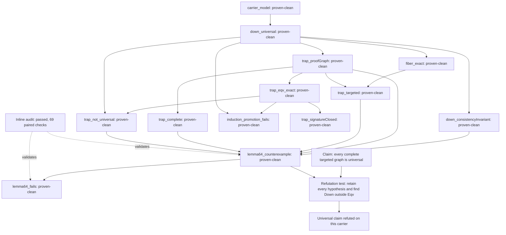

# Lemma 64 counterexample

Dedicated Lean package for Moses Rahnama, *A counterexample to Lemma 64 of the Kahrs and Smith proof for RTA-79*. The formal scope is the three-term example and the failed barred inference in that paper.

The package contains exactly one Lean file, `Lemma64.lean`. Its final section carries the declaration and axiom audit, so no separate audit module is needed. It uses Lean's bundled core only. It has no Mathlib dependency and imports no OperatorKO7 modules. The broader unique normal forms development is not part of this package.

## Verification status

Verified on 2026-10-23 with `leanprover/lean4:v4.22.0-rc4` on Windows. The named build and the direct source check both pass with zero errors and zero warnings. All 69 explicit public declarations, constructors and structure fields have paired `#check @` and `#print axioms` commands. Source-to-check and check-to-axiom parity have no gaps. The source scan found no prohibited trust mechanisms. Their combined axiom set is exactly `{propext, Quot.sound}`. No `Classical.choice`, extra axioms, proof holes, native evaluation, custom elaborators or external proof tools occur in the package.

The main exported theorem is `Lemma64.lemma64_counterexample`; `Lemma64.lemma64_fails` states the negation of the finite-instance implication directly. The former proves the conjunction of the consistency invariant, proof-graph validity, targetedness, completeness and nonuniversality for the same witness.

An independent review checked the definitions against the original source and the standalone manuscript. A separate finite enumeration examined all 512 binary parent relations and all 27 target maps: it found five valid proof graphs, two complete graphs, and one complete targeted nonuniversal witness. That enumeration treated `Down` as universal; Lean independently derives this fact from the printed closure clauses. The enumeration and the visual proof graph are supporting checks; the Lean declarations are the formal artifact.

## Reproduction

From this directory, with the pinned Lean toolchain installed:

```console
lake build Lemma64
lake env lean Lemma64.lean
```

The second command always checks the source and prints every audited declaration and its axiom footprint. The manifest contains no external packages. Building this directory does not build the parent repository. A direct check of the source also works with the pinned compiler using `lean Lemma64.lean`.

| File | Purpose |
|---|---|
| `Lemma64.lean` | All definitions, proofs and paired audit commands |
| `lean-toolchain`, `lakefile.toml`, `lake-manifest.json` | Pinned compiler and dependency-free Lake configuration |
| `README.md`, `CLAIMS.csv` | Definition correspondence, proof graph, scope and claim traceability |
| `LICENSE` | Unmodified repository license |
| `.gitignore` | Excludes generated build artifacts |

## Model and source correspondence

The carrier is `Node = {t0,t1,t2}`, embedded injectively into the term syntax as `c`, `d(c)`, and `d(d(c))`. The syntax also includes frozen variables, and the carrier contains none. The sole rewrite rule is `d(x) -> x`; its restricted root relation has exactly the edges `t1 -> t0` and `t2 -> t1`.

The definitions are specialized to this carrier, rather than importing a general rewriting library. `Bar E` compares the arguments of destructor terms; `Hat E` is the singleton pair `(t0,t0)`. `CT E` is the least signature-closed extension of `E`. `Down` is the inductive least fixed point of Definitions 38 and 40, including root prefixing and destructor prefixing, with no unrestricted transitivity rule. `Eqv rho` is the reflexive-transitive closure of `rho` together with its converse. Termination uses `WellFounded (fun b a => rho a b)`, so parent edges point towards smaller nodes.

`Complete rho` quantifies over every proof graph `beta` containing `rho`. Each `beta` is checked against its own `Hat (Eqv beta)` contribution to grey edges. A target is constant on destructor fibers, belongs to its fiber, and selects a root redex whenever one is available there. The two targetedness conditions are stated separately.

The consistency-invariant condition quantifies over every constructor-compatible equivalence `E` contained in `Down` and requires `Root` converse, followed by `Bar E`, followed by `Root`, to be contained in `CT E`. The proof establishes the stronger fork fact for every relation `E`.

Primary definition source: Stefan Kahrs and Connor Smith, *Non-Omega-Overlapping TRSs are UN*, FSCD 2016, [DOI 10.4230/LIPIcs.FSCD.2016.22](https://doi.org/10.4230/LIPIcs.FSCD.2016.22), Definitions 24, 25, 27, 30, 38, 40, 46, 49, 51, 54, 57, 58, 59, 63 and Lemma 64. The standalone manuscript's Theorem 1 and Section 3 supply the witness and diagnostic.

## Proof graph and claim ledger

[Editable Lucid overview](https://lucid.app/lucidchart/74fd175b-9b00-4e74-aa28-41cfdcdf9822/edit). The source-bound graph below remains the package record.

Every mathematical node below is `proven-clean`: freshly kernel checked with axioms contained in `{propext, Quot.sound}`. The graph was recorded before implementation and updated after the axiom audit. The CSV beside this file provides machine-readable traceability. The refutation branch retains all hypotheses and exhibits a missing represented equation.



| Node / Lean declaration | Statement | Status | Source | Module | What fails without it |
|---|---|---|---|---|---|
| `carrier_model` | Three distinct terms form a subterm-closed carrier with the stated root steps and no frozen variables. | proven-clean | Standalone setup; KS Def. 5 | `Lemma64` | The finite model would lack a term interpretation. |
| `down_universal` | The inductively defined `Down` relates all nine pairs. | proven-clean | Standalone Theorem 1; KS Defs. 38, 40 | `Lemma64` | Grey edges, consistency closure and the missing equation would lack derivations. |
| `down_consistencyInvariant` | `Down` satisfies consistency, signature closure and the barred fork condition for every eligible equivalence. | proven-clean | Standalone Theorem 1; KS Def. 30 | `Lemma64` | A hypothesis of Lemma 64 would be missing. |
| `trap_proofGraph` | The sole edge `t1 -> t2` is deterministic, terminating and admissible; its represented equations lie in `Down`. | proven-clean | Standalone Theorem 1; KS Defs. 46, 51 | `Lemma64` | The witness would not be an eligible graph. |
| `fiber_exact` | Destructor fibers are `{t0}` and `{t1,t2}`. | proven-clean | Standalone Theorem 1; KS Def. 57 | `Lemma64` | Target membership and constancy would be unproved. |
| `trap_targeted` | The target `(t0,t2,t2)` meets Definition 58 and both Definition 59 conditions. | proven-clean | Standalone Theorem 1; KS Defs. 58, 59 | `Lemma64` | The witness would not satisfy targetedness. |
| `trap_complete` | Every valid edge-preserving extension has exactly the original edges. | proven-clean | Standalone Theorem 1 extension table; KS Def. 54 | `Lemma64` | The witness would not satisfy completeness. |
| `trap_eqv_exact` | The represented classes are `{t0}` and `{t1,t2}`. | proven-clean | Standalone Theorem 1 | `Lemma64` | Nonuniversality would lack a justified closure calculation. |
| `trap_not_universal` | `Down t1 t0` holds and `Eqv trap t1 t0` fails. | proven-clean | Standalone Theorem 1; KS Def. 63 | `Lemma64` | No contradicted conclusion would have been exhibited. |
| `lemma64_counterexample` | One witness simultaneously satisfies all hypotheses and fails universality. | proven-clean | Standalone Theorem 1; KS Lemma 64 | `Lemma64` | Separate facts could concern different witnesses. |
| `lemma64_fails` | The finite-instance implication of Lemma 64 is false. | proven-clean | Standalone Theorem 1; KS Lemma 64 | `Lemma64` | The direct refutation would not be exported. |
| `induction_promotion_fails` | `Bar Down t1 t2` holds while `Bar (Eqv trap) t1 t2` fails. | proven-clean | Standalone Section 3 | `Lemma64` | The paper's failed-inference diagnosis would be unchecked. |
| `trap_signatureClosed` | The represented equivalence is signature closed. | proven-clean | Standalone Section 3; KS Def. 24 | `Lemma64` | The distinction between signature closure and destructor cancellation would be unchecked. |
| `reach_axioms` | Every explicit public declaration has a paired check and axiom report. | passed | Package verification obligation | `Lemma64` | The exported statements and trust footprint would be unaudited. |

## Scope and minimality

The repaired graph, general completion machinery, constructor translation, overlap theory, and global unique-normal-forms results are deliberately outside this package. They are unnecessary for the counterexample theorem. The two small diagnostic corollaries directly formalize Section 3 of the standalone paper.

The declaration and axiom checks were consolidated into `Lemma64.lean`, eliminating the audit-only Lean file. `import Init` is the sole import. The earlier general formalization pulls in 35 project modules; this package imports none of them. The namespace `Lemma64` is distinct from the older development, and no equivalence with that older implementation is claimed as a Lean theorem.

The `LICENSE` file is a direct, unmodified copy of the parent repository license. This directory is self-contained as a Lake package. The license must accompany any separately distributed copy.
